
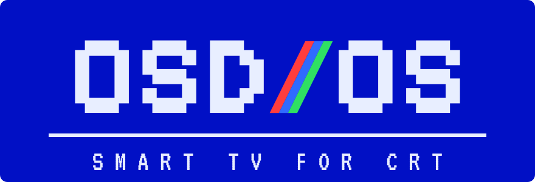

# OSD/OS

**Smart TV for CRT.** OSD/OS makes a TV, preferably a CRT, a smart TV with the look of a VCR. Flash it to an SD card, plug the Raspberry Pi into the TV, and it starts straight into OSD/OS. It also runs as an app on macOS, Windows, Linux, FreeBSD and OpenBSD.

- Films, streams and arcade games, with the arrows, select and back on a remote, a keyboard or a gamepad.
- Composite, SCART RGB or HDMI, and an arcade cabinet's own monitor through a Raspberry Pi to JAMMA board.

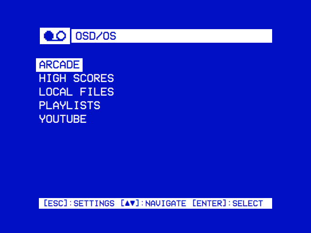

Out of the box it is plain: two colors, and nothing moving but the cursor. A theme changes the whole look at once. Nine come with it:

<table>
<tr>
<td width="25%">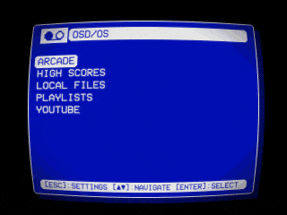</td>
<td width="25%">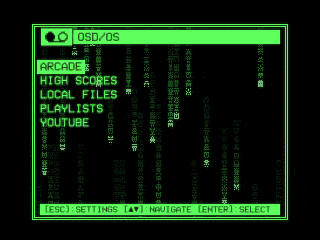</td>
<td width="25%">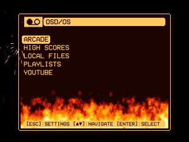</td>
<td width="25%">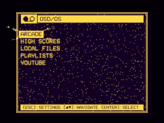</td>
</tr>
<tr><td align="center">Trinitron</td><td align="center">Matrix</td><td align="center">Inferno</td><td align="center">Demoscene</td></tr>
<tr>
<td>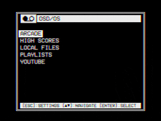</td>
<td>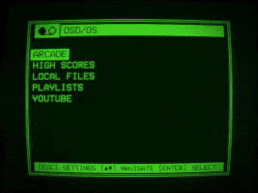</td>
<td>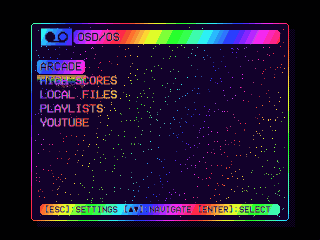</td>
<td>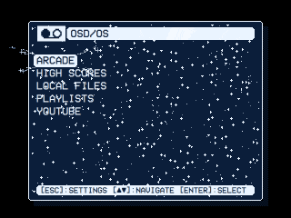</td>
</tr>
<tr><td align="center">Late Show</td><td align="center">Green Screen</td><td align="center">Arcade</td><td align="center">Winter</td></tr>
</table>

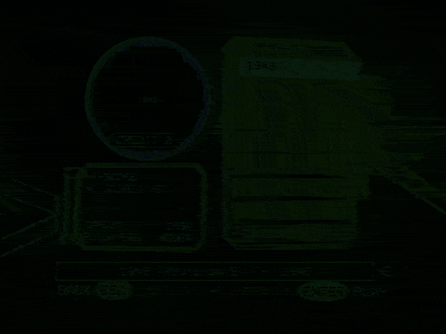

## How it differs

A media centre and an arcade under one menu, drawn for a tube and set up from its own Settings.

| | OSD/OS | Media centres (Kodi, LibreELEC) | Retro gaming systems (RetroPie, Batocera, Recalbox) |
|---|---|---|---|
| Films, streaming and arcade games in one menu | Yes | Films and streaming; games through add-ons | Games; films through Kodi |
| Menus drawn for a 240p CRT | Yes: two colors, large type | Skins for HD screens | Themes for HD screens, some for CRTs |
| Composite, SCART RGB and JAMMA picked in Settings | Yes | No | Config files, or the system's own board |
| A JAMMA cabinet's monitor, sticks and buttons | Yes, with Cabinet Lock and TATE | No | With their own boards, or by hand |
| LAN play with no internet, six players across machines | Yes | No | RetroArch's netplay |
| The same app on macOS, Windows, Linux and the BSDs | Yes | Kodi: yes | No: each is a system of its own |

As of November 2026. Corrections are welcome in an [issue](https://github.com/mehmetraif/OSD-OS/issues).

## What it does

### TV / Movie

- **Your videos in one place**: the SD card or a USB drive, Plex, Jellyfin, Emby, YouTube, Netflix and Prime Video, each a module.
- **One way to browse**: a tree with Recently Watched, Favorites and Search.
- **Playlists** across modules, streamed or downloaded.
- **Transparent Background**: the menus over a video that plays on.
- **And more**: Ambient:Mode, a 90s weather channel, NFC cards that play a film, and shell scripts.

### Arcade

- **Arcade games** in MAME and FinalBurn Neo, from a folder of ROM sets, for up to six players.
- **A cabinet's selection screen**: a list, an arc or a 3D wheel, with pictures, high scores, filters, search and an attract mode.
- **JAMMA cabinets**: 15, 25 and 31 kHz modes, the cabinet's sticks and buttons, Cabinet Lock, and monitors on their side (TATE).
- **Play together**: LAN Play with no internet, up to six players across Raspberry Pis, PCs and Macs, and online through RetroArch's lobby ([Online and LAN Play](https://github.com/mehmetraif/OSD-OS/wiki/Online-and-LAN-Play)).
- **RetroAchievements**: achievements, leaderboards and game pictures.

### On every screen

- **Made for CRTs**: shapes kept on a tube's non-square pixels, 16:9 films fitted to 4:3.
- **Themes**: colors, skin, effects and menu music at once. A new one is a folder.
- **Menu Layout**: a list, a camcorder's menu or a studio monitor's.
- **Status icons** for Wi-Fi, Bluetooth and the arcade's online features.

The [feature list](https://github.com/mehmetraif/OSD-OS/wiki/Features) has the rest.

## Get it

- **The OSD/OS image** for a Raspberry Pi: download `OSD-OS-<version>-raspberry-pi.img.xz` from the [latest release](https://github.com/mehmetraif/OSD-OS/releases/latest) and [flash it](os/README.md#flashing). [OSD/OS Setup](https://osdos.tv/setup/) sets the card up before its first start: display, Wi-Fi, accounts and every setting ([how](os/README.md#osdos-setup)).
- **As an app** on [Raspberry Pi OS](INSTALL.md#on-a-raspberry-pi), [macOS (ARM)](INSTALL.md#on-macos-arm), [SteamOS and other Linux x86_64](INSTALL.md#on-steamos--linux-x86_64) or [Windows 11 (x64)](INSTALL.md#on-windows-x64), or as a package on [FreeBSD](INSTALL.md#on-freebsd-amd64) and [OpenBSD](INSTALL.md#on-openbsd-amd64).
- **From a terminal**: `curl -fsSL https://osdos.tv/get.sh | sh` for the app, `curl -fsSL https://osdos.tv/get.sh | sh -s -- image` for the image, and `irm https://osdos.tv/get.ps1 | iex` in Windows PowerShell. Each checks the download's SHA-256 ([details](https://osdos.tv/)).

Tested on a Raspberry Pi 4, a Raspberry Pi 5 (8 GB) and a Windows 11 PC. On another board? Tell us in an [issue](https://github.com/mehmetraif/OSD-OS/issues).

## Learn more

- **[The website](https://osdos.tv/)** and **[the screen tour](docs/TOUR.md)**.
- **[The wiki](https://github.com/mehmetraif/OSD-OS/wiki)**: [installing](https://github.com/mehmetraif/OSD-OS/wiki/Installation), [using it](https://github.com/mehmetraif/OSD-OS/wiki/Using-OSD-OS), [settings](https://github.com/mehmetraif/OSD-OS/wiki/Settings), [the image](https://github.com/mehmetraif/OSD-OS/wiki/The-OSD-OS-Image), [display](https://github.com/mehmetraif/OSD-OS/wiki/Display-Output) and [audio](https://github.com/mehmetraif/OSD-OS/wiki/Audio-Output) outputs, [modules](https://github.com/mehmetraif/OSD-OS/wiki/Modules), [themes](https://github.com/mehmetraif/OSD-OS/wiki/Themes), [troubleshooting](https://github.com/mehmetraif/OSD-OS/wiki/Troubleshooting) and the [FAQ](https://github.com/mehmetraif/OSD-OS/wiki/FAQ).
- **For developers**: [how it works](https://github.com/mehmetraif/OSD-OS/wiki/How-It-Works), [writing a module](https://github.com/mehmetraif/OSD-OS/wiki/Writing-a-Module), [building](BUILDING.md), [architecture](ARCHITECTURE.md) and [contributing](CONTRIBUTING.md).

## Credits and license

OSD/OS grew out of [240-MP](https://github.com/anthonycaccese/240-MP), Anthony Caccese's VCR-style frontend for CRTs and the app it all started from. It is a modified version of 240-MP, by Anthony Caccese and [its contributors](https://github.com/anthonycaccese/240-MP/graphs/contributors), under the same license, the GNU GPL v3.

OSD/OS is developed by mehmet raif tasdemir (darkBLACK). Its changes were written with [Claude Code](https://www.anthropic.com/claude-code), and its logos and the boot screen's cassette were made with [ChatGPT](https://chatgpt.com). The menus' typeface is [VCR OSD Mono](https://www.dafont.com/vcr-osd-mono.font) by Riciery Santos Leal (mrmanet). Everyone else it stands on is in the [credits](https://github.com/mehmetraif/OSD-OS/wiki/Credits), and in Settings → System → About on the device.

OSD/OS is free software under the [GNU General Public License v3.0](LICENSE). 240-MP is Copyright (C) 2026 Anthony Caccese and the 240-MP contributors; the modifications, from 2026 on, are Copyright (C) 2026 mehmet raif tasdemir (darkBLACK). The OSD/OS image's other software, each under its own licence, is listed in [os/NOTICE](os/NOTICE). Raspberry Pi, Netflix, Prime Video, YouTube, Plex, Jellyfin and Emby are their owners' trademarks; OSD/OS is not affiliated with or endorsed by any of them.
