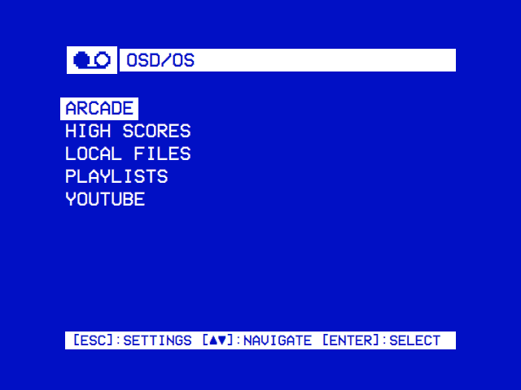
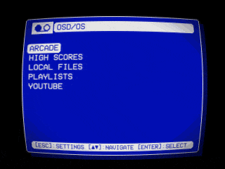
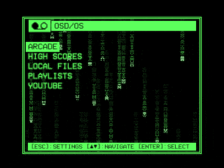
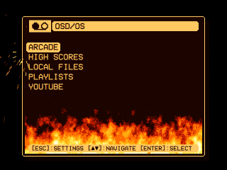
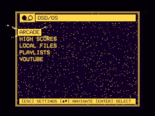
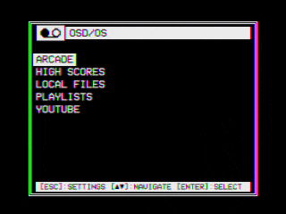
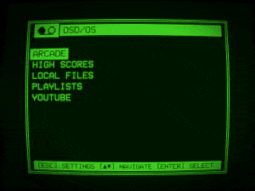
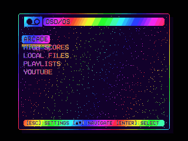
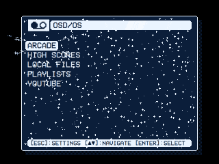

# OSD/OS

**Smart TV for CRT.** OSD/OS makes a TV, preferably a CRT, a smart TV with the look of a VCR. Flash it to an SD card, plug the Raspberry Pi into the TV, and it starts straight into OSD/OS: nothing to log in to, no desktop. Every screen is drawn like a VCR's on-screen display, in two colors and large type, and works with the arrows, select and back on a remote, a keyboard or a gamepad.

**Made for CRTs, arcade cabinets too.** OSD/OS is developed for tubes first: composite, SCART RGB or HDMI from Settings, and menus, films and games kept in their shapes on a CRT's non-square pixels. With Crown Arcade's Raspberry Pi to JAMMA board it runs an arcade cabinet's own monitor, in each mode one may take from 15 kHz to 31 kHz, and the cabinet's sticks and buttons drive it. Its arcade keeps each game's high scores and goes online too: achievements and leaderboards on RetroAchievements, and netplay, playing others over the internet through RetroArch's lobby, or on the same network, straight from one machine to the other.

Out of the box it is plain on purpose, as above: two colors, and nothing moving but the cursor. If you want more, a theme changes the whole look at once, with effects, transitions between windows and music of its own, from a tube's curved glass to Matrix rain and a fire in the window. Eight come with it, here each on the Arcade screen and in Local Files' tree:

<table>
<tr>
<td width="25%"></td>
<td width="25%"></td>
<td width="25%"></td>
<td width="25%"></td>
</tr>
<tr><td align="center">Trinitron</td><td align="center">Matrix</td><td align="center">Inferno</td><td align="center">Demoscene</td></tr>
<tr>
<td></td>
<td></td>
<td></td>
<td></td>
</tr>
<tr><td align="center">Late Show</td><td align="center">Green Screen</td><td align="center">Arcade</td><td align="center">Winter</td></tr>
</table>

## What it does

- **Made for CRTs**: composite, SCART RGB or HDMI from Settings; menus, videos and games kept in their shapes on a tube's non-square pixels; 16:9 films fitted to 4:3, a channel logo in the corner, and a tape loading while a video starts.
- **JAMMA arcade cabinets**: Crown Arcade's Raspberry Pi to JAMMA board drives the cabinet's monitor in every mode it may take, 15 kHz 240p and 288p, 480i and 576i (on a Pi 4), 25 kHz and 31 kHz, and its two players' sticks and buttons work in the menus and the games.
- **Arcade games** in MAME, from a folder of ROM sets, for up to six players: listed by players, decade and maker in OSD/OS's tree, or on a cabinet's selection screen, straight, on an arc or on a 3D wheel, with each game's picture, high scores and genre, filters to go round with ◄ ►, a search that narrows the list as each letter is typed, COIN for credits and START to play.
- **Online achievements, high scores and netplay**: a game FinalBurn Neo has plays in RetroArch, signed in to RetroAchievements in hardcore mode, so that its achievements and scores count online, and the selection screen shows its leaderboard's top three. With a RetroAchievements key, each game's pictures are downloaded from there to go round on the selection screen, and its details list its achievements, earned and not, with their badges. Online Games lists the games others host in RetroArch's lobby, joined with select, RetroArch Lobby every game hosted there, and a game's options host one; LAN Games does the same on the local network, without the internet. Each game's own high score table, as MAME kept it, is read on the device too.
- **Your videos in one place**: films on the SD card or a USB drive, Plex, Jellyfin, Emby, YouTube, Netflix and Prime Video, each a module, like the inputs on a deck.
- **One way to browse**: a horizontal tree that starts with Recently Watched, Favorites and Search, typed on an on-screen keyboard.
- **Playlists** across modules, streamed, or downloaded to play without the network.
- **Transparent Background**: back from a video, the menus lie over it while it plays on.
- **Status icons** at the top right of the title bar: Wi-Fi's signal, Bluetooth, and the arcade's high scores, RetroAchievements and netplay while they are on.
- **Themes**, the whole look at once: the colors, the skin, effects like the ones above and the menu music. Eight come with it, and a new one is a folder.
- **And more**: a fireplace on a loop (Ambient:Mode), a 90s weather channel, NFC cards that play a film when they touch the reader, and anything a shell script can start.

The [feature list](https://github.com/mehmetraif/OSD-OS/wiki/Features) has the rest.

## Get it

- **The OSD/OS image**, the whole system for a Raspberry Pi: download `OSD-OS-<version>-raspberry-pi.img.xz` from the [latest release](https://github.com/mehmetraif/OSD-OS/releases/latest) and [flash it](os/README.md#flashing). OSD/OS is on screen from the moment the Pi is switched on, and films go in the Movies folder on the card's own partition.
  - **[OSD/OS Setup](https://osdos.tv/setup/)** chooses what the card starts with before it goes into the Pi, for a TV or an arcade cabinet, with a live preview of the look chosen, OSD/OS's own effects running in the browser: the display output, Wi-Fi, the device's name, the user's password, SSH, the time zone, the keyboard, every setting of OSD/OS, and the RetroAchievements account. It gives one file for the card's boot partition, which the card applies as it starts ([how](os/README.md#osdos-setup)); OSD/OS on a computer takes its own settings and the account from it too, pasted in Settings or as the file ([how](INSTALL.md)).
- **As an app** on [Raspberry Pi OS](INSTALL.md#on-a-raspberry-pi), [macOS (ARM)](INSTALL.md#on-macos-arm), [SteamOS and other Linux x86_64](INSTALL.md#on-steamos--linux-x86_64) or [Windows 11 (x64)](INSTALL.md#on-windows-x64), or as a package on [FreeBSD](INSTALL.md#on-freebsd-amd64) and [OpenBSD](INSTALL.md#on-openbsd-amd64).

Tested on a Raspberry Pi 4 and a Raspberry Pi 5 (8 GB): the Pi 4 as a TV, the Pi 5 in a JAMMA arcade cabinet, and LAN Play between the two. On another board? Tell us how it went in an [issue](https://github.com/mehmetraif/OSD-OS/issues).

## Learn more

- **[The website](https://osdos.tv/)**: OSD/OS in short, the themes as they move, where it runs, how to get it, and [OSD/OS Setup](https://osdos.tv/setup/).
- **[The wiki](https://github.com/mehmetraif/OSD-OS/wiki)**, all of it in detail: [installing](https://github.com/mehmetraif/OSD-OS/wiki/Installation) and [using it](https://github.com/mehmetraif/OSD-OS/wiki/Using-OSD-OS), [every setting](https://github.com/mehmetraif/OSD-OS/wiki/Settings), [the OSD/OS image](https://github.com/mehmetraif/OSD-OS/wiki/The-OSD-OS-Image), the [display](https://github.com/mehmetraif/OSD-OS/wiki/Display-Output) and [audio](https://github.com/mehmetraif/OSD-OS/wiki/Audio-Output) outputs, the [modules](https://github.com/mehmetraif/OSD-OS/wiki/Modules), [themes](https://github.com/mehmetraif/OSD-OS/wiki/Themes), [effects](https://github.com/mehmetraif/OSD-OS/wiki/Effects), [menu music](https://github.com/mehmetraif/OSD-OS/wiki/Menu-Music) and [skins](https://github.com/mehmetraif/OSD-OS/wiki/Skins), [troubleshooting](https://github.com/mehmetraif/OSD-OS/wiki/Troubleshooting) and the [FAQ](https://github.com/mehmetraif/OSD-OS/wiki/FAQ).
- **[The screen tour](docs/TOUR.md)**: every screen, module by module.
- **For developers**: [how it works](https://github.com/mehmetraif/OSD-OS/wiki/How-It-Works), [writing a module](https://github.com/mehmetraif/OSD-OS/wiki/Writing-a-Module), [building](BUILDING.md), [architecture](ARCHITECTURE.md) and [contributing](CONTRIBUTING.md).

## Credits and license

OSD/OS grew out of [240-MP](https://github.com/anthonycaccese/240-MP), Anthony Caccese's VCR-style frontend for CRTs and the app it all started from. It is a modified version of 240-MP, by Anthony Caccese and [its contributors](https://github.com/anthonycaccese/240-MP/graphs/contributors), under the same license, the GNU GPL v3.

OSD/OS is developed by mehmet raif tasdemir (darkBLACK). Its changes were written with [Claude Code](https://www.anthropic.com/claude-code), and its logos and the boot screen's cassette were made with [ChatGPT](https://chatgpt.com). Everyone else it stands on is in the [credits](https://github.com/mehmetraif/OSD-OS/wiki/Credits), and in Settings → About on the device.

OSD/OS is free software under the [GNU General Public License v3.0](LICENSE). 240-MP is Copyright (C) 2026 Anthony Caccese and the 240-MP contributors; the modifications, from 2026 on, are Copyright (C) 2026 mehmet raif tasdemir (darkBLACK). The OSD/OS image's other software, each under its own licence, is listed in [os/NOTICE](os/NOTICE). Raspberry Pi, Netflix, Prime Video, YouTube, Plex, Jellyfin and Emby are their owners' trademarks; OSD/OS is not affiliated with or endorsed by any of them.
