# The OSD/OS screen tour

Every screen of OSD/OS: its two sides, TV / Movie and Arcade, then Settings and the themes. The [wiki](https://github.com/mehmetraif/OSD-OS/wiki) tells what each does.

Every screen below is the app itself, running at 640×480. The film and YouTube entries are sample data; the weather is real.

### Starting and stopping

<table>
<tr><th width="33%">Boot screen</th><th width="33%">Main menu</th><th width="33%">Quit</th></tr>
<tr><td></td><td>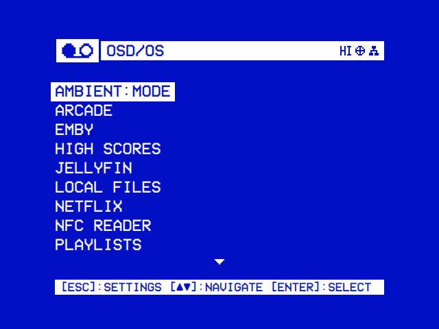</td><td>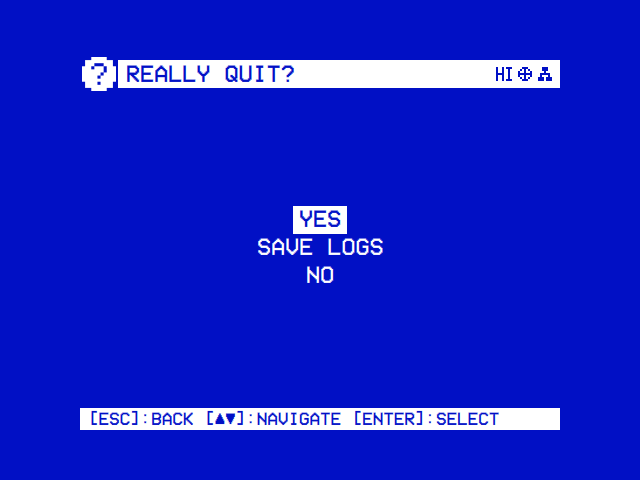</td></tr>
<tr><td>On the OSD/OS image, the OSD/OS cassette winds its tape from reel to reel while the services start, <code>[ OK ]</code> once each is up. It closes by itself when the last one has settled.</td><td>The modules turned on, like the inputs on a deck, and at the top right the status icons of what is on. Select opens one; back opens Settings.</td><td>Settings → Quit. On the OSD/OS image, Save Logs copies the logs to the card's OSD-OS partition. When OSD/OS starts with the system, it offers Power Off, Restart or Exit to Terminal instead.</td></tr>
</table>

## TV / Movie

### Local Files

<table>
<tr><th width="50%">Recently Watched</th><th width="50%">Favorites</th></tr>
<tr><td></td><td></td></tr>
<tr><td>The tree opens on what you played last, then Favorites, Search and your folders. The entry under the cursor branches out to its contents in full; the other folders' branches are faint.</td><td>Files and playlists you marked from their options.</td></tr>
</table>

<table>
<tr><th width="50%">Folders</th><th width="50%">Search</th></tr>
<tr><td></td><td></td></tr>
<tr><td>The open folders run along the line through the middle. The folder under the cursor branches out once more: Action › Rambo Movies › its films.</td><td>An on-screen keyboard: the arrows move, select types.</td></tr>
</table>

<table>
<tr><th width="50%">Search results</th><th width="50%">Options</th></tr>
<tr><td></td><td></td></tr>
<tr><td>Names that match anywhere under the media folder and on the USB drives plugged in.</td><td>► on a file: Add to Favorites (or Remove), Play at Startup, and Add to Playlist.</td></tr>
</table>

### Playing

<table>
<tr><th width="33%">Resume</th><th width="33%">Loading</th><th width="33%">Deck menu</th></tr>
<tr><td></td><td></td><td></td></tr>
<tr><td>Pick up where you left off, or start from the beginning.</td><td>While a video starts, a tape loads: live VHS noise in the theme's colours, the tracking band rolling through, and a dubbing deck's display, TAPE A at where the video is and TAPE B LOADING with its length once known. Settings → TV / Movie → Loading Effect turns the noise off, and Loading Screen Colors keeps it white on blue whatever the theme.</td><td>▲ or ▼ during playback opens the deck's menu: the position bar, audio and subtitle tracks, crop (the four Scalings in turn) and stop.</td></tr>
</table>

<table>
<tr><th width="33%">The video's menu</th><th width="33%">Back to the menus</th><th width="33%">Main menu</th></tr>
<tr><td>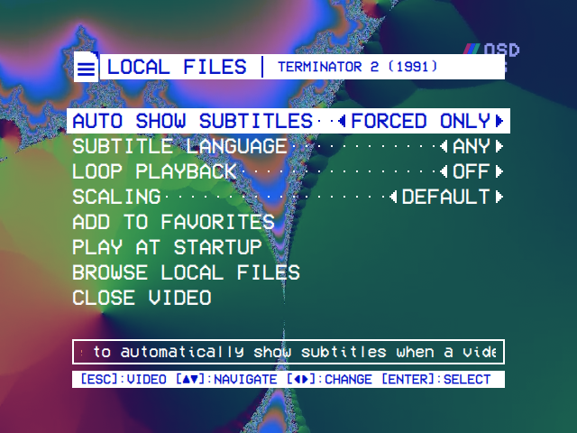</td><td></td><td></td></tr>
<tr><td>With Transparent Background, back during a Local Files, YouTube or Playlists video opens its menu over the picture, which plays on, here at 40% solid. ◄ ► change its module's settings for it, at once or as you go back to it. Close Video goes to the main menu; back, to the video.</td><td>Browse in that menu, or back from any other module's video, returns to the module's menus, the video playing on behind them. Choose it again to watch it full screen from where it is.</td><td>For a Local Files, YouTube or Playlists video, the main menu leads with it, the cursor on it: select takes it back to full screen where it is. Play/pause stops it (<code>[SPACE]:STOP</code>), and playing anything else replaces it.</td></tr>
</table>

### Netflix, Prime Video and YouTube

<table>
<tr><th width="50%">Netflix</th><th width="50%">Movies › Popular</th></tr>
<tr><td></td><td></td></tr>
<tr><td>Recently Watched, Favorites, Search, then Movies and Series, and the service's own home page.</td><td>Popular, then each genre, a page of titles at a time.</td></tr>
</table>

<table>
<tr><th width="50%">Info screen</th><th width="50%">Playing on Netflix</th></tr>
<tr><td></td><td></td></tr>
<tr><td>Story, genre, director, cast and rating, from TMDB. Select plays the title; ► offers its options.</td><td>The service's own player, in Chromium, has the screen. Hold back for two seconds to come back.</td></tr>
</table>

<table>
<tr><th width="50%">Prime Video</th><th width="50%">YouTube</th></tr>
<tr><td></td><td></td></tr>
<tr><td>The same tree, for Prime Video.</td><td>Recently Watched, Favorites, Search, Subscriptions, Channels, Playlists and Watch Later.</td></tr>
</table>

<table>
<tr><th width="50%">Subscriptions</th><th width="50%">A video's info screen</th></tr>
<tr><td></td><td></td></tr>
<tr><td>The latest videos from your channels, newest first.</td><td>Channel, date, length, views and description.</td></tr>
</table>

### Plex, Jellyfin and Emby

<table>
<tr><th width="33%">Plex</th><th width="33%">Jellyfin</th><th width="33%">Emby</th></tr>
<tr><td></td><td></td><td></td></tr>
<tr><td>Sign in with a code at plex.tv/link.</td><td>Connect to a server with Quick Connect.</td><td>A server on your network, or Emby Connect.</td></tr>
</table>

Once signed in, each opens on the server's Continue Watching and its libraries. See [Modules](https://github.com/mehmetraif/OSD-OS/wiki/Modules) for everything they do.

### Playlists

<table>
<tr><th width="50%">Playlists</th><th width="50%">An offline playlist</th></tr>
<tr><td>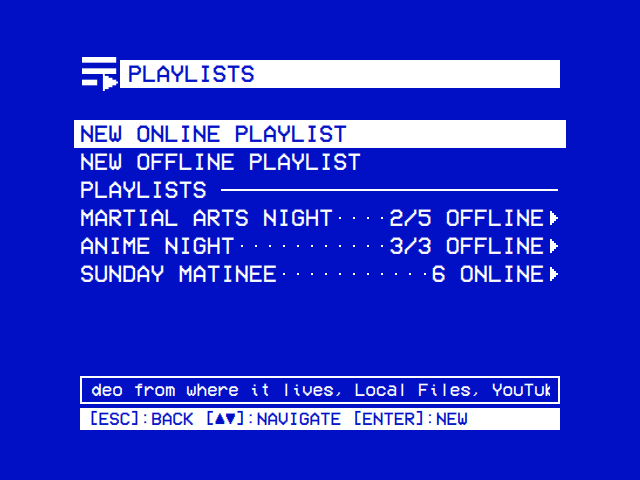</td><td></td></tr>
<tr><td>Online playlists play each video from where it lives; offline ones, from the device, with how many of their videos are on it.</td><td>Each video downloads once, in the background: ready, under way, or why not (a server that doesn't let you download it).</td></tr>
</table>

<table>
<tr><th width="50%">Adding videos</th><th width="50%">Add to Playlist</th></tr>
<tr><td></td><td></td></tr>
<tr><td>Local Files, YouTube, Jellyfin and Emby in one tree, down to a show's episodes. Select adds a video and stays, for the next.</td><td>From a module itself: a video's options (►), or ► on PLAY in Jellyfin and Emby.</td></tr>
</table>

### Weather, Ambient:Mode, NFC Reader and Scripts

<table>
<tr><th width="50%">Weather</th><th width="50%">Extended forecast</th></tr>
<tr><td></td><td></td></tr>
<tr><td>In the style of WeatherStar 3000+: current conditions…</td><td>…the extended forecast and an almanac, in turn.</td></tr>
</table>

<table>
<tr><th width="50%">Ambient:Mode</th><th width="50%">NFC Reader</th></tr>
<tr><td></td><td></td></tr>
<tr><td>A video, with music of your choice, on a loop.</td><td>Tap a card to play the video it is mapped to.</td></tr>
</table>

<table>
<tr><th width="50%">Scripts</th><th width="50%">A console script</th></tr>
<tr><td></td><td></td></tr>
<tr><td>Your own shell scripts. ► puts one on the main menu.</td><td>A console script shows its output. A takeover script gets the whole screen until it exits.</td></tr>
</table>

## Arcade

### The Arcade screen

<table>
<tr><th width="50%">The Arcade screen</th><th width="50%">A game started from it</th></tr>
<tr><td>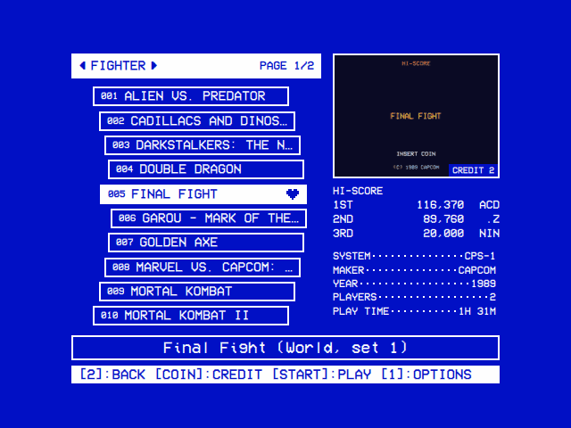</td><td>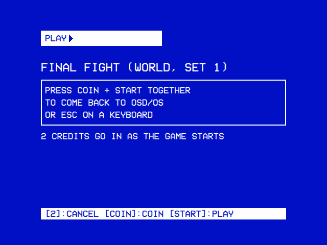</td></tr>
<tr><td>A cabinet's selection screen, Settings → Arcade → Screen's default: one filter's games at a time, ◄ ► from filter to filter, the selected one's picture, high scores, maker and play time. COIN buys credits; select or START plays. The pictures here are stand-ins.</td><td>How to come back, and the credits going in with the game.</td></tr>
</table>

<table>
<tr><th width="50%">List Style: Straight</th><th width="50%">List Style: 3D Curved</th></tr>
<tr><td>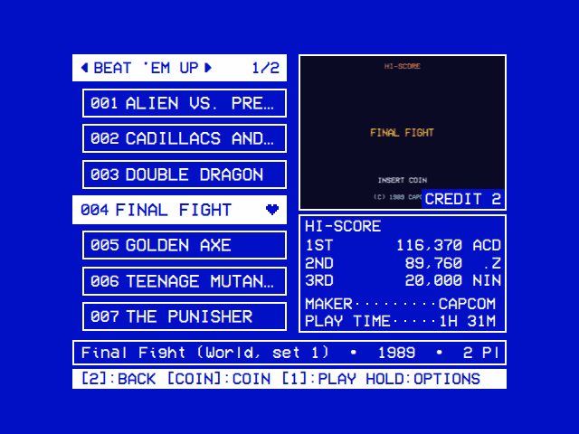</td><td>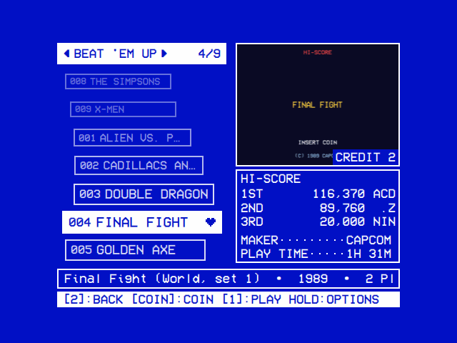</td></tr>
<tr><td>Settings → Arcade → List Style lays the games out straight, on an arc, or on a 3D wheel.</td><td>The 3D wheel: the cursor roams the list and the wheel turns with it.</td></tr>
</table>

<table>
<tr><th width="50%">Menu Filters</th><th width="50%">Screen Adjustment</th></tr>
<tr><td>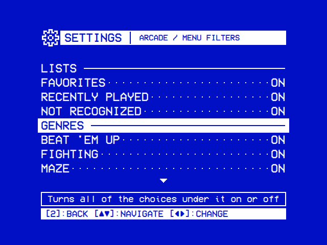</td><td>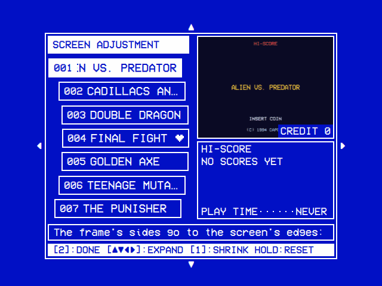</td></tr>
<tr><td>Which filters ◄ ► go through: lists, genres, players, decades and makers, under headings that turn a whole group on or off.</td><td>The screen's frame moved to a tube's edges, live, with the arrows: the Arcade screen fits inside it.</td></tr>
</table>

<table>
<tr><th>On a monitor turned on its side</th></tr>
<tr><td>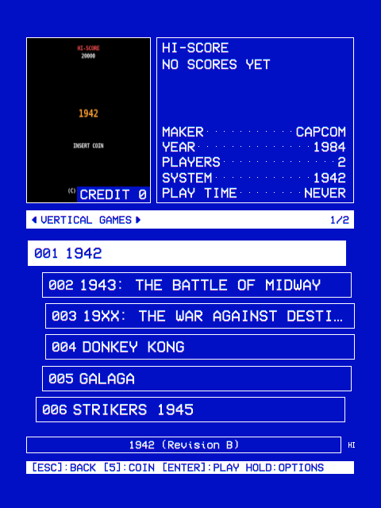</td></tr>
<tr><td>Settings → Screen → Monitor turned right or left, for vertical games (TATE): the Arcade screen takes the whole tall screen, the menus and the games are turned to stand upright on it, and a shmup fills it with its own lines.</td></tr>
</table>

### The Orb look

<table>
<tr><th width="50%">The Orb look</th><th width="50%">A game starting</th></tr>
<tr><td>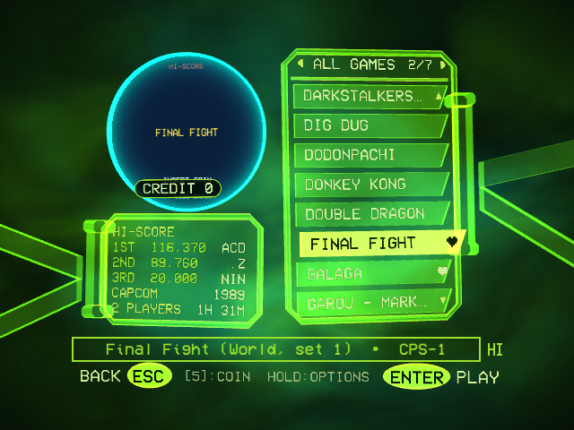</td><td>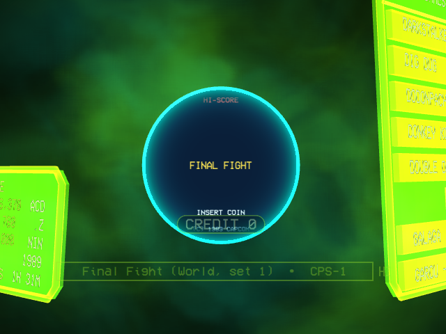</td></tr>
<tr><td>Settings → Look → Theme → Orb draws the Arcade screen in 3D, in x-ray glass that lights up where its parts cross. The keys do what they do on the plain screen.</td><td>The same game started in the Orb look.</td></tr>
</table>

### Playing together

Settings → Arcade → **LAN Play** and **Online Play**: up to six players across Raspberry Pis, PCs and Macs, each machine bringing as many as it has controllers ([Online and LAN Play](https://github.com/mehmetraif/OSD-OS/wiki/Online-and-LAN-Play)).

<table>
<tr><th width="50%">LAN Games</th><th width="50%">RetroArch Lobby</th></tr>
<tr><td>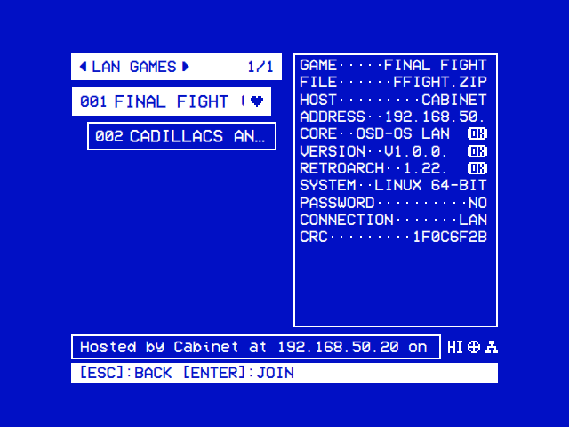</td><td>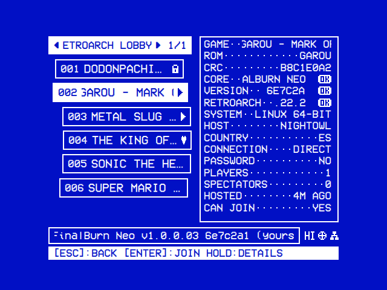</td></tr>
<tr><td>Games hosted on your network that you have, with what the host's machine says of the one selected: who hosts it and where, its core, versions and system. Select joins it, no internet needed.</td><td>Every game hosted in RetroArch's lobby, ▶ on those you can join and a lock on those with a password, with what the lobby says of the one selected.</td></tr>
</table>

### The original screen

<table>
<tr><th width="50%">The games</th><th width="50%">All Games</th></tr>
<tr><td>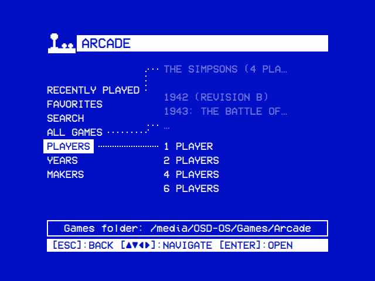</td><td>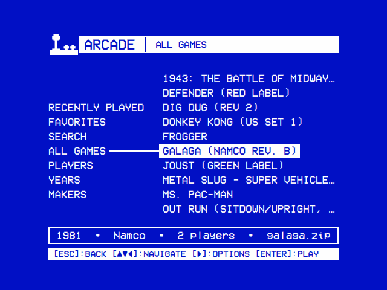</td></tr>
<tr><td>MAME's ROM sets from the games folder, by players, decade and maker, as MAME names them.</td><td>A game's year, maker, players and file under the tree. Select plays it in MAME.</td></tr>
</table>

<table>
<tr><th width="50%">Playing</th><th width="50%">A game that couldn't start</th></tr>
<tr><td>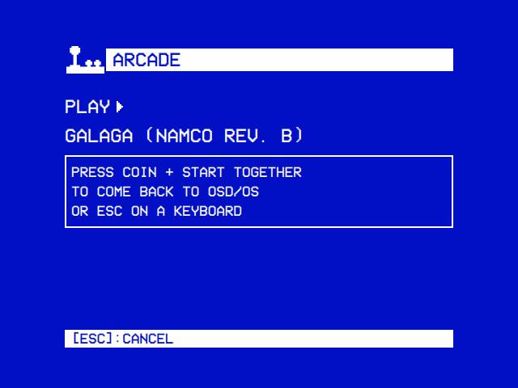</td><td>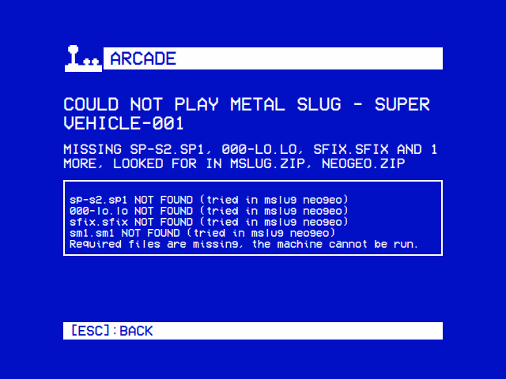</td></tr>
<tr><td>How to come back, in player 1's own buttons, then MAME has the screen, with Settings → Controls' players as its players 1 to 6.</td><td>What the set lacked and where MAME looked: here the Neo-Geo BIOS.</td></tr>
</table>

### Check ROMs and Cabinet Lock

<table>
<tr><th width="50%">Check ROMs</th><th width="50%">Cabinet Lock</th></tr>
<tr><td>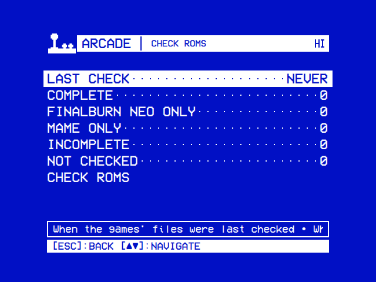</td><td>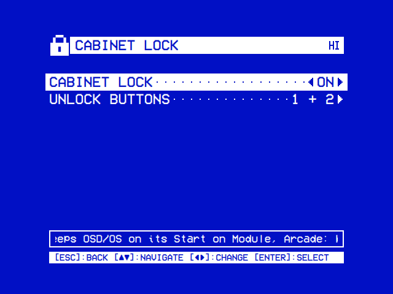</td></tr>
<tr><td>Started only from here: whether every game's files are whole, for MAME and for FinalBurn Neo. Each game then plays in the engine that has its files.</td><td>Settings → Startup → Cabinet Lock keeps a cabinet on the Arcade screen for the players; the menus open only with up to four buttons of your choosing held together.</td></tr>
</table>

<table>
<tr><th width="50%">Unlock Buttons</th><th width="50%">Lock the cabinet?</th></tr>
<tr><td>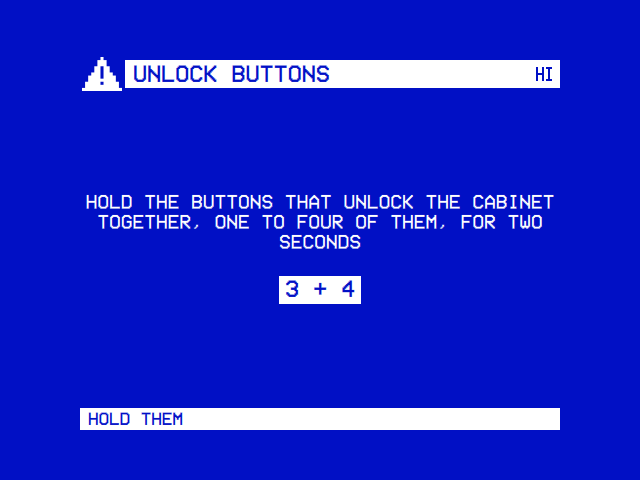</td><td>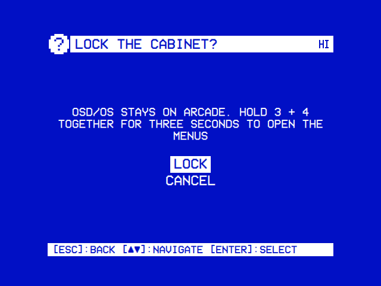</td></tr>
<tr><td>The buttons held, named as they are, kept after two seconds.</td><td>Asked before it locks, with what unlocks it.</td></tr>
</table>

### Controls and Game Buttons

<table>
<tr><th width="50%">A pad's page</th><th width="50%">Its player</th></tr>
<tr><td>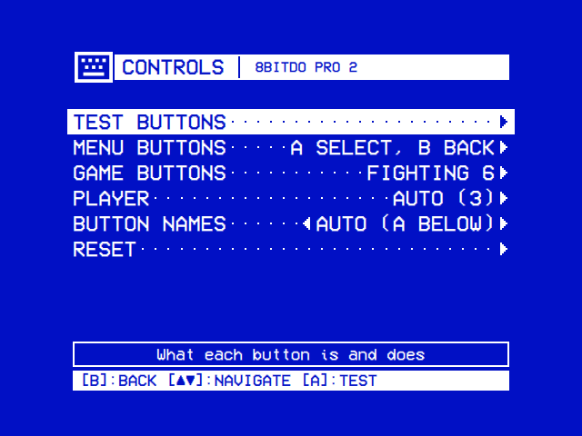</td><td>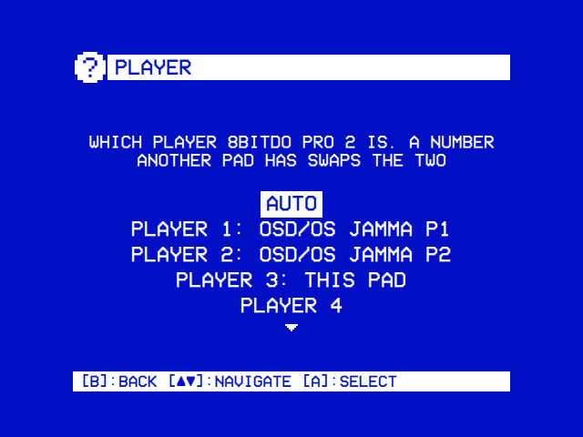</td></tr>
<tr><td>Each gamepad apart, on a page of six lines: its test, the buttons that work the menus, the ones the games get, its player, what its buttons are called, and Reset, which asks first.</td><td>Which player a pad is, 1 to 6, for MAME, FinalBurn Neo and the games played together. The list says who has each number.</td></tr>
</table>

<table>
<tr><th width="50%">Test Buttons</th><th width="50%">Waiting for a press</th></tr>
<tr><td>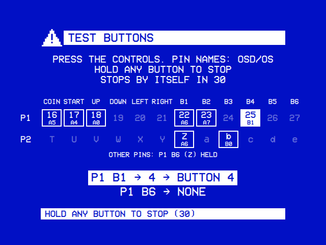</td><td>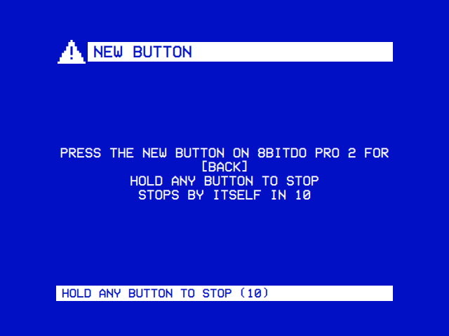</td></tr>
<tr><td>Test Buttons on the JAMMA board's sticks: both players' controls on a grid of the edge connector's pins, each press lit as it is held.</td><td>Every wait for a press says its one rule on the screen: a tap answers, holding any button stops it.</td></tr>
</table>

<table>
<tr><th width="50%">A pad's Game Buttons</th><th width="50%">Set One by One</th></tr>
<tr><td>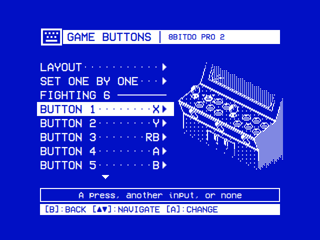</td><td>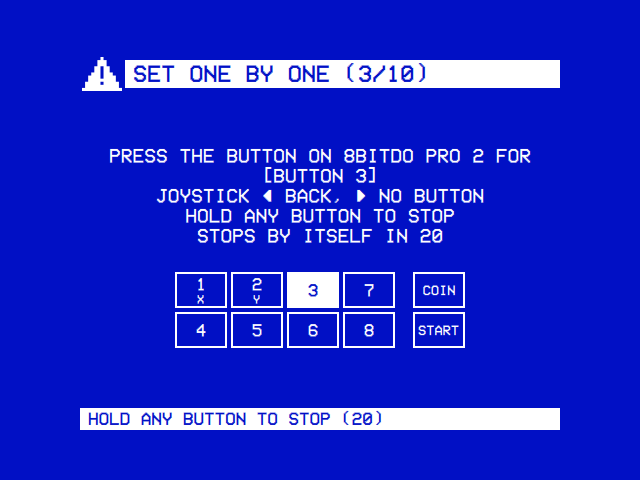</td></tr>
<tr><td>The game's buttons 1 to 8 on a pad, here Fighting 6: a fighter's punches on X, Y and RB, its kicks on A, B and RT. The control panel blinks the line's button.</td><td>Set One by One takes the buttons from presses in turn, the joystick a step back or no button, and saves nothing before it has shown all ten.</td></tr>
</table>

### High Scores

<table>
<tr><th width="50%">The games</th><th width="50%">All Games</th></tr>
<tr><td>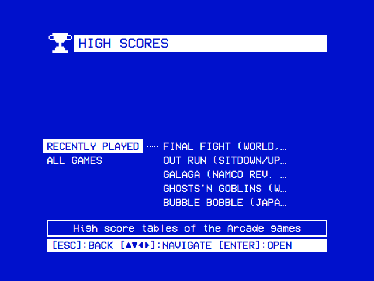</td><td>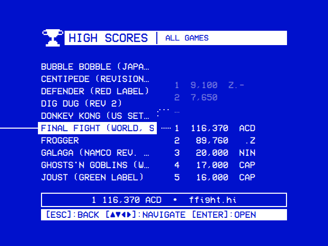</td></tr>
<tr><td>The games played last in Arcade, latest first, those with a table.</td><td>A game's table beside it, and under the tree its best entry and the file MAME kept it in.</td></tr>
</table>

<table>
<tr><th width="50%">A game's table</th><th width="50%">Several tables</th></tr>
<tr><td>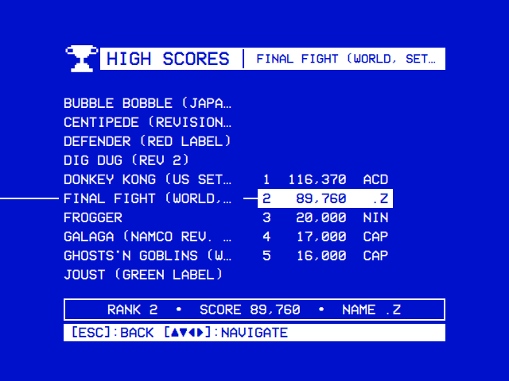</td><td>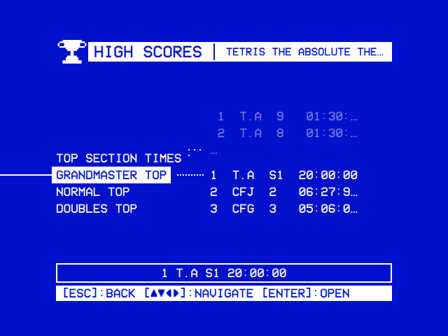</td></tr>
<tr><td>An entry's cells by column, under the tree.</td><td>A game with a table for each mode, a folder each.</td></tr>
</table>

## Settings and the look

### Settings

<table>
<tr><th width="50%">Settings</th><th width="50%">TV / Movie</th></tr>
<tr><td>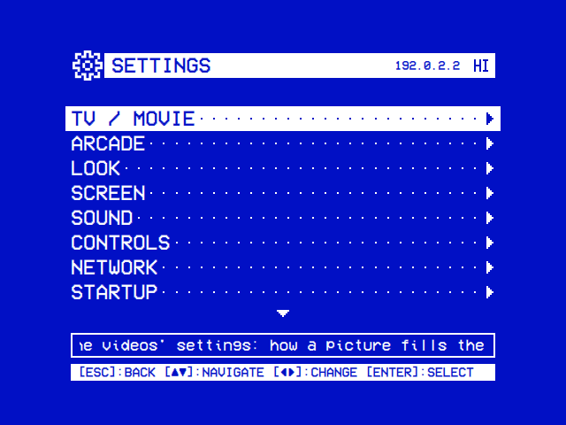</td><td>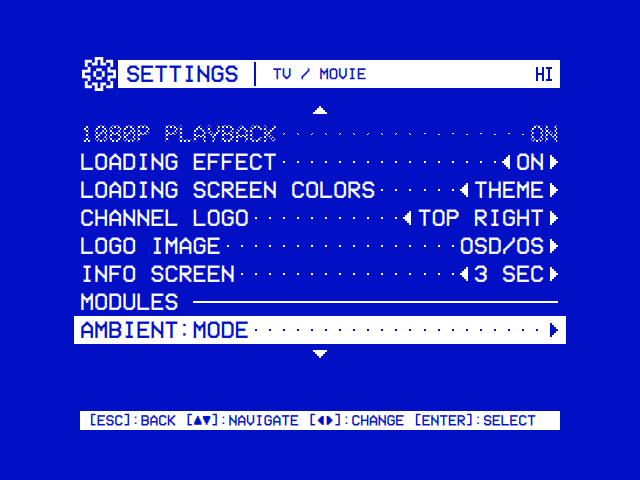</td></tr>
<tr><td>Laid out like a camcorder's menu, a short first screen of pages: TV / Movie and Arcade for the videos and the games, then Look, Screen, Sound, Controls, Network, Startup and System, each a screenful. Nothing is hidden: a line that can't be used here is dimmed, and the help line says why.</td><td>The videos' page: Transparent Background is a slider, the deck's tape bar, from TRANSPARENT to SOLID; Channel Logo puts OSD/OS's logo in a corner of the picture while a video plays. Under Modules, each video module is turned on and set up from its own page.</td></tr>
</table>

<table>
<tr><th width="50%">Dimmed rows</th><th width="50%">Look</th></tr>
<tr><td>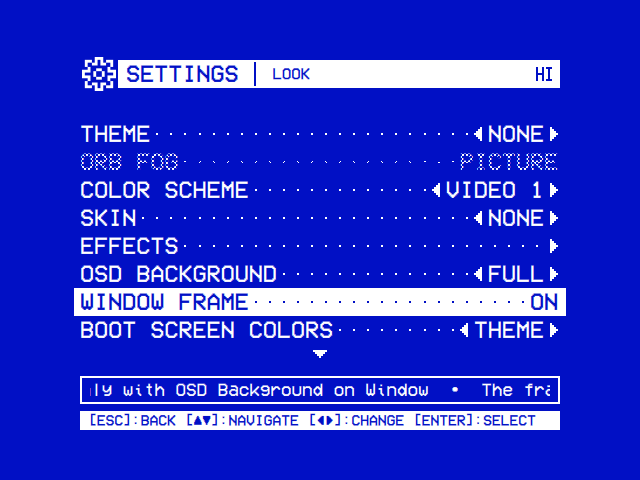</td><td>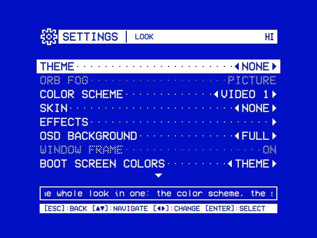</td></tr>
<tr><td>A row that can't be used here is dimmed, never hidden, and the help line says why.</td><td>The whole look at once with Theme, or each part on its own row.</td></tr>
</table>

#### Menu Layout

Settings → Look → Menu Layout draws Settings and the main menu as a list (above), or as a camcorder's menu or a studio monitor's, from a window over the picture to a broadcast monitor's plain blue.

<table>
<tr><th width="50%">Camcorder</th><th width="50%">Camcorder</th></tr>
<tr><td>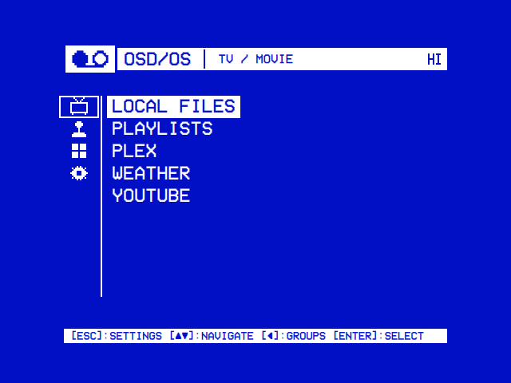</td><td>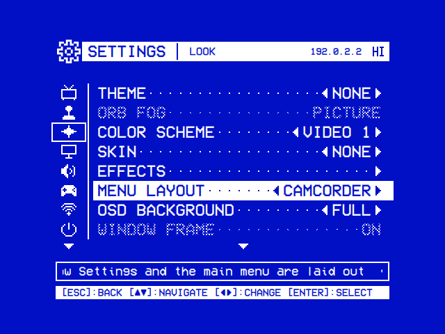</td></tr>
<tr><td>The main menu in groups: TV / Movie, Arcade, More, and Settings.</td><td>The pages as icons, the rows of the one the cursor is on beside them.</td></tr>
</table>

<table>
<tr><th width="50%">Studio Monitor</th><th width="50%">Studio Monitor</th></tr>
<tr><td>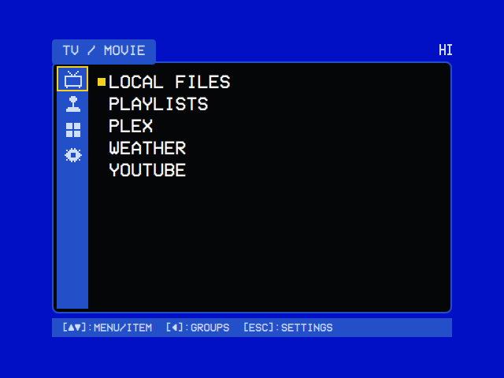</td><td>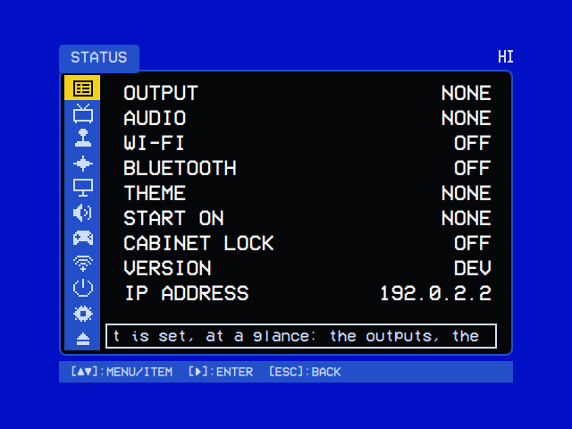</td></tr>
<tr><td>A black window over the picture, the name on a blue tab.</td><td>The pages' icons in a blue strip, a yellow square before the selected row; its first page, Status, is what is set at a glance.</td></tr>
</table>

<table>
<tr><th width="50%">Broadcast</th><th width="50%">Broadcast</th></tr>
<tr><td>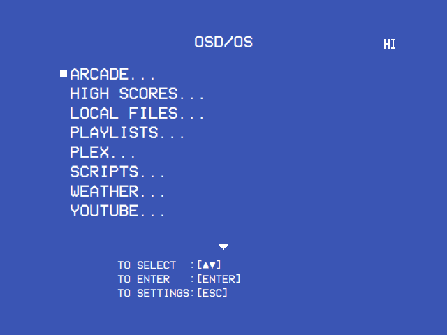</td><td>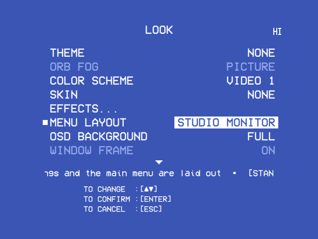</td></tr>
<tr><td>Plain blue, the title centred, a filled square for the cursor.</td><td>Three dots after a row that opens another level, a three-line key guide; a value changes in two steps.</td></tr>
</table>

<table>
<tr><th width="50%">Flat Panel</th><th width="50%">Flat Panel</th></tr>
<tr><td>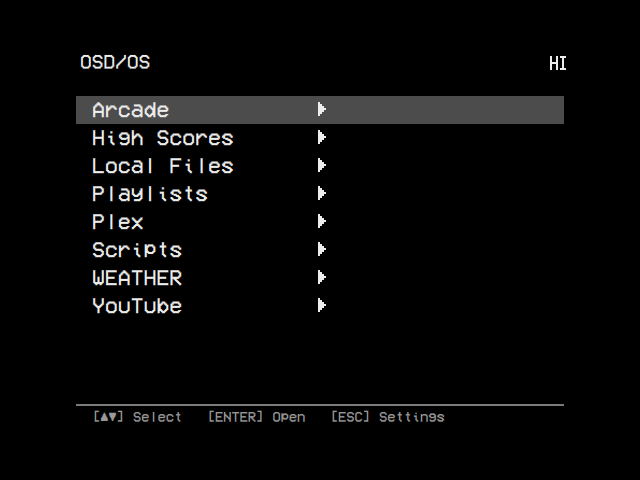</td><td>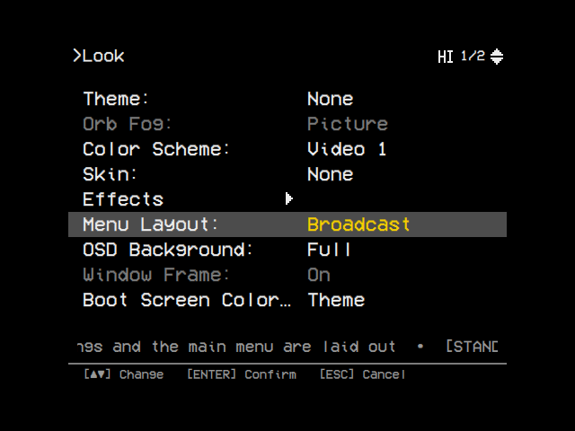</td></tr>
<tr><td>Black, mixed case, the title the path to the page.</td><td>The rows a page at a time, the page at the top right, a value yellow while it is changed.</td></tr>
</table>

#### The look and the screen

<table>
<tr><th width="50%">OSD Background: Window</th><th width="50%">OSD Background: Off</th></tr>
<tr><td></td><td></td></tr>
<tr><td>The menus in a framed window of the color scheme's background, black around it. Over a video behind the menus, the picture shows whole around the window.</td><td>No background: the menus on black, like a deck's on-screen display with nothing playing, in the scheme's lighter color.</td></tr>
</table>

<table>
<tr><th width="50%">Test Patterns</th><th width="50%">Monoscope</th></tr>
<tr><td>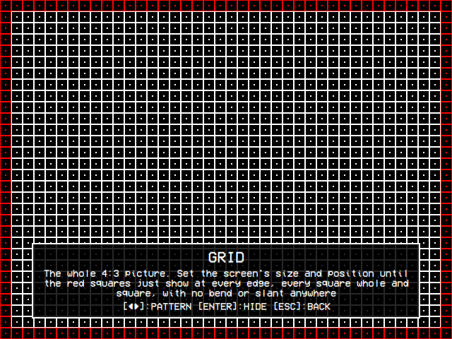</td><td>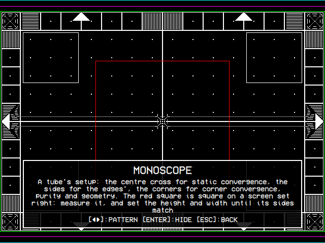</td></tr>
<tr><td>Settings → Screen → Test Patterns: pictures from the 240p Test Suite to set a TV or monitor up by. ◄ ► go through them; select hides the box.</td><td>A tube's convergence, purity and geometry, each pattern saying what to set with it.</td></tr>
</table>

<table>
<tr><th width="50%">A module's settings</th><th width="50%">Picking a folder</th></tr>
<tr><td>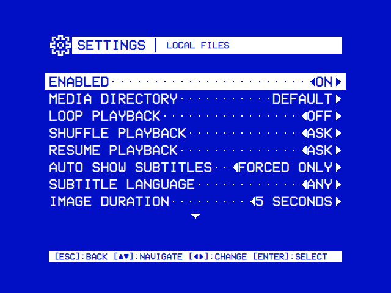</td><td></td></tr>
<tr><td>Local Files: its folder, looping, shuffle, resume, subtitles, and its own Scaling.</td><td>Folders are picked on the same tree Local Files is browsed with, from home, the drives and the root down: USE THIS FOLDER picks the one open, Default Folder the module's own.</td></tr>
</table>

#### Network and system

<table>
<tr><th width="50%">Wi-Fi</th><th width="50%">The country</th></tr>
<tr><td>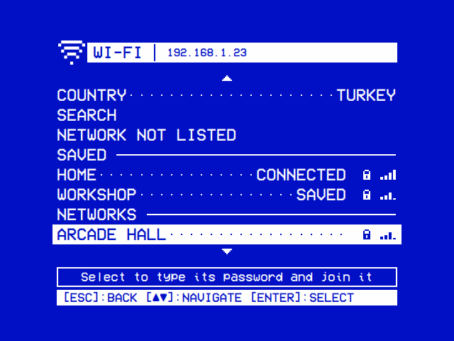</td><td>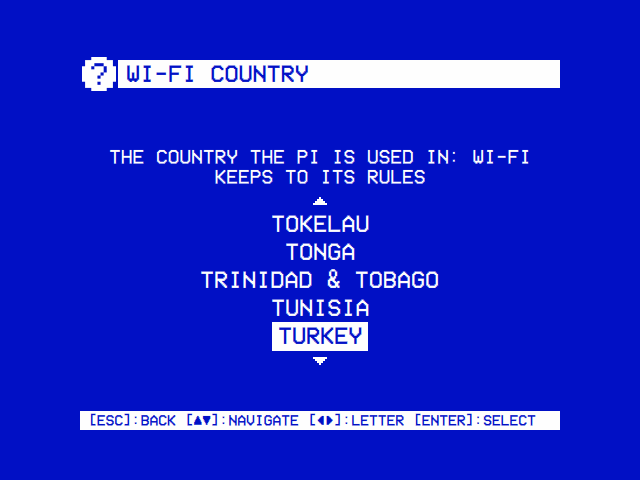</td></tr>
<tr><td>Each network with its lock, when it wants a password, and its signal in bars; joined with a password typed on the on-screen keyboard.</td><td>Wi-Fi stays off until the country is set.</td></tr>
</table>

<table>
<tr><th width="50%">Bluetooth</th><th width="50%">Pairing a keyboard</th></tr>
<tr><td></td><td></td></tr>
<tr><td>Search finds what is in pairing mode nearby for a minute, keyboards, gamepads and the like. Select pairs one and connects it, and it comes back by itself after a restart. Select on a paired one connects, disconnects or forgets it.</td><td>A keyboard is paired by typing the code it asks for, then its Enter. The digits light up as they are typed.</td></tr>
</table>

<table>
<tr><th width="50%">System Information</th><th width="50%">Renaming the device</th></tr>
<tr><td></td><td></td></tr>
<tr><td>The device's name first, the name LAN Play shows the others, then what it is and each connection's addresses.</td><td>On the image, select on the name types a new one.</td></tr>
</table>

<table>
<tr><th width="50%">Controls</th><th width="50%">Update</th></tr>
<tr><td></td><td></td></tr>
<tr><td>Every controller connected, each with its own buttons and a pad's button labels, the pads of players 1 to 6, and one more button for each action on every keyboard and remote.</td><td>Checks for a newer release and installs it.</td></tr>
</table>

<table>
<tr><th width="50%">About</th><th width="50%">The license</th></tr>
<tr><td></td><td></td></tr>
<tr><td>What OSD/OS is, who makes it, what it is made of and under which license, each line's detail in the help line.</td><td>Behind the LICENSE line: the notice, then the GNU GPL's text, a page at a time.</td></tr>
</table>

#### Channel Logo

<table>
<tr><th width="50%">Channel Logo</th><th width="50%">Under the menus</th></tr>
<tr><td></td><td></td></tr>
<tr><td>OSD/OS's logo in a corner of the picture while a video plays, the way a channel's sits in a broadcast. It is off at first: Settings → TV / Movie → Channel Logo picks the corner, all four, or none.</td><td>It is in the picture itself, so with Transparent Background the menus lie over it.</td></tr>
</table>

<table>
<tr><th width="50%">Logo Image</th><th width="50%">Picking the picture</th></tr>
<tr><td></td><td></td></tr>
<tr><td>Settings → TV / Movie → Logo Image puts a picture of your own there instead, as tall as OSD/OS's logo.</td><td>Picked on the same file browser: select on a picture, or OSD/OS Logo at the top to go back to it.</td></tr>
</table>

### Themes

Settings → Look → Theme sets the whole look at once: the color scheme, the skin, the effects and the menu music. Each part has its row under Theme, to change, and all but the color scheme to turn off. None of it ever lies over a video: the effects and the music rest while one plays, loads or has its menu open.

<table>
<tr><th width="50%">Trinitron</th><th width="50%">Late Show</th></tr>
<tr><td></td><td></td></tr>
<tr><td>Video 1 in Rounded windows on a tube's curved face: scanlines, glow and darker corners, drawn by the GPU over the whole screen (CRT). Windows turn over like a cube.</td><td>Late Night's white on black in DOS windows, with a tape's color bleed and noise (VHS) and text flickering like a neon sign. Windows fade.</td></tr>
</table>

<table>
<tr><th width="50%">Green Screen</th><th width="50%">Matrix</th></tr>
<tr><td></td><td></td></tr>
<tr><td>A phosphor green of its own, DOS windows, a glowing tube and glowing text. Windows come in on a wave from a corner.</td><td>Green on black: Matrix rain behind the menus, glowing text, and lightning crackling out of the selected line. Windows ripple.</td></tr>
</table>

<table>
<tr><th width="50%">Inferno</th><th width="50%">Arcade</th></tr>
<tr><td></td><td></td></tr>
<tr><td>Amber on brown: pixel flames burning up from the window's foot, inside its frame, and a welder's sparks bursting from the selected line's corners.</td><td>Synthwave's colors: a starfield, text running through the rainbow, and a pixel rainbow dripping from under the selected line.</td></tr>
</table>

<table>
<tr><th width="50%">Winter</th><th width="50%">Demoscene</th></tr>
<tr><td></td><td></td></tr>
<tr><td>Ice on night blue: snow falling, a glint sweeping across the text, and sparkles flying off the selected line. Windows spread from a drop.</td><td>Gold on purple: a starfield, glowing text and sparkles, windows turning left like a demo's cube, and a tracker's XM for its music.</td></tr>
</table>

<table>
<tr><th width="50%">Skin: DOS, Window Frame: Shadow</th><th width="50%">Skin: Rounded</th></tr>
<tr><td></td><td></td></tr>
<tr><td>A skin dresses the window, apart from the color scheme: DOS gives it a double line. Window Frame, offered with OSD Background's Window, adds a DOS window's shadow, a half tone of the window's color (over a video, it darkens the picture), or takes the frame away.</td><td>Rounded rounds the window's corners and the ends of its bars and of the selected line. A skin gives the shapes, and can draw icons of its own; the color scheme still gives the colors.</td></tr>
</table>
