# Arcade

The Arcade module plays arcade games in MAME from a folder of ROM sets, a zip for each game. It lists the games on one of two screens and starts MAME full screen for the game you choose. A game FinalBurn Neo has can play in RetroArch instead, for RetroAchievements and for play with others ([FinalBurn Neo](#finalburn-neo), [Online and LAN Play](https://github.com/mehmetraif/OSD-OS/wiki/Online-and-LAN-Play)).

It is off at first: turn it on in **Settings → Arcade → Enabled**.

<table>
<tr><th width="50%">The games</th><th width="50%">All Games</th></tr>
<tr><td>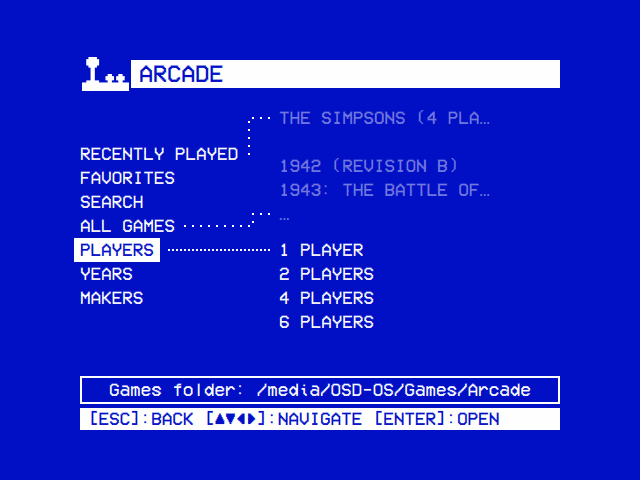</td><td>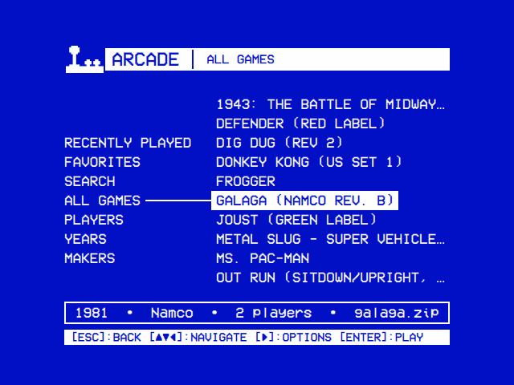</td></tr>
<tr><td>The games by players, decade and maker.</td><td>A game's year, maker, players and file under the tree.</td></tr>
<tr><th>Playing</th><th>A game that couldn't start</th></tr>
<tr><td>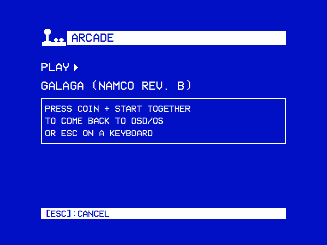</td><td>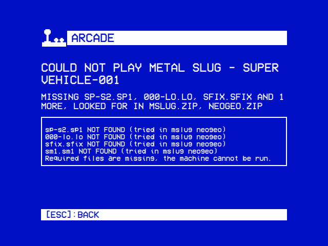</td></tr>
<tr><td>How to come back, in player 1's own buttons.</td><td>What the set lacked: here the Neo-Geo BIOS, neogeo.zip.</td></tr>
<tr><th>The Arcade screen</th><th>A game started from it</th></tr>
<tr><td>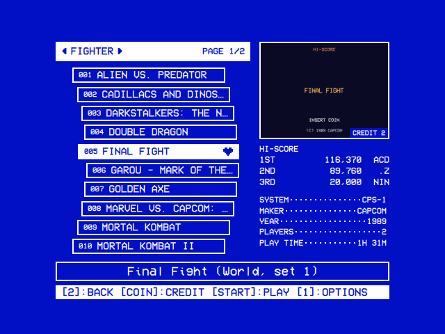</td><td>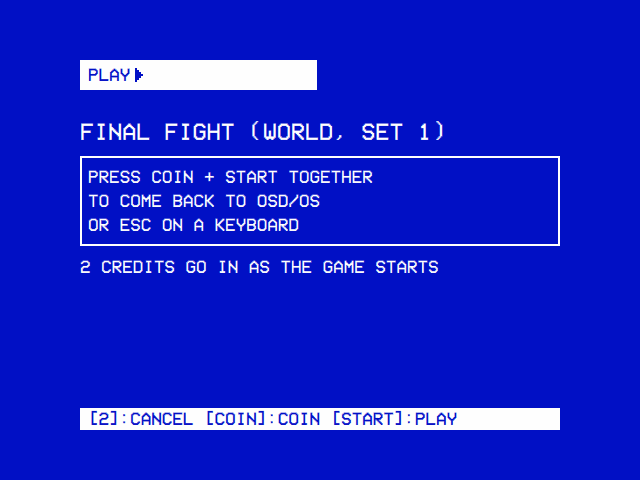</td></tr>
<tr><td>One filter's games, with the selected game's picture, high scores and details. The pictures here are stand-ins.</td><td>How to come back, and the credits going in.</td></tr>
<tr><th>The Arcade screen in the Orb look</th><th>A game starting in it</th></tr>
<tr><td>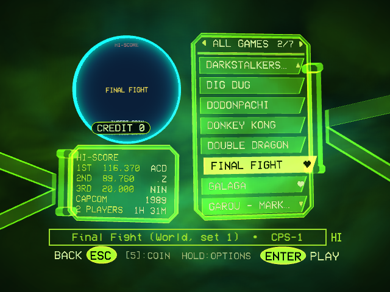</td><td>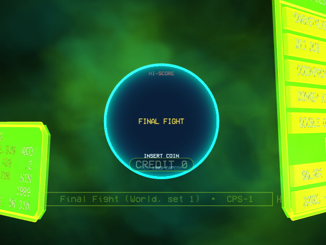</td></tr>
<tr><td>The same screen in 3D: Settings → Look → Theme → Orb (<a href="#the-orb-look">The Orb look</a>).</td><td>The screen goes into the orb as the game starts.</td></tr>
</table>

## Setting it up

1. **MAME.** The OSD/OS image has MAME 0.276 and RetroArch, unless it was built with `OSDOS_ARCADE=0`. Elsewhere, install them (RetroArch is for step 5):

   | System | MAME | RetroArch |
   |---|---|---|
   | Raspberry Pi OS, Debian | `sudo apt install mame` | `sudo apt install retroarch` |
   | Mac | `brew install mame` | retroarch.com, or `brew install --cask retroarch` |
   | FreeBSD | `pkg install mame` | `pkg install retroarch` |
   | OpenBSD | `doas pkg_add mame` | `doas pkg_add retroarch` |
   | Windows | **Settings → Arcade → MAME → Download MAME**, or MAME from [mamedev.org](https://www.mamedev.org/) unpacked beside OSD/OS as a folder named `MAME` | **Settings → Arcade → FinalBurn Neo → Download RetroArch**, or RetroArch from retroarch.com unpacked beside OSD/OS as a folder named `RetroArch` |

   A MAME of your own goes in the data folder as `bin/mame` (`bin/mame.exe` on Windows), with its own folders beside it. The module looks there first, then for `mame` on the `PATH`, then for `/usr/games/mame`, `/usr/local/bin/mame` and `/opt/homebrew/bin/mame`. On Windows it also looks for `mame.exe` beside OSD/OS, in a `MAME` or `mame` folder there, in `C:\mame` and in `MAME` under Program Files.
2. **The games.** Put the ROM sets in the games folder, one per game, named as MAME names the game, in lower case: `pacman.zip`, not `Pac-Man.zip`. A set is a zip, a 7z or a folder of the game's files.
   - BIOS sets (`neogeo.zip`) go beside them, or in a `bios` folder there.
   - Samples go in a `samples` folder there, a zip for each game (`dkong.zip`).

   The games folder is:
   - on the OSD/OS image, `Games/Arcade` on the card's OSD-OS partition (`/media/OSD-OS/Games/Arcade`);
   - elsewhere, `Games/Arcade` in the data folder's `media` folder;
   - or the folder **Settings → Arcade → Games Folder** names.
3. **Sets for this MAME.** A ROM set has to match the MAME that plays it: the image's is 0.276.
4. **Turn it on**: **Settings → Arcade → Enabled**.
5. **FinalBurn Neo** (optional), for online high scores and play with others. Its core comes with OSD/OS; it needs RetroArch.

ROM sets are copyrighted: use the games you are entitled to. MAME is free software (GPL-2.0 or later).

## Two screens

**Settings → Arcade → Screen** chooses how the games are listed, from the next time Arcade opens:

| Screen | What it is |
|---|---|
| **Original** | OSD/OS's own tree, by players, decade and maker ([below](#the-original-screen)) |
| **Arcade** (the default) | A cabinet's selection screen: one filter's games at a time, with the selected game's picture, high scores and details ([below](#the-arcade-screen)). It has a 3D look too ([The Orb look](#the-orb-look)) |

Both list the same games and share Recently Played and Favorites.

## The original screen

Arcade opens on a tree, which works as Local Files' does ([The tree](https://github.com/mehmetraif/OSD-OS/wiki/Local-Files#the-tree)).

| Folder | What it holds |
|---|---|
| **Online Games**, **LAN Games** | With **Online Play** or **LAN Play** on: the games others host that you have ([Playing together](#playing-together)) |
| **Recently Played** | The games played last, latest first, up to 30 |
| **Favorites** | The games added from a game's options, up to 100 |
| **Search** | The games whose name or set has every word typed |
| **All Games** | Every game, by name |
| **Players**, **Years**, **Makers** | The games by players at once, decade and maker: `Namco (Midway license)` is under **Namco** |
| **Not Recognized** | The files neither MAME nor FinalBurn Neo plays, and those whose name can't be a set's: `Street Fighter.zip`, or `PACMAN.ZIP` on a drive that tells cases apart |

The line under the tree describes the entry under the cursor. For a game it reads `1981 • Namco • 2 players • galaga.zip`, with `Imperfect in MAME` or `Not working in MAME` where MAME says so. What stands in the way of the list comes first: `The games folder can't be read: …`, `MAME is not installed`, `MAME could not list the games` ([Troubleshooting](#troubleshooting)).

### A game's options

Right on a game opens its options; on the Arcade screen, hold select.

| Option | What it does |
|---|---|
| **Game Details** | The game's page ([Game Details](#game-details)) |
| **Monitor** | For a vertical game, while Settings → Screen → Monitor isn't turned: **Turned Right**, **Turned Left** or **Default** ([A monitor on its side](#a-monitor-on-its-side-tate)) |
| **Difficulty** | For a game MAME plays whose board has a difficulty DIP switch ([Difficulty](#difficulty)) |
| **Add to Favorites** / **Remove from Favorites** | Puts it on Favorites, or takes it off; 100 at most |
| **Engine** | For a game both MAME and FinalBurn Neo have: **Auto**, **MAME** or **FinalBurn Neo** ([FinalBurn Neo](#finalburn-neo)) |
| **Host Online Game**, **Host LAN Game** | With **Online Play** or **LAN Play** on, for a game FinalBurn Neo has ([Playing together](#playing-together)) |
| **Play at Startup** / **Don't Play at Startup** | Starts the game every time OSD/OS starts, ahead of Settings → Startup → Start on Module. There is one for the whole app: choosing another replaces it |

## The Arcade screen

Arcade opens on a cabinet's selection screen, in letters sized for a CRT.

- **The list**, on the left: one filter's games, seven to a page. A heart marks a favorite.
- **The bar** over it: the filter, with ◄ ► while there are others, and the page (`1/4`).
- **The picture**, on the right, with the credits in its corner (`Credit 2`), and **the box** under it.
- **The help line**: the game's full name, then the details the box has no line for, as `Final Fight (World, set 1) • 1989 • 2 Players • CPS-1`.
- **The hint bar**: the keys.
- **The status icons**, at the right of the help line ([Status Icons](https://github.com/mehmetraif/OSD-OS/wiki/Settings#status-icons)).

**Border**, **Info Background**, **Hint Bar** and **Help Line** in Settings → Arcade change this screen ([Settings](#settings)). Hint Bar and Help Line apply here whatever Settings' own say.

| Key | Pad (JAMMA board) | Keyboard | What it does |
|---|---|---|---|
| ▲ ▼ | Joystick, D-pad | Arrows | The game before or after, round from the last to the first |
| ◄ ► | Joystick, D-pad | Arrows | The filter before or after |
| COIN | **COIN** (Back, Select, -) | **5** | Puts a credit in, up to 9 ([Credits](#credits)) |
| Select, START | Button 1 (A), **START** | **Enter**, **Space**, **1** | Plays the game, with the credits |
| Select, held | Button 1 (A), held | **Enter**, held | The game's options, after most of a second |
| Back | Button 2 (B) | **Esc**, **Backspace** | Leaves Arcade |

On a pad, COIN is its Back button, so here the pad's B is Back.

### List Style

<table>
<tr><th>Straight</th><th>Curved</th><th>3D Curved</th></tr>
<tr><td>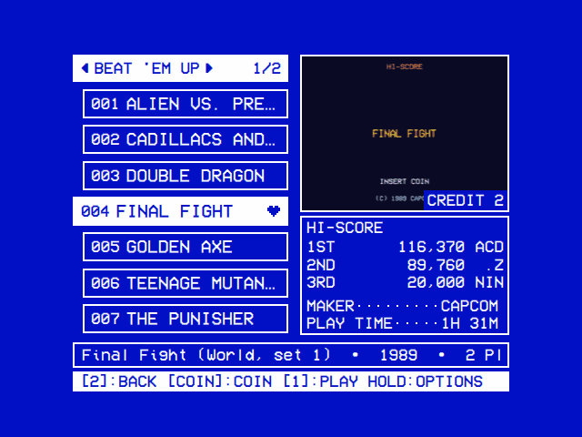</td><td></td><td>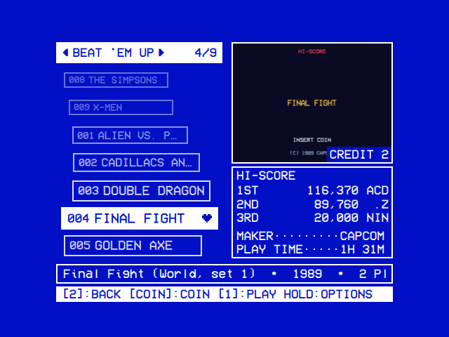</td></tr>
</table>

**Settings → Arcade → List Style** lays the list out:

| List Style | How the games lie |
|---|---|
| **Straight** | One under another, a page at a time |
| **Curved** (the default) | On an arc, a page at a time |
| **3D Curved** | On a wheel, which turns once the selection reaches its top or bottom row. It holds nine games where Curved holds seven, and the bar shows the game (`12/512`) |

### The box under the picture

The box shows as many of these lines as it has room for, in this order:

1. **Play Time**, at the foot: how long the game has been played in OSD/OS (`1H 31M`, `Never`).
2. **Hi-Score**: the best three entries of the game's table, as the [High Scores](https://github.com/mehmetraif/OSD-OS/wiki/High-Scores) module reads it. `No Scores Yet` before the game has one.
3. **Achievements**, with a Web API key, for a game RetroAchievements has achievements of: those earned of all (`7/100`).
4. **Maker**, **Year**, **Players** and **System**, with `?` for what MAME doesn't say. System is the game's board: CPS-1, Neo-Geo, NAOMI…

**RA Hi-Score** takes Hi-Score's place for a game played in FinalBurn Neo with Online High Scores on: the top three of its RetroAchievements leaderboard ([FinalBurn Neo](#finalburn-neo)).

For a game without achievements, the list and the box hold:

| Room | List | Box |
|---|---|---|
| Hint Bar and Help Line on | 7 games | Hi-Score with three scores, Maker, Play Time |
| Hint Bar off | 8 games | Hi-Score with three scores, Maker, Year, Play Time |
| Help Line off | 8 games | Hi-Score with three scores, Maker, Year, Players, Play Time |
| Both off | 9 games | Hi-Score with three scores, Maker, Year, Players, System, Play Time |

[Screen Adjustment](#screen-adjustment) changes the room. A room under **Online Games**, **LAN Games** or **RetroArch Lobby** has no picture: the box takes the whole column and says what is known of the room.

### Screen Adjustment

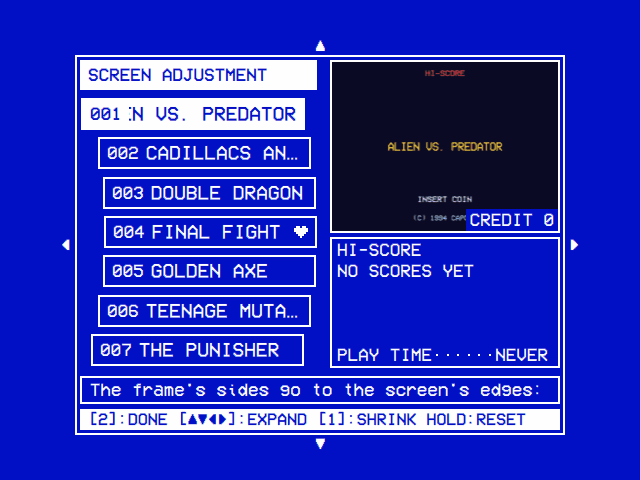

**Settings → Arcade → Screen Adjustment** opens the Arcade screen inside a frame, to fit it to your screen.

- ▲ ▼ ◄ ► move that side of the frame, a step at a time.
- Select switches between moving the sides out (**EXPAND**) and in (**SHRINK**).
- Select held puts the frame back where OSD/OS has it.
- Back keeps it and returns to Settings.

On a CRT, move each side to where the tube's edge cuts the picture off.

### Filters

◄ ► go round the filters [Menu Filters](#menu-filters) shows, in this order:

| Filter | What it holds |
|---|---|
| **All Games** | Every game, by name. Always there |
| **Favorites**, **Recently Played** | The favorites, by name; the games played last, up to 30 |
| **LAN Games**, **Online Games** | With **LAN Play** or **Online Play** on: the games hosted on your network, or in RetroArch's lobby, that you have. Select joins one. With none, it says why |
| **RetroArch Lobby** | With **Online Play** on: every game hosted in RetroArch's lobby |
| **RetroAchievements** | With **Online High Scores** on and a Web API key: the games RetroAchievements has achievements or a leaderboard for that play in FinalBurn Neo |
| **Playable Online** | With **Online Play** on: the games FinalBurn Neo has that your machine has the memory to host |
| **Vertical Games** | The games whose screen stood upright in their cabinets |
| A genre (**Beat 'em Up**, **Fighting**, **Shmup**…) | The games of that genre ([Genres](#genres)) |
| **1 Player**…, **1980s**… | The games by players at once and by decade, **Year Unknown** last |
| A publisher (**Capcom**, **Namco**…) | The games of that maker, once turned on in Menu Filters. A company is one publisher: **Nintendo** covers Nintendo of America |
| **Not Recognized** | The files neither MAME nor FinalBurn Neo plays |
| **Search** | Last: the games its words find |

Three settings hide games from every filter and list, on both screens. Favorites and Recently Played keep the hidden games.

- **Hide Hacks and Bootlegs** hides the sets marked as a bootleg or a hack, in the parentheses of the name (`Galaga (bootleg)`) or as the maker.
- **Hide Incomplete Games** hides the games [Check ROMs](#check-roms) found files missing of for every engine that knows them.
- **Regions** hides the sets of the regions turned off: World, USA, Europe, Asia, Japan, Korea, China, Hong Kong, Taiwan, Hispanic, Brazil, Oceania and Others.

A set's region is the one in the parentheses of its name: `Street Fighter Alpha 3 (Euro 980904)`.

- `US` counts as USA, `Euro` as Europe and Sega's `Export` as World.
- A country counts as its region (Germany as Europe, Canada as USA, Australia as Oceania), and any other region as Others.
- A set of several regions is hidden once they all are off. A set whose name gives no region is always listed.

**Settings → Arcade → Start Filter** is the filter the screen opens on. One that isn't there, such as a genre no game has, opens on All Games.

### Search

Search is the last filter. While it is shown, the on-screen keyboard stands in the picture's frame.

- **►** from the list goes onto the keys. So does a letter typed on a keyboard.
- Each letter narrows the list at once. A game is found when its name or set has every word typed, in any order: `fighter street` finds Street Fighter II.
- **OK** goes down to the first game found. Back returns to the list with the words kept.
- COIN buys no credit while Search is shown.

### Menu Filters

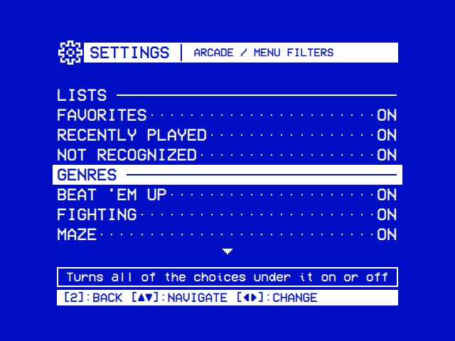

**Settings → Arcade → Menu Filters** chooses the filters ◄ ► goes round. Its page lists them under five headings: **Lists**, **Genres**, **Players**, **Years** and **Publishers**.

- ◄, ► or select on a filter turns it **ON** or **OFF**.
- On a heading, they turn every filter under it on, or off once they all are on.
- Every filter is on until turned off, except the publishers, which are off until turned on.

### Genres

The genres come from **catver.ini**, progettosnaps.net's category list for MAME's games: a line for each game, such as `sf2=Fighter / Versus`.

- Put `catver.ini` in the games folder, or in `arcade` in the data folder.
- With neither and a connection, OSD/OS downloads the latest into `arcade` in the data folder. A download that fails is tried again an hour later.

| Genre | catver.ini's categories |
|---|---|
| **Fighting** (Street Fighter II) | `Fighter / Versus`, `Versus Co-op`, `3D` and the other fighters |
| **Beat 'em Up** (Final Fight) | `Fighter / 2.5D`, `2D`, `Vertical`, `Field`, `Scrolling`; `Platform / Fighter` |
| **Shmup** (1942) | `Shooter / Flying` and every `Flying …`, `Gallery`, `Misc. Vertical`, `Misc. Horizontal` |
| **Run and Gun** (Metal Slug) | `Platform / Shooter …`, `Shooter / Walking` |
| **Light Gun** | `Shooter / Gun` |
| **Shooter** | The other shooters |
| **Platform** | The other platform games: `Run Jump`, `Fighter Scrolling`… |
| **Racing** | `Driving / …` |
| Any other (**Maze**, **Puzzle**, **Sports**…) | Its category up to the `/` |

### Pictures

A game's pictures are, in this order:

1. `titles/<set>.png` in the games folder, its title screen.
2. `snap/<set>_1.png`, `snap/<set>_2.jpg`… in the games folder: your own and those downloaded from RetroAchievements.
3. `snap/<set>.png` (or `.jpg`).
4. The first snapshot taken of it in MAME (F12 in the game), kept in `arcade/snap/<set>/`.

- A clone without pictures of its own shows its parent's.
- With more than one, the Arcade screen shows the next every 4 seconds.
- Without any, the frame says `No Picture` and the file it would be, with `No Web API Key` or `Web API Key Refused` where that is why.

**Settings → Arcade → Pictures From** sets where pictures are downloaded from: **RetroAchievements, then progetto-SNAPS** (the default), either alone, or **Off**. **Settings → Arcade → Game Pictures** says how many games have a picture, and holds **Download Pictures**.

#### Pictures from RetroAchievements

These need a **Web API Key** in **Settings → Arcade → RetroAchievements Account** ([FinalBurn Neo](#finalburn-neo)) and a connection. Online High Scores needn't be on.

- A game's title screen, a screenshot in play and its box art are downloaded the first time it is shown.
- They go in the games folder's `snap` folder with the first numbers free: `sf2_1.png`, `sf2_2.png`, `sf2_3.png`. A file already there is never written over.
- `snap/.retroachievements.json` notes what was downloaded. A picture you delete isn't downloaded again.

#### Pictures from progetto-SNAPS

[progetto-SNAPS](https://www.progettosnaps.net/), by AntoPISA, keeps a screenshot and the title screen of nearly every MAME game. OSD/OS gets them game by game from [ArcadeDB](https://adb.arcadeitalia.net/), by motoschifo. No key is needed.

- ArcadeDB is asked only about a game with no picture at all.
- The screenshot is saved as `snap/<set>.png` and the title screen as `titles/<set>.png`, never over a file there.
- `snap/.arcadedb.json` notes what ArcadeDB had. A set it had no pictures of is asked about again two months later.
- The pictures' copyright is the games' publishers'; they are free to use under fair use.

#### Download Pictures

**Settings → Arcade → Game Pictures → Download Pictures** looks for every game's pictures in the background, a game a second, as Pictures From allows.

- The Game Pictures page and the picture's frame say how far it has got (`Downloading 120/900`).
- Games whose pictures couldn't be had are tried again ten minutes later, up to three looks in a row.
- A look cut short goes on at the next start. **Read the Games Again** starts the same look.

### Credits

COIN puts in a credit, up to 9, shown as `Credit 2` on the picture. The credits go in with the next game played, in either engine, 5 seconds after it starts.

- They are spent once the game starts, even if it then stops with an error.
- A game still starting up then may not count them all, and a game played with others takes none: insert a coin in the game.

**Free Play.** **Settings → Arcade → Play Mode** is **Credits** by default. **Free Play** puts 9 credits in with every game: the picture says `Free Play`, and COIN buys none.

### Attract Mode

**Settings → Arcade → Attract Mode** makes the Arcade screen go through its games on its own when left alone, a game every six seconds. It is Off by default.

- **In Order** goes down the list and round; **Random** picks a game at random each time.
- **Attract After** sets how long the screen is left alone first: 30 Seconds, 1 Minute (the default), 2 Minutes or 5 Minutes.
- The first button or key ends it and does nothing else. COIN also puts in a credit.
- It waits on Search, Online Games, LAN Games and RetroArch Lobby, and on a filter of fewer than two games.

### The Orb look

<table>
<tr><th width="50%">The list</th><th width="50%">A game starting</th></tr>
<tr><td></td><td></td></tr>
</table>

Settings → Look → **Theme** → **Orb** draws the Arcade screen in 3D, in x-ray glass. The keys do what they do on the screen above.

- The games are on a panel at the right, eight to a page. The game's pictures are in the orb at the left.
- Settings → Look → **Orb Fog** chooses the fog behind: **Picture** (the default) or **Live** (more work for a Raspberry Pi's GPU).
- A game started goes into the orb for about two and a half seconds, in which no key counts.
- Screen Adjustment, Hint Bar and Help Line apply; List Style, Border and Info Background don't, and Settings → Arcade shows them dimmed, the help line saying why.

The Orb look needs a GPU and Qt Quick 3D. Without them the screen is drawn flat, and the log says `[Arcade] the Orb look needs Qt Quick 3D: the Arcade screen's own is drawn`.

- The OSD/OS image and `install.sh` (both since 0.0.31) and the Mac and Windows builds bring Qt Quick 3D.
- Elsewhere, install `qml6-module-qtquick3d` and `qml6-module-qtquick3d-helpers` on Linux, `qt6-quick3d` on FreeBSD, `qt6-qtquick3d` on OpenBSD.

**A Raspberry Pi set up before 0.0.31** has no Qt Quick 3D, and Settings → System → Update doesn't install it. Install it once, from SSH or Exit to Terminal, as a user who can use `sudo`:

```sh
sudo apt update
sudo apt install qml6-module-qtquick3d qml6-module-qtquick3d-helpers
sudo reboot
```

Running `install.sh` again does the same ([Installation → Updating with install.sh](https://github.com/mehmetraif/OSD-OS/wiki/Installation#updating-with-installsh)). An image built without a password has no `sudo` ([The user, its password and sudo](https://github.com/mehmetraif/OSD-OS/wiki/The-OSD-OS-Image#the-user-its-password-and-sudo)): flash the image of 0.0.31 or later instead.

### Favorites as a file

**Settings → Arcade → Favorites** keeps the favorites as `osdos-favorites.txt` in the games folder. **Export** writes it, a game's set a line, its title after a `#`:

```
# OSD/OS's Arcade favorites: a game's set a line, its title after the #.
1942         # 1942 (Revision B)
sf2          # Street Fighter II: The World Warrior
```

**Import** adds the games the file names that aren't favorites yet, up to 100 favorites in all. Anything after a `#` is left out, so a list typed by hand, one set a line, works too. [Export to OSD/OS Setup](https://github.com/mehmetraif/OSD-OS/wiki/Settings#export-to-osdos-setup) carries the favorites as well.

### Difficulty

**Difficulty**, in a game's options, sets the board's difficulty DIP switch before the game starts, as `Difficulty: Normal`. MAME keeps it for the game, as if set in its own menu (Tab → DIP Switches).

- **Which games**: those MAME plays whose switch it calls Difficulty, Game Difficulty or Difficulty Level. A game FinalBurn Neo plays has no Difficulty in its options.
- **Boards without the switch** (CPS2, CPS3, the Neo-Geo, most from the late 1990s on): set the difficulty in the game's service menu (F2 in MAME).

### A monitor on its side (TATE)

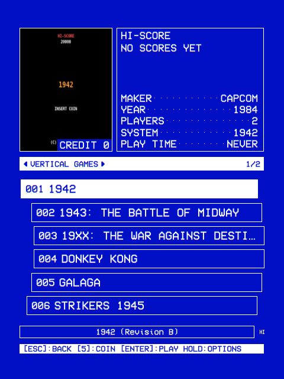

Three settings turn the picture for a monitor on its side. **Turned Right** has the monitor's top on the right as you face it, **Turned Left** on the left.

| The monitor | Setting |
|---|---|
| Stays turned | **Settings → Screen → Monitor** |
| Is turned for vertical games | **Settings → Arcade → Emulator Video → Vertical Games**: only the vertical games are turned |
| Is turned for one game | **Monitor** in the game's options, which goes before Vertical Games |

With Settings → Screen → Monitor turned:

- The games stand upright on it: a vertical game fills the screen, a horizontal one lies across its middle.
- The Arcade screen takes a tall layout of its own. The Orb look isn't drawn.
- The menus keep their 4:3 design, in a band across the screen's middle. Videos are turned too.
- The controls stay as they are.

A desktop's monitor is turned in the system's display settings; OSD/OS then lays itself out the same way.

## Game Details

**Game Details**, in a game's options, opens a page of the game. Under its title is a line of what it is: maker, year, players, system, play time, and what [Check ROMs](#check-roms) found missing (`2 Files Missing for MAME`). Its achievements on RetroAchievements follow.

- **How many**: `2 of 3 Earned • 35 of 40 Points`; without a signed-in account, `3 Achievements • 40 Points`.
- **The list**: **Earned**, then **Not Earned**. The help line says what the selected one asks for, and `Earned 2026-03-14 in Hardcore` or `Not Earned Yet`.
- **The badges** are saved in the games folder's `snap` folder as `achieve_sf2_12345.png` (`achieve_sf2_12345_lock.png` for the grey one).

The achievements are read with the account's **Web API Key**, and its **User** for which you have earned ([FinalBurn Neo](#finalburn-neo)). Without them the page says why:

- `No Web API key: Settings, Arcade, RetroAchievements Account`
- `RetroAchievements refused the Web API key`
- `RetroAchievements could not be reached`
- `RetroAchievements has no achievements for this game`

## Reading the games

Names, years, makers, players and systems come from MAME. Those of a set only FinalBurn Neo has come from FinalBurn Neo's list.

- Each time it opens, the module asks MAME about the sets new in the folder: all of them the first time.
- Meanwhile the tree shows `loading…` and `Reading the games…`.
- What MAME said is kept in `arcade/games.json` in the data folder until MAME itself changes.
- **Settings → Arcade → Read the Games Again** asks about every set again, then looks for every game's pictures.

## Check ROMs

**Settings → Arcade → Check ROMs** says whether each game's files are whole, for MAME and for FinalBurn Neo. Start it with **Check ROMs** on that page: nothing starts it by itself. It takes a few minutes on a Raspberry Pi, and a game started meanwhile holds it (`Waiting`).

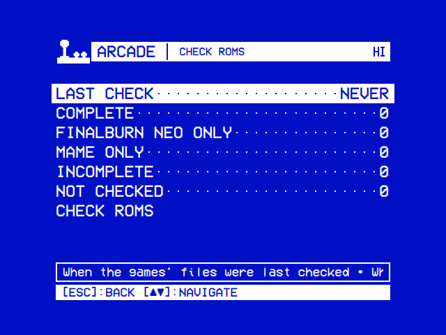

The page counts the games: **Complete** (whole for every engine that knows them), **FinalBurn Neo Only** and **MAME Only** (whole for one engine), **Incomplete** (whole for neither) and **Not Checked**. What the check found is used at once:

- **The engine**: with **Engine** at Auto, a game missing files for one engine plays in the other.
- **Online and LAN play**: a game missing files for FinalBurn Neo isn't offered for hosting, and a room of it can't be joined.
- The log names the files a game lacks.

A game whose file, parent or BIOS set changes is **Not Checked** until the next check; so is every game after an update of MAME or FinalBurn Neo. The results are kept in `arcade/romcheck.json` in the data folder.

## Playing

Select on a game in the tree, or select or START on the Arcade screen. The game starts under a loading screen, then MAME has the screen for as long as the game runs.

**Settings → Arcade → Start Info Screen**, On by default, shows a screen before the game: **PLAY ▶**, the game's name and how to come back.

- From the tree, the first game after OSD/OS starts waits a second and a half; the games after it don't wait.
- From the Arcade screen, every game waits three seconds. The screen says `2 credits go in as the game starts`, or `No credit: insert a coin in the game`. COIN puts in another; START or select starts at once.
- Back in that time cancels the game and keeps the credits.

**Coming back**: press **Coin and Start together** on any player's controller, or **Esc** on a keyboard. The screen names them as player 1's controller does: `COIN + START` on the JAMMA board's sticks, `BACK + START` on an Xbox pad, `SELECT + START` on a PlayStation one, `- + +` on a Nintendo one. A button changed in MAME's menu for UI Cancel replaces this way back.

MAME's own menu is **Tab** on a keyboard, or the controller's guide button: **MODE** on the JAMMA board.

A game that couldn't start, or that MAME ended with an error, shows what went wrong and MAME's last lines ([Troubleshooting](#troubleshooting)).

## Players and buttons

MAME's players are the ones **Settings → Controls → Players** sets ([Controls](https://github.com/mehmetraif/OSD-OS/wiki/Controls#players)): player 1's controller is MAME's joystick 1, up to player 6.

| On the controller | In MAME, for that player |
|---|---|
| Joystick or D-pad | The joystick |
| Buttons 1 to 6 (A, B, X, Y, LB, RB on a pad) | Buttons 1 to 6 |
| **Coin** (Back, Select) | Coin |
| **Start** | Start |

- On the JAMMA board that is the cabinet's own layout, with the kick harness's buttons 4 to 6.
- Change a game's buttons in MAME's menu (**Tab → Input Settings**); MAME keeps them in `arcade/cfg`.
- MAME can't tell two pads of the same model apart: one of them takes the place MAME's own order gives it.
- Keyboards play with MAME's keys: 5 coin, 1 start, the arrows and Ctrl, Alt, Space for player 1.
- Six-player games take the JAMMA board's two sticks and four pads over USB or Bluetooth.

**Arcade Buttons.** A pad's own page in Settings → Controls says which of its buttons is each of a cabinet's: Button 1 to 8, Coin and Start ([Controls → Arcade Buttons](https://github.com/mehmetraif/OSD-OS/wiki/Controls#arcade-buttons)).

- A player whose pad has them plays every game with them, in MAME, and in FinalBurn Neo off line.
- What is changed in MAME's menu comes before them: **Input Settings → Input Assignments (general)** for every game (`arcade/cfg/default.cfg`), and a game's own for that game.
- In a game played with others, the host's layout holds for every player ([Players](https://github.com/mehmetraif/OSD-OS/wiki/Online-and-LAN-Play#players)).

## High scores

With **Save High Scores** on (the default), MAME runs with its hiscore plugin, which keeps the high score tables of the games that forget them when switched off.

- The tables are in `arcade/hiscore/<game>.hi` in the data folder, for the games MAME's `hiscore.dat` knows.
- Games that keep their own scores in NVRAM keep them in `arcade/nvram`.
- A table is saved when the game closes with Coin and Start, and a few seconds after a new score goes in.
- The [High Scores](https://github.com/mehmetraif/OSD-OS/wiki/High-Scores) module shows the tables.

## MAME's page

**Settings → Arcade → MAME** shows the MAME the games play in:

- **MAME**: **Installed**, with where it is on the help line; **Downloaded** for the one OSD/OS fetched; or **Not Installed**.
- **Hiscore Plugin**: whether it is beside MAME. A MAME of your own needs its `plugins` folder beside it.

**Download MAME**, on Windows only, shows while no MAME is found.

- It fetches MAME 0.276 for 64-bit Windows from mamedev's releases on GitHub, some 100 MB.
- It unpacks into `arcade/mame` in the data folder, which takes up to half a gigabyte of memory and about 700 MB of disk.
- The row is then **Download MAME Again**, which replaces that folder whole.
- The same download starts with select on the `MAME is not installed` screen, where it says `DOWNLOAD MAME`.
- A download that fails says why and leaves what was there: `github.com answered 404`, `The file is not a 7z archive`, `The download has no mame.exe`, or a disk that couldn't take it.

## FinalBurn Neo

FinalBurn Neo is a second arcade emulator, played here in RetroArch as a libretro core. It plays the games it has, some 8,400 arcade sets, from the same games folder. It brings what MAME lacks: RetroAchievements, and play with others.

**Engine**, in a game's options, chooses which emulator plays the game:

| Engine | The game plays in |
|---|---|
| **Auto** (the default) | FinalBurn Neo, for a game it has, while **Online High Scores** is **RetroAchievements**, **Online Play** or **LAN Play** is on, or no MAME is installed. MAME otherwise. The option names its pick: `Engine: Auto (MAME)` |
| **MAME** | MAME, always. With none installed the option reads `MAME (Not Installed)` |
| **FinalBurn Neo** | FinalBurn Neo. MAME where FinalBurn Neo isn't installed or hasn't the set |

**Its sets**

- Most of a ROM set for MAME 0.276 plays in FinalBurn Neo too. A set that doesn't stops with a notice naming the files; **Engine: MAME** plays it.
- A Neo-Geo game needs `neogeo.zip`, beside the games or in their `bios` folder.
- It plays a zip or a 7z, not a folder of files.
- A set MAME doesn't know that FinalBurn Neo has is listed as a game, and always plays in FinalBurn Neo.

**Playing**

- Come back as from MAME. A keyboard's coin and start are **5** and **1** for player 1, 6 and 2 for player 2, and so on to player 4. Player 1's buttons are Z, X, A, S, Q, W and the arrows.
- The JAMMA board's sticks, and a pad with Arcade Buttons of its own, have FinalBurn Neo's **6-Button Panel**: buttons 1 to 3 in the top row and 4 to 6 below.
- RetroArch's menu is **F1** on a keyboard. A change made there lasts that game; FinalBurn Neo's own **Core Options** are kept.
- A game's state is saved with **F2** and loaded with **F4**, except in hardcore mode.

**Online High Scores**, set to **RetroAchievements**, plays FinalBurn Neo's games signed in to your RetroAchievements account, in **hardcore** mode: no save states, rewinding or cheats. Only hardcore scores go on the leaderboards.

- OSD/OS sets the core option **Allow patched romsets** to disabled before each such game, as hardcore needs.
- A cheat turned on in the core options pauses hardcore (`Hardcore paused. Setting not allowed: …`): turn it off in RetroArch's menu (F1 → Core Options).

Sign in under **Settings → Arcade → RetroAchievements Account**:

1. Make an account at retroachievements.org.
2. Type **User**, then **Password**, then **Sign In**. **Status** says **Checking** for a moment, then **Signed In**.
   - **Not Signed In**: RetroAchievements' reason is under **Password** (`Invalid User/Password combination`). Type it again.
   - **At the Next Game**: no connection. RetroArch signs in as the next FinalBurn Neo game starts.
3. Type the **Web API Key**: your account's key, from retroachievements.org's **Settings** page, under **Keys**. It is not the password. The page says **Working**, **Kept** while it can't be checked, or **Refused**.

The key is for the leaderboards, the games' pictures and the achievements in Game Details. **Forget Web API Key** removes it; **Sign Out** forgets the account and its token. The password is never saved. On the OSD/OS image and a Raspberry Pi, the RetroArch that comes with OSD/OS sends it over https, and only to a server whose certificate it has checked. A system's own RetroArch built without TLS, as Debian's and Ubuntu's packages are, sends it over plain HTTP: use one you use nowhere else there.

**RA Hi-Score.** With Online High Scores on RetroAchievements and a key, the Arcade screen's box shows each FinalBurn Neo game's leaderboard, kept ten minutes. For a game with no leaderboard, or while it is read or can't be, the box shows this machine's own table. With no table either, it says `Reading…`, or `Not Reachable` without a connection or with a key refused.

The High Scores module shows MAME's tables only: a game played in FinalBurn Neo keeps no table on the machine.

### The core and RetroArch

FinalBurn Neo comes with OSD/OS on every system, built from one commit of it. RetroArch and MAME are the OSD/OS image's versions ([The same engines on every machine](https://github.com/mehmetraif/OSD-OS/wiki/Online-and-LAN-Play#the-same-engines-on-every-machine)).

**Settings → Arcade → FinalBurn Neo** shows RetroArch, the core, and how many games its list has.

- The core reads **With OSD/OS**, **Latest** after an upgrade, or **Installed**. Its line names the commit and date OSD/OS brought, as `77016b4 (261108)`.
- **Upgrade to Latest** fetches the core libretro builds every night, about 35 MB, into `arcade/retroarch` in the data folder. Machines playing together need the same core, so play with others on OSD/OS's.
- **Download Latest Again** fetches a newer one. **Back to OSD/OS's Version** deletes it. Core options, remap files, saves and save states stay.
- The BSDs have no such row. A build of OSD/OS from source without the core has **Download** instead.
- A download that brings nothing for a minute, or grows past 64 MB, is given up.

OSD/OS's core is in the bundle on a Mac and beside `osdos.exe` on Windows. Elsewhere it is in `lib/osdos/` under the app's folder (`/opt/osdos` on the image, `/usr/local` on the BSDs). Its licence is on **Settings → System → About**: it may be used and shared, never sold.

A core remap file of your own (**Save Core Remap File** in RetroArch's menu) is loaded in place of OSD/OS's: delete it to have OSD/OS's back.

**Download RetroArch**, on Windows only, shows while no RetroArch is found. It works as Download MAME does ([MAME's page](#mames-page)).

- It fetches RetroArch 1.20.0 for 64-bit Windows from libretro's build server, some 200 MB.
- It unpacks into `arcade/retroarch/RetroArch-Win64` in the data folder, which takes some 400 MB of memory and about 750 MB of disk.
- The row is then **Download RetroArch Again**.
- A RetroArch installed elsewhere (a `RetroArch` folder beside OSD/OS, `C:\RetroArch-Win64`, Program Files, Steam's) has no such row.
- Its own messages: `buildbot.libretro.com answered 404`, `The download has no retroarch.exe`.

## Playing together

**Online Play** and **LAN Play**, in Settings → Arcade, play the games FinalBurn Neo has with others: see [Online and LAN Play](https://github.com/mehmetraif/OSD-OS/wiki/Online-and-LAN-Play).

- **LAN Play**: up to six players across the machines of your network, with no internet.
- **Online Play**: through RetroArch's lobby and a relay.
- **LAN Games**, **Online Games** and **RetroArch Lobby** list the games others host. **Host LAN Game** and **Host Online Game** host one.
- A game hosted or joined plays in FinalBurn Neo whatever its **Engine** says.

## The picture and the sound

- MAME and RetroArch draw the game in the display mode OSD/OS runs in (**Settings → Screen → Display Output**).
- On a Raspberry Pi 5, MAME opens the output the display preset names. RetroArch opens the first output with a screen plugged in.
- The sound goes to the card **Settings → Sound → Audio Output** chose ([Audio Output](https://github.com/mehmetraif/OSD-OS/wiki/Audio-Output)). With no sound card that can play, the game plays without sound.
- A Pi 5's HDMI plays sound only while that port shows the picture. On the JAMMA board or composite, a USB sound card plays.

### Emulator Video

**Settings → Arcade → Emulator Video** sets how both MAME and FinalBurn Neo draw a game on your screen. The first value is the default.

| Setting | Values | What it does | Config key |
|---|---|---|---|
| Game Picture | Original, Fit to Screen | **Original**: the game in its own shape, with black around it. **Fit to Screen**: stretched over the whole screen; Screen Shape and Integer Scale are then dimmed | `modules.com.osdos.arcade.game_picture` |
| Screen Shape | Auto, 4:3, 16:9, Square Pixels | The shape of your screen. **Auto**: 4:3 on a CRT's display output (composite, SCART RGB, JAMMA; off the OSD/OS image, a mode of 576 lines or fewer), square pixels on HDMI | `modules.com.osdos.arcade.screen_shape` |
| Integer Scale | Auto, On, Off | A game's lines drawn whole, once (twice on a 480-line output), with a thin border above and below. **Auto**: on on a CRT's display output. A game with more lines than the screen fills it either way | `modules.com.osdos.arcade.integer_scale` |
| Vertical Games | Horizontal, Turned Right, Turned Left | Turns the vertical games for a monitor you turn on its side for them ([A monitor on its side](#a-monitor-on-its-side-tate)) | `modules.com.osdos.arcade.vertical_monitor` |
| MAME Video | Auto, OpenGL, BGFX, Accelerated, Software | How MAME draws. **Auto** leaves it to MAME's own settings (Debian's `mame.ini` says OpenGL). Try another when a game shows no picture | `modules.com.osdos.arcade.video` |

## Settings

Settings → Arcade. The page is shared with the [High Scores](https://github.com/mehmetraif/OSD-OS/wiki/High-Scores) module, whose **Enabled** follows these rows under a **High Scores** heading. The rows marked † show while Screen is Arcade.

| Setting | Values | Default | What it does | Config key |
|---|---|---|---|---|
| Enabled | ON, OFF | OFF | Shows Arcade on the main menu | `modules.com.osdos.arcade.enabled` |
| Games Folder | Default, or a folder | Default | The folder of ROM sets ([Setting it up](#setting-it-up)) | `modules.com.osdos.arcade.games_directory` |
| Hide Hacks and Bootlegs | ON, OFF | OFF | Hides bootleg and hack sets ([Filters](#filters)) | `modules.com.osdos.arcade.hide_bootlegs` |
| Hide Incomplete Games | ON, OFF | OFF | Hides the games Check ROMs found incomplete | `modules.com.osdos.arcade.hide_incomplete` |
| Regions | Each region ON or OFF | All ON | Hides a region's sets ([Filters](#filters)) | `modules.com.osdos.arcade.regions` |
| Screen | Original, Arcade | Arcade | The tree, or the Arcade screen | `modules.com.osdos.arcade.screen` |
| Start Filter † | All Games, a list, LAN Games, Online Games, RetroArch Lobby, a genre, a number of players, a decade or a publisher | All Games | The filter the Arcade screen opens on | `modules.com.osdos.arcade.start_filter` |
| Menu Filters † | Each filter ON or OFF | All ON, the publishers OFF | The filters ◄ ► goes round | `modules.com.osdos.arcade.menu_filters` |
| Play at Startup | None, then the favorites | None | A favorite started as OSD/OS starts | `modules.com.osdos.arcade.play_at_startup` |
| List Style † | Straight, Curved, 3D Curved | Curved | How the Arcade screen's games lie | `modules.com.osdos.arcade.list_style` |
| Border † | ON, OFF | ON | The frames round the picture and the box | `modules.com.osdos.arcade.border` |
| Info Background † | A slider from TRANSPARENT to SOLID, 0 to 100 in steps of 10 | 100 (SOLID) | How much of the Background Effect shows under the picture and the box | `modules.com.osdos.arcade.info_background` |
| Screen Adjustment † | (opens the Arcade screen) | As OSD/OS lays it out | Fits the Arcade screen to your screen | `modules.com.osdos.arcade.screen_adjustment` |
| Hint Bar † | ON, OFF | ON | The keys at the foot of the Arcade screen | `modules.com.osdos.arcade.hint_bar` |
| Help Line † | ON, OFF | ON | The line under the list | `modules.com.osdos.arcade.help_line` |
| Attract Mode † | Off, In Order, Random | Off | The Arcade screen goes through its games when left alone | `modules.com.osdos.arcade.attract_mode` |
| Attract After | 30 Seconds, 1 Minute, 2 Minutes, 5 Minutes | 1 Minute | How long the screen is left alone first. Shown while Attract Mode isn't Off | `modules.com.osdos.arcade.attract_after` |
| Start Info Screen | ON, OFF | ON | The screen before a game ([Playing](#playing)) | `modules.com.osdos.arcade.start_info` |
| Play Mode | Credits, Free Play | Credits | COIN buys credits, or every game starts with 9 | `modules.com.osdos.arcade.play_mode` |
| Save High Scores | ON, OFF | ON | Keeps the games' high score tables ([High scores](#high-scores)) | `modules.com.osdos.arcade.high_scores` |
| Online High Scores | Off, RetroAchievements | Off | FinalBurn Neo's games play in hardcore mode, their scores going to RetroAchievements | `modules.com.osdos.arcade.online_high_scores` |
| RetroAchievements Account | (page) | | Sign in and out, and the Web API key ([FinalBurn Neo](#finalburn-neo)) | |
| Pictures From | RetroAchievements, then progetto-SNAPS; RetroAchievements; progetto-SNAPS; Off | RetroAchievements, then progetto-SNAPS | Where pictures are downloaded from | `modules.com.osdos.arcade.pictures_source` |
| Game Pictures | (page) | | How many games have a picture, and Download Pictures | |
| Online Play | Off, On | Off | Play over the internet, in FinalBurn Neo | `modules.com.osdos.arcade.online_play` |
| Relay Server | New York, Madrid, São Paulo, Singapore, Chuncheon | New York | Where a game you host is relayed from. Shown while Online Play is On | `modules.com.osdos.arcade.relay_server` |
| LAN Play | Off, On | Off | Play on the same network, in FinalBurn Neo | `modules.com.osdos.arcade.lan_play` |
| LAN Sync | Smooth, Responsive | Smooth | How a game you host keeps its machines together. **Smooth**: the joiners follow the host. **Responsive**: every machine plays ahead, with a frame of input latency ([Speed](https://github.com/mehmetraif/OSD-OS/wiki/Online-and-LAN-Play#speed)). Shown while LAN Play is On | `modules.com.osdos.arcade.lan_sync` |
| Online Name | (on-screen keyboard) | Online, the RetroAchievements account's, else OSD-OS; on the local network, the device's name | The name the others see. Shown while Online Play or LAN Play is On | `modules.com.osdos.arcade.online_name` |
| MAME, FinalBurn Neo | (pages) | | [MAME's page](#mames-page), [The core and RetroArch](#the-core-and-retroarch) | |
| Emulator Video | (page) | | Five settings ([Emulator Video](#emulator-video)) | |
| Favorites, Check ROMs | (pages) | | [Favorites as a file](#favorites-as-a-file), [Check ROMs](#check-roms) | |
| Read the Games Again | (action) | | [Reading the games](#reading-the-games) | |

### How the values are saved

| Key | Saved as |
|---|---|
| `enabled`, `hide_bootlegs`, `hide_incomplete`, `border`, `hint_bar`, `help_line`, `start_info`, `high_scores` | `true` or `false` |
| `games_directory` | `""` for the default, else the folder's full path |
| `regions` | The regions turned on or off, by id: `{ "japan": false }`. The ids: `world`, `usa`, `europe`, `asia`, `japan`, `korea`, `china`, `hong_kong`, `taiwan`, `hispanic`, `brazil`, `oceania`, `others` |
| `start_filter` | The filter's id: `"all"`, `"favorites"`, `"recent"`, `"lan"`, `"online"`, `"lobby"` (RetroArch Lobby), `"achievements"` (RetroAchievements), `"netplay"` (Playable Online), `"vertical"` (Vertical Games), `"genres/<genre>"`, `"players/<n>"`, `"years/<decade>"` (`"years/1980s"`, `"years/unknown"`) or `"makers/<publisher>"` |
| `menu_filters` | The filters turned on or off, by the same ids: `{ "genres/Puzzle": false, "makers/Capcom": true }`, with `"unknown"` for Not Recognized. One not in it is on, except a publisher's |
| `play_at_startup` | The game's set (`"galaga"`), `""` for None. The app's own `startup_favorite` holds the same game |
| `info_background` | A number from 0 (transparent) to 100 (solid) |
| `screen_adjustment` | How far each side is moved out (in, below 0), in 960ths of the screen's width and 720ths of its height: `{ "top": 30, "bottom": 54, "left": 12, "right": 12 }` |
| `online_name` | The name, `""` for the default |
| `engines` | Each game's Engine, by set, except Auto: `{ "sf2": "fbneo", "mslug": "mame" }` |
| `monitors` | Each game's Monitor, by set, except Default: `{ "galaga": "Turned Right" }` |
| `difficulties` | Each game's Difficulty, by set, as MAME names the setting: `{ "dkong": "Hard" }` |
| Any other key | The option's text, as the tables have it: `"3D Curved"`, `"1 Minute"`, `"São Paulo"` |

The module's entry in `config.json`, in the data folder:

```json
{
    "modules": {
        "com.osdos.arcade": {
            "enabled": true,
            "games_directory": "/media/usb/MAME",
            "screen": "Arcade",
            "start_filter": "genres/Fighting",
            "menu_filters": { "genres/Puzzle": false, "makers/Capcom": true },
            "hint_bar": false,
            "high_scores": true,
            "video": "Software"
        }
    }
}
```

## Files it keeps

Everything MAME writes is in `arcade` in the data folder: `~/.local/share/OSD-OS/` on Linux and the OSD/OS image, `~/Library/Application Support/OSD-OS/` on a Mac, `%APPDATA%\OSD-OS\` on Windows.

| File | What it holds |
|---|---|
| `arcade/games.json` | What MAME said of each set |
| `arcade/romcheck.json` | What Check ROMs last found of each game |
| `arcade/playtime.json` | How long each game has been played, in seconds, by set |
| `arcade/coins.lua` | The script that puts the credits in |
| `arcade/catver.ini` | The games' genres, when they aren't in the games folder |
| `arcade/cfg/` | MAME's settings for each game, and `default.cfg` for all of them |
| `arcade/nvram/` | The games' NVRAM: their settings and, for many, their scores |
| `arcade/hiscore/` | The hiscore plugin's tables |
| `arcade/sta/`, `arcade/snap/`, `arcade/inp/`, `arcade/diff/` | Save states, snapshots, input recordings, and what a game with a hard disk writes to it |
| `arcade/ctrlr/osdos.cfg` | The players' controllers for MAME, written before each game |
| `arcade/retroachievements.json` | The RetroAchievements account: its user, token and Web API key, readable by you alone |
| `arcade/retroachievements-games.json` | RetroAchievements' list of arcade games, kept a week |
| `arcade/badges/` | The achievements' badges, when the games folder's `snap` can't be written |
| `arcade/pictures-wanted` | The marker of a Download Pictures look under way |
| `arcade/retroarch/` | RetroArch's folder for FinalBurn Neo's games, readable by you alone. The rows below are in it |
| `retroarch.cfg`, `info/fbneo_libretro.info` | RetroArch's settings and the core's information, written before each game |
| `last.log`, `system/fbneo` | What RetroArch said in the last game; links to the BIOS sets |
| `saves`, `states`, `config` | The games' NVRAM, save states, and FinalBurn Neo's options (`config/FinalBurn Neo/FinalBurn Neo.opt`) |
| `remaps/FinalBurn Neo/FinalBurn Neo.rmp` | The 6-Button Panel for the JAMMA board's sticks, written before a game played off line. One of your own is kept |
| `cores/fbneo_libretro.so` (`.dylib` on a Mac, `.dll` on Windows), `fbneo-arcade.dat`, `fbneo-license.txt` | The core, its list and its licence, once downloaded |

Recently Played and Favorites are in `lists.json` with the other modules' lists.

In the games folder, the module reads `catver.ini` and the pictures in `snap` and `titles`. It writes the downloaded pictures and badges there, never over a file, with `snap/.retroachievements.json` and `snap/.arcadedb.json` ([Pictures](#pictures)).

MAME runs in `arcade`, with these arguments:

```sh
mame galaga \
    -rompath "/media/OSD-OS/Games/Arcade;/media/OSD-OS/Games/Arcade/bios" \
    -homepath ~/.local/share/OSD-OS/arcade \
    -cfg_directory ~/.local/share/OSD-OS/arcade/cfg \
    -nvram_directory ~/.local/share/OSD-OS/arcade/nvram \
    -input_directory ~/.local/share/OSD-OS/arcade/inp \
    -state_directory ~/.local/share/OSD-OS/arcade/sta \
    -snapshot_directory ~/.local/share/OSD-OS/arcade/snap \
    -diff_directory ~/.local/share/OSD-OS/arcade/diff \
    -ctrlrpath ~/.local/share/OSD-OS/arcade/ctrlr -ctrlr osdos \
    -skip_gameinfo \
    -samplepath /media/OSD-OS/Games/Arcade/samples \
    -pluginspath /usr/share/games/mame/plugins -plugin hiscore \
    -aspect 4:3 -nounevenstretch -unevenstretchx \
    -autoboot_script ~/.local/share/OSD-OS/arcade/coins.lua
```

`;…/bios` and the arguments after `-skip_gameinfo` are given only when they apply. The settings add `-video …`, `-rol` or `-ror`, `-nokeepaspect` and `-sound none` where they ask for them.

Everything else is MAME's own settings: `/etc/mame/mame.ini` on the image, or a `mame.ini` of your own in `~/.mame`. A MAME of your own with its folders beside it runs in its own folder instead, and reads the `mame.ini` there.

## Troubleshooting

The [Troubleshooting](https://github.com/mehmetraif/OSD-OS/wiki/Troubleshooting#arcade) page has the messages of a list that can't be read and of a game that can't start. These are the others:

| Problem | What to do |
|---|---|
| No sound | Check **Settings → Sound → Audio Output**: on a Pi 5 with the JAMMA board, the USB sound card |
| Some of a game's sounds are missing | Put its sample set (`dkong.zip` for Donkey Kong) in a `samples` folder in the games folder |
| A player's controls are wrong | Check **Settings → Controls → Players**, then MAME's menu: **Tab → Input Settings** |
| High scores aren't kept | See [High scores](#high-scores) |
| Download Pictures says `Not Downloaded` | No connection, or a server asked for a pause ([Download Pictures](#download-pictures)). The log has each server's answer: `journalctl -u osdos -b \| grep Arcade` |
| The credits bought don't show in the game | The board was still starting up: insert a coin in the game with COIN. A game MAME shows a warning for first counts them once the warning is gone |
| `FinalBurn Neo is not installed`, `FinalBurn Neo Not Installed` | Install RetroArch, and download the core in **Settings → Arcade → FinalBurn Neo**, or set the game's **Engine** to MAME. On the BSDs a build from source needs `scripts/build-fbneo.sh` ([Building from source](https://github.com/mehmetraif/OSD-OS/wiki/Building-from-Source#freebsd-and-openbsd-amd64)) |
| `Missing …: FinalBurn Neo's sets aren't always MAME's`, `FinalBurn Neo could not start the game` | Set the game's **Engine** to **MAME**, or put a set made for FinalBurn Neo in the folder |
| `Missing …: the set may be for another version of FinalBurn Neo` | Put a set made for this FinalBurn Neo in the folder, with its BIOS set (`neogeo.zip` for a Neo-Geo game) beside it or in the `bios` folder |
| The account says **Not Signed In** or **At the Next Game** | The reason is on the **Account** line. Type the password again and **Sign In**, once there is a connection |
| Coin, Start or a stick does nothing in a FinalBurn Neo game on the JAMMA board | Restart the cabinet once after updating OSD/OS. Check **Settings → Controls → Players** gives player 1 the P1 stick and player 2 the P2 one |
| `Lobby Not Reachable`, `No Games Online` | No connection or the lobby is down; or no one there hosts a game you have, without a password. It is read again every 20 seconds |
| `No LAN Games` | No one on your network hosts a game you have, without a password. A guest Wi-Fi, a router's client isolation or a VPN lets no game be found. Both machines need an address of a private network ([LAN play](https://github.com/mehmetraif/OSD-OS/wiki/Online-and-LAN-Play#lan-play)). On a Mac, turn on **System Settings → Privacy & Security → Local Network** for OSD-OS |
| `Network Not Reachable` | This machine isn't on a network. It is asked again every 5 seconds. On a Mac, check **Local Network** as above |
| `Could not join the game: …` | The line says why, in RetroArch's words: `A netplay peer is running a different core`, another core on the host; `Netplay host full`, no port left. A host on Windows must let RetroArch through Windows Defender Firewall |
| `Core does not support netplay`, then `Failed to initialize netplay` | Update OSD/OS on the machines that host and join. `Failed to initialize netplay` alone follows a connection that failed, which the screen names |
| RetroArch's picture is on the other screen, or none | On a Pi with two screens plugged in, RetroArch opens the first. Unplug the other |
| A filter isn't among the Arcade screen's | It has no games, or **Menu Filters** has it off |

The app's log has the module's lines: `journalctl -u osdos -b | grep -E 'Arcade|Scripts'` with the service. To see all MAME says, run it by hand from a terminal with the [arguments above](#files-it-keeps).

## See also

- [Online and LAN Play](https://github.com/mehmetraif/OSD-OS/wiki/Online-and-LAN-Play)
- [Controls](https://github.com/mehmetraif/OSD-OS/wiki/Controls)
- [Display Output](https://github.com/mehmetraif/OSD-OS/wiki/Display-Output) and [Audio Output](https://github.com/mehmetraif/OSD-OS/wiki/Audio-Output)
- [Scripts](https://github.com/mehmetraif/OSD-OS/wiki/Scripts): other games and emulators
- [The OSD/OS Image](https://github.com/mehmetraif/OSD-OS/wiki/The-OSD-OS-Image)
- [Settings](https://github.com/mehmetraif/OSD-OS/wiki/Settings) and [Configuration Files](https://github.com/mehmetraif/OSD-OS/wiki/Configuration-Files)
