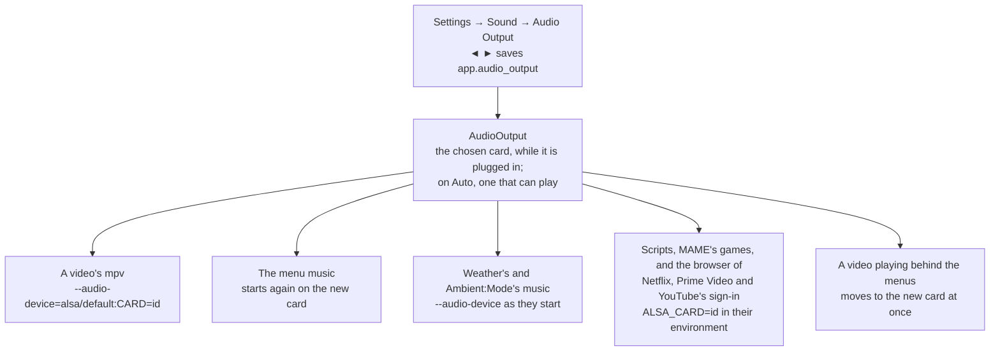

# Audio Output

Settings → Sound → **Audio Output** picks the sound card OSD/OS plays through: a Raspberry Pi's AV jack, one of its HDMI ports, or a USB sound card.

## Where it is, and when

The row is on Settings' Sound page. It works on Linux where the players talk to ALSA directly:

- `/proc/asound/cards` exists, and
- no sound server runs: no PipeWire or PulseAudio socket in `$XDG_RUNTIME_DIR` (`pipewire-0`, `pulse/native`), and no `PULSE_SERVER` set.

That is the OSD/OS image, and Raspberry Pi OS Lite with OSD/OS installed. Anywhere else the row is dimmed: choose the output in the system's sound settings.

## The cards and their names

OSD/OS lists the cards in `/proc/asound/cards` that have a playback device:

```text
 0 [Headphones     ]: bcm2835_headpho - bcm2835 Headphones
                      bcm2835 Headphones
```

The word in brackets is the card's **id**. After the dash comes its **short name**.

| The card | ALSA has it as | In Settings |
|---|---|---|
| A Pi's AV jack | id `Headphones`, short name `bcm2835 Headphones` | **AV Jack** |
| A Pi's HDMI under full KMS (Pi 5) | ids `vc4hdmi0`, `vc4hdmi1` | **HDMI 0**, **HDMI 1** |
| A Pi's HDMI under fake KMS (Pi 3, Pi 4 on the image) | short names `bcm2835 HDMI 1`, `bcm2835 HDMI 2` | **HDMI 0**, **HDMI 1** |
| Only one HDMI card | | **HDMI** |
| Any other card, such as a USB sound card | its short name | that name: **USB Audio Device** |
| Two cards of one name | | the name with its id: **USB Audio Device (Device_1)** |

HDMI cards are numbered as the board's ports are printed, `HDMI0` and `HDMI1`. A Bluetooth speaker isn't an ALSA card, so it isn't listed.

◄ ► on the row go through **Auto** ([Auto](#auto)), each card there now, and a chosen card that isn't plugged in, marked **(Unplugged)**. The list is read as Settings opens.

With no USB sound card in the list, the help line says what the system sees of one. The log has the same, after `[AudioOutput]`.

- *No USB sound card is plugged in, as far as the system can tell*: check the plug, or try another USB port.
- *USB Audio is plugged in, but shows no sound interface: some adapters show one only when something is in their jack as they are plugged in*: plug a cable into the adapter's jack, then plug the adapter in again. Leave the cable in. Realtek's USB Audio (`0bda:4ef0`) is one such adapter.
- *USB Audio Device is plugged in, but the USB sound driver (snd-usb-audio) didn't take it*: `dmesg | grep -i usb` says why.
- *USB Audio Device is plugged in and the USB sound driver took it, but ALSA made no card of it to play through*: `dmesg` says why.
- *USB Audio Device is plugged in, but it has no output to play through*: the card has an input only (a microphone).
- *The Pi's power has dropped too low since it started, which can keep USB devices from working* (or *The Pi's power is too low, …*): use a stronger power supply (`vcgencmd get_throttled` shows it too). A Pi 5 powered through its GPIO pins, as a JAMMA board does, also limits its USB ports' current.

## What each Pi has

| Pi | AV Jack | HDMI | USB sound card |
|---|---|---|---|
| Pi 3 | ✓ (picture and sound on one jack) | one port: **HDMI** | ✓ |
| Pi 4 | ✓ (picture and sound on one jack) | two ports: **HDMI 0**, **HDMI 1** | ✓ |
| Pi 5 | none | two ports: **HDMI 0**, **HDMI 1** | ✓ |

A Pi 4 on composite or SCART RGB has its HDMI off, sound included ([Display Output](https://github.com/mehmetraif/OSD-OS/wiki/Display-Output)). A Pi 5 has no analog sound.

## What happens when you choose

The choice is saved and used at once. ALSA's own default (`/etc/asound.conf`) is left as it is.



### Auto

On **Auto**, sound goes to ALSA's `default` device: its first card (card 0), unless you set it otherwise.

Where that card can't play now, the players get the first card that can, and the row names it: **Auto (USB Audio Device)**.

A Pi 5's HDMI plays only while its port shows the picture. With the picture on a JAMMA board or composite, the sound goes to a USB sound card. With no card that can play, MAME and RetroArch play the games without sound.

Two places set the card outside OSD/OS. Both apply only on Auto: a card chosen in Settings wins.

- **For every program**, `/etc/asound.conf`, with the card's id:

  ```text
  defaults.pcm.card "Headphones"
  defaults.ctl.card "Headphones"
  ```

  While it is there (or a `~/.asoundrc`, or `ALSA_CARD` in OSD/OS's own environment), Auto keeps that card, whether it can play or not.

- **For mpv only**, `~/.config/mpv/mpv.conf` of the user OSD/OS runs as (on the image, `/home/pi/.config/mpv/mpv.conf`):

  ```ini
  audio-device=alsa/default:CARD=Headphones
  ```

  `mpv --audio-device=help` lists the devices. The line doesn't apply to a video played with Transparent Background, nor to the menu music ([Playback and mpv](https://github.com/mehmetraif/OSD-OS/wiki/Playback-and-mpv)).

### A card that is unplugged

A chosen card that isn't plugged in stays chosen. The row shows it as **<name> (Unplugged)**, and sound goes as on Auto. Once it is plugged back in, the next thing that plays uses it again.

The log says which card is in use: a chosen one, ALSA's default (Auto, or the chosen card unplugged), or Auto's other card.

```text
[AudioOutput] Sound through Headphones
[AudioOutput] Sound through ALSA's default card, Device being unplugged
[AudioOutput] Sound through Device, as ALSA's default card can't play now
```

## Where it is saved

In `config.json` ([Configuration files](https://github.com/mehmetraif/OSD-OS/wiki/Configuration-Files)): `""` for Auto, else the card's id and name.

| Setting | Values | Default | What it does | Config key |
|---|---|---|---|---|
| Audio Output | Auto, each card there is, and a chosen card that is gone, marked (Unplugged) | Auto | The sound card every player plays through | `app.audio_output` |

```json
{
  "app": {
    "audio_output": { "card": "Headphones", "name": "AV Jack" }
  }
}
```

A Pi 5's first HDMI port is `{ "card": "vc4hdmi0", "name": "HDMI 0" }`. Edit it by hand only with OSD/OS stopped.

## Volume

OSD/OS has no system volume setting. There are three volumes:

| What | Changed with | Saved |
|---|---|---|
| **The menu music** | Settings → Sound → **Music Volume**: QUIET to LOUD in steps of 10, while Menu Music isn't Off | `app.menu_music_volume`, 0 to 100, 60 when unset |
| **A video** | A keyboard's or remote's volume keys while it plays (up, down, mute): steps of 5 ([Controls](https://github.com/mehmetraif/OSD-OS/wiki/Controls)) | No. Each video starts at mpv's volume (100), or at `volume=` in mpv.conf |
| **The sound card** | Kept at full level by OSD/OS: a level below 0 dB goes to 0 dB (100% on a card without dB), a muted one is unmuted. Never lowered. The log says when: `<card> at full level: 'PCM',0` | No |

The TV's volume, or an amplifier's (a JAMMA board's knob), sets how loud it is. The volume keys don't change the menu music, nor Weather's or Ambient:Mode's music ([Menu music](https://github.com/mehmetraif/OSD-OS/wiki/Menu-Music)).

## Getting the sound to a CRT

| Pi and picture | Sound from | To the TV |
|---|---|---|
| Pi 3 or 4, composite | The AV jack (**AV Jack**) | The picture's 4-pole cable: tip left, ring 1 right, ring 2 ground. To SCART: pins 6 (left), 2 (right), 4 (ground) |
| Pi 4, SCART RGB | The AV jack | SCART pins 6, 2 and 4 |
| Pi 5, composite or SCART RGB | A USB sound card | Its line out to SCART pins 6, 2 and 4, or to the TV's audio inputs |
| Any Pi, HDMI | The HDMI port the TV is on | The HDMI cable |

[Display Output → The cables](https://github.com/mehmetraif/OSD-OS/wiki/Display-Output#the-cables) has the whole SCART plug.

## When there is no sound

1. **Choose the card** you are plugged into, rather than Auto: by the port's label on the board for HDMI.
2. **See what ALSA has**, from a shell (Exit to Terminal, or SSH):

   ```sh
   aplay -l                  # the cards that play, and their devices
   cat /proc/asound/cards    # the same, with each card's id in brackets
   ```

3. **Try the card on its own**, from Exit to Terminal, with its id:

   ```sh
   speaker-test -D default:CARD=Headphones -c 2 -t wav -l 1
   ```

   It says "Front Left" and "Front Right". Silence means the card, the cable or the TV, not OSD/OS.
4. **Quiet on the AV jack?** OSD/OS keeps it at 0 dB. It goes 4 dB higher, where loud sound can clip:

   ```sh
   amixer -c Headphones sset PCM 100%
   sudo alsactl store
   ```

5. **Read the log** ([the lines](#a-card-that-is-unplugged)). mpv's own log is `/tmp/runtime-pi/osdos-mpv.log` on the image ([elsewhere](https://github.com/mehmetraif/OSD-OS/wiki/Configuration-Files#logs-and-temporary-files)).

   ```sh
   journalctl -b -u osdos | grep AudioOutput
   journalctl -b -u osdos | grep -F "[Scripts] Running"    # the card each game was given
   ```

   `sound card Device` names the card. `no sound card that can play` means MAME and RetroArch play without sound.
6. **Check the other end**: the TV's input and volume; the right HDMI port of two; on SCART, pins 6 and 2 with ground on 4.

| What you see | What to do |
|---|---|
| A Pi 4 on composite, sound only on HDMI or nowhere | Choose **AV Jack** |
| A Pi 5 on a CRT, no sound | Plug in a USB sound card |
| A USB sound card isn't among the cards | Read the row's help line ([The cards and their names](#the-cards-and-their-names)). `lsusb -t` and `dmesg` say more |
| The card shows **(Unplugged)** | Plug it in, or check that ALSA sees it (`aplay -l`) |
| Sound in the menus but not in a video, or the other way round | On Auto, an `audio-device=` in mpv.conf applies to videos only. Check it |

## See also

- [Display Output](https://github.com/mehmetraif/OSD-OS/wiki/Display-Output): the picture, and the SCART plug
- [Menu music](https://github.com/mehmetraif/OSD-OS/wiki/Menu-Music): what plays under the menus, and its volume
- [Playback and mpv](https://github.com/mehmetraif/OSD-OS/wiki/Playback-and-mpv): mpv's options and mpv.conf
- [Settings](https://github.com/mehmetraif/OSD-OS/wiki/Settings): every row
- [Configuration files](https://github.com/mehmetraif/OSD-OS/wiki/Configuration-Files): config.json
- [The OSD/OS image](https://github.com/mehmetraif/OSD-OS/wiki/The-OSD-OS-Image)
- [Troubleshooting](https://github.com/mehmetraif/OSD-OS/wiki/Troubleshooting)
