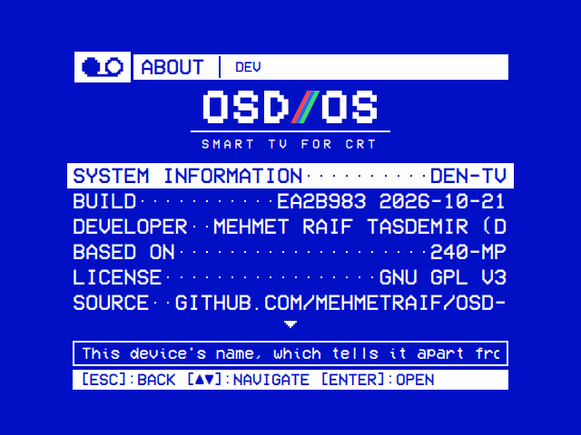

# Building from source

How to build OSD/OS on each system, run the build and its tests, and how releases are made. [BUILDING.md](https://github.com/mehmetraif/OSD-OS/blob/main/BUILDING.md) has each step in full.

## What it takes

OSD/OS is one C++17 program (Qt 6 and QML) built with CMake 3.21 or newer. CMake looks for:

| Dependency | What for | If it is missing |
|---|---|---|
| Qt 6: Core, Concurrent, Gui, Quick, Qml, Network, Svg | Everything | The configure fails |
| OpenSSL | Plex's sign-in (`OpenSSL::Crypto`) | The configure fails |
| SDL2 | Gamepads (`InputManager`) | The configure fails |
| libdrm, through pkg-config (Linux) | Handing the screen to mpv on a Pi (`DisplayHandoff`) | The configure fails |
| Qt Shader Tools | The effects' shaders ([below](#qt-shader-tools)) | `Qt Shader Tools not found — the shader effects will be unavailable` |
| libmpv's headers, through pkg-config | Transparent Background | `libmpv headers not found — Transparent Background will be unavailable` |
| PC/SC: `libpcsclite` (Linux), `pcsc-lite` (BSDs), built into macOS, unused on Windows | PC/SC NFC readers (ACR122U) | `PC/SC not found — NFC reader module will build with PN532 USB serial support only` |
| Qt D-Bus (Linux) | Settings → Network → Bluetooth and Wi-Fi | `Qt D-Bus not found — Settings → Network → Bluetooth and Wi-Fi will be unavailable` |
| zlib and minizip | The High Scores module's tables | `minizip not found — High Scores will show no tables` |
| git | The commit in Settings → System → About → Build | The build line has the day alone |

Run-time programs, none needed to build:

- **mpv** 0.38 or newer, for every video.
- yt-dlp and Deno (YouTube).
- FluidSynth with a SoundFont, and openmpt123 (MIDI and tracker menu music).
- Chromium with Widevine (Netflix and Prime Video).
- MAME and RetroArch (Arcade).

Get the source first:

```sh
git clone https://github.com/mehmetraif/OSD-OS.git
cd OSD-OS
```

## macOS (Apple Silicon)

### Qt

Any of three:

- **Qt's online installer** ([qt.io/download](https://qt.io/download)), installed to `~/Qt`. Under Additional Libraries, add **Qt Shader Tools**.
- **aqtinstall**. The release workflow uses Qt 6.7 with `qtshadertools` and `qtquick3d` (the Orb look, at run time only):

  ```sh
  python3 -m pip install aqtinstall
  aqt install-qt mac desktop 6.7.3 clang_64 -m qtshadertools qtquick3d -O ~/Qt
  ```

- **Homebrew**: `brew install qt@6`, which includes Qt Shader Tools.

### The other packages

```sh
brew install cmake sdl2 mpv pkgconf      # build tools, gamepads, playback, libmpv's headers
brew install fluid-synth libopenmpt      # optional: menu music in MIDI and trackers' formats
brew install yt-dlp deno                 # optional: the YouTube module
brew install mame                        # optional: the Arcade module
brew install minizip                     # optional: the High Scores module's tables
```

- Homebrew's `sdl2` is `sdl2-compat` (SDL2's API on SDL3). The release workflow builds SDL2 2.32.10 from source instead.
- A MIDI file needs a General MIDI SoundFont: put a `.sf2` in `~/Library/Application Support/OSD-OS/soundfonts/`.

### Build and run

```sh
# First time, and after any change to CMakeLists.txt:
cmake -B build -DCMAKE_PREFIX_PATH=~/Qt/6.7.3/macos . && cmake --build build

# After a code change:
cmake --build build

# Run, with the log in the terminal:
APP_ROOT=$(pwd) ./build/osdos.app/Contents/MacOS/osdos
```

`CMAKE_PREFIX_PATH` names the Qt: the version's `macos` folder for the installer's or aqtinstall's, `$(brew --prefix)` for Homebrew's. Double-clicking `build/osdos.app` works too.

## Raspberry Pi OS (arm64)

On Raspberry Pi OS Trixie (Debian 13):

```sh
sudo apt-get update
sudo apt-get install -y \
  build-essential cmake pkgconf \
  qt6-base-dev qt6-declarative-dev \
  qml6-module-qtquick qml6-module-qtquick-controls \
  qml6-module-qtquick-window \
  libqt6svg6 qt6-svg-dev qt6-svg-plugins qt6-wayland \
  qt6-shadertools-dev \
  libdrm-dev libxkbcommon-dev libssl-dev \
  libsdl2-dev \
  mpv
```

This is [BUILDING.md](https://github.com/mehmetraif/OSD-OS/blob/main/BUILDING.md#raspberry-pi-os-arm64)'s list less its optional packages:

| Package | Adds |
|---|---|
| `libmpv-dev` | Transparent Background. It opens `libmpv2` at run time |
| `qt6-shadertools-dev` (in the list above) | The effects' shaders. `qt6-shader-baker` brings `qsb`, for a theme's own shader |
| `libpcsclite-dev` | PC/SC NFC readers. Run `bash scripts/setup-nfc-reader.sh` once either way, for access to the reader |
| `fluidsynth timgm6mb-soundfont openmpt123` | Menu music in MIDI and trackers' formats (run time only) |
| `mame` | The Arcade module's games (run time only) |
| `retroarch` | The Arcade module's second engine, FinalBurn Neo (run time only). Download its core in Settings → Arcade → FinalBurn Neo, or build it with `scripts/build-fbneo.sh` and the LAN core with `scripts/build-fbneo-lan.sh` |
| `libminizip-dev` | The High Scores module's tables. Linked in statically |
| `bluez`, and the user in the `bluetooth` group | Settings → Network → Bluetooth (run time). `sudo usermod -aG bluetooth $USER` |
| NetworkManager | Settings → Network → Wi-Fi (run time). Under the service, the user needs `install.sh`'s polkit rule |

For YouTube, install Deno and a current yt-dlp (apt's is too old) on the `PATH` of OSD/OS's user ([yt-dlp's EJS notes](https://github.com/yt-dlp/yt-dlp/wiki/EJS)):

```sh
sudo wget https://github.com/yt-dlp/yt-dlp/releases/latest/download/yt-dlp -O /usr/local/bin/yt-dlp
sudo chmod a+rx /usr/local/bin/yt-dlp
```

Build, then run:

```sh
cmake -B build              # first time, and after CMakeLists.txt changes
cmake --build build         # every time

APP_ROOT=$(pwd) ./build/osdos                        # with a desktop
APP_ROOT=$(pwd) QT_QPA_PLATFORM=eglfs ./build/osdos  # Raspberry Pi OS Lite, no desktop
```

Apt's Qt is found without `CMAKE_PREFIX_PATH`. Without a desktop:

- **Stop the service first** if OSD/OS is installed with autostart: `sudo systemctl stop osdos`.
- **On a Pi 5**, run your build through `scripts/rpi-run-local.sh` (`OSDOS_BIN=/path/to/osdos` for another binary), which sets up the display as the installed launcher does. Run it from the Pi's own console, not over SSH.

## Debian or Ubuntu on a PC (x86_64)

```sh
sudo apt-get install -y build-essential cmake pkgconf \
  libdrm-dev libssl-dev libsdl2-dev libpcsclite-dev \
  libgl1-mesa-dev libxkbcommon-dev mpv
```

Optional: `libpcsclite-dev` (PC/SC readers), `libmpv-dev` (Transparent Background), `libminizip-dev` (High Scores' tables).

Qt comes from the distribution (`qt6-base-dev qt6-declarative-dev qt6-svg-dev qt6-shadertools-dev` and the `qml6-module-qtquick*` modules), or from Qt's installer or aqtinstall with Qt Shader Tools:

```sh
aqt install-qt linux desktop 6.7.3 linux_gcc_64 -m qtshadertools -O ~/Qt
cmake -B build -DCMAKE_PREFIX_PATH=~/Qt/6.7.3/gcc_64 && cmake --build build
APP_ROOT=$(pwd) ./build/osdos
```

On Ubuntu 24.04:

- **Its Qt is 6.4**, the oldest the project builds with.
- **Its mpv is 0.37**, too old: OSD/OS passes `--subs-with-matching-audio=forced`, which came in 0.38. Build a newer one with `scripts/build-mpv.sh` ([below](#the-appimage-and-mpv-038)). OSD/OS takes an `mpv` beside its own binary before the one on the `PATH`:

  ```sh
  cp "$(scripts/build-mpv.sh)" build/mpv
  ```

## Windows (x64)

A build for Windows 11 on x64, published as `OSD-OS-<version>-windows-x64.zip` ([Installation](https://github.com/mehmetraif/OSD-OS/wiki/Installation#on-windows-x64)). The **Windows build** workflow makes it ([below](#continuous-integration)). What it leaves out is in [BUILDING.md → Windows (x64)](https://github.com/mehmetraif/OSD-OS/blob/main/BUILDING.md#windows-x64).

- **Visual Studio 2022 Build Tools** with the *Desktop development with C++* workload (MSVC, the Windows SDK, CMake and Ninja).
- **Qt 6.8** for MSVC 2022 64-bit, with Qt Shader Tools: from Qt's installer, or `aqt install-qt windows desktop 6.8.3 win64_msvc2022_64 -m qtshadertools -O C:\Qt`.
- **vcpkg** for SDL2, OpenSSL and minizip with zlib:

  ```bat
  git clone https://github.com/microsoft/vcpkg C:\vcpkg
  C:\vcpkg\bootstrap-vcpkg.bat
  C:\vcpkg\vcpkg install sdl2 openssl minizip --triplet x64-windows
  ```

- **mpv**: a Windows build from [mpv.io](https://mpv.io/installation/), as `mpv.exe` beside `osdos.exe`, its folder beside the app as `mpv\`, or on the `PATH`.
- Optional, on the `PATH`: MAME's and RetroArch's Windows builds (Arcade), `yt-dlp.exe` and `deno.exe` (YouTube).

Build, in an *x64 Native Tools Command Prompt for VS 2022* (`6.8.3` standing for the Qt version installed):

```bat
cmake -B build -G Ninja -DCMAKE_BUILD_TYPE=Release ^
  -DCMAKE_TOOLCHAIN_FILE=C:\vcpkg\scripts\buildsystems\vcpkg.cmake -DVCPKG_TARGET_TRIPLET=x64-windows ^
  -DCMAKE_PREFIX_PATH=C:\Qt\6.8.3\msvc2022_64 -DCMAKE_INSTALL_PREFIX=%CD%\install
cmake --build build --parallel
cmake --install build
C:\Qt\6.8.3\msvc2022_64\bin\windeployqt.exe --release --qmldir . install\osdos\osdos.exe
copy build\*.dll install\osdos\
copy C:\vcpkg\installed\x64-windows\bin\libssl*.dll install\osdos\
install\osdos\osdos.exe
```

- The install is one folder, `install\osdos\`, with `osdos.exe`, the libraries and the app's own files. It can be moved anywhere whole; the `osdos-windows-x64` artifact is that folder zipped.
- The data folder is `%APPDATA%\OSD-OS\`.
- The log goes to `osdos.log` in the data folder (the run before's is `osdos-previous.log`), and to the console the app was started from.
- Settings → Screen → **Window Mode** (F11, or Alt+Enter) puts the menus in a window, 960×720 to start with.

## FreeBSD and OpenBSD (amd64)

A desktop app for the BSDs. Each release carries `OSD-OS-<tag>-freebsd-amd64.pkg` and `OSD-OS-<tag>-openbsd-amd64.tgz` ([Installation](https://github.com/mehmetraif/OSD-OS/wiki/Installation#on-freebsd-or-openbsd-amd64)), made by the **FreeBSD build** and **OpenBSD build** workflows ([below](#continuous-integration)).

- **FreeBSD**, as root: `pkg install cmake-core ninja pkgconf qt6-base qt6-declarative qt6-svg qt6-shadertools sdl2 minizip mpv` (OpenSSL is the base system's).
- **OpenBSD**, as root: `pkg_add cmake ninja qt6-qtbase qt6-qtdeclarative qt6-qtsvg qt6-qtshadertools sdl2 minizip mpv` (pkg-config and LibreSSL are the base system's).
- Optional: `pcsc-lite` (PC/SC NFC readers), `mame` and `retroarch` (Arcade), `yt-dlp` (YouTube).
- For FinalBurn Neo's cores and the package: `gmake`, `bash` and, on FreeBSD, `perl5`.
- For the regression tests: `bash`, Lua 5.4 (`lua54`, `lua%5.4`) and, on FreeBSD, the `dejavu` fonts.

Build and run:

```sh
cmake -B build -G Ninja -DCMAKE_BUILD_TYPE=Release -DCMAKE_PREFIX_PATH=/usr/local -DCMAKE_INSTALL_PREFIX="$PWD/install"
cmake --build build --parallel
cmake --install build
install/bin/osdos
```

The install is laid out as on Linux (`bin/`, `share/osdos/`), and the data folder is `~/.local/share/OSD-OS/`. The tests build and run as on Linux, with `-DCMAKE_PREFIX_PATH=/usr/local` ([below](#the-regression-tests)).

The package is made from an install staged under `/usr/local`:

- [build-fbneo.sh](https://github.com/mehmetraif/OSD-OS/blob/main/scripts/build-fbneo.sh) builds FinalBurn Neo's core from the commit `scripts/engines.env` names.
- [build-fbneo-lan.sh](https://github.com/mehmetraif/OSD-OS/blob/main/scripts/build-fbneo-lan.sh) builds the [LAN core](https://github.com/mehmetraif/OSD-OS/wiki/Online-and-LAN-Play#osdoss-lan-core) from another copy of the source, with OSD/OS's [patch](https://github.com/mehmetraif/OSD-OS/blob/main/scripts/fbneo-lan.patch).
- [bsd-package.sh](https://github.com/mehmetraif/OSD-OS/blob/main/scripts/bsd-package.sh) makes the package.

```sh
cmake -B build -G Ninja -DCMAKE_BUILD_TYPE=Release -DCMAKE_PREFIX_PATH=/usr/local -DCMAKE_INSTALL_PREFIX=/usr/local -DAPP_VERSION=v0.0.24
cmake --build build --parallel
DESTDIR="$PWD/stage" cmake --install build
bash scripts/build-fbneo-lan.sh <another FBNeo source> stage/usr/local/lib/osdos stage/usr/local/share/osdos/fbneo/license.txt
bash scripts/build-fbneo.sh <FBNeo source> stage/usr/local/lib/osdos stage/usr/local/share/osdos/fbneo/fbneo-arcade.dat stage/usr/local/share/osdos/fbneo/license.txt
bash scripts/bsd-package.sh stage v0.0.24 .   # OSD-OS-v0.0.24-freebsd-amd64.pkg, or OSD-OS-0.0.24-openbsd-amd64.tgz
```

OpenBSD's package is named by the tag's number alone. More in [BUILDING.md → FreeBSD and OpenBSD](https://github.com/mehmetraif/OSD-OS/blob/main/BUILDING.md#freebsd-and-openbsd-amd64).

## Qt Shader Tools

Qt Shader Tools compiles the shaders in [`shaders/`](https://github.com/mehmetraif/OSD-OS/tree/main/shaders) into the binary at build time (`qt_add_shaders`). Nothing of it is needed at run time.

| Shader | What it draws |
|---|---|
| `effects.frag` | The screen effects (Scanlines, CRT, VHS) and the text effects (Rainbow, Shimmer, Glow, Flicker) |
| `bg-matrix.frag`, `bg-fire.frag`, `bg-stars.frag`, `bg-snow.frag`, `bg-flag.frag`, `bg-plasma.frag` | The background effects |
| `ripple.frag`, `wave.frag`, `drop.frag` | The Ripple, Wave and Drop transitions |

Without it, or under Qt's software renderer, Settings leaves out Text Effect, Background Effect, Screen Effect and the Ripple, Wave and Drop transitions. A theme's own compiled shader (a `.qsb`) still runs. More in [Effects](https://github.com/mehmetraif/OSD-OS/wiki/Effects) and [Shaders](https://github.com/mehmetraif/OSD-OS/wiki/Shaders).

## Running your build

```sh
APP_ROOT=$(pwd) ./build/osdos
```

- **`APP_ROOT`** is the folder with `Main.qml`, `views/`, `modules/`, `assets/` and `scripts/`: the repository.
- **`DATA_ROOT`** gives the build a data folder of its own. The folder must exist:

  ```sh
  mkdir -p ~/osdos-test-data
  DATA_ROOT=~/osdos-test-data APP_ROOT=$(pwd) ./build/osdos
  ```

  Without it, the build uses the usual data folder ([Configuration files](https://github.com/mehmetraif/OSD-OS/wiki/Configuration-Files)).
- **The log** prints in the terminal. Only a Release build (`-DCMAKE_BUILD_TYPE=Release`) strips the debug lines ([Troubleshooting](https://github.com/mehmetraif/OSD-OS/wiki/Troubleshooting#what-a-build-from-source-adds)).
- **The version** of a local build is `dev` (CMake's `APP_VERSION`; CI passes the tag). Its Update screen says `Dev build — self-update is disabled.`
- **Another screen.** `display_index` under `"app"` in `config.json` opens OSD/OS on another display ([BUILDING.md → Choosing the display](https://github.com/mehmetraif/OSD-OS/blob/main/BUILDING.md#choosing-the-display-display_index)).
- **Ctrl+Q** on a keyboard quits.



Settings → System → About shows `DEV` in the title bar, and **Build** with the commit and the day of the last CMake configure (`APP_BUILD`).

## The AppImage and mpv 0.38

`scripts/build-appimage.sh` makes the AppImage for x86_64 PCs and the Steam Deck, with Qt, SDL2 and mpv inside:

```sh
CMAKE_PREFIX_PATH=/path/to/Qt/6.7.x/gcc_64 scripts/build-appimage.sh --configure
```

- `--configure` configures and builds a Release first; leave it out if `build/` is built already. The result is `OSD-OS-linux-x86_64.AppImage` in the repository's folder.
- The first run downloads `linuxdeploy`, `linuxdeploy-plugin-qt` and `appimagetool` into `.appimage-tools/`.
- Environment: `BUILD_DIR` (default `build`), `APPDIR` (default `AppDir`), `VERSION` (default `git describe`), `MPV_BIN` (the mpv to bundle, default the one on the `PATH`), `QMAKE`, `CMAKE_PREFIX_PATH`.
- The build fails if a library is neither bundled nor allowed from the host. `ALLOW_HOST_LIBS_EXTRA="soname …"` lets one through.
- A Qt with Qt Quick 3D needs **Qt Quick Timeline** too, or that check fails. The release workflow's Qt has `qtshadertools qtquick3d qtquicktimeline`.
- **The bundled mpv must be 0.38 or newer.** Ubuntu 24.04's is 0.37, so build one first:

  ```sh
  MPV_BIN=$(scripts/build-mpv.sh) scripts/build-appimage.sh --configure
  ```

  `scripts/build-mpv.sh` compiles mpv 0.40 against the system's FFmpeg and prints the binary's path. The release workflow's Linux x86_64 job lists its build packages. `MPV_TAG` picks another tag, `MPV_SRC` another build folder (default `.mpv-build`).
- The build machine sets the glibc floor: 2.39 for CI's Ubuntu 24.04.

More in [BUILDING.md → Linux x86_64 (AppImage)](https://github.com/mehmetraif/OSD-OS/blob/main/BUILDING.md#linux-x86_64-appimage).

## The regression tests

The tests in [`tests/`](https://github.com/mehmetraif/OSD-OS/tree/main/tests) are built apart from the app. They need:

- CMake, a C++17 compiler and Lua;
- the development packages of Qt 6 (Core, Concurrent, Gui, Network, Qml, Quick, Test), OpenSSL, SDL2 and, on Linux, libdrm;
- zlib and minizip (`libminizip-dev`) for the High Scores suite, which is left out without them;
- no mpv, FluidSynth or screen.

```sh
cmake -S tests -B build-tests
cmake --build build-tests --parallel
ctest --test-dir build-tests --output-on-failure
```

- `ctest --test-dir build-tests -R looks` runs one by name.
- The `app_` tests start your build of the app from `build/` (`-DOSDOS_APP=<path>` for one elsewhere) and are skipped without one.
- [tests/README.md](https://github.com/mehmetraif/OSD-OS/blob/main/tests/README.md) has every test, and the checks that want a Raspberry Pi.
- A test of your own goes in `tests/CMakeLists.txt`; [Writing a module](https://github.com/mehmetraif/OSD-OS/wiki/Writing-a-Module#a-test-in-tests) shows one.

## Continuous integration

Ten workflows in [`.github/workflows`](https://github.com/mehmetraif/OSD-OS/tree/main/.github/workflows). "Changes" below means pull requests and pushes to `main`.

| Workflow | Runs on | What it does |
|---|---|---|
| [`regression-tests.yml`](https://github.com/mehmetraif/OSD-OS/blob/main/.github/workflows/regression-tests.yml) | Changes to the app, its scripts or its tests; every release | Builds the app (Release) and runs the tests on Ubuntu 24.04 (x64 and arm64, apt's Qt 6.4) and in a `debian:trixie` container with Raspberry Pi's archive (arm64, Qt 6.8, mpv 0.40) |
| [`os-image.yml`](https://github.com/mehmetraif/OSD-OS/blob/main/.github/workflows/os-image.yml) | By hand; pull requests that touch `os/`, the boot screen or `scripts/install.sh` | Builds a `dev` arm64 tarball, then the OSD/OS image from it. The image is the run's `osdos-image` artifact, kept 30 days |
| [`windows.yml`](https://github.com/mehmetraif/OSD-OS/blob/main/.github/workflows/windows.yml) | Changes to the sources; every release; by hand | Builds the app on `windows-2022` with MSVC, Qt 6.8 and vcpkg, and uploads the folder as `osdos-windows-x64` ([above](#windows-x64)) |
| [`freebsd.yml`](https://github.com/mehmetraif/OSD-OS/blob/main/.github/workflows/freebsd.yml) and [`openbsd.yml`](https://github.com/mehmetraif/OSD-OS/blob/main/.github/workflows/openbsd.yml) | Changes to the sources, the tests or the packaging scripts; every release; by hand | Build the app in a FreeBSD 15.1 or OpenBSD 8.0 virtual machine ([vmactions](https://github.com/vmactions)), run the tests, make and install the package, and upload it as `osdos-freebsd-amd64` or `osdos-openbsd-amd64` ([above](#freebsd-and-openbsd-amd64)) |
| [`fbneo.yml`](https://github.com/mehmetraif/OSD-OS/blob/main/.github/workflows/fbneo.yml) | Changes to FinalBurn Neo's build scripts or `scripts/engines.env`; by hand | Builds the two FinalBurn Neo cores for Linux x86_64 and arm64, macOS arm64 and Windows x64, each uploaded as `fbneo-<system>` |
| [`retroarch.yml`](https://github.com/mehmetraif/OSD-OS/blob/main/.github/workflows/retroarch.yml) | Changes to RetroArch's build script, its test or `scripts/engines.env`; by hand | Builds the Linux arm64 package's own RetroArch with TLS, tries it against a stand-in for RetroAchievements' site, and uploads it as `retroarch-linux-arm64` |
| [`engines.yml`](https://github.com/mehmetraif/OSD-OS/blob/main/.github/workflows/engines.yml) | Every Monday; by hand | Opens a pull request that raises `scripts/engines.env` when RetroArch, MAME or FinalBurn Neo has a newer version |
| [`pages.yml`](https://github.com/mehmetraif/OSD-OS/blob/main/.github/workflows/pages.yml) | Changes to the website's sources; after each release | Builds and tests the website (`site/`, `scripts/build-site.py`) and publishes it on GitHub Pages from `main` |
| [`release.yml`](https://github.com/mehmetraif/OSD-OS/blob/main/.github/workflows/release.yml) | A tag matching `v*.*.*` | Builds, tests and publishes a release ([below](#making-a-release)) |
| [`wiki.yml`](https://github.com/mehmetraif/OSD-OS/blob/main/.github/workflows/wiki.yml) | A push to `main` that touches `docs/wiki/`; by hand | Publishes `docs/wiki` to the [wiki](https://github.com/mehmetraif/OSD-OS/wiki), page for page |

A `dev` image's app never updates itself. With the repository secret `OS_FIRST_USER_PASS`, the image's `pi` user gets it as its password; without it the account is locked.

## Making a release

Releases are the owner's to make. A release starts from a version tag, created on GitHub's Releases page or pushed with git:

```sh
git tag v2026.06.04
git push origin v2026.06.04
```

Any tag matching `v*.*.*` starts `release.yml`. A tag containing `-rc`, `-beta` or `-alpha` (`v1.0.0-rc1`) is published as a pre-release, which `install.sh` and the in-app updater ignore. Seven builds run, and beside them the regression tests on the tagged commit:

| Job | Runner | Makes |
|---|---|---|
| `build-macos-arm64` | `macos-15` | `OSD-OS-<tag>-macOS-arm64.dmg`, without mpv. Signed and notarized with the secrets `APPLE_CERT_P12_BASE64`, `APPLE_CERT_PASSWORD`, `APPLE_ID`, `APPLE_APP_PASSWORD` and `APPLE_TEAM_ID`; signed ad hoc without them |
| `build-linux-arm64` | `ubuntu-24.04-arm` | `OSD-OS-<tag>-linux-arm64.tar.gz`, for Raspberry Pi OS. `install.sh` installs it and its packages |
| `build-linux-x86_64` | `ubuntu-24.04` | `OSD-OS-linux-x86_64.AppImage`, with mpv 0.40. No version in its name: it updates itself in place |
| `build-windows-x64` | `windows-2022`, calling `windows.yml` | The `osdos\` folder, zipped by the `release` job as `OSD-OS-<tag>-windows-x64.zip` |
| `build-freebsd-amd64` | A FreeBSD 15.1 virtual machine, calling `freebsd.yml` | `OSD-OS-<tag>-freebsd-amd64.pkg` |
| `build-openbsd-amd64` | An OpenBSD 8.0 virtual machine, calling `openbsd.yml` | `OSD-OS-<number>-openbsd-amd64.tgz` (the tag without its `v`) |
| `build-os-image` | `ubuntu-24.04-arm`, after the arm64 build | `OSD-OS-<tag>-raspberry-pi.img.xz`, from the release's own tarball |

- The first job, `hold-release`, keeps a release made on the Releases page a draft until every file is attached.
- The last job, `release`, waits for the builds and the tests. A tag whose tests fail gets no release.
- It writes the release notes and publishes the seven files and `install.sh`, each with a SHA-256 digest the in-app updater checks.
- While the workflow runs, each job's file is under its run's **Artifacts**.

## Building the OSD/OS image

The image is Raspberry Pi OS Lite (64-bit, Trixie) built by pi-gen, plus [`os/stage-osdos`](https://github.com/mehmetraif/OSD-OS/tree/main/os/stage-osdos), with the app from an arm64 release tarball. The simplest way is the **OS image** workflow (above). Locally, with Docker on an arm64 Linux machine (x86 works through QEMU, in hours):

```sh
FIRST_USER_PASS='…' os/build.sh path/to/OSD-OS-<version>-linux-arm64.tar.gz
```

The image lands in `os/work/pi-gen/deploy/`. The tarball can be a release's or one of your own. `os/build.sh` takes its settings from environment variables (`OSDOS_DISPLAY`, `OSDOS_STREAMING`, `OSDOS_ARCADE`, `ENABLE_SSH`…).

The steps and every variable are on [The OSD/OS image](https://github.com/mehmetraif/OSD-OS/wiki/The-OSD-OS-Image#building-the-image-yourself) and in [os/README.md](https://github.com/mehmetraif/OSD-OS/blob/main/os/README.md#building).

## See also

- [BUILDING.md](https://github.com/mehmetraif/OSD-OS/blob/main/BUILDING.md): every platform in full, gamepad mapping, decode tuning, logs
- [Writing a module](https://github.com/mehmetraif/OSD-OS/wiki/Writing-a-Module) and [How it works](https://github.com/mehmetraif/OSD-OS/wiki/How-It-Works)
- [Troubleshooting](https://github.com/mehmetraif/OSD-OS/wiki/Troubleshooting): the log, and what goes wrong
- [CONTRIBUTING.md](https://github.com/mehmetraif/OSD-OS/blob/main/CONTRIBUTING.md): opening a pull request
