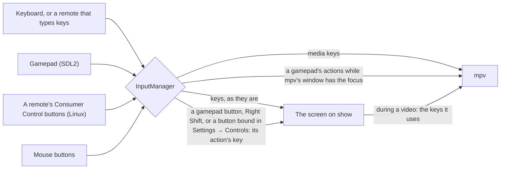

# Controls

Every way to drive OSD/OS: a keyboard, a remote, a gamepad, a mouse. This page lists what each key and button does, on the menus and during a video; how gamepads and remotes reach OSD/OS; how Settings → Controls sets each controller apart, with its own buttons and button labels, chooses the pads of players 1 to 6, and gives every keyboard and remote one more key for an action; remapping every gamepad in `input.cfg`; the hints at the foot of the screen; and pairing Bluetooth devices in Settings → Bluetooth.


## The actions

All of OSD/OS works with a handful of actions. Every screen reads them as key presses, so a keyboard, a remote and a gamepad all do the same thing.

| Action | Keyboard | Gamepad (by default) | Remote | What it does |
|---|---|---|---|---|
| **Up**, **Down** | ▲ ▼ | D-pad, left stick | Its arrows | Move through a list. During a video: open the deck's menu |
| **Left**, **Right** | ◄ ► | D-pad, left stick, LB / RB (the shoulder buttons) | Its arrows | Change a setting. In a tree: up a level, open a folder. During a video: jump back and forward |
| **► on an entry** | ► | D-pad right, RB | Its right arrow | A video's options, or its info screen |
| **Select** | Enter | A (the bottom face button) | OK | Open, play, choose. During a video: pause |
| **Back** | Esc, Backspace or Right Shift | B (the right face button), or Back (the small Back / Select / View / Share button) | Back, when it sends Esc, Backspace or the Back key | One step back. On the main menu: Settings. During a video: leave it, or open its menu |
| **Hold back** (2 seconds) | Esc (not Backspace) | B or Back | Back, when it sends Esc or the Back key | Closes Netflix's, Prime Video's or YouTube's sign-in browser and returns to OSD/OS |
| **Play/pause** | Space | Start | Its Play/Pause key only pauses: a media key goes straight to mpv | Pause a video. On the main menu: stop the video playing behind the menus. In Netflix's, Prime Video's or YouTube's tree: open the info screen |
| **Info** | I | | Its Info key | Open a title's info screen (Netflix, Prime Video, YouTube) |

Apart from typing, Ctrl+Q and the media keys, only these keys do anything in OSD/OS's own screens; a key a screen doesn't use does nothing there. If a remote's button sends none of them, give it an action in [Settings → Controls](https://github.com/mehmetraif/OSD-OS/wiki/Controls#settings--controls).

**Esc, Enter and Space act once a press**, and so do a remote's Back and OK keys: held down, they don't repeat. The arrows, the volume keys and Backspace (which deletes a letter on the on-screen keyboard) still do, and so does every key while a text field has the focus. Holding Back for 2 seconds still closes a sign-in browser. A key whose release reaches the system late, as can happen to a Bluetooth keyboard's first press after it wakes, looks held down, and its repeats took Back a step too far: from the main menu into Settings and straight out again.

## The keyboard

| Key | What it does |
|---|---|
| ▲ ▼ ◄ ► | The arrows |
| Enter | Select. The keypad's Enter selects in the trees, the dialogs and during a video, but not on every screen (not on the main menu or in Settings): use the main one |
| Esc | Back. Held for 2 seconds while Netflix, Prime Video or YouTube's sign-in has the screen, it closes the browser |
| Backspace | Back, except on the on-screen keyboard, where it deletes the last letter, and in a browser OSD/OS opened, where it is the browser's |
| Right Shift | Back, so a keyboard works one-handed. While a text field has the focus (typing a server's address, say) it is Shift again, to type `:` or `@` |
| Space | Play/pause |
| I | A title's info screen, in Netflix, Prime Video and YouTube |
| Letters, digits, punctuation | On the on-screen keyboard, they type straight in (the box jumps to OK, so Enter then finishes) |
| Ctrl+Q (⌘Q on a Mac) | Quits OSD/OS at once, from most screens, without asking. Started with the system (the OSD/OS image, or `install.sh`'s service), that switches the Pi off, as Settings → Quit → Power Off does |
| Ctrl+W | In Netflix, Prime Video or YouTube's sign-in, closes the browser |
| Media keys | Go to mpv: [During playback](https://github.com/mehmetraif/OSD-OS/wiki/Controls#during-playback) |

The keys go to whichever window has the keyboard. On the Raspberry Pi (and with [Transparent Background](https://github.com/mehmetraif/OSD-OS/wiki/Using-OSD-OS#transparent-background) everywhere), OSD/OS keeps it and passes the keys a video needs on to mpv. On a Mac or a Linux desktop, a video played by mpv as a program of its own has its own window, which has the keyboard while it plays: OSD/OS's keys work there as below, and so do mpv's own keys. Right Shift doesn't work in a video there, as mpv can't take a lone Shift as a key.

## During playback


| Key | The deck's menu closed | The deck's menu open |
|---|---|---|
| ▲ or ▼ | Opens the deck's menu, on its buttons | ▲ goes to the position bar, ▼ to the buttons |
| ◄ ► | Jump 5 seconds back or forward (mpv's own keys) | On the position bar: jump 10 seconds. On the buttons: move between them |
| Select | Pause / play | Press the button: SKIP, AUDIO, SUBTITLE, CROP, the playlist's < and >, STOP |
| Play/pause | Pause / play | Pause / play |
| Back | Leave the video, or open its menu ([Back during a video](https://github.com/mehmetraif/OSD-OS/wiki/Using-OSD-OS#back-during-a-video)) | Close the deck's menu |

The deck's menu also closes by itself after 5 seconds without a key. A gamepad's buttons do the same as the keys they stand for.

**Media keys**, on a keyboard or a remote that sends them as keys, always go to mpv. They do nothing while no video plays (one playing behind the menus counts):

| Media key | What it does |
|---|---|
| Volume Up, Volume Down | The volume, 5% a press (held, it carries on), with a VOLUME bar on screen |
| Mute | Mutes or unmutes; the bar reads MUTE |
| Play/Pause, Play, Pause | Pause / play |
| Stop | Ends the video |
| Fast Forward | Jumps 30 seconds forward, and shows the deck's menu with the new place |
| Rewind | Jumps 10 seconds back, and shows the deck's menu |
| Next, Previous | The next or previous chapter, and shows the deck's menu |

## Gamepads

OSD/OS reads gamepads through SDL2's game controller support, which knows most pads (Xbox, PlayStation, 8BitDo, Nintendo-style and the many pads that copy them) and gives all of them the same layout. A gamepad can be plugged in or switched on at any time, and a Bluetooth one works once it is paired ([below](https://github.com/mehmetraif/OSD-OS/wiki/Controls#bluetooth)).

### The default buttons

Buttons are named by **where they are**, on an Xbox pad's layout: `a` is always the bottom face button (south), `b` the right one (east), `x` the left one (west), `y` the top one (north), whatever is printed on them. So the same button selects on an Xbox pad, an 8BitDo and a PlayStation pad, where it is labelled A, B or ✕.

| Button or stick | Action |
|---|---|
| D-pad | Up, Down, Left, Right |
| Left stick | Up, Down, Left, Right (it acts once pushed past half-way, and lets go below about a third) |
| South face button (`a`) | Select |
| East face button (`b`) | Back |
| Back / Select / View / Share (`back`) | Back |
| Start / Options / Menu (`start`) | Play/pause |
| LB, RB (`leftshoulder`, `rightshoulder`) | Left, Right: during a video, jump back and forward |

The west and north face buttons, the right stick, the triggers and the Guide button do nothing until you give them an action: on the pad's page in [Settings → Controls](https://github.com/mehmetraif/OSD-OS/wiki/Controls#a-controllers-own-page), for that model of pad, or in `input.cfg`, for every pad. A direction held on the D-pad or the stick repeats, after 0.4 seconds and then every 0.1 seconds, as a keyboard's arrow does.

### How a gamepad becomes key presses

Each button becomes an action, and each action the key it stands for: Up, Down, Left and Right the arrows, Select Enter, Back Esc, Play/pause Space. OSD/OS hands that key to the screen on show, exactly as if it had been pressed on a keyboard, so every screen works with a gamepad without knowing one is there. When mpv's own window has the focus (a video on a Mac), the action goes straight to mpv instead, as the key mpv knows it by.



A few things it takes care of:

- **The Steam Deck, and Steam.** With Steam running, Steam Input shows a "Steam Virtual Gamepad" beside the pads it mirrors, and each press would arrive twice, the second half a second late. While that virtual gamepad is there, OSD/OS listens to it alone.
- **One press, once.** A press of an action already held is dropped, so a pad seen twice can't double every move.
- **Let go, a button ends what its press began**, even if its binding changed while it was held, as a page in Settings → Controls can do.
- **Unplugged mid-press**, nothing it held is left held or repeating: a pad, a keyboard or a remote. The same goes for a pad that Steam's virtual gamepad comes to stand for, whose releases are no longer listened to. An action two controllers hold at once ends with the first of them to let go.
- **On a manual install run by hand**, reading a gamepad needs your user in the `input` group: `sudo usermod -aG input $USER`, then reboot. The autostart service and the OSD/OS image give it that access already.

### Remapping a gamepad: input.cfg

`input.cfg` remaps every gamepad at once: it is the map each pad starts from, and a pad's own page in [Settings → Controls](https://github.com/mehmetraif/OSD-OS/wiki/Controls#a-controllers-own-page) changes that pad's over it. It is a text file in the data folder (`~/.local/share/OSD-OS/input.cfg` on Linux and the Pi, `~/Library/Application Support/OSD-OS/input.cfg` on a Mac). You only write what you want to change: everything else keeps its default. OSD/OS reads it again as soon as it is saved, so you can try changes without restarting.

```text
# input.cfg: OSD/OS's gamepad buttons. One binding per line: <input> <action>
x              play_pause     # the west face button pauses too
y              back           # and the north one goes back
righty-        up             # the right stick moves, as the left one does
righty+        down
rightx-        left
rightx+        right
rightshoulder  none           # RB no longer moves right
label south    B              # a pad printed like a Switch's that says it is an Xbox one:
label east     A              # the hints show what is printed on its buttons
```

- **A binding** is `<input> <action>`. The actions are `up`, `down`, `left`, `right`, `select`, `back`, `play_pause`, and `none`, which takes a button's action away.
- **Buttons** take SDL's names: `a`, `b`, `x`, `y`, `back`, `guide`, `start`, `leftstick`, `rightstick`, `leftshoulder`, `rightshoulder`, `dpup`, `dpdown`, `dpleft`, `dpright`, `misc1`, `paddle1` to `paddle4`, `touchpad`; or their long forms (`SDL_CONTROLLER_BUTTON_A`); or the positions `south`, `east`, `west` and `north`.
- **Sticks and triggers** take a direction after their name: `leftx-` (left), `leftx+` (right), `lefty-` (up), `lefty+` (down), the same for `rightx` and `righty`, and `lefttrigger+` and `righttrigger+` (or `triggerleft+`, `triggerright+`). A line binds that one direction.
- **`label <button> <text>`** sets what a button is called, in the hints at the foot of the screen and on the pads' pages, on every pad. OSD/OS already shows what is printed on each pad, by the type it reports (a Nintendo pad has B at the bottom; a PlayStation pad shows X, O, SQ and TR), or as its [Button Labels](https://github.com/mehmetraif/OSD-OS/wiki/Controls#button-labels) say. A `label` line wins over both.
- Upper or lower case doesn't matter (a label's text keeps its own). `#` starts a comment. A line OSD/OS can't read is skipped, with a warning in the log naming its line number.

**A pad SDL doesn't know** at all can be taught with the community's [gamecontrollerdb.txt](https://github.com/mdqinc/SDL_GameControllerDB): put the file in the data folder, beside `input.cfg`. It is read as OSD/OS starts, so restart it after adding the file.

## A JAMMA cabinet

On the OSD/OS image, with a Raspberry Pi to JAMMA board in RGB-Pi's layout and one of the **JAMMA** display outputs ([Display Output](https://github.com/mehmetraif/OSD-OS/wiki/Display-Output#jamma-a-raspberry-pi-to-jamma-board)), the cabinet's controls are two gamepads, **OSD/OS JAMMA P1** and **OSD/OS JAMMA P2**, on a Pi 4 and a Pi 5 alike:

- **Where they come from.** The board reads the joysticks and buttons through two MCP23017 port expanders on the Pi's I2C bus, player 1's at address 0x20 and player 2's at 0x21. `osdos-jamma.service` (`/opt/osdos/bin/osdos-jamma`) reads both every 2 ms and plays what changes on the two pads.
- **What they are.** OSD/OS and any emulator take them as any other gamepad: the joystick a stick that is either all the way over or in the middle, as RGB-Pi's own driver has it, the buttons gamepad buttons. MAME takes the stick as its joystick.
- **Two controllers.** Settings → Controls lists them apart, each with its own page, its buttons named as the cabinet numbers them: 1 to 8, COIN and START, the stick JOYSTICK ([Button Labels](https://github.com/mehmetraif/OSD-OS/wiki/Controls#button-labels): Arcade).
- **In the Arcade module.** Buttons 1 to 6, COIN and START are MAME's buttons 1 to 6, coin and start, for both players, and COIN and START together on any player's controller leave a game ([Arcade](https://github.com/mehmetraif/OSD-OS/wiki/Arcade#players-and-buttons)). On the Arcade screen, COIN puts a credit in and START (or button 1) plays the game, as on a cabinet's own selection screen ([The Arcade screen](https://github.com/mehmetraif/OSD-OS/wiki/Arcade#the-arcade-screen)).
- **Bounce.** A switch's bounce in the 5 ms after it closes or opens is let go by.
- **Six buttons on the edge.** A cabinet with buttons 4 to 6 on the JAMMA edge, pins 27 and e among them (CHAMMA), needs the board's JP1 and JP2 on CHAMMA ([Display Output → A Raspberry Pi to JAMMA board](https://github.com/mehmetraif/OSD-OS/wiki/Display-Output#a-raspberry-pi-to-jamma-board)).

With the built-in mapping, the same on both expanders: the layout Crown Arcade's board is wired in, that of the driver Crown gives for it (mk_arcade_joystick_rpi). The joystick, START and COIN come first, then the buttons in their order.

| Pin | Input | In OSD/OS's menus |
|---|---|---|
| A0, A1, A2, A3 | Joystick up, down, left, right | Up, Down, Left, Right |
| A4 | `start` | Play/pause |
| A5 | `coin` (the pad's Back/Select button) | Back |
| A6 | Button 1: `a` | Select |
| A7 | Button 2: `b` | Back |
| B0, B1 | Buttons 3 and 4: `x`, `y` | Nothing, until the stick's page in Settings → Controls or `input.cfg` gives them an action |
| B2, B3 | Buttons 5 and 6: `tl`, `tr` (the shoulders) | Left, Right |
| B4, B5 | Buttons 7 and 8: `tl2`, `tr2` | Nothing |
| B6, B7 | `z`, `mode` | Nothing |

Up to OSD/OS v0.0.11 the built-in mapping was the layout JammaPi's driver (joypi) reads. Bindings made then in Settings → Controls were made for those pins: after the update, choose **Reset to Defaults** on each JAMMA stick's page. A board wired in JammaPi's layout gets it back with this `osdos-jamma.txt` (how to write one is below):

```text
# osdos-jamma.txt: JammaPi's layout (joypi), on both expanders
0x20 A4 mode
0x20 A5 start
0x20 A6 coin
0x20 A7 z
0x20 B0 tr2
0x20 B1 tl2
0x20 B2 tr
0x20 B3 tl
0x20 B4 y
0x20 B5 x
0x20 B6 b
0x20 B7 a
0x21 A4 mode
0x21 A5 start
0x21 A6 coin
0x21 A7 z
0x21 B0 tr2
0x21 B1 tl2
0x21 B2 tr
0x21 B3 tl
0x21 B4 y
0x21 B5 x
0x21 B6 b
0x21 B7 a
```

**Which of your cabinet's buttons is on which pin** depends on the board and the harness. To see, open Settings → Controls → OSD/OS JAMMA P1 (or P2) → **Test Buttons** and press each control in turn. Both players' controls are tested at once, and each press shows its player, its pin on the board and what OSD/OS sees: `P1 B4 → 7`, or `P1 B6 → NONE` for a pin the sticks don't show (one the mapping makes `z`, `c` or `none`). A control that shows no line at all reaches neither expander. The test ends 10 seconds after the last press ([A controller's own page](https://github.com/mehmetraif/OSD-OS/wiki/Controls#a-controllers-own-page)).


The same comes from Exit to Terminal, or over SSH (the first user may read the I2C bus):

```sh
/opt/osdos/bin/osdos-jamma --test
```

It plays nothing, and prints each pin as it changes, with what the mapping makes of it: `P1 0x20 A6 pressed  a`. Ctrl+C ends it. The service goes on reading beside it, and Test Buttons runs this same test.

**A button on another pin.** Write `osdos-jamma.txt` on the boot partition, beside `config.txt`. From a computer it is the **bootfs** drive. A line a pin, `<address> <pin> <input>`:

```text
# osdos-jamma.txt: a Raspberry Pi to JAMMA board's pins, where they differ
0x20 A6 b       # player 1's first two buttons the other way round
0x20 A7 a
0x21 B7 none    # and nothing on player 2's B7
```

- **The inputs** are `up`, `down`, `left`, `right`, `start`, `coin`, `a`, `b`, `x`, `y`, `tl`, `tr`, `tl2`, `tr2`, `c`, `z`, `mode` and `none`.
- **Other names:** `b1` to `b6` stand for `a`, `b`, `x`, `y`, `tl`, `tr`; `select` for `coin`; `service` for `mode`.
- **Two pins on one input** are held while either is.
- **When it is read:** as the Pi starts, or with `sudo systemctl restart osdos-jamma`.
- **A line it can't read** is skipped, and named in its log.

**Nothing moves?** `journalctl -u osdos-jamma -b` says what it found: `osdos-jamma: player 1 at 0x20`, or why not: the JAMMA display output isn't in force, or no MCP23017 answers at 0x20 or 0x21. An expander that stops answering has its buttons let go within 50 ms, and is taken up again once it answers. The pads are remapped on their pages in Settings → Controls, or in `input.cfg` like any other, by SDL's button names.

## Remotes

- **Remotes that type keys.** Most USB remotes, and the 2.4 GHz ones with a USB dongle, present themselves as a keyboard: their arrows, OK and Back arrive as keys, and work as the keyboard's do. An OK that arrives as keypad Enter, or as a Select or OK key, is Select / OK as Enter is. Bluetooth remotes are paired in [Settings → Bluetooth](https://github.com/mehmetraif/OSD-OS/wiki/Controls#bluetooth) and then work the same way. What a button sends depends on the remote: if one does nothing, give it an action in Settings → Controls, on the remote's own page or under All Keyboards & Remotes.
- **Consumer Control buttons.** Some remotes send their extra buttons (Home, Back, Menu, the colored buttons, zoom, the media buttons) from a second device of their own, named "Consumer Control", beside the keyboard one. On Linux OSD/OS reads every such device itself, as it comes and goes: its OK and Select buttons are Select / OK, and its other buttons do what you give them in Settings → Controls, on the remote's own page or under All Keyboards & Remotes.
- **Air mice.** Some remotes are a mouse as well, their OK a left click while their pointer is on. Without a desktop, as on the OSD/OS image, a left click is Select / OK and a right click Back, so such a remote works as it comes. (On many, a button of their own turns the pointer off, and OK then arrives as a key.) With a desktop, a click does only what you give it in Settings → Controls → All Keyboards & Remotes.
- **Media keys** (volume, play/pause, stop, skipping) that a remote sends as keys go to mpv, as a keyboard's do ([During playback](https://github.com/mehmetraif/OSD-OS/wiki/Controls#during-playback)).

### HDMI-CEC

OSD/OS has no HDMI-CEC support: a TV's own remote, passed on over HDMI, doesn't drive it. Use a USB, 2.4 GHz or Bluetooth remote, a keyboard or a gamepad. The Pi's input device for CEC, there whenever its HDMI is, stays silent, and Settings → Controls leaves it out.

## Settings → Controls

Settings → **Controls** lists every controller connected, each with a page of its own. Above them come **All Keyboards & Remotes**, one more key for an action on every keyboard and remote at once, and **Players**, the pads of players 1 to 6.

| Line | What it is |
|---|---|
| **All Keyboards & Remotes** | One more key, remote button or mouse button for each of six actions, on all of them ([below](https://github.com/mehmetraif/OSD-OS/wiki/Controls#all-keyboards--remotes-one-more-key-per-action)) |
| **Players** · **Player 1**, **Player 2**… | The pad each player has in games, up to six, chosen from the pads connected, or Auto ([below](https://github.com/mehmetraif/OSD-OS/wiki/Controls#players)) |
| **Connected** | Each controller there now, pads first, then keyboards, then remotes: its name, and `GAMEPAD`, `ARCADE` (the JAMMA board's sticks), `KEYBOARD` or `REMOTE`, after `P1`, `P2`… for a pad that plays (`P2+P3` for two of a model). Two of the same pad make one line, `x2`. **◄** marks the one used last, so a button pressed on a controller shows which line is its own (one that does nothing there, such as Y, shows it without moving the cursor) |
| **Not Connected** | Controllers away that have settings of their own, kept for when they are back. Their pages show them; Reset to Defaults forgets them |

**What a controller is:**

- **A gamepad**, as SDL knows it, the JAMMA board's two sticks among them. Its settings go by its model (SDL's GUID for it: its connection, maker, product and name), so two of the same pad share them, and a pad finds them again whenever it is plugged in or paired. The same pad over USB and over Bluetooth is two.
- **A keyboard or a remote**, on Linux, by its connection, maker and product: a remote's keyboard, Consumer Control and mouse parts are one line, and so are two of the same keyboard. One with the letters is a keyboard; one with only arrows, OK or media buttons, a remote. On a Mac keyboards aren't listed, and All Keyboards & Remotes is theirs.

### Players


**Player 1** to **Player 6** say which pad each player has in games: the [Arcade](https://github.com/mehmetraif/OSD-OS/wiki/Arcade#players-and-buttons) module's, where player 1's pad is MAME's joystick 1, player 2's its joystick 2 and so on, and any game or emulator a [script](https://github.com/mehmetraif/OSD-OS/wiki/Scripts#what-a-script-receives) starts. There are lines for two players, and one more for each pad connected beyond two, up to six: the JAMMA board's two sticks and four pads over USB or Bluetooth, as many as MAME's six-player games take. A player whose pad was chosen keeps its line while the pad is away. Select on one lists the pads connected, Auto first; ◄ ► go through the same list in place. Keyboards and remotes aren't players. The menus go on taking every controller, players or not.

- **Auto**, the default, takes the JAMMA board's stick of the player's number (`OSD/OS JAMMA P1` for player 1, `P2` for player 2), else the first pad left, in the order the pads came: players 3 to 6 take the pads after the sticks. The line reads `AUTO (<pad>)`.
- **A pad chosen** is that player's wherever it is plugged in. While it is away its player has no pad, rather than another's, and the line reads `<pad> (AWAY)`.
- **One pad, one player.** A model of pad is as many players as there are of it connected: chosen for one more, it is taken from the highest-numbered other, which goes back to Auto. Two of a model chosen by two players give each one of them, the first connected to the lower player.
- **On the pad.** OSD/OS gives SDL each pad's player number. A pad with player lights (a PlayStation pad's, a Switch Pro Controller's, an Xbox 360 pad's ring, where SDL drives them) shows its player; the pads that don't play are numbered on from 7.
- **For a game or an emulator.** A script, and so what it starts, finds each player's pad in its environment: `OSDOS_PLAYER1_NAME` (its name), `OSDOS_PLAYER1_GUID` (SDL's GUID for it) and `OSDOS_PLAYER1_DEVICE` (its device node, `/dev/input/event7` on Linux), and the same for players 2 to 6. A player without a pad has none of them.
- **Saved** in `config.json` as `app.players`: `{ "1": { "key", "name" }, "2": …, "6": … }`, a pad's key (`""` for Auto) and its name, for its line while it is away.

### A controller's own page

<table>
<tr><th width="50%">A pad's page</th><th width="50%">Waiting for a press</th></tr>
<tr><td></td><td></td></tr>
<tr><td>The JAMMA board's first stick, its buttons named as the cabinet numbers them. Each action lists every button and stick direction that does it.</td><td>Select on an action waits for a press on that controller, and only that one.</td></tr>
</table>

| Row | On a pad | On a keyboard or a remote |
|---|---|---|
| **Button Labels** | What its buttons are called, here and in the hints: Auto, Xbox, PlayStation, Nintendo or Arcade ([below](https://github.com/mehmetraif/OSD-OS/wiki/Controls#button-labels)). ◄ ► or select go round them | (none) |
| **Test Buttons** / **Test Keys** | Select, then press its buttons and move its sticks: each press shows what it is called, the last at the top, and does nothing else. On the JAMMA board's sticks it tests both players' controls, each press with its pin on the board ([A JAMMA cabinet](https://github.com/mehmetraif/OSD-OS/wiki/Controls#a-jamma-cabinet)) | Select, then press its keys: each shows what it is called. Whatever does Back on it ends the test |
| **Up**, **Down**, **Left**, **Right**, **Select / OK**, **Back**, **Play / Pause** | The buttons and stick directions that do it, by their labels (`D-PAD ▲, L STICK ▲`), or `NONE`. Select, then press a button on the pad: it does this from now on | `DEFAULT`, or `DEFAULT + ` its extra keys. Select, then press a key on it: one more key for the action, on this one only |
| **Clear a Button** / **Remove a Key** | Select, then press a button: it does nothing from now on (not its only Select / OK or Back) | Select, then press one of its extra keys: it is taken away (not one that does Select / OK or Back) |
| **Reset to Defaults** | Its buttons as every pad has them, and Auto labels | No extra keys of its own. A controller away has nothing left, and its line goes |

- **Testing its buttons.** The test takes only that controller's presses (on the JAMMA board, both sticks'), and ends 10 seconds after the last one (`ENDS IN 9` on a pad, `[ESC]:END (9)` on a keyboard), or with another controller's Back. Each press starts the 10 seconds again. The last six presses are kept, five shown (six with the Hint Bar off).
- **Waiting for a press.** The screen says "Press a button on <name> for [Select / OK]", and takes only that controller's presses: every other goes on as usual, and **its Back cancels**. The wait also ends on its own after 10 seconds (`CANCELS IN 9` on a pad, `[ESC]:CANCEL (9)` on a keyboard): a pad can't cancel it itself, as every button of it is one to set. On a keyboard or a remote, whatever does Back on it cancels too, as on All Keyboards & Remotes: Esc, Backspace, a Back key, or a button given Back. A key held on through the wait does nothing until it is let go.
- **What stays.** A press never leaves a controller without a way through the menus. The help line then says why nothing changed (`A is its only Select / OK button`, `Return is Select / OK already`):
  - A pad keeps one Select / OK, one Back, one Up and one Down: the last button or stick direction that does one of them can't be set to another action or cleared (`L STICK ▼ is its only Down button`). Give the action another button first.
  - On a keyboard or a remote, a key that does Select / OK, Up or Down keeps it, and so do the keys the menus use: the arrows, Enter and Space. One of its own extra keys for Select / OK, Back, Up or Down goes only with Reset to Defaults.
  - A button that does the action already is left as it is.
- **On a pad**, the button pressed does that action instead of what `input.cfg` or the defaults give it, on this model of pad. The action's other buttons keep doing it: X set to Select leaves A selecting too, until Clear a Button or another action takes A. A stick's direction or a trigger can be set like a button (`L STICK ◄`, `RT`). A pad away shows its buttons, but can't be set until it is back.
- **On a keyboard or a remote**, a key set here is one more for the action, as All Keyboards & Remotes' are, on this one only: the action's own keys keep working, a text field still types, and of the two, this one's comes first. One of its extra keys pressed for another action moves to it. A remote's Consumer Control buttons can be set here too.
- **A mouse's buttons** have no page of their own, as a mouse isn't told apart: give them an action under All Keyboards & Remotes.

### Button labels

What a pad's buttons are called, on its page and in the hints at the foot of the screen. The buttons are the same whatever the labels: `a`, the bottom face button, is A on an Xbox pad and B on a Nintendo one.

| Labels | `a` (south) | `b` (east) | `x` (west) | `y` (north) | Shoulders | Triggers | `back` | `start` | `guide` |
|---|---|---|---|---|---|---|---|---|---|
| Xbox | A | B | X | Y | LB, RB | LT, RT | BACK | START | GUIDE |
| PlayStation | X | O | SQ | TR | L1, R1 | L2, R2 | SELECT | START | PS |
| Nintendo | B | A | Y | X | L, R | ZL, ZR | - | + | HOME |
| Arcade | 1 | 2 | 3 | 4 | 5, 6 | 7, 8 | COIN | START | MODE |

The d-pad is `D-PAD ▲ ▼ ◄ ►` on all of them, the sticks `L STICK` and `R STICK` with their direction (Arcade's left stick `JOYSTICK`), and the stick buttons `LS`, `RS` (PlayStation's `L3`, `R3`). The font has no ✕ ○ □ △, so PlayStation's are spelled as the hints always have.

**Auto**, the default, names a pad as it says it is: PlayStation's labels on a PlayStation pad, Nintendo's on a Switch pad, Arcade's on the JAMMA board's sticks, Xbox's on any other. A pad that says it is the wrong thing, as many Nintendo-style pads in X-input mode do, gets its right names here. A `label` line in `input.cfg` still wins, on every pad.

### All Keyboards & Remotes: one more key per action

Settings → Controls → **All Keyboards & Remotes** gives each of six actions one more button, from any keyboard, remote or mouse: a remote's OK that sends a key OSD/OS doesn't use, say, or its Home button for Back. The action's own key keeps working beside it, so a bad choice can never lock you out of the menus. To give one keyboard or remote a key of its own, use its own page instead.

| Row | What it does |
|---|---|
| **Up**, **Down**, **Left**, **Right**, **Select / OK**, **Back** | Each reads `DEFAULT`, or `DEFAULT + ` the extra button's name. Select opens **New button**: press the button to give that action |
| **Reset to Defaults** | Takes every extra button away |

- On the **New button** screen ("Press a new button for [Select / OK]"), the next key, remote button or mouse button you press is the action's. Whatever does Back cancels instead: Esc, Backspace, a Back key that arrives as a key, the button given Back here or on the remote's own page, and Right Shift, which stands for back; a gamepad's back buttons cancel too, and without a desktop a right click. The buttons that do Select / OK, Up or Down (without a desktop, a left click among them), and the keys the menus use (the arrows, Enter and Space), keep what they do, and the help line says so (`Return is Select / OK already`), so that no keyboard or remote loses them. A key held on does nothing until it is let go.
- **One button, one action**: a button given to an action is taken off any other (but those above, which keep theirs).
- **What can be chosen:** any keyboard key, a remote's Consumer Control buttons (Linux), and a mouse's buttons. **Not** a gamepad's buttons (those are set on the pad's own page, or in [input.cfg](https://github.com/mehmetraif/OSD-OS/wiki/Controls#remapping-a-gamepad-inputcfg)), and **not Play/pause**, which has no row here (a keyboard's own page has one).
- An extra *key* doesn't act while a text field has the focus, so typing still types; nor while Netflix, Prime Video or YouTube's sign-in has the screen.
- A Consumer Control or mouse button given a direction repeats while held, after 0.4 seconds and then every 0.1 seconds, as a held arrow does. The hints at the foot of the screen still name the actions' own keys.

**How it is saved.** In `config.json`, under `app.remote_keymap`, a number per action; `0` (or nothing) means no extra button. The number says which button:

| Button | Saved as | Example | Shown as |
|---|---|---|---|
| A key (from a keyboard, or a remote that types keys) | Qt's code for the key | the Menu key: `16777301` | `MENU` |
| A Consumer Control button (Linux) | 33554432 (`0x02000000`) + the Linux key code | its Back button, `KEY_BACK` 158: `33554590` | `BACK` |
| A mouse button | 50331648 (`0x03000000`) + Qt's code for the button | the left click, 1: `50331649` | `MOUSE: LEFT CLICK` |

For example, a remote whose Menu key is given Select / OK, and whose Home button, from a Consumer Control device, is given Back:

```json
{
  "app": {
    "remote_keymap": {
      "up": 0,
      "down": 0,
      "left": 0,
      "right": 0,
      "select": 16777301,
      "back": 33554604
    }
  }
}
```

The screen saves these as you choose, and OSD/OS takes them up at once. A change made to `config.json` by hand is read as OSD/OS starts: edit it while OSD/OS isn't running ([Configuration files](https://github.com/mehmetraif/OSD-OS/wiki/Configuration-Files)).

### How a controller's settings are saved

In `config.json`, under `app.controllers`, by the controller's key:

| Controller | Its key | Its `bindings` |
|---|---|---|
| A gamepad | `pad-` and SDL's GUID for it, in lower case | Its inputs by `input.cfg`'s names (`a`, `dpup`, `leftx-`, `lefttrigger+`), each with an action, or `none` |
| A keyboard or a remote | `kbd-` and its connection, maker and product in hex: `kbd-0005-046d-b342` is a Bluetooth (`0005`) Logitech (`046d`) K380 (`b342`) | Its extra keys, by the numbers All Keyboards & Remotes saves them as, each with an action |

Beside `bindings`, `labels` (`auto`, `xbox`, `playstation`, `nintendo` or `arcade`), and `name` and `kind`, as it was last seen, for its line while it is away. A controller with nothing of its own isn't written. A pad's key is in the log as it comes: `[input] controller added: Xbox Wireless Controller (pad-…)`.

```json
{
  "app": {
    "controllers": {
      "pad-0300c9b85e040000ea02000000007801": {
        "name": "Xbox Wireless Controller",
        "kind": "gamepad",
        "labels": "nintendo",
        "bindings": { "x": "select", "a": "none", "leftshoulder": "play_pause" }
      },
      "kbd-0005-046d-b342": {
        "name": "Logitech K380",
        "kind": "keyboard",
        "labels": "auto",
        "bindings": { "79": "select" }
      }
    }
  }
}
```

The pages save these as you choose, and OSD/OS takes them up at once. A change made to `config.json` by hand is read as OSD/OS starts.

| Setting | Values | Default | What it does | Config key |
|---|---|---|---|---|
| Player 1 to Player 6 | Auto, or a pad connected | Auto | The pad that player has in games | `app.players.1` to `app.players.6`: `{ "key", "name" }` |
| A pad's Button Labels | Auto, Xbox, PlayStation, Nintendo, Arcade | Auto | What its buttons are called | `app.controllers.<key>.labels` |
| A controller's Up, Down, Left, Right, Select / OK, Back, Play / Pause | A pad's buttons; a keyboard's DEFAULT + its keys | As every pad, or keyboard, has them | Which of its buttons do the action | `app.controllers.<key>.bindings` |
| All Keyboards & Remotes → Up, Down, Left, Right, Select / OK, Back | DEFAULT, or DEFAULT + a button | DEFAULT | One more button for that action | `app.remote_keymap.up`, `.down`, `.left`, `.right`, `.select`, `.back` |

### How OSD/OS tells keyboards apart

Qt, which hands OSD/OS its key presses, doesn't say which keyboard a key came from. So on Linux OSD/OS reads each keyboard's and remote's device itself (`/dev/input/event*`), read-only and never grabbed, so that Qt and everything else go on reading it too, and a key Qt reports is the one a device has just sent.

- **It needs the `input` group**, as gamepads do: the OSD/OS image and the autostart service have it. Without it only the gamepads are listed, and All Keyboards & Remotes works as before.
- **As devices come and go** (a Bluetooth keyboard connecting) the list follows. A device that can't be opened yet, as udev hands it to the `input` group a moment after it appears, is tried again every second for 10 seconds.
- **Not listed:** a device with gamepad or joystick buttons, which is SDL's, as a gamepad; a mouse; a power button; and the Pi's HDMI-CEC device ([HDMI-CEC](https://github.com/mehmetraif/OSD-OS/wiki/Controls#hdmi-cec)).
- **The log** names each as it is found: `[input] keyboard: Logitech K380 (/dev/input/event4, kbd-0005-046d-b342)`, `[input] remote: …`, and `[input] Logitech K380 gone (/dev/input/event4)` when it goes.

## The hints at the foot of the screen

The bar at the foot of every screen names the keys that work there (`[ESC]:BACK [▲▼]:NAVIGATE [◄►]:CHANGE [ENTER]:SELECT`), and follows the last thing you pressed: a key on a keyboard (or a remote that types keys) puts the keyboard's names there, a gamepad button the gamepad's. The arrows keep their arrows on both.

| Hint | Keyboard | Xbox labels | Nintendo labels | PlayStation labels | Arcade labels |
|---|---|---|---|---|---|
| Back | `[ESC]` | `[B]` | `[A]` | `[O]` | `[2]` |
| Select | `[ENTER]` | `[A]` | `[B]` | `[X]` | `[1]` |
| Play/pause | `[SPACE]` | `[START]` | `[+]` | `[START]` | `[START]` |
| Navigate | `[▲▼]` | `[▲▼]` | `[▲▼]` | `[▲▼]` | `[▲▼]` |
| The trees' arrows | `[▲▼◄►]` | `[▲▼◄►]` | `[▲▼◄►]` | `[▲▼◄►]` | `[▲▼◄►]` |
| Change | `[◄►]` | `[◄►]` | `[◄►]` | `[◄►]` | `[◄►]` |
| Options or info | `[►]` | `[►]` | `[►]` | `[►]` | `[►]` |
| Coin (the [Arcade screen](https://github.com/mehmetraif/OSD-OS/wiki/Arcade#the-arcade-screen)'s) | `[5]` | `[BACK]` | `[-]` | `[SELECT]` | `[COIN]` |

A gamepad's names are those of the pad used last, from its own map: the hint for an action names the first of that pad's buttons that does it, in SDL's order (`a`, `b`, `x`, `y`, `back`, `guide`, `start`, …: so `x play_pause` makes the play/pause hint `[X]`, but `y back` leaves the back hint `[B]`), by the pad's [Button Labels](https://github.com/mehmetraif/OSD-OS/wiki/Controls#button-labels) (Auto: as the pad says it is), and a `label` line in `input.cfg` renames a button on every pad. An action with no gamepad button keeps the keyboard's name. Settings → **Hint Bar** takes the bar away (`app.hint_bar`: `Off`); the keys work as they always do.

## Bluetooth

<table>
<tr><th width="50%">Bluetooth</th><th width="50%">Pairing a keyboard</th></tr>
<tr><td></td><td></td></tr>
<tr><td>Search finds what is in pairing mode nearby for a minute, keyboards, gamepads and the like. Select pairs one and connects it, and it comes back by itself after a restart. Select on a paired one connects, disconnects or forgets it.</td><td>A keyboard is paired by typing the code it asks for, then its Enter. The digits light up as they are typed.</td></tr>
</table>

Settings → **Bluetooth** pairs a Bluetooth keyboard, gamepad or remote from the couch. It talks to BlueZ, Linux's Bluetooth service, so it is there on Linux (the Raspberry Pi included); on a Mac, pair devices in macOS's own Bluetooth settings. The title bar names the Bluetooth adapter.

| Line | What it does |
|---|---|
| **Bluetooth** · On / Off | Select, ◄ or ► switch Bluetooth on or off |
| **Details** | Only when Bluetooth wouldn't switch on: what the system says about it ([below](https://github.com/mehmetraif/OSD-OS/wiki/Controls#when-bluetooth-wont-switch-on)) |
| **Search** | Select looks for devices for a minute (`SEARCHING…`); select again stops |
| **Paired** | The devices paired already, each with `CONNECTED` or `PAIRED` |
| **Found** | What the search has found, in the order it answered, each with what it says it is: `KEYBOARD`, `MOUSE`, `KEYBOARD+MOUSE`, `GAMEPAD`, `REMOTE`, `TABLET`, `AUDIO`, `PHONE`, `COMPUTER`, or `NEW` |

The help line says what the selected line is for, or how the last thing you did went.

### Pairing

1. Put the device in pairing mode (its manual says how), close to the Pi.
2. Select **Search**. Devices appear under **Found** as they answer; one that hasn't said its name yet is left out until it does.
3. Select the device. The search stops, and the line reads `PAIRING…`, then `CONNECTING…`.
4. What happens next depends on the device:
   - **A keyboard** asks for a code: **Pairing** comes up over the list, with the device's name, "Type this code on it, then press its Enter key", and the code, a box per digit. Type it on the keyboard you are pairing, then its Enter; on a keyboard that reports the digits as they are typed, each box goes solid. An older keyboard gets a PIN to type the same way.
   - **A phone** shows a code of its own, and OSD/OS asks "Does it show this code?": answer **Yes** or **No** (▲ ▼, then select).
   - **A gamepad, a mouse or a remote** has nothing to show, and pairs without a question.
   - Back, on the code, gives the pairing up.
5. Once paired, OSD/OS marks the device as trusted and connects it. A trusted device comes back by itself after a restart, a keyboard at its first key press, with nothing to do here. A paired gamepad is a gamepad like any other to OSD/OS, a keyboard or remote a keyboard.

Select on a **paired** device offers **Connect** (or **Disconnect**, when it is connected) and **Forget**, which unpairs it. Leaving the page stops a search and gives up a pairing, as nothing would show its code any more.

When something goes wrong, the help line says what, in a few words:

| Message | Means |
|---|---|
| `pairing failed, was the code typed right?` | The code typed didn't match |
| `pairing took too long` | Nothing came back within the two minutes pairing allows |
| `pairing canceled`, `pairing declined` | Back was pressed, or the device said no |
| `no answer, is it on, close by and in pairing mode?` | The device didn't answer |
| `it has gone out of reach` | The device went away |
| `Bluetooth is off` | Switch it on first (Search does) |
| `Couldn't turn Bluetooth on: rfkill blocks it` | A software switch keeps the radio off ([below](https://github.com/mehmetraif/OSD-OS/wiki/Controls#when-bluetooth-wont-switch-on)) |

### Who may use Bluetooth

OSD/OS talks to BlueZ as the user it runs as, which BlueZ lets in through the `bluetooth` group: the OSD/OS image and `install.sh` put that user in it. On a system you set up yourself, `sudo usermod -aG bluetooth $USER` (then log in again). Settings → Bluetooth needs Qt D-Bus at build time (`qt6-base-dev` has it); a build without it has no Bluetooth line.

### On the OSD/OS image

- **BlueZ starts after OSD/OS.** The image starts Bluetooth once OSD/OS is on screen, its line on the boot screen (`[ OK ] BLUETOOTH`). Settings → Bluetooth waits for it to be up rather than starting it early.
- **rfkill never blocks it.** Raspberry Pi OS starts every radio blocked (`rfkill.default_state=0`), so that Wi-Fi stays off until its country is set, and then unblocks Bluetooth only on the adapters pi-gen knows by device path. The Pi 4 this was found on wasn't one of them: its adapter stayed blocked, and BlueZ couldn't switch it on. The image runs `rfkill unblock bluetooth` as the Bluetooth service starts, so OSD/OS's switch is the only one.

### When Bluetooth won't switch on

Switching on is tried a second time two seconds later, as the Bluetooth service may still be setting the adapter up. If it fails again, the help line says why, and a **Details** line appears: select it for what the system says, ready to photograph and send with a bug report. It shows the adapter as BlueZ has it (its address, and whether it is powered), rfkill's switches for Bluetooth (soft and hard, blocked or not), and the last 20 different lines about Bluetooth in this boot's system log (those mentioning `bluetooth`, `hci`, `rfkill`, `bthelper`, `bcm` or `brcm`), each once, with how many times it came (`(x3)`). ▲ ▼ scroll it; back or select closes it.

An adapter rfkill blocks isn't tried again: BlueZ only answers "Failed" for one. From a shell on the Pi you can look for yourself:

```sh
rfkill list bluetooth
journalctl -b -u bluetooth
bluetoothctl show
```

## The mouse

A mouse, or a keyboard's touchpad, shows OSD/OS's own pointer while it moves, drawn in the screen's pixels and colors, and the pointer goes again once the mouse has been still for a few seconds. Moving it also counts as being there: it wakes the screen saver (not with Mouse Pointer Off). The menus still go by keys, though, and a click isn't on what the pointer is over: without a desktop, as on the OSD/OS image, a left click is Select / OK and a right click Back, as an air-mouse remote's OK is a left click; with a desktop a click selects nothing. To make a mouse button do something else, give it an action in [Settings → Controls → All Keyboards & Remotes](https://github.com/mehmetraif/OSD-OS/wiki/Controls#all-keyboards--remotes-one-more-key-per-action), where it shows as `MOUSE: LEFT CLICK`, `MOUSE: RIGHT CLICK`, `MOUSE: MIDDLE CLICK`, `MOUSE: BACK` or `MOUSE: FORWARD`. A button given an action works whatever Mouse Pointer is set to, and every press of it is that action and nothing else.

| Setting | Values | Default | What it does | Config key |
|---|---|---|---|---|
| Mouse Pointer | Off, 2 sec, 5 sec, 10 sec, 30 sec, Always | 5 sec | How long the pointer stays after the mouse stops. **Off**: never shown. **Always**: it stays | `app.mouse_pointer` (`off`, `2`, `5`, `10`, `30`, `always`) |

## Other inputs

An NFC reader is an input of its own: tapping a card plays the video it is mapped to ([NFC Reader](https://github.com/mehmetraif/OSD-OS/wiki/NFC-Reader)). A script that takes over the screen owns the keys until it exits, and back does nothing in OSD/OS meanwhile ([Scripts](https://github.com/mehmetraif/OSD-OS/wiki/Scripts)). So does a game in MAME, until Coin and Start together on any player's controller, or Esc on a keyboard, end it ([Arcade](https://github.com/mehmetraif/OSD-OS/wiki/Arcade#playing)).

## See also

- [Using OSD/OS](https://github.com/mehmetraif/OSD-OS/wiki/Using-OSD-OS): what the actions do on each screen
- [Settings](https://github.com/mehmetraif/OSD-OS/wiki/Settings): every row of Settings
- [Configuration files](https://github.com/mehmetraif/OSD-OS/wiki/Configuration-Files): `config.json`, `input.cfg` and the data folder
- [Playback and mpv](https://github.com/mehmetraif/OSD-OS/wiki/Playback-and-mpv): how a video plays, and mpv's keys and scripts
- [Troubleshooting](https://github.com/mehmetraif/OSD-OS/wiki/Troubleshooting): when a device isn't seen
- [How it works](https://github.com/mehmetraif/OSD-OS/wiki/How-It-Works): the input path inside the app
