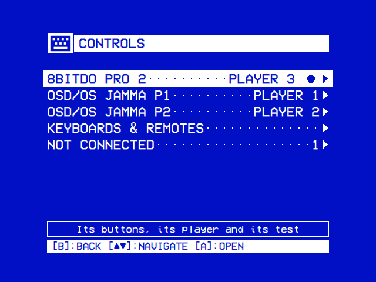
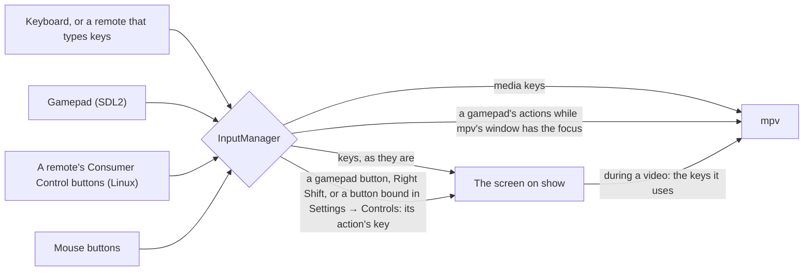
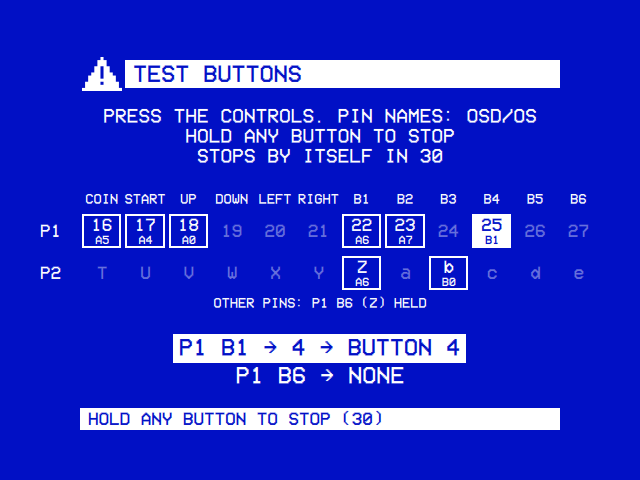
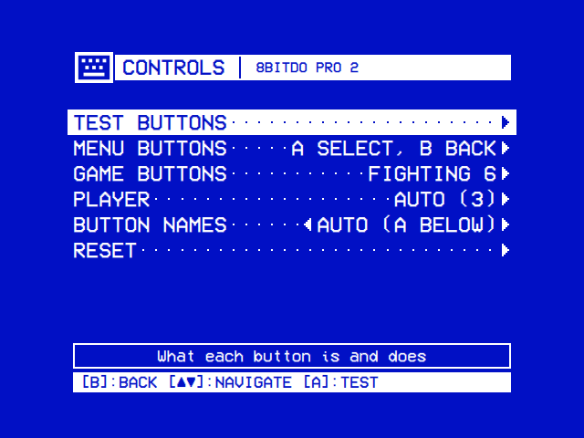
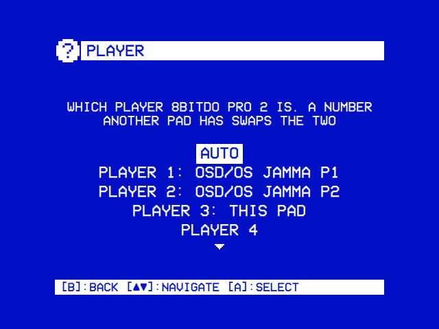
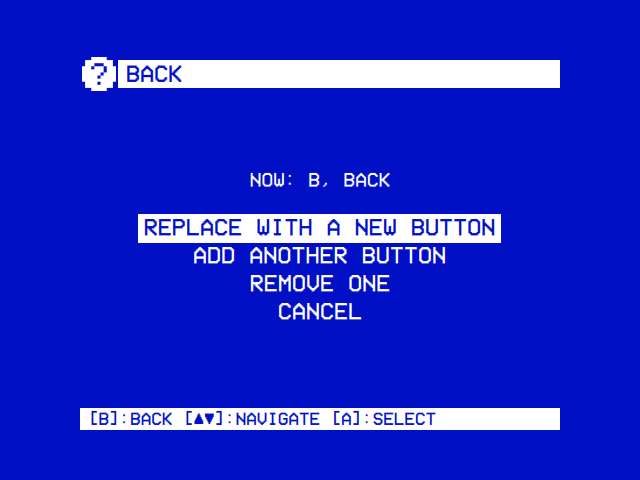
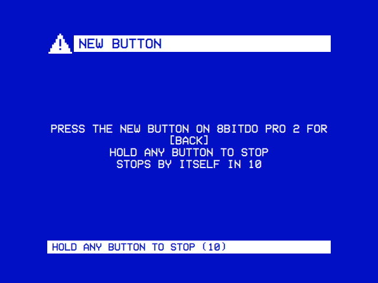
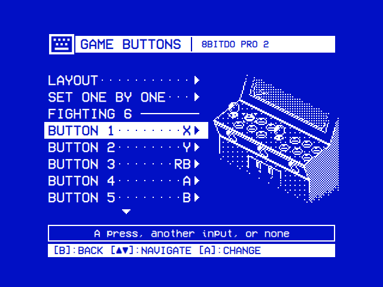
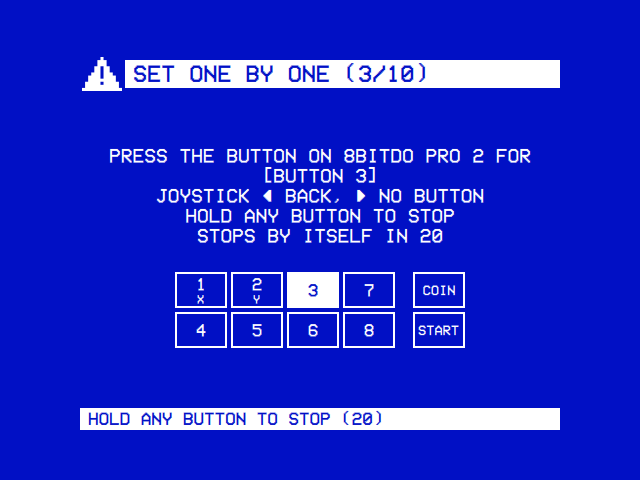

# Controls

What each key and button does on a keyboard, a remote, a gamepad or a mouse, and how Settings → Controls, `input.cfg` and Bluetooth set them up.



## The actions

Every screen works with these actions, whatever sends them.

| Action | Keyboard | Gamepad (by default) | Remote | What it does |
|---|---|---|---|---|
| **Up**, **Down** | ▲ ▼ | D-pad, left stick | Its arrows | Move through a list. During a video: open the deck's menu |
| **Left**, **Right** | ◄ ► | D-pad, left stick, LB / RB | Its arrows | Change a setting shown between ◄ and ►. In a tree: up a level, open a folder. During a video: jump back and forward |
| **► on an entry** | ► | D-pad right, RB | Its right arrow | Open a menu line that ends in ►, a video's options or its info screen |
| **Select** | Enter | A (the bottom face button) | OK | Open, play, choose. During a video: pause |
| **The mouse** | Left click, right click, the wheel | | | Select, Back and ▲ ▼ ([The mouse](https://github.com/mehmetraif/OSD-OS/wiki/Controls#the-mouse)) |
| **Back** | Esc, Backspace or Right Shift | B (the right face button), or Back / Select / View / Share | Back, when it sends Esc, Backspace or the Back key | One step back. On the main menu: Settings. During a video: leave it, or open its menu |
| **Hold back** (2 seconds) | Esc (not Backspace) | B or Back | Back, when it sends Esc or the Back key | Closes Netflix's, Prime Video's or YouTube's sign-in browser |
| **Play/pause** | Space | Start | Its Play/Pause key only pauses: a media key goes to mpv | Pause a video. On the main menu: stop the video playing behind the menus. In Netflix's, Prime Video's or YouTube's tree: open the info screen |
| **Info** | I | | Its Info key | A title's info screen (Netflix, Prime Video, YouTube) |

A button that sends none of these keys can be given an action in [Settings → Controls](https://github.com/mehmetraif/OSD-OS/wiki/Controls#settings--controls). Esc, Enter, Space and a remote's Back and OK act once a press. The arrows, Backspace and the volume keys repeat while held.

## The keyboard

| Key | What it does |
|---|---|
| ▲ ▼ ◄ ►, Enter, Esc, Space, I | As in the table above. The keypad's Enter selects too |
| Backspace | Back. On the on-screen keyboard it deletes the last letter, and is back once nothing is typed. In a browser OSD/OS opened it is the browser's |
| Right Shift | Back. While a text field has the focus it is Shift again |
| Letters, digits, punctuation | Type straight into the on-screen keyboard; Enter then finishes. Delete deletes the last letter there |
| Ctrl+Q (⌘Q on a Mac) | Quits OSD/OS at once, without asking. Started with the system, that powers the Pi off. Not while [Cabinet Lock](https://github.com/mehmetraif/OSD-OS/wiki/Settings#cabinet-lock) holds the cabinet |
| Ctrl+W | Closes Netflix's, Prime Video's or YouTube's sign-in browser |
| Media keys | Go to mpv: [During playback](https://github.com/mehmetraif/OSD-OS/wiki/Controls#during-playback) |

On a desktop without [Transparent Background](https://github.com/mehmetraif/OSD-OS/wiki/Using-OSD-OS#transparent-background), a video's own mpv window has the keyboard: OSD/OS's keys and mpv's own work there, but not Right Shift.

## During playback


| Key | The deck's menu closed | The deck's menu open |
|---|---|---|
| ▲ or ▼ | Opens the deck's menu, on its buttons | ▲ goes to the position bar, ▼ to the buttons |
| ◄ ► | Jump 5 seconds back or forward | On the position bar: jump 10 seconds. On the buttons: move between them |
| Select | Pause / play | Press the button: SKIP, AUDIO, SUBTITLE, CROP, the playlist's < and >, STOP |
| Play/pause | Pause / play | Pause / play |
| Page Up / Page Down, or a remote's Channel + / − | In Local Files: the folder's next or previous film. In a playlist: its next or previous video. Both go round the end | The same |
| Back | Leave the video, or open its menu ([Back during a video](https://github.com/mehmetraif/OSD-OS/wiki/Using-OSD-OS#back-during-a-video)) | Close the deck's menu |

The deck's menu closes by itself after 5 seconds without a key.

**Media keys** always go to mpv. They do nothing while no video plays (one playing behind the menus counts).

| Media key | What it does |
|---|---|
| Volume Up, Volume Down | The volume, 5% a press, with a VOLUME bar. Held, it moves 5 points every 150 ms |
| Mute | Mutes or unmutes; the bar reads MUTE |
| Play/Pause, Play, Pause | Pause / play |
| Stop | Ends the video |
| Fast Forward, Rewind | Jump 30 seconds forward, 10 seconds back, and show the deck's menu |
| Next, Previous | The next or previous chapter, and show the deck's menu |

## Gamepads

OSD/OS reads gamepads through SDL2, which gives most pads the same layout. A pad can be plugged in at any time, a Bluetooth one once it is paired ([below](https://github.com/mehmetraif/OSD-OS/wiki/Controls#bluetooth)).

### The default buttons

Buttons are named by their place, whatever is printed on them: `a` is the bottom face button (south), `b` the right (east), `x` the left (west), `y` the top (north). The tables here call them by the letters of a pad with A at the bottom.

| Button or stick | Action |
|---|---|
| D-pad | Up, Down, Left, Right |
| Left stick | Up, Down, Left, Right. It acts past half-way, and lets go below about a third |
| South face button (`a`) | Select |
| East face button (`b`) | Back |
| Back / Select / View / Share (`back`) | Back |
| Start / Options / Menu (`start`) | Play/pause |
| LB, RB (`leftshoulder`, `rightshoulder`) | Left, Right. Not on the JAMMA board's sticks, where they are buttons 5 and 6 |

- The west and north face buttons, the right stick, the triggers and Guide do nothing until given an action: in the pad's [Menu Buttons](https://github.com/mehmetraif/OSD-OS/wiki/Controls#menu-buttons), or in `input.cfg`.
- A held direction repeats after 0.4 seconds, then every 0.1 seconds.

### How a gamepad becomes key presses

Each button becomes its action's key: the arrows, Enter (Select), Esc (Back) or Space (Play/pause). While mpv's own window has the focus, the action goes straight to mpv.



- **With Steam running** (the Steam Deck), OSD/OS listens to the "Steam Virtual Gamepad" alone.
- **On a manual install run by hand**, reading a gamepad needs your user in the `input` group: `sudo usermod -aG input $USER`, then reboot. The autostart service and the OSD/OS image have it already.

### Remapping a gamepad: input.cfg

`input.cfg` remaps every gamepad at once; a pad's own [Menu Buttons](https://github.com/mehmetraif/OSD-OS/wiki/Controls#menu-buttons) win over it. It is a text file in the data folder:

- Linux and the Pi: `~/.local/share/OSD-OS/input.cfg`
- Mac: `~/Library/Application Support/OSD-OS/input.cfg`
- Windows: `%APPDATA%\OSD-OS\input.cfg`

Write only what you want to change. It is read again as soon as it is saved.

```text
# input.cfg: OSD/OS's gamepad buttons. One binding per line: <input> <action>
x              play_pause     # the west face button pauses too
y              back           # and the north one goes back
righty-        up             # the right stick moves, as the left one does
righty+        down
rightx-        left
rightx+        right
rightshoulder  none           # RB no longer moves right
label south    B              # a pad with A on the right that says it has A at the bottom:
label east     A              # the hints show what is printed on its buttons
```

- **Actions**: `up`, `down`, `left`, `right`, `select`, `back`, `play_pause`, and `none`, which takes a button's action away.
- **Buttons**, by SDL's names: `a`, `b`, `x`, `y`, `back`, `guide`, `start`, `leftstick`, `rightstick`, `leftshoulder`, `rightshoulder`, `dpup`, `dpdown`, `dpleft`, `dpright`, `misc1`, `paddle1` to `paddle4`, `touchpad`. Their long forms (`SDL_CONTROLLER_BUTTON_A`) and the positions `south`, `east`, `west`, `north` work too.
- **Sticks and triggers**, with a direction: `leftx-` (left), `leftx+` (right), `lefty-` (up), `lefty+` (down), the same for `rightx` and `righty`, and `lefttrigger+` and `righttrigger+` (or `triggerleft+`, `triggerright+`).
- **`label <button> <text>`** names a button on every pad, in the hints and on the pads' pages. It wins over a pad's [Button Names](https://github.com/mehmetraif/OSD-OS/wiki/Controls#button-names).
- Case doesn't matter. `#` starts a comment. A line that can't be read is skipped, with a warning in the log.

**A pad SDL doesn't know**: put the community's [gamecontrollerdb.txt](https://github.com/mdqinc/SDL_GameControllerDB) in the data folder, beside `input.cfg`, and restart OSD/OS. MAME and RetroArch get the mappings too.

## A JAMMA cabinet

On the OSD/OS image, a Raspberry Pi to JAMMA board in RGB-Pi's layout gives the cabinet's controls as two gamepads: **OSD/OS JAMMA P1** and **OSD/OS JAMMA P2**. It needs one of the **JAMMA** display outputs ([Display Output](https://github.com/mehmetraif/OSD-OS/wiki/Display-Output#jamma-a-raspberry-pi-to-jamma-board)).

- **Where they come from.** Two MCP23017 port expanders on the Pi's I2C bus: player 1's at address 0x20, player 2's at 0x21. `osdos-jamma.service` (`/opt/osdos/bin/osdos-jamma`) reads both every 2 ms, and ignores a switch's bounce for 5 ms.
- **Their buttons** are named 1 to 8, COIN and START, the stick JOYSTICK ([Button Names](https://github.com/mehmetraif/OSD-OS/wiki/Controls#button-names): Numbers).
- **In games**, buttons 1 to 6, COIN and START are MAME's buttons 1 to 6, coin and start, unless a stick's [Game Buttons](https://github.com/mehmetraif/OSD-OS/wiki/Controls#game-buttons) say otherwise. COIN and START together leave a game ([Arcade](https://github.com/mehmetraif/OSD-OS/wiki/Arcade#players-and-buttons), [FinalBurn Neo](https://github.com/mehmetraif/OSD-OS/wiki/Arcade#finalburn-neo)).
- **On the Arcade screen**, COIN puts a credit in and START (or button 1) plays the game ([The Arcade screen](https://github.com/mehmetraif/OSD-OS/wiki/Arcade#the-arcade-screen)).
- **One coin button for both players.** Hold player 2's **START** and press **COIN**: the coin is player 2's. One player's COIN with the other's START never leaves a game.
- **Cabinet Lock** keeps the cabinet on the Arcade screen ([Settings → Startup → Cabinet Lock](https://github.com/mehmetraif/OSD-OS/wiki/Settings#cabinet-lock)).
- **Six buttons on the edge** (CHAMMA) need the board's JP1 and JP2 on CHAMMA ([Display Output → A Raspberry Pi to JAMMA board](https://github.com/mehmetraif/OSD-OS/wiki/Display-Output#a-raspberry-pi-to-jamma-board)).

The built-in mapping, the same on both expanders, is the layout of Crown Arcade's board (mk_arcade_joystick_rpi):

| Pin | Input | In OSD/OS's menus |
|---|---|---|
| A0, A1, A2, A3 | Joystick up, down, left, right | Up, Down, Left, Right |
| A4 | `start` | Play/pause |
| A5 | `coin` (the pad's Back/Select button) | Back |
| A6 | Button 1: `a` | Select |
| A7 | Button 2: `b` | Back |
| B0, B1 | Buttons 3 and 4: `x`, `y` | Nothing, until given an action |
| B2, B3 | Buttons 5 and 6: `tl`, `tr` (the shoulders) | Nothing, until given an action: the joystick goes left and right |
| B4, B5 | Buttons 7 and 8: `tl2`, `tr2` | Nothing |
| B6, B7 | `z`, `mode` | Nothing |

A board wired in JammaPi's layout (joypi) needs this `osdos-jamma.txt` (how to write one is below):

```text
# osdos-jamma.txt: JammaPi's layout (joypi), on both expanders
0x20 A4 mode
0x20 A5 start
0x20 A6 coin
0x20 A7 z
0x20 B0 tr2
0x20 B1 tl2
0x20 B2 tr
0x20 B3 tl
0x20 B4 y
0x20 B5 x
0x20 B6 b
0x20 B7 a
0x21 A4 mode
0x21 A5 start
0x21 A6 coin
0x21 A7 z
0x21 B0 tr2
0x21 B1 tl2
0x21 B2 tr
0x21 B3 tl
0x21 B4 y
0x21 B5 x
0x21 B6 b
0x21 B7 a
```

**Which button is on which pin** depends on the board and the harness. Open Settings → Controls → OSD/OS JAMMA P1 (or P2) → **Test Buttons** and press each control, of either player: it takes both sticks at once.

- **The grid** is the JAMMA edge's control pins: player 1's on the parts side (16 to 27), player 2's on the solder side (T to e). Pins 27 and e are ground on a JAMMA harness, button 6 on a CHAMMA one.
- A pin lights while its switch is held, and stays framed afterwards, with its expander pin under it.
- A pin that stays dim never reaches the board: check its wire, the harness's ground, or the board's jumpers (JP1 and JP2, or the JAMMA/kick harness switch).
- **Pin Names**, on the stick's page, chooses the layout that names the expander pins, with ◄ ►, before the test. They are **OSD/OS** (the mapping, `osdos-jamma.txt` included), **Crown, CHAMMA** (the built-in mapping's order, above) and **JammaPi** (buttons from B7 down). The layout whose columns light is your board's.
- **Other pins** lists pressed pins on no control: a system switch (Test, Service, Tilt), a button 7 or 8, or a third expander (`0x24 B3`).
- Under the grid, each press is a line: its player, its pin and what OSD/OS sees (`P1 B1 → 4 → BUTTON 4`, `P1 B6 → NONE` for a pin the sticks don't show).
- The test ends when any button of either stick is held for a second and a half, 30 seconds after the last press, or with a keyboard's Esc.



The same test runs from Exit to Terminal, or over SSH:

```sh
/opt/osdos/bin/osdos-jamma --test
```

It prints each pin as it changes: `P1 0x20 A6 pressed  a`. Another MCP23017 on the bus (0x22 to 0x27) shows as `P0`. Ctrl+C ends it.

**A button on another pin.** Write `osdos-jamma.txt` on the boot partition (the **bootfs** drive), beside `config.txt`. A line a pin, `<address> <pin> <input>`:

```text
# osdos-jamma.txt: a Raspberry Pi to JAMMA board's pins, where they differ
0x20 A6 b       # player 1's first two buttons the other way round
0x20 A7 a
0x21 B7 none    # and nothing on player 2's B7
```

- **The inputs** are `up`, `down`, `left`, `right`, `start`, `coin`, `a`, `b`, `x`, `y`, `tl`, `tr`, `tl2`, `tr2`, `c`, `z`, `mode` and `none`.
- **Other names:** `b1` to `b6` stand for `a`, `b`, `x`, `y`, `tl`, `tr`; `select` for `coin`; `service` for `mode`.
- **Two pins on one input** are held while either is.
- **When it is read:** as the Pi starts, or with `sudo systemctl restart osdos-jamma`.
- **A line it can't read** is skipped, and named in its log.

**Nothing moves?** `journalctl -u osdos-jamma -b` says what it found (`osdos-jamma: player 1 at 0x20`), or why not: the JAMMA display output isn't in force, or no MCP23017 answers at 0x20 or 0x21.

## Remotes

- **Remotes that type keys.** Most USB and 2.4 GHz remotes are keyboards to OSD/OS. An OK that arrives as keypad Enter, or as a Select or OK key, is Select. Bluetooth remotes are paired in [Settings → Network → Bluetooth](https://github.com/mehmetraif/OSD-OS/wiki/Controls#bluetooth).
- **Consumer Control buttons** (Linux): a remote's extra buttons (Home, Back, Menu, the coloured buttons, zoom, the media buttons), sent from a second device of that name. Its OK and Select are Select. Its Channel + / − step through a folder or a playlist [during playback](https://github.com/mehmetraif/OSD-OS/wiki/Controls#during-playback).
- **A button that does nothing** can be given an action in Settings → Controls → [Keyboards & Remotes](https://github.com/mehmetraif/OSD-OS/wiki/Controls#keyboards--remotes), on the remote's own page or under All Keyboards & Remotes.
- **Air mice** work as [the mouse](https://github.com/mehmetraif/OSD-OS/wiki/Controls#the-mouse) does: OK is a left click while the pointer is on.

### HDMI-CEC

OSD/OS has no HDMI-CEC support: a TV's own remote doesn't drive it.

## Settings → Controls

Settings → **Controls** lists the gamepads connected, the one used last on top, each with the player it is and a page of its own.

| Line | What it is |
|---|---|
| A gamepad | Its name and its player: `8BITDO PRO 2 ······ PLAYER 1 ►`. Two of the same pad make one line, `x2`, `PLAYERS 3+4`. A **●** marks the one used last: press a button on a pad to find its line. Select opens [its page](https://github.com/mehmetraif/OSD-OS/wiki/Controls#a-gamepads-page) |
| **No gamepad connected** | Shown instead while there is none, with `Plug one in or pair it in Network`: [Settings → Network → Bluetooth](https://github.com/mehmetraif/OSD-OS/wiki/Controls#bluetooth) |
| **All Players Automatic** | Only while a pad's player was chosen by hand: puts every player back to Auto |
| **Keyboards & Remotes** | Extra keys for the menus' actions ([below](https://github.com/mehmetraif/OSD-OS/wiki/Controls#keyboards--remotes)) |
| **Not Connected** | Only while there are any: the controllers away that have settings of their own. **Reset** on a page forgets them |

- **A gamepad's** settings go by its model, so two of the same pad share them. The same pad over USB and over Bluetooth is two.
- **Back** leaves every page one step at a time. Nothing on these pages changes by ◄ ► alone, but a pad's Button Names.

### A gamepad's page

<table>
<tr><th width="50%">A pad's page</th><th width="50%">Its player</th></tr>
<tr><td></td><td></td></tr>
<tr><td>Six lines, each one job.</td><td>The list says who has each number.</td></tr>
</table>

| Row | What it does |
|---|---|
| **Test Buttons** | Each press shows what the button is called, what it does in the menus and what it is in the games ([below](https://github.com/mehmetraif/OSD-OS/wiki/Controls#test-buttons)) |
| **Menu Buttons** | Which of its buttons work the menus: Up, Down, Left, Right, Select / OK, Back, Play / Pause ([below](https://github.com/mehmetraif/OSD-OS/wiki/Controls#menu-buttons)). The row shows the first Select and Back: `A SELECT, B BACK` |
| **Game Buttons** | Which of its buttons is each of an arcade cabinet's ([below](https://github.com/mehmetraif/OSD-OS/wiki/Controls#game-buttons)). The row shows the layout |
| **Player** | The player it is in games: `AUTO (1)`, or a number chosen from a list ([below](https://github.com/mehmetraif/OSD-OS/wiki/Controls#players)) |
| **Button Names** | What its buttons are called on screen; ◄ ► go round them ([below](https://github.com/mehmetraif/OSD-OS/wiki/Controls#button-names)) |
| **Reset** | Asks first, with the cursor on **Cancel**: its Menu Buttons, its Game Buttons and its Button Names go back to the defaults. A controller away is forgotten |

- One of the JAMMA board's sticks has a seventh row, **Pin Names**, for its test ([A JAMMA cabinet](https://github.com/mehmetraif/OSD-OS/wiki/Controls#a-jamma-cabinet)).
- A pad away has `NOT CONNECTED` for its title, before its name. Its test and anything that needs a press say `Connect it first`.

### Waiting for a press

<table>
<tr><th width="50%">What to do with an action</th><th width="50%">Waiting for a press</th></tr>
<tr><td></td><td></td></tr>
<tr><td>Nothing is changed before a choice is made here.</td><td>A tap answers. Holding any button stops.</td></tr>
</table>

Every screen that waits for a press works the same way, and says so on the screen itself:

- **A tap answers.** The press counts when the button is let go.
- **Holding any button for a second and a half stops the wait**, with nothing changed. That goes for the pad's own Back too, which a tap would answer with.
- **It stops by itself** after 10 seconds without a press (`STOPS BY ITSELF IN 9`), and another controller's Back stops it too.
- The help line then says what happened: `A is Back, B Select / OK`, `Nothing changed`, or `No press: nothing changed`.

### Test Buttons

One test for each controller: **Test Buttons** on a pad's page, **Test Keys** on a keyboard's or a remote's.

- Each press shows at once, the last at the top: `A → SELECT / OK → BUTTON 4`, `X → NO ACTION → BUTTON 1`, `D-PAD ▲ → UP → JOYSTICK`. Guide is `MAME'S MENU`, and under the Engine's layout a button is `ENGINE'S`.
- On a pad, the cabinet's buttons are a grid under the text, the last press's lit.
- It acts on nothing, and takes only that controller's presses.
- It ends as every wait does: hold any button, leave it alone for 10 seconds, or press another controller's Back. A keyboard's or a remote's own Back ends it too.
- The JAMMA board's sticks show the edge's pins ([A JAMMA cabinet](https://github.com/mehmetraif/OSD-OS/wiki/Controls#a-jamma-cabinet)).

### Menu Buttons

Seven actions, each with the buttons and stick directions that do it now (`BACK ······ B, BACK ►`), only those the pad has. Select on one asks what to do:

| Choice | What it does |
|---|---|
| **Replace with a new button** | Press the new button: it is the action's only one from now on, and the ones that did it do nothing (`X is Left, LB, D-PAD ◄ and L STICK ◄ nothing`) |
| **Add another button** | Press a button: it does the action too (`X is Back too`) |
| **Remove one** | A list of the action's buttons: the one chosen does nothing from now on. No press |
| **Cancel** | Nothing changes, as with Back |

- **A and B swap in one step.** A pad always keeps one Select / OK, one Back, one Up and one Down. When Replace takes a pad's only button for one of those, the button it replaces takes that action instead: on Back's row, Replace and a press of A gives `A is Back, B Select / OK`. From Select / OK's row it is the same the other way round.
- **Add another** and **Remove one** refuse a pad's last button for those four (`A is its only Select / OK button: it stays`).
- A stick's direction or a trigger can be set like a button (`L STICK ◄`, `RT`).

### Game Buttons

<table>
<tr><th width="50%">A pad's Game Buttons</th><th width="50%">Set One by One</th></tr>
<tr><td></td><td></td></tr>
<tr><td>Fighting 6. The control panel blinks the line's button.</td><td>The grid shows the one asked for, and what the others are so far.</td></tr>
</table>

A pad's **Game Buttons** say which of its buttons is each of an arcade cabinet's: **Button 1** to **Button 8**, **Coin** and **Start**. MAME and FinalBurn Neo both get them ([Arcade](https://github.com/mehmetraif/OSD-OS/wiki/Arcade#players-and-buttons)). The joystick is always the D-pad and the left stick.

| Row | What it does |
|---|---|
| **Layout** | Select opens the list: **Engine's**, **Fighting 6**, **Neo Geo 4**, a console pad's (**NES**, **Mega Drive**, **SNES**, **Saturn**, **N64**) or **Custom**. Back leaves it as it was. The layout's name heads the ten buttons under it |
| **Set One by One** | Asks for them in turn: Buttons 1 to 6, Coin, Start, then Buttons 7 and 8. It ends on all ten, to **Save**, **Do It Again** or **Cancel**. Saved, the layout is Custom |
| **Button 1** to **Button 8**, **Coin**, **Start** | The button each is on this pad, or `NONE`. Select opens a list: **Press a button**, each input of the pad that no other line has, **None** (not for Coin and Start) and **Cancel**. A change makes the layout Custom |

**Set One by One**, a press a step:

- **The joystick steers**, as it is never a button: ◄ goes a step back, ► gives this one no button. Button 1, Coin and Start need one.
- A button already taken, the joystick's up and down, and Guide are asked for again (`X is Button 1 already`).
- It waits 20 seconds a step. Holding any button stops it with nothing changed, at any step.
- Nothing is saved before **Save**.

The layouts, by the letters of a pad with A at the bottom (the page names a pad's buttons by its own):

| Layout | Buttons 1 to 8 | Coin, Start |
|---|---|---|
| **Engine's** | None of OSD/OS's (`ENGINE'S`): MAME and FinalBurn Neo number a pad's buttons their own ways. On the JAMMA board's sticks, buttons 1 to 8 in order | BACK, START |
| **Fighting 6** | Punches 1, 2, 3 on X, Y, RB; kicks 4, 5, 6 on A, B, RT; 7 and 8 on LB and LT. On a JAMMA board's stick, buttons 1 to 8 in order | BACK, START |
| **Neo Geo 4** | A Neo Geo's A, B, C, D on A, B, X, Y; 5 to 8 on LB, RB, LT, RT | BACK, START |
| **NES** | B is 1, A is 2; 3 to 8 none | SELECT, START |
| **Mega Drive** | A, B, C are 1, 2, 3; a six-button pad's X, Y, Z are 4, 5, 6; 7 and 8 none | MODE, START |
| **SNES** | Punches 1, 2, 3 on Y, X, L; kicks 4, 5, 6 on B, A, R; 7 and 8 none | SELECT, START |
| **Saturn** | Punches 1, 2, 3 on X, Y, Z; kicks 4, 5, 6 on A, B, C; R is 7, 8 none | L, START |
| **N64** | Punches 1, 2, 3 on B, C◄, C▲; kicks 4, 5, 6 on A, C▼, C►; L is 7, R is 8 | Z, START |
| **Custom** | As they were set here | As they were set here |

The console layouts take a pad's buttons as SDL names that kind of pad. A button a pad names otherwise is set with a press.

- **SNES**: by their places, its B, A, Y, X where a pad with A at the bottom has A, B, X, Y.
- **NES, N64**: A and B by their letters. An N64's C buttons are the right stick, its Z the left trigger.
- **Mega Drive, Saturn**: A, B, X, Y by their letters, C the right trigger, Z the right shoulder. A Saturn's L and R are the left shoulder and trigger.

Rules:

- **Custom is kept.** The buttons set by hand stay saved while another layout is chosen: choosing Custom again brings them back.
- **One button, one input.** A button given to an input another has swaps the two (`A is Button 1 now, and X is Button 4`).
- **Coin and Start always have a button** (`BACK stays Coin: it needs a button`).
- **What can be one**: the face buttons, shoulders, triggers, Back, Start, the stick buttons, Misc, the paddles, the touchpad, and the right stick pushed one way. Not Guide (`GUIDE shows MAME's menu, not a button`), nor the D-pad or left stick (`D-PAD ▲ is the joystick, not a button`).
- **A pad away**: its layout and a line's list still change its buttons; a press and Set One by One wait until it is back.
- **Online**, the host's layout holds for every player ([Arcade → Players and buttons](https://github.com/mehmetraif/OSD-OS/wiki/Arcade#players-and-buttons)).
- **Saved** in `config.json` as `app.controllers.<key>.arcade`, each input by `input.cfg`'s names (`""` for none). The Engine's layout isn't written, unless there are Custom's buttons to keep beside it (`"layout": "default"` with `custom`). Beside a preset they are `custom` too.

```json
"arcade": {
  "layout": "fighting6",
  "inputs": { "1": "x", "2": "y", "3": "rightshoulder", "4": "a", "5": "b", "6": "righttrigger+",
              "7": "leftshoulder", "8": "lefttrigger+", "coin": "back", "start": "start" },
  "custom": { "1": "a", "2": "b", "3": "x", "4": "y", "5": "", "6": "", "7": "", "8": "",
              "coin": "back", "start": "start" }
}
```

### Players

A pad's **Player** says which player it is in the [Arcade](https://github.com/mehmetraif/OSD-OS/wiki/Arcade#players-and-buttons) module's games and in any game a [script](https://github.com/mehmetraif/OSD-OS/wiki/Scripts#what-a-script-receives) starts, up to six. Select on the row lists **Auto** and **Player 1** to **Player 6**, each with the pad that has it now (`PLAYER 1: OSD/OS JAMMA P1`, `PLAYER 3: THIS PAD`). Keyboards and remotes aren't players.

- **Auto**, the default, gives the JAMMA board's sticks players 1 and 2, then the other pads the numbers left, in the order they came. The row reads `AUTO (3)`.
- **A number chosen** is that pad's wherever it is plugged in. While it is away that player has no pad.
- **One pad, one player.** A number another pad was chosen for swaps the two. One a pad had by Auto leaves that pad to Auto, which gives it the next number free. The help line says where it went (`It is player 1 now, OSD/OS JAMMA P1 player 3`).
- **All Players Automatic**, on Controls' first list, puts every player back to Auto.
- **Player lights** on a pad show its player.
- **A script** finds each player's pad in `OSDOS_PLAYER1_NAME`, `OSDOS_PLAYER1_GUID` and `OSDOS_PLAYER1_DEVICE`, and so on to player 6.

### Button names

What a pad's buttons are called, on its pages and in the hints. The buttons are the same whatever the names.

| Names | `a` (south) | `b` (east) | `x` (west) | `y` (north) | Shoulders | Triggers | `back` | `start` | `guide` |
|---|---|---|---|---|---|---|---|---|---|
| A below | A | B | X | Y | LB, RB | LT, RT | BACK | START | GUIDE |
| A right | B | A | Y | X | L, R | ZL, ZR | - | + | HOME |
| Shapes | X | O | SQ | TR | L1, R1 | L2, R2 | SELECT | START | HOME |
| Numbers | 1 | 2 | 3 | 4 | 5, 6 | 7, 8 | COIN | START | MODE |

- The d-pad is `D-PAD ▲ ▼ ◄ ►`, the sticks `L STICK` and `R STICK` with their direction (Numbers' left stick `JOYSTICK`), the stick buttons `LS`, `RS` (Shapes' `L3`, `R3`).
- **Auto**, the default, names a pad as it says it is: letters with A at the bottom on most pads, with A on the right or shapes on the pads that have them so, numbers on the JAMMA board's sticks. The row reads `AUTO (A BELOW)`.
- Choose the names by hand for a pad that says it is the wrong thing, as many pads with A on the right do in X-input mode.
- A `label` line in `input.cfg` wins, on every pad.

### Keyboards & Remotes

**Keyboards & Remotes** gives the menus' actions extra keys. It lists **All Keyboards & Remotes**, for a key that should work on every one, and on Linux each keyboard and remote connected, for a key on that one only. Where none is listed apart (a Mac, Windows), it opens All Keyboards & Remotes at once.

Each has the same page:

| Row | What it does |
|---|---|
| **Test Keys** | Each key shows its name and what it does ([Test Buttons](https://github.com/mehmetraif/OSD-OS/wiki/Controls#test-buttons)) |
| **Up**, **Down**, **Left**, **Right**, **Select / OK**, **Back**, **Play / Pause** | The action's own key, then its extra keys: `ENTER + F5`. On a keyboard's own page, every keyboard's extra keys come between, marked `(ALL)`: `ENTER + MENU (ALL) + F5`. Select asks what to do |
| **Remove All Extra Keys** | Asks first, with the cursor on **Cancel** |

Select on an action offers **Add another key**, and once it has an extra key **Replace with a new key**, **Remove one** and **Cancel**, as [Menu Buttons](https://github.com/mehmetraif/OSD-OS/wiki/Controls#menu-buttons) does. The wait for a key is [the same](https://github.com/mehmetraif/OSD-OS/wiki/Controls#waiting-for-a-press): a tap answers, holding any key stops it.

- **The menus' own keys keep what they do**: the arrows, Enter, Esc and Space can't be given to another action (`Return is Select / OK already`). What is added, replaced and removed are extra keys.
- **Whatever does Back stops the wait**: Esc, Backspace, a Back key, Right Shift, a gamepad's Back, and without a desktop a right click.
- **One key, one action**: a key given to an action is taken off any other. **Replace** puts the new key in before the old ones go.
- **The key the menus are worked with stays.** An extra key for Select / OK, Back, Up or Down can't be removed or moved while it is the one that last did that action (`F5 is the Up in use: it stays`): do the action once with another key, or a gamepad, first. A keyboard's own page never refuses, as a keyboard has the arrows, Enter and Esc beside it.
- **What can be an extra key**: any keyboard key, a remote's Consumer Control buttons (Linux), and under All Keyboards & Remotes a mouse's buttons. A gamepad's buttons are set on the pad's page.
- An extra key doesn't act while a text field has the focus, nor in Netflix's, Prime Video's or YouTube's sign-in.

**How every keyboard's extra keys are saved.** In `config.json`, under `app.remote_keymap`, by action: a number for one key, a list of numbers for several, `0` (or nothing) for none.

| Button | Saved as | Example | Shown as |
|---|---|---|---|
| A key (from a keyboard, or a remote that types keys) | Qt's code for the key | the Menu key: `16777301` | `MENU` |
| A Consumer Control button (Linux) | 33554432 (`0x02000000`) + the Linux key code | its Back button, `KEY_BACK` 158: `33554590` | `BACK` |
| A mouse button | 50331648 (`0x03000000`) + Qt's code for the button | the left click, 1: `50331649` | `MOUSE: LEFT CLICK` |

A remote whose Menu key is Select / OK, and whose Consumer Control Home button is Back:

```json
{
  "app": {
    "remote_keymap": {
      "up": 0,
      "down": 0,
      "left": 0,
      "right": 0,
      "select": 16777301,
      "back": 33554604,
      "play_pause": 0
    }
  }
}
```

Edit `config.json` by hand only while OSD/OS isn't running ([Configuration files](https://github.com/mehmetraif/OSD-OS/wiki/Configuration-Files)).

### How a controller's settings are saved

In `config.json`, under `app.controllers`, by the controller's key:

| Controller | Its key | Its `bindings` |
|---|---|---|
| A gamepad | `pad-` and SDL's GUID for it, in lower case | Its inputs by `input.cfg`'s names (`a`, `dpup`, `leftx-`, `lefttrigger+`), each with an action, or `none` |
| A keyboard or a remote | `kbd-` and its connection, maker and product in hex: `kbd-0005-046d-b342` is a Bluetooth (`0005`) Logitech (`046d`) K380 (`b342`) | Its extra keys, by the numbers All Keyboards & Remotes saves them as, each with an action |

Beside `bindings` come `labels` (`auto`, `a_below`, `a_right`, `shapes` or `numbers`), a pad's `arcade`, and `name` and `kind`. A controller with nothing of its own isn't written. A pad's key is in the log as it comes: `[input] controller added: 8BitDo Pro 2 (pad-…)`. Settings written by an earlier version are read as they are, the names it gave the four label styles too.

```json
{
  "app": {
    "controllers": {
      "pad-0300c9b8c82d00000360000000007801": {
        "name": "8BitDo Pro 2",
        "kind": "gamepad",
        "labels": "a_right",
        "bindings": { "x": "select", "a": "none", "leftshoulder": "play_pause" }
      },
      "kbd-0005-046d-b342": {
        "name": "Logitech K380",
        "kind": "keyboard",
        "labels": "auto",
        "bindings": { "79": "select" }
      }
    }
  }
}
```

| Setting | Values | Default | What it does | Config key |
|---|---|---|---|---|
| A pad's Player | Auto, 1 to 6 | Auto | The player that pad is in games | `app.players.1` to `app.players.6`: `{ "key", "name" }`, the pad's key, `""` for Auto |
| A pad's Button Names | Auto, A below, A right, Shapes, Numbers | Auto | What its buttons are called | `app.controllers.<key>.labels` |
| A pad's Game Buttons | Engine's, Fighting 6, Neo Geo 4, NES, Mega Drive, SNES, Saturn, N64, Custom | Engine's | Which of its buttons is each of a cabinet's | `app.controllers.<key>.arcade` |
| A pad's Menu Buttons | Its buttons, for each of the seven actions | As every pad has them | Which of its buttons do the action | `app.controllers.<key>.bindings` |
| A keyboard's or a remote's extra keys | Its keys, for each of the seven actions | None | More keys for that action, on that one | `app.controllers.<key>.bindings` |
| All Keyboards & Remotes' extra keys | Keys, a remote's buttons, a mouse's buttons | None | More keys for that action, on every one | `app.remote_keymap.up`, `.down`, `.left`, `.right`, `.select`, `.back`, `.play_pause` |
| A JAMMA stick's Pin Names | OSD/OS; Crown, CHAMMA; JammaPi | OSD/OS | The layout its test names the board's pins by | `app.jamma_pin_layout` |

### How OSD/OS tells keyboards apart

On Linux OSD/OS reads each keyboard's and remote's device itself (`/dev/input/event*`), read-only.

- **It needs the `input` group**, as gamepads do. Without it only the gamepads are listed.
- **Not listed:** a mouse, a power button, and the Pi's HDMI-CEC device.
- **The log** names each as it is found: `[input] keyboard: Logitech K380 (/dev/input/event4, kbd-0005-046d-b342)`, or `[input] remote: …`.

## The hints at the foot of the screen

The bar at the foot of every screen names the keys that work there (`[ESC]:BACK [▲▼]:NAVIGATE [◄►]:CHANGE [ENTER]:SELECT`). It shows a keyboard's names after a key, a gamepad's after a gamepad button.

| Hint | Keyboard | A below | A right | Shapes | Numbers |
|---|---|---|---|---|---|
| Back | `[ESC]` | `[B]` | `[A]` | `[O]` | `[2]` |
| Select | `[ENTER]` | `[A]` | `[B]` | `[X]` | `[1]` |
| Play/pause | `[SPACE]` | `[START]` | `[+]` | `[START]` | `[START]` |
| Coin (the [Arcade screen](https://github.com/mehmetraif/OSD-OS/wiki/Arcade#the-arcade-screen)'s) | `[5]` | `[BACK]` | `[-]` | `[SELECT]` | `[COIN]` |

- The arrows are the same for all: `[▲▼]` navigate, `[▲▼◄►]` in the trees, `[◄►]` change, `[►]` options or info.
- A gamepad's names are those of the pad used last, by its [Button Names](https://github.com/mehmetraif/OSD-OS/wiki/Controls#button-names).
- A hint names the first of the pad's buttons that does the action, in the order `a`, `b`, `x`, `y`, `back`, `guide`, `start`, …. So `x play_pause` makes the play/pause hint `[X]`, but `y back` leaves the back hint `[B]`.
- Settings → Look → **Hint Bar** takes the bar away (`app.hint_bar`: `Off`).

## Bluetooth

<table>
<tr><th width="50%">Bluetooth</th><th width="50%">Pairing a keyboard</th></tr>
<tr><td></td><td></td></tr>
<tr><td>Search finds what is in pairing mode nearby, for a minute. Select pairs a device and connects it.</td><td>A keyboard is paired by typing the code it asks for, then its Enter.</td></tr>
</table>

Settings → Network → **Bluetooth** pairs a keyboard, gamepad or remote. It needs BlueZ, so it is there on Linux, the Raspberry Pi included. On a Mac, pair devices in macOS's own Bluetooth settings.

| Line | What it does |
|---|---|
| **Bluetooth** · On / Off | Select, ◄ or ► switch Bluetooth on or off |
| **Details** | Only when Bluetooth wouldn't switch on: what the system says about it ([below](https://github.com/mehmetraif/OSD-OS/wiki/Controls#when-bluetooth-wont-switch-on)) |
| **Search** | Select looks for devices for a minute (`SEARCHING…`); select again stops |
| **Paired** | The devices paired already, each with `CONNECTED` or `PAIRED` |
| **Found** | What the search has found, each with what it says it is: `KEYBOARD`, `MOUSE`, `KEYBOARD+MOUSE`, `GAMEPAD`, `REMOTE`, `TABLET`, `AUDIO`, `PHONE`, `COMPUTER`, or `NEW` |

### Pairing

1. Put the device in pairing mode, close to the Pi.
2. Select **Search**. Devices appear under **Found** once they have said their name.
3. Select the device. The line reads `PAIRING…`, then `CONNECTING…`.
4. What happens next depends on the device:
   - **A keyboard** asks for a code: type the code shown on that keyboard, then its Enter. An older keyboard gets a PIN to type the same way.
   - **A phone** shows a code of its own, and OSD/OS asks "Does it show this code?": answer **Yes** or **No**.
   - **A gamepad, a mouse or a remote** pairs without a question.
   - Back, on the code, gives the pairing up.
5. Once paired, the device is trusted and connected. It comes back by itself after a restart, a keyboard at its first key press.

Select on a **paired** device offers **Connect** (or **Disconnect**) and **Forget**, which unpairs it. Leaving the page stops a search and gives up a pairing.

The help line says what went wrong:

| Message | Means |
|---|---|
| `pairing failed, was the code typed right?` | The code typed didn't match |
| `pairing took too long` | Nothing came back within the two minutes pairing allows |
| `pairing canceled`, `pairing declined` | Back was pressed, or the device said no |
| `no answer, is it on, close by and in pairing mode?` | The device didn't answer |
| `it has gone out of reach` | The device went away |
| `Bluetooth is off` | Switch it on first (Search does) |
| `Couldn't turn Bluetooth on: rfkill blocks it` | A software switch keeps the radio off ([below](https://github.com/mehmetraif/OSD-OS/wiki/Controls#when-bluetooth-wont-switch-on)) |

### Who may use Bluetooth

- OSD/OS's user must be in the `bluetooth` group. The OSD/OS image and `install.sh` see to it.
- On a system you set up yourself: `sudo usermod -aG bluetooth $USER`, then log in again.
- A build without Qt D-Bus (`qt6-base-dev` has it) has no Bluetooth line.

### On the OSD/OS image

- **BlueZ starts after OSD/OS**, with its line on the boot screen (`[ OK ] BLUETOOTH`). Settings → Network → Bluetooth waits for it.
- **rfkill never blocks it**: the image runs `rfkill unblock bluetooth` as the Bluetooth service starts.

### When Bluetooth won't switch on

Switching on is tried a second time two seconds later. If it fails again, the help line says why, and a **Details** line appears. Select it to see:

- the adapter as BlueZ has it: its address, and whether it is powered;
- rfkill's switches for Bluetooth, soft and hard;
- the last 20 different lines about Bluetooth in this boot's system log.

From a shell on the Pi:

```sh
rfkill list bluetooth
journalctl -b -u bluetooth
bluetoothctl show
```

## The mouse

A mouse, or a keyboard's touchpad, shows OSD/OS's own pointer while it moves, on the OSD/OS image and on a desktop alike.

- A left click is Select / OK, a right click Back and the wheel ▲ ▼.
- Over a menu or the Arcade screen's list, the selection follows the pointer.
- In a file tree the wheel moves a row a notch, and a click opens what the cursor is on.
- On the on-screen keyboard a click types the key under the pointer.
- Moving the mouse wakes the screen saver.
- With Mouse Pointer Off, the selection stays put and moving doesn't wake the screen saver.

A mouse button can be given another action in [Settings → Controls → Keyboards & Remotes → All Keyboards & Remotes](https://github.com/mehmetraif/OSD-OS/wiki/Controls#keyboards--remotes): `MOUSE: LEFT CLICK`, `MOUSE: RIGHT CLICK`, `MOUSE: MIDDLE CLICK`, `MOUSE: BACK` or `MOUSE: FORWARD`. It then does that action only, whatever Mouse Pointer is set to.

| Setting | Values | Default | What it does | Config key |
|---|---|---|---|---|
| Mouse Pointer | Off, 2 sec, 5 sec, 10 sec, 30 sec, Always | 5 sec | How long the pointer stays after the mouse stops. **Off**: never shown. **Always**: it stays | `app.mouse_pointer` (`off`, `2`, `5`, `10`, `30`, `always`) |

## Other inputs

- **An NFC reader**: tapping a card plays the video it is mapped to ([NFC Reader](https://github.com/mehmetraif/OSD-OS/wiki/NFC-Reader)).
- **A script that takes over the screen** owns the keys until it exits ([Scripts](https://github.com/mehmetraif/OSD-OS/wiki/Scripts)).
- **A game in MAME** owns them until Coin and Start together, or Esc on a keyboard, end it ([Arcade](https://github.com/mehmetraif/OSD-OS/wiki/Arcade#playing)).

## See also

- [Using OSD/OS](https://github.com/mehmetraif/OSD-OS/wiki/Using-OSD-OS): what the actions do on each screen
- [Settings](https://github.com/mehmetraif/OSD-OS/wiki/Settings): every row of Settings
- [Configuration files](https://github.com/mehmetraif/OSD-OS/wiki/Configuration-Files): `config.json`, `input.cfg` and the data folder
- [Playback and mpv](https://github.com/mehmetraif/OSD-OS/wiki/Playback-and-mpv): how a video plays, and mpv's keys and scripts
- [Troubleshooting](https://github.com/mehmetraif/OSD-OS/wiki/Troubleshooting): when a device isn't seen
- [How it works](https://github.com/mehmetraif/OSD-OS/wiki/How-It-Works): the input path inside the app
