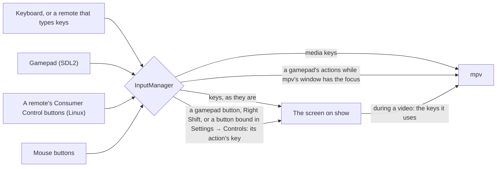

# Controls

What each key and button does on a keyboard, a remote, a gamepad or a mouse, and how Settings → Controls, `input.cfg` and Bluetooth set them up.


## The actions

Every screen works with these actions, whatever sends them.

| Action | Keyboard | Gamepad (by default) | Remote | What it does |
|---|---|---|---|---|
| **Up**, **Down** | ▲ ▼ | D-pad, left stick | Its arrows | Move through a list. During a video: open the deck's menu |
| **Left**, **Right** | ◄ ► | D-pad, left stick, LB / RB | Its arrows | Change a setting shown between ◄ and ►. In a tree: up a level, open a folder. During a video: jump back and forward |
| **► on an entry** | ► | D-pad right, RB | Its right arrow | Open a menu line that ends in ►, a video's options or its info screen |
| **Select** | Enter | A (the bottom face button) | OK | Open, play, choose. During a video: pause |
| **The mouse** | Left click, right click, the wheel | | | Select, Back and ▲ ▼ ([The mouse](https://github.com/mehmetraif/OSD-OS/wiki/Controls#the-mouse)) |
| **Back** | Esc, Backspace or Right Shift | B (the right face button), or Back / Select / View / Share | Back, when it sends Esc, Backspace or the Back key | One step back. On the main menu: Settings. During a video: leave it, or open its menu |
| **Hold back** (2 seconds) | Esc (not Backspace) | B or Back | Back, when it sends Esc or the Back key | Closes Netflix's, Prime Video's or YouTube's sign-in browser |
| **Play/pause** | Space | Start | Its Play/Pause key only pauses: a media key goes to mpv | Pause a video. On the main menu: stop the video playing behind the menus. In Netflix's, Prime Video's or YouTube's tree: open the info screen |
| **Info** | I | | Its Info key | A title's info screen (Netflix, Prime Video, YouTube) |

A button that sends none of these keys can be given an action in [Settings → Controls](https://github.com/mehmetraif/OSD-OS/wiki/Controls#settings--controls). Esc, Enter, Space and a remote's Back and OK act once a press. The arrows, Backspace and the volume keys repeat while held.

## The keyboard

| Key | What it does |
|---|---|
| ▲ ▼ ◄ ►, Enter, Esc, Space, I | As in the table above. The keypad's Enter selects too |
| Backspace | Back. On the on-screen keyboard it deletes the last letter, and is back once nothing is typed. In a browser OSD/OS opened it is the browser's |
| Right Shift | Back. While a text field has the focus it is Shift again |
| Letters, digits, punctuation | Type straight into the on-screen keyboard; Enter then finishes. Delete deletes the last letter there |
| Ctrl+Q (⌘Q on a Mac) | Quits OSD/OS at once, without asking. Started with the system, that powers the Pi off. Not while [Cabinet Lock](https://github.com/mehmetraif/OSD-OS/wiki/Settings#cabinet-lock) holds the cabinet |
| Ctrl+W | Closes Netflix's, Prime Video's or YouTube's sign-in browser |
| Media keys | Go to mpv: [During playback](https://github.com/mehmetraif/OSD-OS/wiki/Controls#during-playback) |

On a desktop without [Transparent Background](https://github.com/mehmetraif/OSD-OS/wiki/Using-OSD-OS#transparent-background), a video's own mpv window has the keyboard: OSD/OS's keys and mpv's own work there, but not Right Shift.

## During playback


| Key | The deck's menu closed | The deck's menu open |
|---|---|---|
| ▲ or ▼ | Opens the deck's menu, on its buttons | ▲ goes to the position bar, ▼ to the buttons |
| ◄ ► | Jump 5 seconds back or forward | On the position bar: jump 10 seconds. On the buttons: move between them |
| Select | Pause / play | Press the button: SKIP, AUDIO, SUBTITLE, CROP, the playlist's < and >, STOP |
| Play/pause | Pause / play | Pause / play |
| Page Up / Page Down, or a remote's Channel + / − | In Local Files: the folder's next or previous film. In a playlist: its next or previous video. Both go round the end | The same |
| Back | Leave the video, or open its menu ([Back during a video](https://github.com/mehmetraif/OSD-OS/wiki/Using-OSD-OS#back-during-a-video)) | Close the deck's menu |

The deck's menu closes by itself after 5 seconds without a key.

**Media keys** always go to mpv. They do nothing while no video plays (one playing behind the menus counts).

| Media key | What it does |
|---|---|
| Volume Up, Volume Down | The volume, 5% a press, with a VOLUME bar. Held, it moves 5 points every 150 ms |
| Mute | Mutes or unmutes; the bar reads MUTE |
| Play/Pause, Play, Pause | Pause / play |
| Stop | Ends the video |
| Fast Forward, Rewind | Jump 30 seconds forward, 10 seconds back, and show the deck's menu |
| Next, Previous | The next or previous chapter, and show the deck's menu |

## Gamepads

OSD/OS reads gamepads through SDL2, which gives most pads the same layout. A pad can be plugged in at any time, a Bluetooth one once it is paired ([below](https://github.com/mehmetraif/OSD-OS/wiki/Controls#bluetooth)).

### The default buttons

Buttons are named by where they are on an Xbox pad, whatever is printed on them. `a` is the bottom face button (south), `b` the right (east), `x` the left (west), `y` the top (north).

| Button or stick | Action |
|---|---|
| D-pad | Up, Down, Left, Right |
| Left stick | Up, Down, Left, Right. It acts past half-way, and lets go below about a third |
| South face button (`a`) | Select |
| East face button (`b`) | Back |
| Back / Select / View / Share (`back`) | Back |
| Start / Options / Menu (`start`) | Play/pause |
| LB, RB (`leftshoulder`, `rightshoulder`) | Left, Right |

- The west and north face buttons, the right stick, the triggers and Guide do nothing until given an action: on the pad's page in [Settings → Controls](https://github.com/mehmetraif/OSD-OS/wiki/Controls#a-controllers-own-page), or in `input.cfg`.
- A held direction repeats after 0.4 seconds, then every 0.1 seconds.

### How a gamepad becomes key presses

Each button becomes its action's key: the arrows, Enter (Select), Esc (Back) or Space (Play/pause). While mpv's own window has the focus, the action goes straight to mpv.



- **With Steam running** (the Steam Deck), OSD/OS listens to the "Steam Virtual Gamepad" alone.
- **On a manual install run by hand**, reading a gamepad needs your user in the `input` group: `sudo usermod -aG input $USER`, then reboot. The autostart service and the OSD/OS image have it already.

### Remapping a gamepad: input.cfg

`input.cfg` remaps every gamepad at once; a pad's own page in [Settings → Controls](https://github.com/mehmetraif/OSD-OS/wiki/Controls#a-controllers-own-page) wins over it. It is a text file in the data folder:

- Linux and the Pi: `~/.local/share/OSD-OS/input.cfg`
- Mac: `~/Library/Application Support/OSD-OS/input.cfg`
- Windows: `%APPDATA%\OSD-OS\input.cfg`

Write only what you want to change. It is read again as soon as it is saved.

```text
# input.cfg: OSD/OS's gamepad buttons. One binding per line: <input> <action>
x              play_pause     # the west face button pauses too
y              back           # and the north one goes back
righty-        up             # the right stick moves, as the left one does
righty+        down
rightx-        left
rightx+        right
rightshoulder  none           # RB no longer moves right
label south    B              # a pad printed like a Switch's that says it is an Xbox one:
label east     A              # the hints show what is printed on its buttons
```

- **Actions**: `up`, `down`, `left`, `right`, `select`, `back`, `play_pause`, and `none`, which takes a button's action away.
- **Buttons**, by SDL's names: `a`, `b`, `x`, `y`, `back`, `guide`, `start`, `leftstick`, `rightstick`, `leftshoulder`, `rightshoulder`, `dpup`, `dpdown`, `dpleft`, `dpright`, `misc1`, `paddle1` to `paddle4`, `touchpad`. Their long forms (`SDL_CONTROLLER_BUTTON_A`) and the positions `south`, `east`, `west`, `north` work too.
- **Sticks and triggers**, with a direction: `leftx-` (left), `leftx+` (right), `lefty-` (up), `lefty+` (down), the same for `rightx` and `righty`, and `lefttrigger+` and `righttrigger+` (or `triggerleft+`, `triggerright+`).
- **`label <button> <text>`** names a button on every pad, in the hints and on the pads' pages. It wins over a pad's [Button Labels](https://github.com/mehmetraif/OSD-OS/wiki/Controls#button-labels).
- Case doesn't matter. `#` starts a comment. A line that can't be read is skipped, with a warning in the log.

**A pad SDL doesn't know**: put the community's [gamecontrollerdb.txt](https://github.com/mdqinc/SDL_GameControllerDB) in the data folder, beside `input.cfg`, and restart OSD/OS. MAME and RetroArch get the mappings too.

## A JAMMA cabinet

On the OSD/OS image, a Raspberry Pi to JAMMA board in RGB-Pi's layout gives the cabinet's controls as two gamepads: **OSD/OS JAMMA P1** and **OSD/OS JAMMA P2**. It needs one of the **JAMMA** display outputs ([Display Output](https://github.com/mehmetraif/OSD-OS/wiki/Display-Output#jamma-a-raspberry-pi-to-jamma-board)).

- **Where they come from.** Two MCP23017 port expanders on the Pi's I2C bus: player 1's at address 0x20, player 2's at 0x21. `osdos-jamma.service` (`/opt/osdos/bin/osdos-jamma`) reads both every 2 ms, and ignores a switch's bounce for 5 ms.
- **Their buttons** are named 1 to 8, COIN and START, the stick JOYSTICK ([Button Labels](https://github.com/mehmetraif/OSD-OS/wiki/Controls#button-labels): Arcade).
- **In games**, buttons 1 to 6, COIN and START are MAME's buttons 1 to 6, coin and start, unless a stick's [Arcade Buttons](https://github.com/mehmetraif/OSD-OS/wiki/Controls#arcade-buttons) say otherwise. COIN and START together leave a game ([Arcade](https://github.com/mehmetraif/OSD-OS/wiki/Arcade#players-and-buttons), [FinalBurn Neo](https://github.com/mehmetraif/OSD-OS/wiki/Arcade#finalburn-neo)).
- **On the Arcade screen**, COIN puts a credit in and START (or button 1) plays the game ([The Arcade screen](https://github.com/mehmetraif/OSD-OS/wiki/Arcade#the-arcade-screen)).
- **One coin button for both players.** Hold player 2's **START** and press **COIN**: the coin is player 2's. One player's COIN with the other's START never leaves a game.
- **Cabinet Lock** keeps the cabinet on the Arcade screen ([Settings → Startup → Cabinet Lock](https://github.com/mehmetraif/OSD-OS/wiki/Settings#cabinet-lock)).
- **Six buttons on the edge** (CHAMMA) need the board's JP1 and JP2 on CHAMMA ([Display Output → A Raspberry Pi to JAMMA board](https://github.com/mehmetraif/OSD-OS/wiki/Display-Output#a-raspberry-pi-to-jamma-board)).

The built-in mapping, the same on both expanders, is the layout of Crown Arcade's board (mk_arcade_joystick_rpi):

| Pin | Input | In OSD/OS's menus |
|---|---|---|
| A0, A1, A2, A3 | Joystick up, down, left, right | Up, Down, Left, Right |
| A4 | `start` | Play/pause |
| A5 | `coin` (the pad's Back/Select button) | Back |
| A6 | Button 1: `a` | Select |
| A7 | Button 2: `b` | Back |
| B0, B1 | Buttons 3 and 4: `x`, `y` | Nothing, until given an action |
| B2, B3 | Buttons 5 and 6: `tl`, `tr` (the shoulders) | Left, Right |
| B4, B5 | Buttons 7 and 8: `tl2`, `tr2` | Nothing |
| B6, B7 | `z`, `mode` | Nothing |

A board wired in JammaPi's layout (joypi) needs this `osdos-jamma.txt` (how to write one is below):

```text
# osdos-jamma.txt: JammaPi's layout (joypi), on both expanders
0x20 A4 mode
0x20 A5 start
0x20 A6 coin
0x20 A7 z
0x20 B0 tr2
0x20 B1 tl2
0x20 B2 tr
0x20 B3 tl
0x20 B4 y
0x20 B5 x
0x20 B6 b
0x20 B7 a
0x21 A4 mode
0x21 A5 start
0x21 A6 coin
0x21 A7 z
0x21 B0 tr2
0x21 B1 tl2
0x21 B2 tr
0x21 B3 tl
0x21 B4 y
0x21 B5 x
0x21 B6 b
0x21 B7 a
```

**Which button is on which pin** depends on the board and the harness. Open Settings → Controls → OSD/OS JAMMA P1 (or P2) → **Test Buttons** and press each control, of either player.

- **The grid** is the JAMMA edge's control pins: player 1's on the parts side (16 to 27), player 2's on the solder side (T to e). Pins 27 and e are ground on a JAMMA harness, button 6 on a CHAMMA one.
- A pin lights while its switch is held, and stays framed afterwards, with its expander pin under it.
- A pin that stays dim never reaches the board: check its wire, the harness's ground, or the board's jumpers (JP1 and JP2, or the JAMMA/kick harness switch).
- **N** on a keyboard goes round the layouts that name the expander pins. They are **OSD/OS** (the mapping, `osdos-jamma.txt` included), **Crown, CHAMMA** (the built-in mapping's order, above) and **JammaPi** (buttons from B7 down). The layout whose columns light is your board's.
- **Other pins** lists pressed pins on no control: a system switch (Test, Service, Tilt), a button 7 or 8, or a third expander (`0x24 B3`).
- The test ends 30 seconds after the last press, or with a keyboard's Esc.


The same test runs from Exit to Terminal, or over SSH:

```sh
/opt/osdos/bin/osdos-jamma --test
```

It prints each pin as it changes: `P1 0x20 A6 pressed  a`. Another MCP23017 on the bus (0x22 to 0x27) shows as `P0`. Ctrl+C ends it.

**A button on another pin.** Write `osdos-jamma.txt` on the boot partition (the **bootfs** drive), beside `config.txt`. A line a pin, `<address> <pin> <input>`:

```text
# osdos-jamma.txt: a Raspberry Pi to JAMMA board's pins, where they differ
0x20 A6 b       # player 1's first two buttons the other way round
0x20 A7 a
0x21 B7 none    # and nothing on player 2's B7
```

- **The inputs** are `up`, `down`, `left`, `right`, `start`, `coin`, `a`, `b`, `x`, `y`, `tl`, `tr`, `tl2`, `tr2`, `c`, `z`, `mode` and `none`.
- **Other names:** `b1` to `b6` stand for `a`, `b`, `x`, `y`, `tl`, `tr`; `select` for `coin`; `service` for `mode`.
- **Two pins on one input** are held while either is.
- **When it is read:** as the Pi starts, or with `sudo systemctl restart osdos-jamma`.
- **A line it can't read** is skipped, and named in its log.

**Nothing moves?** `journalctl -u osdos-jamma -b` says what it found (`osdos-jamma: player 1 at 0x20`), or why not: the JAMMA display output isn't in force, or no MCP23017 answers at 0x20 or 0x21.

## Remotes

- **Remotes that type keys.** Most USB and 2.4 GHz remotes are keyboards to OSD/OS. An OK that arrives as keypad Enter, or as a Select or OK key, is Select. Bluetooth remotes are paired in [Settings → Network → Bluetooth](https://github.com/mehmetraif/OSD-OS/wiki/Controls#bluetooth).
- **Consumer Control buttons** (Linux): a remote's extra buttons (Home, Back, Menu, the coloured buttons, zoom, the media buttons), sent from a second device of that name. Its OK and Select are Select. Its Channel + / − step through a folder or a playlist [during playback](https://github.com/mehmetraif/OSD-OS/wiki/Controls#during-playback).
- **A button that does nothing** can be given an action in Settings → Controls, on the remote's own page or under All Keyboards & Remotes.
- **Air mice** work as [the mouse](https://github.com/mehmetraif/OSD-OS/wiki/Controls#the-mouse) does: OK is a left click while the pointer is on.

### HDMI-CEC

OSD/OS has no HDMI-CEC support: a TV's own remote doesn't drive it.

## Settings → Controls

Settings → **Controls** lists every controller connected, each with a page of its own.

| Line | What it is |
|---|---|
| **All Keyboards & Remotes** | One more key, remote button or mouse button for each of six actions ([below](https://github.com/mehmetraif/OSD-OS/wiki/Controls#all-keyboards--remotes-one-more-key-per-action)) |
| **Players** · **Player 1**, **Player 2**… | The pad each player has in games, up to six ([below](https://github.com/mehmetraif/OSD-OS/wiki/Controls#players)) |
| **Connected** | Each controller there now: its name and `GAMEPAD`, `ARCADE` (the JAMMA board's sticks), `KEYBOARD` or `REMOTE`, after `P1`, `P2`… for a pad that plays. Two of the same pad make one line, `x2`. A **●** marks the one used last |
| **Not Connected** | Controllers away that have settings of their own. Reset to Defaults on a page forgets them |

- **A gamepad's** settings go by its model, so two of the same pad share them. The same pad over USB and over Bluetooth is two.
- **Keyboards and remotes** are listed on Linux only. A remote's keyboard, Consumer Control and mouse parts are one line. On other systems, use All Keyboards & Remotes.

### Players


**Player 1** to **Player 6** say which pad each player has in the [Arcade](https://github.com/mehmetraif/OSD-OS/wiki/Arcade#players-and-buttons) module's games and in any game a [script](https://github.com/mehmetraif/OSD-OS/wiki/Scripts#what-a-script-receives) starts. Select on a line lists the pads connected; ◄ ► go through them. Keyboards and remotes aren't players.

- **Auto**, the default, takes the JAMMA board's stick of the player's number, else the first pad left, in the order the pads came. The line reads `AUTO (<pad>)`.
- **A pad chosen** is that player's wherever it is plugged in. While it is away the player has no pad, and the line reads `<pad> (AWAY)`.
- **One pad, one player.** A pad chosen for a second player is taken from the first, which goes back to Auto. Two of a model connected can be two players.
- **Player lights** on a pad show its player.
- **A script** finds each player's pad in `OSDOS_PLAYER1_NAME`, `OSDOS_PLAYER1_GUID` and `OSDOS_PLAYER1_DEVICE`, and so on to player 6.

### A controller's own page

<table>
<tr><th width="50%">A pad's page</th><th width="50%">Waiting for a press</th></tr>
<tr><td></td><td></td></tr>
<tr><td>Each action lists every button and stick direction that does it.</td><td>Select on an action waits for a press on that controller only.</td></tr>
</table>

| Row | On a pad | On a keyboard or a remote |
|---|---|---|
| **Button Labels** | Auto, Xbox, PlayStation, Nintendo or Arcade ([below](https://github.com/mehmetraif/OSD-OS/wiki/Controls#button-labels)) | (none) |
| **Test Buttons** / **Test Keys** | Each press shows its name, and does nothing else. The JAMMA board's sticks show the edge's pins ([A JAMMA cabinet](https://github.com/mehmetraif/OSD-OS/wiki/Controls#a-jamma-cabinet)) | Each key shows its name. Whatever does Back on it ends the test |
| **Arcade Buttons** | Which of its buttons is each of an arcade cabinet's ([below](https://github.com/mehmetraif/OSD-OS/wiki/Controls#arcade-buttons)) | (none) |
| **Up**, **Down**, **Left**, **Right**, **Select / OK**, **Back**, **Play / Pause** | The buttons and stick directions that do it (`D-PAD ▲, L STICK ▲`), or `NONE`. Select, then press a button on the pad: it does this from now on | `DEFAULT`, or `DEFAULT + ` its extra keys. Select, then press a key on it: one more key for the action, on this one only |
| **Clear a Button** / **Remove a Key** | Select, then press a button: it does nothing from now on | Select, then press one of its extra keys: it is taken away |
| **Reset to Defaults** | Its buttons as every pad has them, Auto labels and Default Arcade Buttons | No extra keys of its own. A controller away is forgotten |

- **The test** takes only that controller's presses. It ends 10 seconds after the last one (`ENDS IN 9`, or `[ESC]:END (9)` on a keyboard), or with another controller's Back.
- **Waiting for a press** ends the same way (`CANCELS IN 9`, or `[ESC]:CANCEL (9)`). On a keyboard or a remote, whatever does Back on it cancels too.
- **A pad keeps one Select / OK, one Back, one Up and one Down.** The last button that does one can't be set to another action or cleared (`A is its only Select / OK button`). Give the action another button first.
- **A keyboard's arrows, Enter and Space keep what they do** (`Return is Select / OK already`). An extra key for Select / OK, Back, Up or Down goes only with Reset to Defaults.
- **On a pad**, the action's other buttons keep doing it: X set to Select leaves A selecting too. A stick's direction or a trigger can be set like a button (`L STICK ◄`, `RT`). A pad away can't be set until it is back.
- **A mouse's buttons** have no page: give them an action under All Keyboards & Remotes.

### Button labels

What a pad's buttons are called, on its page and in the hints. The buttons are the same whatever the labels.

| Labels | `a` (south) | `b` (east) | `x` (west) | `y` (north) | Shoulders | Triggers | `back` | `start` | `guide` |
|---|---|---|---|---|---|---|---|---|---|
| Xbox | A | B | X | Y | LB, RB | LT, RT | BACK | START | GUIDE |
| PlayStation | X | O | SQ | TR | L1, R1 | L2, R2 | SELECT | START | PS |
| Nintendo | B | A | Y | X | L, R | ZL, ZR | - | + | HOME |
| Arcade | 1 | 2 | 3 | 4 | 5, 6 | 7, 8 | COIN | START | MODE |

- The d-pad is `D-PAD ▲ ▼ ◄ ►`, the sticks `L STICK` and `R STICK` with their direction (Arcade's left stick `JOYSTICK`), the stick buttons `LS`, `RS` (PlayStation's `L3`, `R3`).
- **Auto**, the default, names a pad as it says it is. That is PlayStation's labels on a PlayStation pad, Nintendo's on a Switch pad, Arcade's on the JAMMA board's sticks, Xbox's on any other.
- Choose the labels by hand for a pad that says it is the wrong thing, as many Nintendo-style pads in X-input mode do.
- A `label` line in `input.cfg` wins, on every pad.

### Arcade Buttons

<table>
<tr><th width="50%">A pad's Arcade Buttons</th><th width="50%">Set All Buttons</th></tr>
<tr><td></td><td></td></tr>
<tr><td>Fighting 6 on an Xbox pad. The control panel lights the line's button.</td><td>Set All takes the buttons from presses in turn, and keeps none of them until the last.</td></tr>
</table>

A pad's **Arcade Buttons** say which of its buttons is each of an arcade cabinet's: **Button 1** to **Button 8**, **Coin** and **Start**. MAME and FinalBurn Neo both get them ([Arcade](https://github.com/mehmetraif/OSD-OS/wiki/Arcade#players-and-buttons)). The joystick is always the D-pad and the left stick.

The control panel beside the lines lights the line's input: on the right for player 2's pad, on the left for any other's.

| Row | What it does |
|---|---|
| **Layout** | **Default**, **Fighting 6**, **Neo Geo 4**, a console pad's (**NES**, **Mega Drive**, **SNES**, **Saturn**, **N64**) or **Custom** |
| **Set All Buttons** | Select, then press its buttons in turn: Buttons 1 to 6, Coin, Start, then Buttons 7 and 8. Its layout is then Custom |
| **Test Buttons** | Each press shows which of the cabinet's it is (`X → BUTTON 1`, `→ NONE`). The D-pad and left stick show `→ JOYSTICK`, Guide `→ MAME'S MENU`. It ends 10 seconds after the last press, or with another controller's Back |
| **Button 1** to **Button 8**, **Coin**, **Start** | The button each is on this pad, or `NONE`. Select, then press the button; or ◄ ► go round the pad's inputs that no other line has. Either makes the layout Custom |

The layouts, by an Xbox pad's labels (the page names a pad's buttons by its own):

| Layout | Buttons 1 to 8 | Coin, Start |
|---|---|---|
| **Default** | None of its own (`AUTO`): MAME and FinalBurn Neo number a pad's buttons their own ways. On the JAMMA board's sticks, buttons 1 to 8 in order | BACK, START |
| **Fighting 6** | Punches 1, 2, 3 on X, Y, RB; kicks 4, 5, 6 on A, B, RT; 7 and 8 on LB and LT. On a JAMMA board's stick, buttons 1 to 8 in order | BACK, START |
| **Neo Geo 4** | A Neo Geo's A, B, C, D on A, B, X, Y; 5 to 8 on LB, RB, LT, RT | BACK, START |
| **NES** | B is 1, A is 2; 3 to 8 none | SELECT, START |
| **Mega Drive** | A, B, C are 1, 2, 3; a six-button pad's X, Y, Z are 4, 5, 6; 7 and 8 none | MODE, START |
| **SNES** | Punches 1, 2, 3 on Y, X, L; kicks 4, 5, 6 on B, A, R; 7 and 8 none | SELECT, START |
| **Saturn** | Punches 1, 2, 3 on X, Y, Z; kicks 4, 5, 6 on A, B, C; R is 7, 8 none | L, START |
| **N64** | Punches 1, 2, 3 on B, C◄, C▲; kicks 4, 5, 6 on A, C▼, C►; L is 7, R is 8 | Z, START |
| **Custom** | As they are set here | As they are set here |

The console layouts take a pad's buttons as SDL names that kind of pad. A button a pad names otherwise is set with a press.

- **SNES**: by their places, its B, A, Y, X where an Xbox pad has A, B, X, Y.
- **NES, N64**: A and B by their letters. An N64's C buttons are the right stick, its Z the left trigger.
- **Mega Drive, Saturn**: A, B, X, Y by their letters, C the right trigger, Z the right shoulder. A Saturn's L and R are the left shoulder and trigger.

Rules:

- **One button, one input.** A button pressed for an input another has swaps the two (`A is Button 1 now, and X is Button 4`).
- **Coin and Start always have a button** (`BACK stays Coin: Coin and Start always have a button`).
- **What can be one**: the face buttons, shoulders, triggers, Back, Start, the stick buttons, Misc, the paddles, the touchpad, and the right stick pushed one way. Not Guide (`GUIDE shows MAME's menu, not a button`), nor the D-pad or left stick (`D-PAD ▲ is the joystick, not a button`).
- **Set All Buttons** waits 10 seconds for Button 1, Coin and Start. Without a press, or with another controller's Back, nothing changes (`No press for Coin: nothing changed`).
- Buttons 2 to 8 wait 5 seconds each (`NONE IN 4`) and are then left none. A button already used is asked for again (`X is Button 1 already`).
- **A pad away**: its layout and ◄ ► still change its buttons; Set All, a press and the test wait until it is back.
- **Online**, the host's layout holds for every player ([Arcade → Players and buttons](https://github.com/mehmetraif/OSD-OS/wiki/Arcade#players-and-buttons)).
- **Saved** in `config.json` as `app.controllers.<key>.arcade`, each input by `input.cfg`'s names (`""` for none). Default isn't written.

```json
"arcade": {
  "layout": "fighting6",
  "inputs": { "1": "x", "2": "y", "3": "rightshoulder", "4": "a", "5": "b", "6": "righttrigger+",
              "7": "leftshoulder", "8": "lefttrigger+", "coin": "back", "start": "start" }
}
```

### All Keyboards & Remotes: one more key per action

**All Keyboards & Remotes** gives each of six actions one more button, from any keyboard, remote or mouse. The action's own key keeps working.

| Row | What it does |
|---|---|
| **Up**, **Down**, **Left**, **Right**, **Select / OK**, **Back** | Each reads `DEFAULT`, or `DEFAULT + ` the extra button's name. Select opens **New button**: press the button to give that action |
| **Reset to Defaults** | Takes every extra button away |

- **On the New button screen**, whatever does Back cancels: Esc, Backspace, a Back key, Right Shift, a gamepad's back buttons, and without a desktop a right click.
- **Kept as they are**: the buttons that do Select / OK, Up or Down, and the arrows, Enter and Space (`Return is Select / OK already`).
- **One button, one action**: a button given to an action is taken off any other.
- **What can be chosen**: any keyboard key, a remote's Consumer Control buttons (Linux), and a mouse's buttons. A gamepad's buttons are set on the pad's page or in [input.cfg](https://github.com/mehmetraif/OSD-OS/wiki/Controls#remapping-a-gamepad-inputcfg). Play/pause has a row on a keyboard's own page only.
- An extra key doesn't act while a text field has the focus, nor in Netflix's, Prime Video's or YouTube's sign-in.

**How it is saved.** In `config.json`, under `app.remote_keymap`, a number per action; `0` (or nothing) means no extra button.

| Button | Saved as | Example | Shown as |
|---|---|---|---|
| A key (from a keyboard, or a remote that types keys) | Qt's code for the key | the Menu key: `16777301` | `MENU` |
| A Consumer Control button (Linux) | 33554432 (`0x02000000`) + the Linux key code | its Back button, `KEY_BACK` 158: `33554590` | `BACK` |
| A mouse button | 50331648 (`0x03000000`) + Qt's code for the button | the left click, 1: `50331649` | `MOUSE: LEFT CLICK` |

A remote whose Menu key is Select / OK, and whose Consumer Control Home button is Back:

```json
{
  "app": {
    "remote_keymap": {
      "up": 0,
      "down": 0,
      "left": 0,
      "right": 0,
      "select": 16777301,
      "back": 33554604
    }
  }
}
```

Edit `config.json` by hand only while OSD/OS isn't running ([Configuration files](https://github.com/mehmetraif/OSD-OS/wiki/Configuration-Files)).

### How a controller's settings are saved

In `config.json`, under `app.controllers`, by the controller's key:

| Controller | Its key | Its `bindings` |
|---|---|---|
| A gamepad | `pad-` and SDL's GUID for it, in lower case | Its inputs by `input.cfg`'s names (`a`, `dpup`, `leftx-`, `lefttrigger+`), each with an action, or `none` |
| A keyboard or a remote | `kbd-` and its connection, maker and product in hex: `kbd-0005-046d-b342` is a Bluetooth (`0005`) Logitech (`046d`) K380 (`b342`) | Its extra keys, by the numbers All Keyboards & Remotes saves them as, each with an action |

Beside `bindings` come `labels` (`auto`, `xbox`, `playstation`, `nintendo` or `arcade`), a pad's `arcade`, and `name` and `kind`. A controller with nothing of its own isn't written. A pad's key is in the log as it comes: `[input] controller added: Xbox Wireless Controller (pad-…)`.

```json
{
  "app": {
    "controllers": {
      "pad-0300c9b85e040000ea02000000007801": {
        "name": "Xbox Wireless Controller",
        "kind": "gamepad",
        "labels": "nintendo",
        "bindings": { "x": "select", "a": "none", "leftshoulder": "play_pause" }
      },
      "kbd-0005-046d-b342": {
        "name": "Logitech K380",
        "kind": "keyboard",
        "labels": "auto",
        "bindings": { "79": "select" }
      }
    }
  }
}
```

| Setting | Values | Default | What it does | Config key |
|---|---|---|---|---|
| Player 1 to Player 6 | Auto, or a pad connected | Auto | The pad that player has in games | `app.players.1` to `app.players.6`: `{ "key", "name" }`, the key `""` for Auto |
| A pad's Button Labels | Auto, Xbox, PlayStation, Nintendo, Arcade | Auto | What its buttons are called | `app.controllers.<key>.labels` |
| A pad's Arcade Buttons | Default, Fighting 6, Neo Geo 4, NES, Mega Drive, SNES, Saturn, N64, Custom | Default | Which of its buttons is each of a cabinet's | `app.controllers.<key>.arcade` |
| A controller's Up, Down, Left, Right, Select / OK, Back, Play / Pause | A pad's buttons; a keyboard's DEFAULT + its keys | As every pad, or keyboard, has them | Which of its buttons do the action | `app.controllers.<key>.bindings` |
| All Keyboards & Remotes → Up, Down, Left, Right, Select / OK, Back | DEFAULT, or DEFAULT + a button | DEFAULT | One more button for that action | `app.remote_keymap.up`, `.down`, `.left`, `.right`, `.select`, `.back` |

### How OSD/OS tells keyboards apart

On Linux OSD/OS reads each keyboard's and remote's device itself (`/dev/input/event*`), read-only.

- **It needs the `input` group**, as gamepads do. Without it only the gamepads are listed.
- **Not listed:** a mouse, a power button, and the Pi's HDMI-CEC device.
- **The log** names each as it is found: `[input] keyboard: Logitech K380 (/dev/input/event4, kbd-0005-046d-b342)`, or `[input] remote: …`.

## The hints at the foot of the screen

The bar at the foot of every screen names the keys that work there (`[ESC]:BACK [▲▼]:NAVIGATE [◄►]:CHANGE [ENTER]:SELECT`). It shows a keyboard's names after a key, a gamepad's after a gamepad button.

| Hint | Keyboard | Xbox labels | Nintendo labels | PlayStation labels | Arcade labels |
|---|---|---|---|---|---|
| Back | `[ESC]` | `[B]` | `[A]` | `[O]` | `[2]` |
| Select | `[ENTER]` | `[A]` | `[B]` | `[X]` | `[1]` |
| Play/pause | `[SPACE]` | `[START]` | `[+]` | `[START]` | `[START]` |
| Coin (the [Arcade screen](https://github.com/mehmetraif/OSD-OS/wiki/Arcade#the-arcade-screen)'s) | `[5]` | `[BACK]` | `[-]` | `[SELECT]` | `[COIN]` |

- The arrows are the same for all: `[▲▼]` navigate, `[▲▼◄►]` in the trees, `[◄►]` change, `[►]` options or info.
- A gamepad's names are those of the pad used last, by its [Button Labels](https://github.com/mehmetraif/OSD-OS/wiki/Controls#button-labels).
- A hint names the first of the pad's buttons that does the action, in the order `a`, `b`, `x`, `y`, `back`, `guide`, `start`, …. So `x play_pause` makes the play/pause hint `[X]`, but `y back` leaves the back hint `[B]`.
- Settings → Look → **Hint Bar** takes the bar away (`app.hint_bar`: `Off`).

## Bluetooth

<table>
<tr><th width="50%">Bluetooth</th><th width="50%">Pairing a keyboard</th></tr>
<tr><td></td><td></td></tr>
<tr><td>Search finds what is in pairing mode nearby, for a minute. Select pairs a device and connects it.</td><td>A keyboard is paired by typing the code it asks for, then its Enter.</td></tr>
</table>

Settings → Network → **Bluetooth** pairs a keyboard, gamepad or remote. It needs BlueZ, so it is there on Linux, the Raspberry Pi included. On a Mac, pair devices in macOS's own Bluetooth settings.

| Line | What it does |
|---|---|
| **Bluetooth** · On / Off | Select, ◄ or ► switch Bluetooth on or off |
| **Details** | Only when Bluetooth wouldn't switch on: what the system says about it ([below](https://github.com/mehmetraif/OSD-OS/wiki/Controls#when-bluetooth-wont-switch-on)) |
| **Search** | Select looks for devices for a minute (`SEARCHING…`); select again stops |
| **Paired** | The devices paired already, each with `CONNECTED` or `PAIRED` |
| **Found** | What the search has found, each with what it says it is: `KEYBOARD`, `MOUSE`, `KEYBOARD+MOUSE`, `GAMEPAD`, `REMOTE`, `TABLET`, `AUDIO`, `PHONE`, `COMPUTER`, or `NEW` |

### Pairing

1. Put the device in pairing mode, close to the Pi.
2. Select **Search**. Devices appear under **Found** once they have said their name.
3. Select the device. The line reads `PAIRING…`, then `CONNECTING…`.
4. What happens next depends on the device:
   - **A keyboard** asks for a code: type the code shown on that keyboard, then its Enter. An older keyboard gets a PIN to type the same way.
   - **A phone** shows a code of its own, and OSD/OS asks "Does it show this code?": answer **Yes** or **No**.
   - **A gamepad, a mouse or a remote** pairs without a question.
   - Back, on the code, gives the pairing up.
5. Once paired, the device is trusted and connected. It comes back by itself after a restart, a keyboard at its first key press.

Select on a **paired** device offers **Connect** (or **Disconnect**) and **Forget**, which unpairs it. Leaving the page stops a search and gives up a pairing.

The help line says what went wrong:

| Message | Means |
|---|---|
| `pairing failed, was the code typed right?` | The code typed didn't match |
| `pairing took too long` | Nothing came back within the two minutes pairing allows |
| `pairing canceled`, `pairing declined` | Back was pressed, or the device said no |
| `no answer, is it on, close by and in pairing mode?` | The device didn't answer |
| `it has gone out of reach` | The device went away |
| `Bluetooth is off` | Switch it on first (Search does) |
| `Couldn't turn Bluetooth on: rfkill blocks it` | A software switch keeps the radio off ([below](https://github.com/mehmetraif/OSD-OS/wiki/Controls#when-bluetooth-wont-switch-on)) |

### Who may use Bluetooth

- OSD/OS's user must be in the `bluetooth` group. The OSD/OS image and `install.sh` see to it.
- On a system you set up yourself: `sudo usermod -aG bluetooth $USER`, then log in again.
- A build without Qt D-Bus (`qt6-base-dev` has it) has no Bluetooth line.

### On the OSD/OS image

- **BlueZ starts after OSD/OS**, with its line on the boot screen (`[ OK ] BLUETOOTH`). Settings → Network → Bluetooth waits for it.
- **rfkill never blocks it**: the image runs `rfkill unblock bluetooth` as the Bluetooth service starts.

### When Bluetooth won't switch on

Switching on is tried a second time two seconds later. If it fails again, the help line says why, and a **Details** line appears. Select it to see:

- the adapter as BlueZ has it: its address, and whether it is powered;
- rfkill's switches for Bluetooth, soft and hard;
- the last 20 different lines about Bluetooth in this boot's system log.

From a shell on the Pi:

```sh
rfkill list bluetooth
journalctl -b -u bluetooth
bluetoothctl show
```

## The mouse

A mouse, or a keyboard's touchpad, shows OSD/OS's own pointer while it moves, on the OSD/OS image and on a desktop alike.

- A left click is Select / OK, a right click Back and the wheel ▲ ▼.
- Over a menu or the Arcade screen's list, the selection follows the pointer.
- In a file tree the wheel moves a row a notch, and a click opens what the cursor is on.
- On the on-screen keyboard a click types the key under the pointer.
- Moving the mouse wakes the screen saver.
- With Mouse Pointer Off, the selection stays put and moving doesn't wake the screen saver.

A mouse button can be given another action in [Settings → Controls → All Keyboards & Remotes](https://github.com/mehmetraif/OSD-OS/wiki/Controls#all-keyboards--remotes-one-more-key-per-action): `MOUSE: LEFT CLICK`, `MOUSE: RIGHT CLICK`, `MOUSE: MIDDLE CLICK`, `MOUSE: BACK` or `MOUSE: FORWARD`. It then does that action only, whatever Mouse Pointer is set to.

| Setting | Values | Default | What it does | Config key |
|---|---|---|---|---|
| Mouse Pointer | Off, 2 sec, 5 sec, 10 sec, 30 sec, Always | 5 sec | How long the pointer stays after the mouse stops. **Off**: never shown. **Always**: it stays | `app.mouse_pointer` (`off`, `2`, `5`, `10`, `30`, `always`) |

## Other inputs

- **An NFC reader**: tapping a card plays the video it is mapped to ([NFC Reader](https://github.com/mehmetraif/OSD-OS/wiki/NFC-Reader)).
- **A script that takes over the screen** owns the keys until it exits ([Scripts](https://github.com/mehmetraif/OSD-OS/wiki/Scripts)).
- **A game in MAME** owns them until Coin and Start together, or Esc on a keyboard, end it ([Arcade](https://github.com/mehmetraif/OSD-OS/wiki/Arcade#playing)).

## See also

- [Using OSD/OS](https://github.com/mehmetraif/OSD-OS/wiki/Using-OSD-OS): what the actions do on each screen
- [Settings](https://github.com/mehmetraif/OSD-OS/wiki/Settings): every row of Settings
- [Configuration files](https://github.com/mehmetraif/OSD-OS/wiki/Configuration-Files): `config.json`, `input.cfg` and the data folder
- [Playback and mpv](https://github.com/mehmetraif/OSD-OS/wiki/Playback-and-mpv): how a video plays, and mpv's keys and scripts
- [Troubleshooting](https://github.com/mehmetraif/OSD-OS/wiki/Troubleshooting): when a device isn't seen
- [How it works](https://github.com/mehmetraif/OSD-OS/wiki/How-It-Works): the input path inside the app
