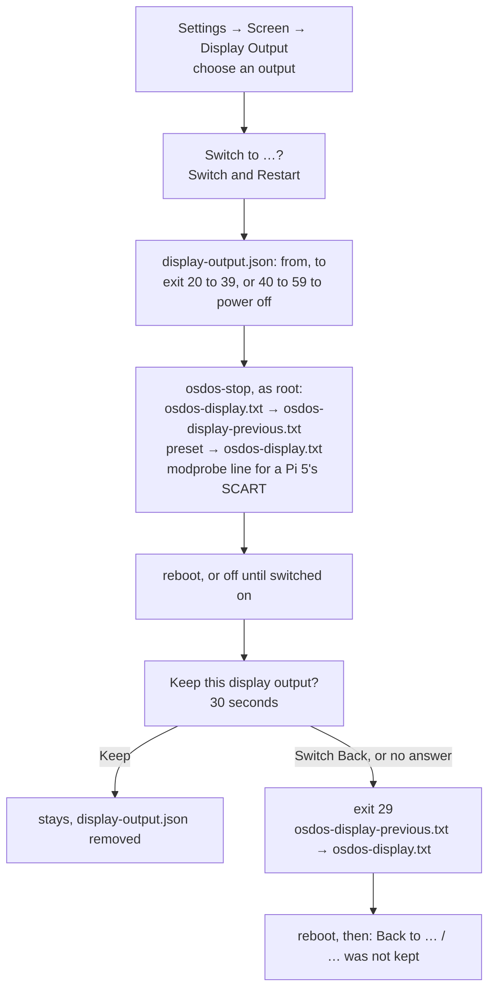
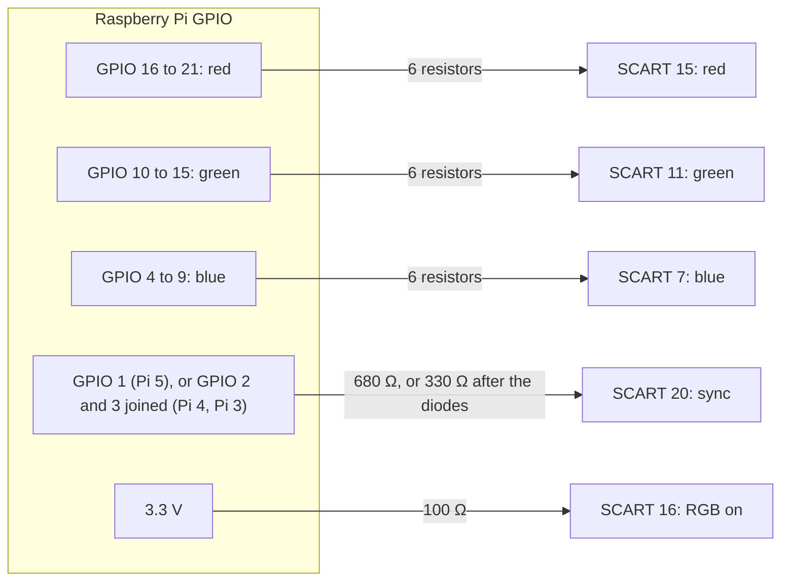

# Display Output

Settings → Screen → **Display Output**, on the OSD/OS image, switches where the picture goes: HDMI, composite, RGB for SCART or a JAMMA board.

## Where it is, and when

The row is on Settings' Screen page. Its value is the output in force (`HDMI`, `Composite PAL`, …). It can be used when all of this holds, and is dimmed otherwise:

1. `/boot/firmware/osdos-display.txt` exists, with the presets beside it: the OSD/OS image, or an app install that added them ([On an app install](https://github.com/mehmetraif/OSD-OS/wiki/Display-Output#on-an-app-install)).
2. OSD/OS was started by its service (`OSDOS_AUTOSTART` set), not by hand.
3. The launcher is level 3 or later (`OSDOS_LAUNCHER_API`, [The launcher API](https://github.com/mehmetraif/OSD-OS/wiki/The-OSD-OS-Image#the-launcher-api)). Some choices need more:
   - JAMMA 240p: level 4.
   - **Switch and Power Off** and **At Next Start**: level 5.
   - The JAMMA board's other modes: level 6.
   - JAMMA 480i at 640 across: level 9.
4. The Pi is a model OSD/OS knows, with more than one output to choose from.

| Setting | Values | Default | What it does | Config key |
|---|---|---|---|---|
| Display Output | The outputs this Pi has ([What each Pi offers](https://github.com/mehmetraif/OSD-OS/wiki/Display-Output#what-each-pi-offers)); **Custom** when the file in force matches none; **Next: <output>** while one waits for the next start | HDMI (the image's build setting `OSDOS_DISPLAY`) | Where the picture goes. A change restarts the Pi, powers it off, or waits for its next start, and stays only when kept | None: the choice is the file `/boot/firmware/osdos-display.txt` |

## How OSD/OS knows which Pi it is

OSD/OS reads the model from `/proc/device-tree/model`, for example `Raspberry Pi 4 Model B Rev 1.5`. The Display Output chooser shows it under its title.

| The model starts with | Family | Notes |
|---|---|---|
| `Raspberry Pi 3` | Pi 3 | 3 B, 3 B+, 3 A+ |
| `Raspberry Pi 4` | Pi 4 | The Pi 400 too, as a keyboard model |
| `Raspberry Pi 5` | Pi 5 | The Pi 500 too, as a keyboard model |
| anything else | none | Compute Modules, Zero 2 W and others: the row is dimmed |

A keyboard model (`Raspberry Pi 400`, `Raspberry Pi 500`) has no AV jack and no TV pads.

## What each Pi offers

The menu lists, in this order, the presets that are on the boot partition and that the board has:

| In the menu | Preset (`osdos-display-<id>.txt`) | Pi 3 | Pi 4 | Pi 5 |
|---|---|---|---|---|
| HDMI | `hdmi` | ✓ | ✓ | ✓ |
| Composite NTSC | `crt-ntsc` | AV jack | AV jack | TV pads |
| Composite PAL | `crt-pal` | AV jack | AV jack | TV pads |
| GPIO Composite NTSC | `crt-gpio-ntsc` | | | ✓ |
| GPIO Composite PAL | `crt-gpio-pal` | | | ✓ |
| SCART RGB NTSC | `scart-rgb-ntsc` (480i) | ✓ | ✓ | ✓ |
| SCART RGB PAL | `scart-rgb-pal` (576i) | ✓ | ✓ | ✓ |
| SCART RGB 240p | `scart-rgb-240p` | ✓ | ✓ | |
| SCART RGB 288p | `scart-rgb-288p` | ✓ | ✓ | |
| JAMMA 240p 15 kHz (720x240) | `jamma-240p` | ✓ | ✓ | ✓ |
| JAMMA 240p 15 kHz (320x240) | `jamma-240p-native` | ✓ | ✓ | ✓ |
| JAMMA 240p 15 kHz (1920x240) | `jamma-240p-super` | ✓ | ✓ | ✓ |
| JAMMA 288p 15 kHz (720x288) | `jamma-288p` | ✓ | ✓ | ✓ |
| JAMMA 288p 15 kHz (1920x288) | `jamma-288p-super` | ✓ | ✓ | ✓ |
| JAMMA 480i 15 kHz (720x480) | `jamma-480i` | ✓ | ✓ | |
| JAMMA 480i 15 kHz (640x480) | `jamma-480i-640` | ✓ | ✓ | |
| JAMMA 576i 15 kHz (720x576) | `jamma-576i` | ✓ | ✓ | |
| JAMMA 25 kHz (496x384) | `jamma-25k` | ✓ | ✓ | ✓ |
| JAMMA 31 kHz (640x480) | `jamma-31k` | ✓ | ✓ | ✓ |

- **A Pi 400 or a Pi 500** offers what a Pi 4 or a Pi 5 does, but for Composite NTSC and PAL.
- **Untested outputs.** [os/README.md](https://github.com/mehmetraif/OSD-OS/blob/main/os/README.md#display-output-hdmi-composite-or-scart) names only the Pi 4's HDMI and composite as tested on hardware. The others are starting points. Report what works, or needs a change, in an [issue](https://github.com/mehmetraif/OSD-OS/issues).
- **A Pi 4 has one output on at a time.** Composite or RGB turns its HDMI off.
- **A Pi 5 may keep HDMI on beside a CRT.** OSD/OS and its videos take the preset's output ([The Pi 5's output](https://github.com/mehmetraif/OSD-OS/wiki/Display-Output#the-pi-5s-output)).

## Switching

1. Select **Settings → Screen → Display Output**. The chooser shows the Pi's model and **Now: <output>**.
2. Choose another output. OSD/OS asks **Switch to <output>?**:
   - **Switch and Restart**: the Pi restarts on it now.
   - **At Next Start**: written now. The Pi stays on its output, and starts on the new one the next time it starts ([At the next start](https://github.com/mehmetraif/OSD-OS/wiki/Display-Output#at-the-next-start)).
   - **Switch and Power Off**: written, then the Pi powers off.
   - **Cancel**.
3. On the new output, OSD/OS asks whether to keep it ([Keep or go back](https://github.com/mehmetraif/OSD-OS/wiki/Display-Output#keep-or-go-back)).

**Into a cabinet, or onto a TV that isn't here.** Use **At Next Start** or **Switch and Power Off**, then move the Pi. **Switch and Restart** would ask on a screen that isn't connected, and go back after 30 seconds.



The stop helper writes the files as root ([osdos-stop](https://github.com/mehmetraif/OSD-OS/wiki/The-OSD-OS-Image#osdos-stop)). OSD/OS logs the switch as it exits, `[DisplayOutput] hdmi -> crt-pal: exit 22 for osdos-stop`:

```sh
journalctl -b -1 -u osdos | grep DisplayOutput
```

### At the next start

**At Next Start** writes the new output to the card while OSD/OS goes on, on the output it has ([At Next Start's socket](https://github.com/mehmetraif/OSD-OS/wiki/The-OSD-OS-Image#at-next-starts-socket)).

- The row reads **Next: <output>**, and the chooser **Next start: <output>**.
- A failure shows as **Not written for the next start**, with the reason.
- **Another output** chosen with At Next Start is written over it.
- **The output in force**, chosen again, asks **Stay on <output>?**: **Stay** takes the waiting one back.
- A restart of OSD/OS alone, without the Pi's, keeps it waiting.

## Keep or go back

On the new output, before anything else, OSD/OS asks **Keep this display output?**, with *Back to <old output> in 30 sec*.

- **Keep** (▲ to it, then select): the output stays.
- **Switch Back**, back, or no answer within **30 seconds**: the Pi reboots on the old output.
- The cursor starts on **Switch Back**, so a key pressed at random on a blank screen never keeps the new output.
- Until it is answered, the startup module, a favourite set to Play at Startup and the menu music wait.
- In a JAMMA cabinet: the joystick up to **Keep**, then button 1 ([Controls → A JAMMA cabinet](https://github.com/mehmetraif/OSD-OS/wiki/Controls#a-jamma-cabinet)).

Afterwards the old output says what happened, once. Select or back closes it.

| Message | Means |
|---|---|
| **Back to <old output>**, *<new output> was not kept* | The Pi switched back |
| **Still on <output>**, *The display output couldn't be switched to <output>* | Nothing was written, as when a preset was missing |

## Setting the screen up

**Settings → Screen → Test Patterns** has the pictures to set the screen up by: size and position, geometry, convergence, brightness, contrast and colour ([Settings → Screen → Test Patterns](https://github.com/mehmetraif/OSD-OS/wiki/Settings#test-patterns)).

## The base config.txt

The image's [`config.txt`](https://github.com/mehmetraif/OSD-OS/blob/main/os/stage-osdos/03-boot/files/config.txt) holds what doesn't change with the output, and includes `osdos-display.txt` for what does. Its global part:

```ini
# --- Global ---
auto_initramfs=1
disable_splash=1
disable_overscan=1
dtparam=audio=on
arm_64bit=1
# No pause before loading the kernel (the firmware waits a second by default).
boot_delay=0

include osdos-display.txt
```

Then come the `[pi3]`, `[pi3+]` and `[pi4]` sections, with the same driver and overclocking lines as an app install's ([Installation → 2. config.txt, for a CRT or for HDMI](https://github.com/mehmetraif/OSD-OS/wiki/Installation#2-configtxt-for-a-crt-or-for-hdmi)).

- A Pi 3 and a Pi 4 run fake KMS (`dtoverlay=vc4-fkms-v3d,cma-256`). The Pi 4 adds its HEVC decoder (`dtoverlay=rpivid-v4l2`).
- A Pi 5 runs full KMS (`vc4-kms-v3d`), set in the preset.

## The outputs, preset by preset

The presets are [`os/stage-osdos/03-boot/files/osdos-display-*.txt`](https://github.com/mehmetraif/OSD-OS/tree/main/os/stage-osdos/03-boot/files), installed beside `config.txt`. `osdos-display.txt` is a byte-for-byte copy of one of them. The row reads **Custom** when it matches none, as after an edit by hand.

The blocks below leave out each preset's prose comments. Four comment lines are read by OSD/OS, not by the firmware:

| Line | What it does |
|---|---|
| `# osdos-output: Composite` or `DPI` | On a Pi 5, the kind of output OSD/OS and mpv take ([The Pi 5's output](https://github.com/mehmetraif/OSD-OS/wiki/Display-Output#the-pi-5s-output)) |
| `# osdos-mode: 720x480` | On a Pi 5, that output's mode |
| `# osdos-controls: jamma` | `osdos-jamma` waits for the board's controls as the Pi starts ([Controls → A JAMMA cabinet](https://github.com/mehmetraif/OSD-OS/wiki/Controls#a-jamma-cabinet)) |
| `# osdos-sync: separate` | The switch writes no `force_csync` for it. On a Pi 5 that would put a sync on GPIO 1, the controls' I2C clock |

### HDMI

```ini
display_auto_detect=1
hdmi_force_hotplug=1

[pi5]
dtoverlay=vc4-kms-v3d

[all]
```

The image's default (`OSDOS_DISPLAY=hdmi`). The TV's resolution is detected. `hdmi_force_hotplug=1` drives HDMI even when the Pi doesn't see the TV.

### Composite: the AV jack, or a Pi 5's TV pads

NTSC, 480 lines, 4:3 (`crt-ntsc`):

```ini
# osdos-output: Composite
# osdos-mode: 720x480
enable_tvout=1
sdtv_mode=0
sdtv_aspect=1

[pi5]
dtoverlay=vc4-kms-v3d,cma-512,composite=1

[all]
```

PAL, 576 lines, 4:3 (`crt-pal`): the same with `sdtv_mode=2` and `# osdos-mode: 720x576`.

| Line | What it does |
|---|---|
| `enable_tvout=1` | Turns composite on. On a Pi 4 it turns HDMI off |
| `sdtv_mode=0` / `2` | NTSC / PAL |
| `sdtv_aspect=1` | 4:3 |
| `[pi5]` `dtoverlay=vc4-kms-v3d,cma-512,composite=1` | A Pi 5's full KMS driver, with a 512 MB memory pool (CMA) and its composite encoder on |
| `# osdos-mode: 720x480` | A Pi 5's composite takes the standard from the mode's lines: 480 is NTSC, 576 PAL |

On a Pi 3 or 4 the AV jack carries the picture and the sound. A Pi 5's composite comes out of two pads on the board, and its sound from HDMI or a USB sound card ([The cables](https://github.com/mehmetraif/OSD-OS/wiki/Display-Output#the-cables), [Audio Output](https://github.com/mehmetraif/OSD-OS/wiki/Audio-Output)).

### GPIO composite (Pi 5)

```ini
# osdos-output: Composite
# osdos-mode: 720x480

[pi5]
dtoverlay=vc4-kms-v3d,cma-512,composite=1
dtoverlay=vec-gpio-pi5

[all]
```

PAL is the same with `720x576`. `vec-gpio-pi5` sends the composite signal to GPIO 4 (the lowest bit) to 11 as an 8-bit code, for a digital-to-analog converter you build. The TV pads are the simpler way.

### SCART RGB on a Pi 4 or a Pi 3: the firmware's DPI

RGB comes out of the GPIO pins as the Pi's parallel display interface (DPI), in the VGA666 board's layout, to a resistor DAC. GPIO 4 to 21 carry the colours, GPIO 2 and 3 the vertical and horizontal sync.

It is the only output while it is on. Untested on a Pi 3.

480i (`scart-rgb-ntsc`). The `[pi3]` part is the same as `[pi4]`:

```ini
# osdos-output: DPI

[pi4]
dtoverlay=vga666
enable_dpi_lcd=1
display_default_lcd=1
hdmi_ignore_hotplug=1
dpi_group=2
dpi_mode=87
dpi_timings=720 0 16 62 60 480 0 9 6 30 0 0 0 30 1 13500000 1
```

| Line | What it does |
|---|---|
| `dtoverlay=vga666` | The VGA666 board's pins: 6 bits a colour on GPIO 4 to 21, syncs on GPIO 2 and 3 |
| `enable_dpi_lcd=1`, `display_default_lcd=1` | DPI on, and the default display |
| `hdmi_ignore_hotplug=1` | HDMI stays off, even with a TV plugged in |
| `dpi_group=2`, `dpi_mode=87` | A mode of its own, from `dpi_timings` |

The four timings, each in its own preset:

| Preset | `dpi_timings` |
|---|---|
| `scart-rgb-ntsc` (480i) | `720 0 16 62 60 480 0 9 6 30 0 0 0 30 1 13500000 1` |
| `scart-rgb-pal` (576i) | `720 0 12 64 68 576 0 5 5 39 0 0 0 25 1 13500000 1` |
| `scart-rgb-240p` | `720 0 16 62 60 240 0 4 3 15 0 0 0 60 0 13500000 1` |
| `scart-rgb-288p` | `720 0 12 64 68 288 0 3 3 18 0 0 0 50 0 13500000 1` |

The 17 numbers of `dpi_timings`:

| # | Field |
|---|---|
| 1 | Active pixels across |
| 2 | **Horizontal sync polarity** |
| 3, 4, 5 | Horizontal front porch, sync pulse, back porch |
| 6 | Active lines |
| 7 | **Vertical sync polarity** |
| 8, 9, 10 | Vertical front porch, sync pulse, back porch |
| 11, 12 | Vertical sync offsets |
| 13 | Pixel repetition |
| 14 | Frame rate |
| 15 | Interlaced |
| 16 | Pixel clock, Hz |
| 17 | Aspect ratio |

- The syncs are negative, as a TV's. **Should the picture roll**, change the 2nd and 7th numbers from `0` to `1`.
- 240p and 288p are progressive: the menus then have half the lines. Use them should 480i or 576i not hold on your TV.

### SCART RGB on a Pi 5: the kernel's DPI

On a Pi 5 the 480i and 576i presets use the kernel's generic DPI overlay (`vc4-kms-dpi-generic`). The 576i part of `osdos-display-scart-rgb-pal.txt`:

```ini
[pi5]
dtoverlay=vc4-kms-v3d,cma-512
dtoverlay=vc4-kms-dpi-generic,clock-frequency=13500000
dtparam=hactive=720,hfp=12,hsync=64,hbp=68
dtparam=vactive=576,vfp=5,vsync=5,vbp=39
dtparam=hsync-invert,vsync-invert,interlaced

[all]
```

480i differs in two lines: `dtparam=hactive=720,hfp=16,hsync=62,hbp=60` and `dtparam=vactive=480,vfp=6,vsync=6,vbp=33`.

SCART wants one composite sync. On a Pi 5 the DPI driver makes it on **GPIO 1**, when its module is loaded with `force_csync=1`:

```text
# /etc/modprobe.d/osdos-display.conf
options drm_rp1_dpi force_csync=1
```

The switch writes this file for the two SCART RGB presets, and removes it for any other. A Pi 5 keeps HDMI on beside its RGB.

### JAMMA: a Raspberry Pi to JAMMA board

A Raspberry Pi to JAMMA board puts the Pi in an arcade cabinet. It takes the picture to the monitor, the sound to the speaker through its own amplifier, and the controls back to the Pi. The [Arcade](https://github.com/mehmetraif/OSD-OS/wiki/Arcade) module plays the cabinet's games.

- The **JAMMA** presets are for boards in RGB-Pi's layout: RGB-Pi's own JAMMA board, and Crown Arcade's "Raspberry Pi TO JAMMA".
- Their DPI is in the "mode 6" layout, not the VGA666's: the SCART presets would show them the wrong colours.
- Crown Arcade names the Pi 3 B+ and the Pi 4 for its board, not the Pi 5. Untested on a Pi 3.
- A Pi 5 can't send its sound to the board's amplifier: it needs a USB sound card.

`osdos-display-jamma-240p.txt`. The `[pi3]` part is the same as `[pi4]`:

```ini
# osdos-controls: jamma
# osdos-output: DPI
# osdos-mode: 720x240
# osdos-sync: separate

[pi4]
gpio=2-9,12-17,20-25=a2
enable_dpi_lcd=1
display_default_lcd=1
hdmi_ignore_hotplug=1
dpi_output_format=6
dpi_group=2
dpi_mode=87
dpi_timings=720 1 16 62 60 240 1 4 3 15 0 0 0 60 0 13500000 1
dtparam=i2c_vc=on
dtoverlay=audremap,pins_18_19

[pi5]
dtparam=i2c_vc=on
dtoverlay=vc4-kms-v3d,cma-512
dtoverlay=vc4-kms-dpi-generic,clock-frequency=13500000
dtparam=hactive=720,hfp=16,hsync=62,hbp=60
dtparam=vactive=240,vfp=4,vsync=3,vbp=15
dtparam=hsync-invert,vsync-invert,rgb666-padhi
dtoverlay=osdos-jamma-dpi

[all]
```

The Pi 4's and Pi 3's part, the firmware's DPI:

| Line | What it does |
|---|---|
| `gpio=2-9,12-17,20-25=a2` | The DPI's pins: the syncs on GPIO 2 and 3, blue on 4 to 9, green on 12 to 17, red on 20 to 25. GPIO 0 and 1 stay free for I2C |
| `dpi_output_format=6` | 6 bits a colour, in that layout ("mode 6") |
| `dpi_timings=…` | 240p at 15.7 kHz and 60 Hz, as `scart-rgb-240p`, with both syncs `1` |
| `dtparam=i2c_vc=on` | I2C on GPIO 0 and 1 (`/dev/i2c-0`), where the board's two MCP23017s read the controls |
| `dtoverlay=audremap,pins_18_19` | The sound on GPIO 18 and 19, the board's amplifier. Settings → Sound → Audio Output's **AV Jack** is then the cabinet's speaker |

The Pi 5's part, the kernel's DPI:

| Line | What it does |
|---|---|
| `dtparam=i2c_vc=on` | I2C on GPIO 0 and 1 (`/dev/i2c-0`), as on the Pi 4 |
| `dtoverlay=vc4-kms-dpi-generic,…`, `dtparam=hactive=…`, `dtparam=vactive=…` | The same 240p |
| `dtparam=hsync-invert,vsync-invert,rgb666-padhi` | Both syncs active low, and 6 bits a colour in the "mode 6" layout |
| `dtoverlay=osdos-jamma-dpi` | The image's own overlay: the DPI on GPIO 2 to 9, 12 to 17 and 20 to 25 only. Built from [`osdos-jamma-dpi.dts`](https://github.com/mehmetraif/OSD-OS/blob/main/os/stage-osdos/03-boot/files/osdos-jamma-dpi.dts) into `/boot/firmware/overlays/osdos-jamma-dpi.dtbo` |

- **The sound on a Pi 5.** Plug in a USB sound card and choose it in [Settings → Sound → Audio Output](https://github.com/mehmetraif/OSD-OS/wiki/Audio-Output). The board's volume knob sets how loud it is.
- **Should the picture roll** on a Pi 4 or a Pi 3, change the 2nd and 7th numbers of `dpi_timings` from `1` to `0`. On a Pi 5, take `hsync-invert,vsync-invert,` out of the line `dtparam=hsync-invert,vsync-invert,rgb666-padhi`.
- A monitor that drops its sync now and then may need a sync cleaner.
- **By hand on a Pi 5.** A preset copied over `osdos-display.txt` from a computer can't remove `/etc/modprobe.d/osdos-display.conf`, which a SCART RGB preset leaves. Its sync would take GPIO 1 from the controls. After SCART RGB, choose a JAMMA preset in Settings, or delete that file.

#### The board's other modes

Each of the board's nine other presets is JAMMA 240p's but for its mode. Its name in the menu says its scan rate, then its resolution ([What each Pi offers](https://github.com/mehmetraif/OSD-OS/wiki/Display-Output#what-each-pi-offers)).

| Preset | Mode | Scan rate | For | Timing |
| --- | --- | --- | --- | --- |
| `jamma-240p` | 720×240, 60 Hz | 15.73 kHz | A 15 kHz monitor | SCART RGB 240p's |
| `jamma-240p-native` | 320×240, 60 Hz | 15.66 kHz | A 15 kHz monitor: one pixel for each of a game's 320 | Recalbox RGB JAMMA's |
| `jamma-240p-super` | 1920×240, 60 Hz | 15.66 kHz | A 15 kHz monitor, a super resolution: a game of any width fills it | Switchres' (arcade_15) |
| `jamma-288p` | 720×288, 50 Hz | 15.63 kHz | A 15 kHz monitor, for games of 50 Hz | CEA-861's, as SCART RGB 288p |
| `jamma-288p-super` | 1920×288, 50 Hz | 15.65 kHz | The same, a super resolution | Recalbox's |
| `jamma-480i` | 720×480 interlaced, 60 fields a second | 15.73 kHz | A 15 kHz monitor, twice the lines, which flicker. A Pi 4 or a Pi 3 | SCART RGB 480i's |
| `jamma-480i-640` | 640×480 interlaced, 60 fields a second | 15.73 kHz | The same with square pixels on a 4:3 tube. A Pi 4 or a Pi 3 | NTSC's square-pixel sampling (12.27 MHz, 780 pixels a line) |
| `jamma-576i` | 720×576 interlaced, 50 fields a second | 15.63 kHz | The same at 50 Hz. A Pi 4 or a Pi 3 | Raspberry Pi's 576i |
| `jamma-25k` | 496×384, 60 Hz | 24.96 kHz | A medium resolution (25 kHz) or tri-sync monitor only | Recalbox RGB JAMMA's |
| `jamma-31k` | 640×480, 60 Hz | 31.47 kHz | A 31 kHz (VGA) or tri-sync monitor only | VESA's |

- **Too high a scan rate can damage a 15 kHz monitor.** Choose JAMMA 25 kHz or JAMMA 31 kHz only for a monitor made for that rate. The switch's question says so first: *For a 31 kHz (VGA) or tri-sync monitor only: too high a scan rate can damage a 15 kHz one.* The mode before comes back only after the 30 seconds.
- **No interlace on a Pi 5.** Its DPI interlaces only with a sync on GPIO 1, which carries the board's controls. JAMMA 480i and 576i are untested on the board.
- **The picture's shape.** Every JAMMA mode is shown 4:3 whatever its pixels ([below](https://github.com/mehmetraif/OSD-OS/wiki/Display-Output#overscan-and-the-safe-area)).
- **Should the picture roll**, change the syncs as for JAMMA 240p.

### The Pi 5's output

On a Pi 5 the launcher reads the preset's `# osdos-output:` and `# osdos-mode:` lines. It waits up to ten seconds for that connector, `/sys/class/drm/card*-Composite-*` or `card*-DPI-*`. OSD/OS and mpv then draw on it, in the preset's mode.

- Without such a connector it takes the first card with a connected display, and logs `osdos: the display preset's Composite output never appeared; taking the first display connected` (`DPI` for an RGB or JAMMA preset).
- A Pi 4 has one output on at a time and is left as it was.
- Netflix and Prime Video's browser picks a screen of its own.

### The other presets, whole

Every preset is whole in [`os/stage-osdos/03-boot/files`](https://github.com/mehmetraif/OSD-OS/tree/main/os/stage-osdos/03-boot/files). Those not shown above differ like this:

| Preset | As | But |
|---|---|---|
| `osdos-display-crt-pal.txt` | `crt-ntsc` | `sdtv_mode=2`, `# osdos-mode: 720x576` |
| `osdos-display-crt-gpio-pal.txt` | `crt-gpio-ntsc` | `# osdos-mode: 720x576` |
| `osdos-display-scart-rgb-pal.txt` | `scart-rgb-ntsc` | The 576i timings, in all three parts |
| `osdos-display-scart-rgb-240p.txt`, `osdos-display-scart-rgb-288p.txt` | `scart-rgb-ntsc` | Their own `dpi_timings`; no `[pi5]` part, no `# osdos-output:` line |
| The other `osdos-display-jamma-*.txt` | `jamma-240p` | Their own timing and `# osdos-mode:`. 480i and 576i have no `[pi5]` part |

## What the switch writes

| File | On | Written |
|---|---|---|
| `/boot/firmware/osdos-display.txt` | the boot partition (bootfs) | The chosen preset, copied whole |
| `/boot/firmware/osdos-display-previous.txt` | the boot partition | The preset that was in force, for going back |
| `/etc/modprobe.d/osdos-display.conf` | the system's partition | `options drm_rp1_dpi force_csync=1` for a SCART RGB preset, else removed |
| `~/.local/share/OSD-OS/display-output.json` | the data folder | `{ "from", "to" }` while a switch waits to be kept, `{ "reverted" }` after a switch back; removed once answered |

`cmdline.txt` is never touched by a switch, and no preset sets a `video=` mode there ([The OSD/OS image → The boot](https://github.com/mehmetraif/OSD-OS/wiki/The-OSD-OS-Image#the-boot-osdos-first)).

## The cables

> GPIO pins carry 3.3 V and take nothing more. SCART's 5 V and 12 V must never reach them.

### Composite from a Pi 4's AV jack

A Pi 4 (and a Pi 3) carries the picture and the sound on its AV jack, a 4-pole 3.5 mm plug. Wired this way to SCART:

| AV jack | Signal | SCART pin |
|---|---|---|
| Tip | Left audio | 6 (audio in, left) |
| Ring 1 | Right audio | 2 (audio in, right) |
| Ring 2 | Ground | 4 (audio ground), 17 (video ground), 21 (shield) |
| Sleeve | Composite video | 20 (video in) |

The same plug to a TV's three RCA inputs is a camcorder cable. Camcorder cables are not all wired alike: check yours against the table.

### Composite from a Pi 5's TV pads

A Pi 5's composite comes from the two pads by HDMI 1 (J7): the picture and ground. Solder on wires or a pin header, the picture to SCART pin 20 and ground to pin 17. For sound, a USB sound card feeds SCART pins 6 and 2, ground on 4 ([Audio Output](https://github.com/mehmetraif/OSD-OS/wiki/Audio-Output)).

### GPIO composite (Pi 5)

`vec-gpio-pi5` puts the composite signal on GPIO 4 (the lowest bit) to 11 as an 8-bit code. It needs a digital-to-analog converter of your own between the pins and the TV.

### SCART RGB on the GPIO pins (Pi 3, Pi 4, Pi 5)

In the layout of the VGA666 board, which the presets use:

| GPIO (header pin) | Signal | SCART pin |
|---|---|---|
| 16 to 21 (36, 11, 12, 35, 38, 40) | Red, 6 bits, GPIO 21 the highest | 15 (red), ground 13 |
| 10 to 15 (19, 23, 32, 33, 8, 10) | Green, 6 bits, GPIO 15 the highest | 11 (green), ground 9 |
| 4 to 9 (7, 29, 31, 26, 24, 21) | Blue, 6 bits, GPIO 9 the highest | 7 (blue), ground 5 |
| 1 (28), Pi 5 | Composite sync | 20, through 680 Ω; ground 17 |
| 2 and 3 (3, 5), Pi 4 and Pi 3 | Vertical and horizontal sync, negative | Joined into one composite sync for pin 20, see below |
| 3.3 V (1) | RGB on | 16 (blanking), through 100 Ω (or 5 V, header pin 2, through 180 Ω); ground 18 |
| GND (6, 9, …) | Ground | 4, 5, 9, 13, 17, 18, 21 |

**The resistor DAC.** Each colour's six pins meet at its SCART pin, each through a resistor: about 0.7 V into the TV's 75 Ω.

| Bit | Resistor: the VGA666's (E96) | Red: GPIO (pin) | Green: GPIO (pin) | Blue: GPIO (pin) |
|---|---|---|---|---|
| highest | 510 Ω (549 Ω) | 21 (40) | 15 (10) | 9 (21) |
| | 1 kΩ (1.1 kΩ) | 20 (38) | 14 (8) | 8 (24) |
| | 2 kΩ (2.21 kΩ) | 19 (35) | 13 (33) | 7 (26) |
| | 3.9 kΩ (4.42 kΩ) | 18 (12) | 12 (32) | 6 (31) |
| | 8.2 kΩ (8.87 kΩ) | 17 (11) | 11 (23) | 5 (29) |
| lowest | 16 kΩ (17.8 kΩ) | 16 (36) | 10 (19) | 4 (7) |
| to SCART | | pin 15, ground 13 | pin 11, ground 9 | pin 7, ground 5 |

The VGA666's values are close enough; the E96 values halve each step exactly. 1 % resistors do for 6 bits.

**The sync on a Pi 4 or a Pi 3.** Their two negative syncs, on GPIO 2 and 3, must be joined into one. Two ways:

- **Two diodes**, their cathodes to GPIO 2 and 3, their anodes joined and pulled up to 3.3 V by 470 Ω, then 330 Ω to SCART pin 20.
- **A 74HC86**, powered from 3.3 V, as XNOR. GPIO 2 XOR GPIO 3 in one gate, through a second gate with its other input at 3.3 V, then 680 Ω to pin 20.

**The rest of the SCART plug.**

- **Sound**: from a Pi 4's or Pi 3's AV jack (tip, ring 1, ring 2 as above) or a USB sound card, to pins 6, 2 and 4 ([Audio Output](https://github.com/mehmetraif/OSD-OS/wiki/Audio-Output)).
- **Pin 8** at 9.5 to 12 V, from a 12 V supply through 1 kΩ, switches most TVs to the SCART input, in 4:3. Without it, choose the input with the TV's remote.
- **Pin 16**, the blanking line ("RGB on" in the table), tells the TV to take the picture from the RGB pins.



### A Raspberry Pi to JAMMA board

No cable to make: the board sits on the Pi's GPIO header, and the cabinet's JAMMA harness on the board's edge.

1. Choose **JAMMA 240p 15 kHz (720x240)**, or the mode the cabinet's monitor takes ([The board's other modes](https://github.com/mehmetraif/OSD-OS/wiki/Display-Output#the-boards-other-modes)), with **At Next Start** or **Switch and Power Off**. Or copy its preset over `osdos-display.txt` from a computer ([Doing it by hand](https://github.com/mehmetraif/OSD-OS/wiki/Display-Output#doing-it-by-hand)).
2. Move the Pi into the cabinet and switch it on.
3. On **Keep this display output?**, push the joystick up to **Keep**, then press button 1.

From owners of Crown Arcade's board, in [its thread on Arcade-Projects](https://www.arcade-projects.com/threads/raspberry-pi-to-jamma-arcade-cabinet-interface.26347/):

- **Power.** The board's amplifier (an LM4952) runs from the cabinet's 12 V: check that the power supply gives it.
- **Pins 27 and e.** JP1 and JP2 (jumpers, or slide switches on later boards) set the edge's pins 27 and e: ground, as standard JAMMA, or the sixth button (CHAMMA). A cabinet with all six buttons on the edge needs CHAMMA. For a kick harness, the CPS1 and CPS2 connectors on the board's left side take buttons 4 to 6.
- **Screws.** Mount it so no screw touches the edge's pins.
- **Ground.** Should the controls or the picture be unsteady, run a ground wire from the harness's edge (pin 27 or 28) to the board's ground.

## Overscan and the safe area

A CRT hides the picture's edges under its bezel. The image sets `disable_overscan=1`, so OSD/OS gets the whole mode, and keeps what matters inside a safe area:

- **The content box** runs from 74 to 566 across and 57 to 430 down at 640×480. That is about 11.6 % in from each side and 11.9 % from the top, ending 10.4 % above the bottom.
- **The title bar** starts 12.5 % in from the top and the left.
- **The channel logo** on a video stands 10 % of the picture in from its corner.
- **A video** fills the whole screen.
- **A module of your own** should size everything from the screen ([Writing a module](https://github.com/mehmetraif/OSD-OS/wiki/Writing-a-Module)).

**The picture's shape on a CRT.** A CRT's mode doesn't have square pixels. On every output but HDMI, OSD/OS draws the menus, the videos (`--monitoraspect=4:3`) and the arcade games ([Arcade](https://github.com/mehmetraif/OSD-OS/wiki/Arcade)) for the tube's 4:3.

Off the image, a mode counts as a tube in two cases:

- 288 lines or fewer, and at least twice as wide as high (720×240, 1920×240, 720×288);
- 720 wide, with 480 or 576 lines.

A picture that still looks squeezed or stretched can be tuned for the videos in `~/.config/mpv/mpv.conf` (on the image, `/home/pi/.config/mpv/mpv.conf`). Start from 4:3's 1.333 and change it until a circle in a 4:3 test pattern is round:

```ini
monitoraspect=1.333
```

mpv.conf doesn't apply to videos played with Transparent Background ([Playback and mpv](https://github.com/mehmetraif/OSD-OS/wiki/Playback-and-mpv)).

## Doing it by hand

### On the image, from a computer

To put right a card that shows nothing, or to pick the output before the first boot:

1. Put the card in a computer and open the **bootfs** drive.
2. Copy the preset you want over `osdos-display.txt`: for PAL composite, copy `osdos-display-crt-pal.txt` and name the copy `osdos-display.txt`.
3. Put the card back in the Pi.

A switch made this way asks nothing.

- **A Pi 5's SCART RGB** also needs its composite sync line on the system's partition, which Windows and macOS can't write. Choose the output in Settings instead, or, from a shell on the Pi:

  ```sh
  echo "options drm_rp1_dpi force_csync=1" | sudo tee /etc/modprobe.d/osdos-display.conf
  ```

- **A preset you change yourself** shows in Settings as **Custom**. Edit `osdos-display.txt` and keep the original presets as they are.

### On an app install

On Raspberry Pi OS with OSD/OS installed as an app, the output is whatever `config.txt` says. [Installation → 2. config.txt, for a CRT or for HDMI](https://github.com/mehmetraif/OSD-OS/wiki/Installation#2-configtxt-for-a-crt-or-for-hdmi) has one for composite and one for HDMI.

**Settings → Screen → Display Output on an app install** needs the image's `config.txt` and presets on the boot partition. An install made with `install.sh` and its autostart service has the rest (an older install needs `install.sh` run again once). Keep the old `config.txt`, then fetch the image's, starting on HDMI:

```sh
base=https://raw.githubusercontent.com/mehmetraif/OSD-OS/main/os/stage-osdos/03-boot/files
sudo cp /boot/firmware/config.txt /boot/firmware/config.txt.before-osdos
for f in config.txt osdos-display-hdmi.txt osdos-display-crt-ntsc.txt osdos-display-crt-pal.txt \
         osdos-display-crt-gpio-ntsc.txt osdos-display-crt-gpio-pal.txt \
         osdos-display-scart-rgb-ntsc.txt osdos-display-scart-rgb-pal.txt \
         osdos-display-scart-rgb-240p.txt osdos-display-scart-rgb-288p.txt; do
    sudo curl -fsSL -o "/boot/firmware/$f" "$base/$f"
done
sudo cp /boot/firmware/osdos-display-hdmi.txt /boot/firmware/osdos-display.txt
sudo reboot
```

- To undo it, copy `config.txt.before-osdos` back over `config.txt`.
- The JAMMA presets are left out: they need the image's `osdos-jamma.service`, and on a Pi 5 its `osdos-jamma-dpi` overlay.

## Troubleshooting a black screen

**Right after a switch, wait.** 30 seconds after OSD/OS has started on the new output, it goes back to the old one by itself and reboots again.

| What you see | What to do |
|---|---|
| Nothing on a composite or SCART TV after the switch, and the old output came back | Check the TV's input and the cable, then the standard: a TV made for PAL may not take NTSC, and the other way round |
| Nothing at all, not even after the 30 seconds | Copy `osdos-display-hdmi.txt` (or the output you know works) over `osdos-display.txt` on **bootfs** ([On the image, from a computer](https://github.com/mehmetraif/OSD-OS/wiki/Display-Output#on-the-image-from-a-computer)) |
| HDMI went dark on a Pi 4 after choosing composite or SCART RGB | As it should: a Pi 4 has one output on at a time. Plug in the CRT |
| A Pi 5's picture still on HDMI after choosing composite or RGB | `ls /sys/class/drm/` should list a `card*-Composite-*` or `card*-DPI-*`. Without one, `journalctl -u osdos -b` has `the display preset's … output never appeared` |
| SCART RGB picture rolls (Pi 4, Pi 3) | Change `dpi_timings`' 2nd and 7th numbers from `0` to `1` in `osdos-display.txt` |
| SCART RGB: no picture, though the colours and the sync are wired | Check pin 16 (blanking, "RGB on"): without it the TV doesn't take RGB |
| A Pi 5's SCART RGB shows nothing, or the picture doesn't hold | Check that `/etc/modprobe.d/osdos-display.conf` has the `force_csync` line: Settings writes it, a preset copied by hand doesn't |
| The TV doesn't switch to SCART by itself | Pin 8 isn't driven; choose the input with the TV's remote |
| The menus run off the edges | Your TV's overscan is unusually large ([Overscan and the safe area](https://github.com/mehmetraif/OSD-OS/wiki/Display-Output#overscan-and-the-safe-area)) |
| The Display Output row is dimmed | One of [the conditions](https://github.com/mehmetraif/OSD-OS/wiki/Display-Output#where-it-is-and-when) isn't met |
| The row reads **Custom** | `osdos-display.txt` matches no preset byte for byte. Choosing a preset puts one back |

**What the Pi sees.** From a shell (Exit to Terminal, or SSH):

```sh
cat /proc/device-tree/model                            # which Pi
cat /boot/firmware/osdos-display.txt                   # the output in force
for c in /sys/class/drm/card*-*/status; do echo "$c: $(cat "$c")"; done   # the connectors
journalctl -b -u osdos | grep -E 'display index|DisplayOutput'           # what Qt drew on
```

At start OSD/OS logs each screen it sees: `[main] display index 0: "<name>" 720x480 at (0,0)`. For more about the KMS output Qt took, run `sudo systemctl edit osdos` and add:

```ini
[Service]
Environment=QT_QPA_EGLFS_DEBUG=1
```

Then `sudo systemctl restart osdos`, and read `journalctl -u osdos -b` ([Troubleshooting](https://github.com/mehmetraif/OSD-OS/wiki/Troubleshooting)).

## See also

- [The OSD/OS image](https://github.com/mehmetraif/OSD-OS/wiki/The-OSD-OS-Image): the boot partition, the boot and the stop helper
- [Audio Output](https://github.com/mehmetraif/OSD-OS/wiki/Audio-Output): the sound to go with the picture
- [How it works](https://github.com/mehmetraif/OSD-OS/wiki/How-It-Works): the display path, EGLFS and DRM
- [Playback and mpv](https://github.com/mehmetraif/OSD-OS/wiki/Playback-and-mpv): Scaling, mpv.conf and the decoding flags
- [Settings](https://github.com/mehmetraif/OSD-OS/wiki/Settings)
- [Troubleshooting](https://github.com/mehmetraif/OSD-OS/wiki/Troubleshooting)
- [FAQ](https://github.com/mehmetraif/OSD-OS/wiki/FAQ): 240p, RGB and HDMI
