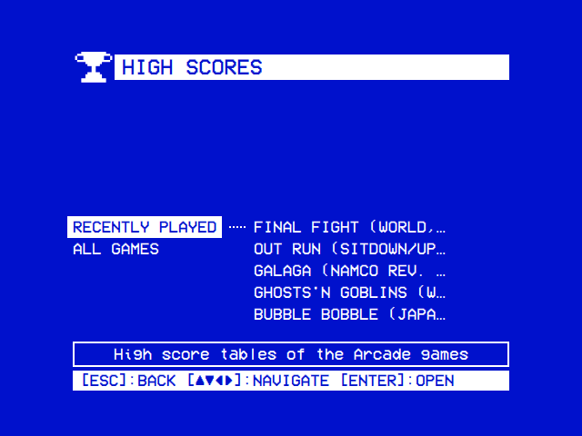
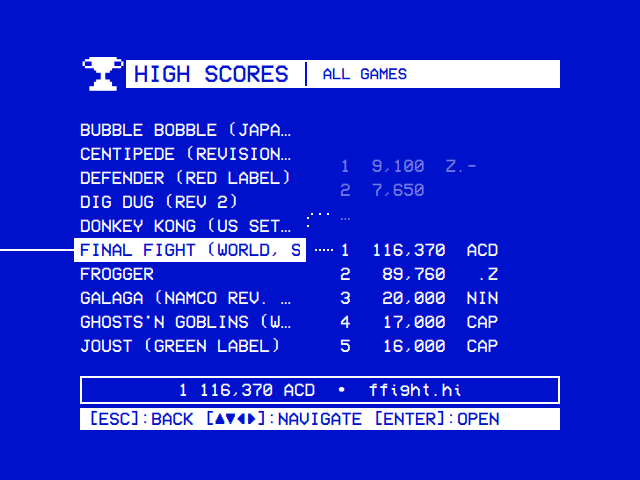
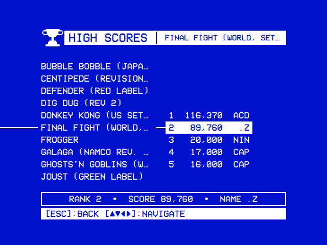
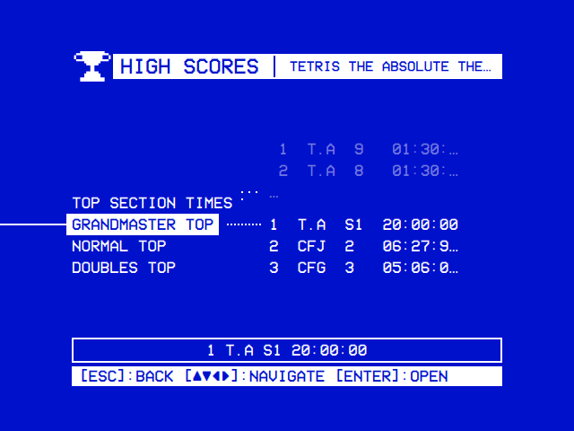

# High Scores

The High Scores module shows the high score tables of the arcade games played in the [Arcade](https://github.com/mehmetraif/OSD-OS/wiki/Arcade) module, as MAME kept them. It reads MAME's files on the device, with nothing online. It is off at first: turn it on in **Settings → Arcade → High Scores → Enabled**.

<table>
<tr><th width="50%">The games</th><th width="50%">All Games</th></tr>
<tr><td></td><td></td></tr>
<tr><td>The games played last in Arcade, latest first.</td><td>A game's table beside it; under the tree, its best entry and its file.</td></tr>
<tr><th>A game's table</th><th>A game with several tables</th></tr>
<tr><td></td><td></td></tr>
<tr><td>An entry's cells by column, under the tree.</td><td>A folder for each table of Tetris The Grand Master 2.</td></tr>
</table>

## Setting it up

1. **Play in Arcade**, with **Settings → Arcade → Save High Scores** on (the default; [Arcade → High scores](https://github.com/mehmetraif/OSD-OS/wiki/Arcade#high-scores)). Leave a game with Coin and Start together, so MAME saves its table.
2. **Turn it on**: **Settings → Arcade → High Scores → Enabled**. **High Scores** is then on the main menu.

A build of your own needs minizip ([Building from source](https://github.com/mehmetraif/OSD-OS/wiki/Building-from-Source)).

## The list

**High Scores** opens on a tree, which works as Local Files' does ([The tree](https://github.com/mehmetraif/OSD-OS/wiki/Local-Files#the-tree)). Each folder is there while it has a game in it.

| Folder | What it holds |
|---|---|
| **Recently Played** | The games played last in Arcade that have a table, latest first, up to 30 |
| **All Games** | Every game with a table, by name |
| **Not Readable** | The games whose files hi2txt can't read, and why ([below](#not-readable)) |

A game opens on its table, a line for each entry. A game with several tables (by difficulty, by mode) opens on a folder for each.

The line under the tree says what is under the cursor:

- on a game, its best entry and its file: `1 116,370 ACD • ffight.hi`;
- on an entry, each cell by its column: `RANK 2 • SCORE 89,760 • NAME .Z`.

### Reading the tables

Each time it opens, the module reads the games whose files are new or changed. The first time it reads them all, and shows `loading…` and `Reading the high scores…` meanwhile.

## Where the tables come from

MAME keeps a game's high scores in one of two places, both in `arcade` in the data folder:

- **The hiscore plugin's files**, `arcade/hiscore/<game>.hi`, for the games that forget their table when switched off. The plugin keeps a table only for the games in its `hiscore.dat`.
- **The game's own NVRAM**, `arcade/nvram/<game>/`, for the games that keep their table themselves.

hi2txt's game definitions say how each game lays its table out in its file: 3,102 definitions, clones included. The module shows the main tables and fields, and leaves out what a definition marks as extra. A game whose NVRAM holds no table hi2txt knows of isn't listed.

### Not Readable

| The line says | What it means |
|---|---|
| `hi2txt has no description of this game's high scores yet` | hi2txt has no definition of the game ([hi2txt-xml](https://github.com/GreatStoneEx/hi2txt-xml) takes new ones) |
| `The file isn't laid out as hi2txt knows this game's: another version of it?` | Another version of the game, or a file saved by another MAME |
| `The file holds what hi2txt can't make out` | A damaged file |
| `hi2txt's description of this game can't be read` | The definition itself is broken |
| `hi2txt reads this game's table from a file MAME hasn't saved` | The table is in the game's NVRAM, which isn't there yet |
| `The file holds no high score table yet` | The main table is in NVRAM that MAME hasn't saved yet |
| `The high scores couldn't be read: …` | Anything else, in openhi2txt's words |

## Settings

The module's row is on the Arcade module's page in Settings, under a **High Scores** heading.

| Setting | Values | Default | What it does | Config key |
|---|---|---|---|---|
| Enabled | ON, OFF | OFF | Shows High Scores on the main menu | `modules.com.osdos.highscores.enabled` |

## Files it keeps

In `highscores` in the data folder: `~/.local/share/OSD-OS/` on Linux and the OSD/OS image, `~/Library/Application Support/OSD-OS/` on a Mac, `%APPDATA%\OSD-OS\` on Windows.

| File | What it holds |
|---|---|
| `highscores/scores.json` | The tables read of each game |
| `highscores/mame/` | Links to `arcade/hiscore`, `arcade/nvram` and MAME's `hiscore.dat` |

MAME's own files are only read. Deleting `highscores` makes the module read every game again.

## Attribution

- [openhi2txt](https://github.com/inigomonyota/openhi2txt), by inigomonyota (GPL-3.0), reads the tables. It uses [RapidXML](https://rapidxml.sourceforge.net/), by Marcin Kalicinski (Boost Software License or MIT), and zlib's minizip (zlib licence).
- [hi2txt](http://greatstone.free.fr/hi2txt/)'s game definitions, many of them from HiToText, are by GreatStone and their contributors ([hi2txt-xml](https://github.com/GreatStoneEx/hi2txt-xml), GPL-2.0).
- MAME's hiscore plugin was written by borgar; its `hiscore.dat` is maintained by Leezer.

See [Credits](https://github.com/mehmetraif/OSD-OS/wiki/Credits).

## Troubleshooting

The messages on the module's own screen are on [Troubleshooting → High Scores](https://github.com/mehmetraif/OSD-OS/wiki/Troubleshooting#high-scores).

| Problem | What to do |
|---|---|
| A game played isn't listed | Turn **Settings → Arcade → Save High Scores** on, and leave the game with Coin and Start. The plugin keeps a table only for the games in its `hiscore.dat` ([above](#where-the-tables-come-from)) |
| A table looks wrong: scores out of order, names garbled | No `hiscore.dat` was found beside MAME: `highscores/mame/plugins/hiscore/hiscore.dat` isn't there. Or the file was saved by another MAME: delete the game's file in `arcade/hiscore` and play the game again |

## See also

- [Arcade](https://github.com/mehmetraif/OSD-OS/wiki/Arcade): the games, and its Save High Scores setting
- [Settings](https://github.com/mehmetraif/OSD-OS/wiki/Settings) and [Configuration Files](https://github.com/mehmetraif/OSD-OS/wiki/Configuration-Files)
