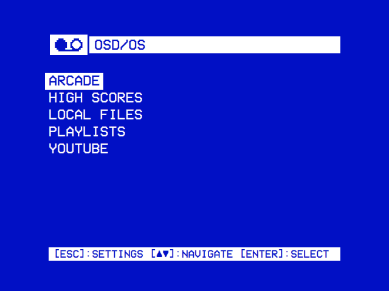

# OSD/OS wiki

OSD/OS makes a TV, preferably a CRT, a smart TV with the look of a VCR. On a Raspberry Pi it is the whole system. It has two sides, TV / Movie and Arcade.

## Getting started

| Page | What is in it |
|---|---|
| [Installation](https://github.com/mehmetraif/OSD-OS/wiki/Installation) | The Raspberry Pi image; the app on Raspberry Pi OS, macOS, SteamOS, Windows and the BSDs; updating; hardware |
| [Using OSD/OS](https://github.com/mehmetraif/OSD-OS/wiki/Using-OSD-OS) | Every screen, from the main menu to quitting |
| [Controls](https://github.com/mehmetraif/OSD-OS/wiki/Controls) | Keyboards, remotes, gamepads, the mouse, remapping, Bluetooth |
| [Features](https://github.com/mehmetraif/OSD-OS/wiki/Features) | Everything it does, at a glance |

## The system

| Page | What is in it |
|---|---|
| [The OSD/OS image](https://github.com/mehmetraif/OSD-OS/wiki/The-OSD-OS-Image) | Boot, services, the films partition, USB drives, SSH, logs |
| [Display Output](https://github.com/mehmetraif/OSD-OS/wiki/Display-Output) | HDMI, composite and SCART RGB on a Pi 4 and a Pi 5; the cables |
| [Audio Output](https://github.com/mehmetraif/OSD-OS/wiki/Audio-Output) | The AV jack, HDMI or a USB sound card |

## TV / Movie

Films and videos. Each source is a module.

| Page | What is in it |
|---|---|
| [Local Files](https://github.com/mehmetraif/OSD-OS/wiki/Local-Files) | Films, videos and photos in a folder |
| [Plex](https://github.com/mehmetraif/OSD-OS/wiki/Plex) · [Jellyfin](https://github.com/mehmetraif/OSD-OS/wiki/Jellyfin) · [Emby](https://github.com/mehmetraif/OSD-OS/wiki/Emby) | A media server's libraries |
| [YouTube](https://github.com/mehmetraif/OSD-OS/wiki/YouTube) | Subscriptions, channels, playlists and search, no account needed |
| [Netflix and Prime Video](https://github.com/mehmetraif/OSD-OS/wiki/Netflix-and-Prime-Video) | The service's catalogue, played in its own player |
| [Playlists](https://github.com/mehmetraif/OSD-OS/wiki/Playlists) | Lists of videos across modules, streamed or downloaded |
| [NFC Reader](https://github.com/mehmetraif/OSD-OS/wiki/NFC-Reader) · [Weather](https://github.com/mehmetraif/OSD-OS/wiki/Weather) · [Ambient:Mode](https://github.com/mehmetraif/OSD-OS/wiki/Ambient-Mode) | A card that plays a film, a 90s weather channel, a video on a loop |

## Arcade

Arcade games for up to six players, alone or with others.

| Page | What is in it |
|---|---|
| [Arcade](https://github.com/mehmetraif/OSD-OS/wiki/Arcade) | MAME and FinalBurn Neo from a folder of ROM sets |
| [Online and LAN Play](https://github.com/mehmetraif/OSD-OS/wiki/Online-and-LAN-Play) | Online, or on the local network with no internet |
| [High Scores](https://github.com/mehmetraif/OSD-OS/wiki/High-Scores) | Each game's high score table |
| [JAMMA cabinets](https://github.com/mehmetraif/OSD-OS/wiki/Display-Output#jamma-a-raspberry-pi-to-jamma-board) | A cabinet's monitor and controls |

## Modules

| Page | What is in it |
|---|---|
| [Modules](https://github.com/mehmetraif/OSD-OS/wiki/Modules) | All of them, and turning them on |
| [Scripts](https://github.com/mehmetraif/OSD-OS/wiki/Scripts) | Your own shell scripts |

## Making it yours

| Page | What is in it |
|---|---|
| [Settings](https://github.com/mehmetraif/OSD-OS/wiki/Settings) | Every row, its choices and where it is saved |
| [Themes](https://github.com/mehmetraif/OSD-OS/wiki/Themes) | The whole look at once: the nine included, and making your own |
| [Skins](https://github.com/mehmetraif/OSD-OS/wiki/Skins) | The window's shapes and icons, and drawing your own |
| [Effects](https://github.com/mehmetraif/OSD-OS/wiki/Effects) | Text, background, selector and screen effects, transitions |
| [Shaders](https://github.com/mehmetraif/OSD-OS/wiki/Shaders) | Writing a background or screen effect |
| [Menu music](https://github.com/mehmetraif/OSD-OS/wiki/Menu-Music) | Recordings, tracker modules and MIDI files |
| [Configuration files](https://github.com/mehmetraif/OSD-OS/wiki/Configuration-Files) | The data folder and config.json |
| [Playback and mpv](https://github.com/mehmetraif/OSD-OS/wiki/Playback-and-mpv) | mpv's options, scaling, subtitles and resume |

## Help

| Page | What is in it |
|---|---|
| [Troubleshooting](https://github.com/mehmetraif/OSD-OS/wiki/Troubleshooting) | The log, and problems by symptom |
| [FAQ](https://github.com/mehmetraif/OSD-OS/wiki/FAQ) | Kodi, other Pis, 240p, RGB, HDMI, Bluetooth, Wi-Fi, the name |
| [Credits and license](https://github.com/mehmetraif/OSD-OS/wiki/Credits) | Who made it, what it stands on, its license |

## Development

For building OSD/OS or adding to it. Not needed to use it.

| Page | What is in it |
|---|---|
| [How it works](https://github.com/mehmetraif/OSD-OS/wiki/How-It-Works) | The shell, modules, display path, playback, effects, settings, logs |
| [Writing a module](https://github.com/mehmetraif/OSD-OS/wiki/Writing-a-Module) | Step by step, with working code |
| [Building from source](https://github.com/mehmetraif/OSD-OS/wiki/Building-from-Source) | The app, the tests and the image; CI and releases |

Every screen is also in the [screen tour](https://github.com/mehmetraif/OSD-OS/blob/main/docs/TOUR.md).

These pages are published from [docs/wiki](https://github.com/mehmetraif/OSD-OS/tree/main/docs/wiki). To change one, open a pull request: an edit made here is replaced at the next publish.
