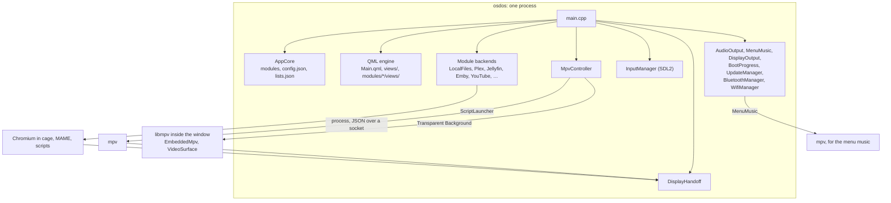
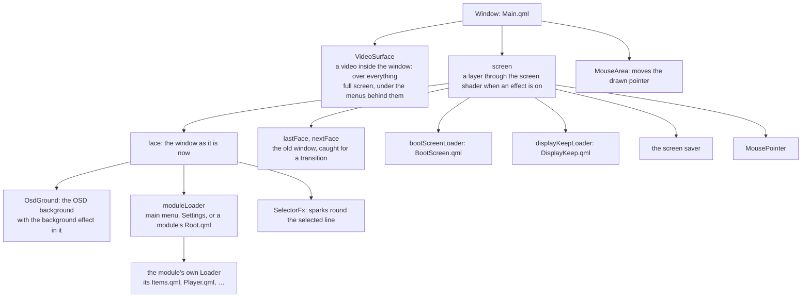
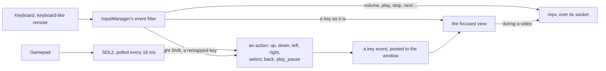
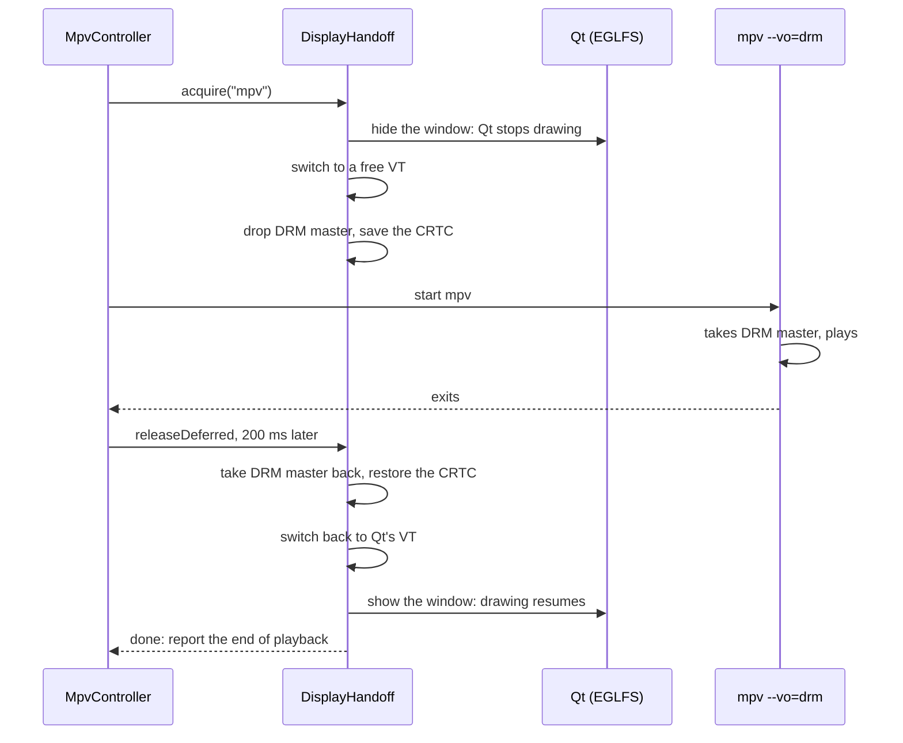
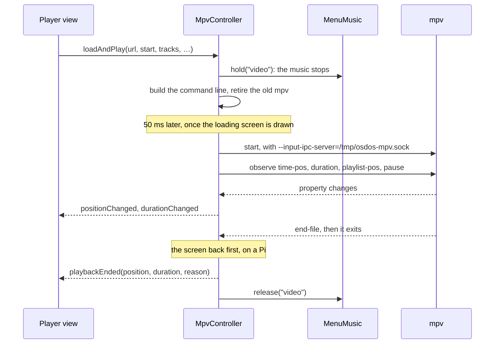
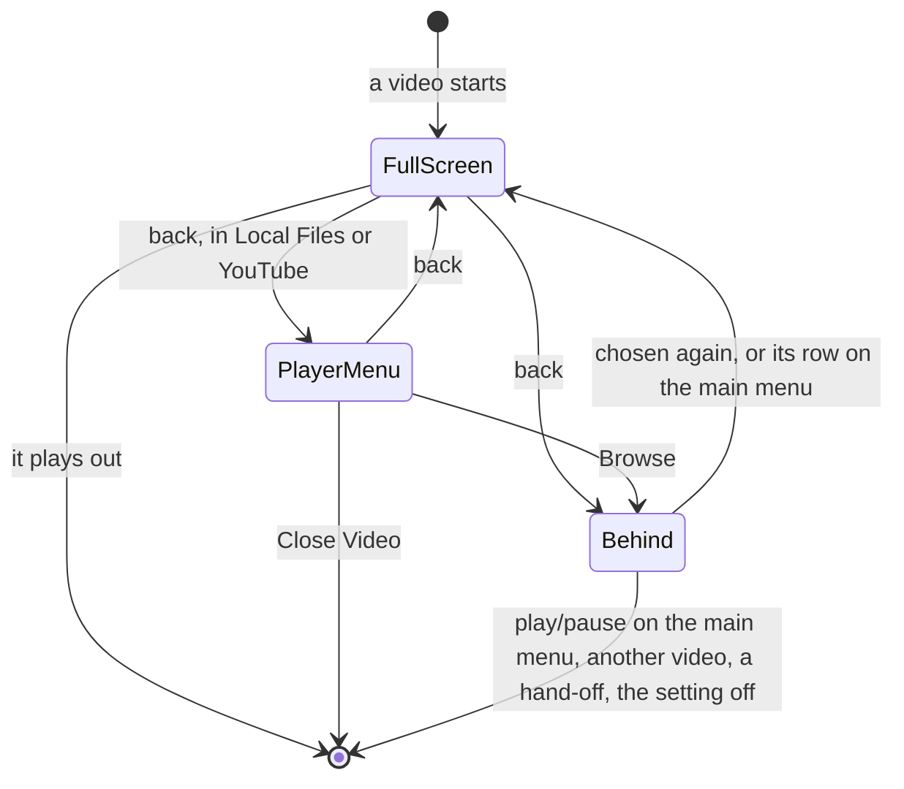
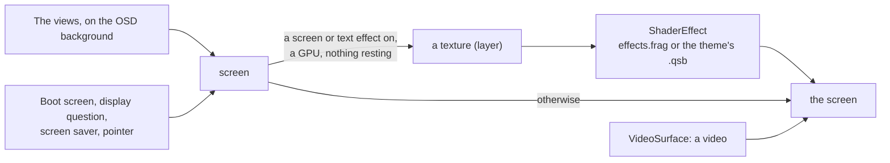

# How it works

A map of what happens inside OSD/OS: the shell and its modules, the screens, input, the display, playback, the menu music, the effects, settings and logs. [ARCHITECTURE.md](https://github.com/mehmetraif/OSD-OS/blob/main/ARCHITECTURE.md) is the reference for every detail.

## The big picture

OSD/OS is a **browsing shell that hands off to tools made for the job**. The shell, one C++ Qt 6 program with QML screens, does the browsing, the sign-ins and the settings. Playing is left to mpv, Chromium (Netflix and Prime Video), MAME (Arcade) and your own programs (Scripts).



## What happens at start

[`src/main.cpp`](https://github.com/mehmetraif/OSD-OS/blob/main/src/main.cpp) sets everything up, in this order:

1. **Qt set up:** `QT_QPA_EGLFS_HIDECURSOR=1` unless set, and shared OpenGL contexts (`Qt::AA_ShareOpenGLContexts`).
2. **The application**, named `OSD-OS`, with the build's version (`APP_VERSION`; `dev` outside a release).
3. **Signals.** SIGTERM, SIGINT and SIGHUP leave the event loop with 128 plus the signal's number ([osdos-stop](https://github.com/mehmetraif/OSD-OS/wiki/The-OSD-OS-Image#osdos-stop)).
4. **The two folders** (below), and a log line for every screen: `[main] display index 0: "<name>" 720x480 at (0,0)`.
5. **`AppCore`**, which finds the modules.
6. **The objects**, each living as long as the app: the module backends, `DisplayHandoff`, `MpvController`, `InputManager`, `IdleTracker`, `UpdateManager`, `BootProgress`, `DisplayOutput`, `AudioOutput`, `MenuMusic`, `BluetoothManager`, `WifiManager`.
7. **Each backend registered** with `AppCore`. Then the context properties, the image providers `osdicon`, `osdskin` and `qr`, and the QML types `VideoSurface`, `VhsNoise` and `SelectorFx` (`import OSDOS.Video`).
8. **`Main.qml` loaded.** If it fails, the app logs `[main] QML engine failed to load Main.qml` and exits with 1.
9. **The first frame** (`frameSwapped`, or five seconds at most) tells `BootProgress`, which lets the image's held-back services start.

### The app's folder and the data folder

| | What | Where |
|---|---|---|
| **`APP_ROOT`** | `Main.qml`, `views/`, `modules/`, `assets/`, `scripts/`, `LICENSE` | `$APP_ROOT` if set, else found from the binary's place |
| **`DATA_ROOT`** | Settings, lists, sign-ins, browser profiles, staged updates | `$DATA_ROOT` if set (an existing folder), else `~/.local/share/OSD-OS` on Linux and the BSDs, `~/Library/Application Support/OSD-OS` on macOS, `%APPDATA%\OSD-OS` on Windows |

From a source tree, run `APP_ROOT=$(pwd) ./build/osdos`. The full rules, and what is carried over from 240-MP, are in [Configuration files](https://github.com/mehmetraif/OSD-OS/wiki/Configuration-Files).

## The shell: AppCore and the modules

[`AppCore`](https://github.com/mehmetraif/OSD-OS/blob/main/src/AppCore.cpp) is the shell, the context property `appCore` in QML. It reads every `modules/*/manifest.json`, folder by folder in name order. A manifest that isn't JSON, or lacks `id` or `entry_point_qml`, is skipped with a warning ([Writing a module → The manifest](https://github.com/mehmetraif/OSD-OS/wiki/Writing-a-Module#the-manifest)).

- **The settings** become the module's page in Settings, saved under `modules.<id>` in `config.json` ([manifest.json Reference](https://github.com/mehmetraif/OSD-OS/blob/main/ARCHITECTURE.md#manifestjson-reference)).
- **`settings_group`** places that page: `"tv"` on the TV / Movie page, `"arcade"` on the Arcade page, none on the System page.
- **Enabled or not**: `enabled` in `config.json`, else the manifest's default for `enabled`, else on.
- **The main menu** (`views/ModuleList.qml`) gets the enabled modules from `scan_for_modules()`. A backend may add rows of its own (`get_menu_entries()`).

### A backend, in one line

A backend lives in `src/modules/<name>/`. It is made in `main.cpp` and registered with one call, the only place its id is written in C++:

```cpp
appCore.registerModule("com.osdos.local_files",  "localFilesBackend",  &localFiles,  ctx);
appCore.registerModule("com.osdos.plex",         "plexBackend",        &plexBackend, ctx);
appCore.registerModule("com.osdos.youtube",      "youtubeBackend",     &youtubeBackend, ctx);
appCore.registerModule("com.osdos.playlists",    "playlistsBackend",   &playlistsBackend, ctx);
```

`registerModule` hands the backend to QML under its name and connects the signals and slots it declares, found by introspection ([Writing a module → Wiring it in](https://github.com/mehmetraif/OSD-OS/wiki/Writing-a-Module#wiring-it-in)).

All fourteen modules have a backend; a module of QML alone needs no line. [ARCHITECTURE.md → AppCore](https://github.com/mehmetraif/OSD-OS/blob/main/ARCHITECTURE.md#appcore--the-app-shell) lists every slot.

### What QML can reach

| Context property | What it is |
|---|---|
| `appCore` | Modules, settings, lists, themes and skins, the file picker's folders |
| `localFilesBackend`, `plexBackend`, … | One per module backend |
| `mpvController` | Playback |
| `inputManager` | Gamepads, remaps, the hints for the foot of each screen |
| `displayHandoff` | Whether something else has the screen |
| `audioOutput`, `menuMusic`, `displayOutput`, `bootProgress` | Audio Output, the menu music, Display Output, the boot screen |
| `updateManager`, `bluetoothManager`, `wifiManager`, `idleTracker` | Update, Bluetooth, Wi-Fi, the screen saver |
| `systemInfo`, `setupExport` | System Information, Export to OSD/OS Setup |

## Main.qml and the screens

[`Main.qml`](https://github.com/mehmetraif/OSD-OS/blob/main/Main.qml) is one full-screen, frameless window. Everything else is loaded into it:



- **Every view is a `FocusScope`** that declares `property var navParams` and talks to its router with signals ([Navigation](https://github.com/mehmetraif/OSD-OS/wiki/How-It-Works#navigation)).
- **Views read the shell through `root.*`**, `Main.qml`'s own properties (`root.hints`, `root.videoActive`…), not context properties, whose bindings throw errors when a `Loader` swaps views.
- **Sizes**: `root.sw` and `root.sh` are the screen's width and height, `root.px` one pixel of a 240-line picture (`sh / 240`), `root.contentBox` the area views lay out in ([Overscan and the safe area](https://github.com/mehmetraif/OSD-OS/wiki/Display-Output#overscan-and-the-safe-area)).
- **The look** is resolved here from Settings and the theme: `root.primaryColor`, `root.surfaceColor` and `root.skin` ([Themes](https://github.com/mehmetraif/OSD-OS/wiki/Themes)).
- **The layers above the views** take the keys while they are up: the boot screen, the display question, the screen saver.

## Navigation

There are two levels, each a `Loader` with a stack:

- **The app's**: `Main.qml`'s `moduleLoader` and its `appNavStack`, between the main menu, Settings and a module.
- **A module's**: its `Root.qml`, the router, with its own `Loader` and `navStack`, between the module's views.

A view never loads another itself. It emits `navigateTo(path, params, listState)` or `goBack()`, and its router does the rest ([a whole router](https://github.com/mehmetraif/OSD-OS/wiki/Writing-a-Module#rootqml-the-router)):

- **Forward**: the router loads the next view with `params` as its `navParams`.
- **Back**: it hands the old view its `navListState`, so the cursor is where it was.
- **Back from a module's first view** returns to the main menu. Back on the main menu opens Settings.
- **`replaceWith(path, params)`** loads a view without stacking the one before (a sign-in done).
- **`root.changeWindow(loader, source, properties)`** changes every view and plays the Transition. None plays into or out of a video's views, or while the effects rest.
- **At start**, `openStartupModule()` opens Start on Module's module with `navParams.fromAppStartup`, or Play at Startup's favourite with `navParams.startupPlay`.

[ARCHITECTURE.md → QML View Patterns](https://github.com/mehmetraif/OSD-OS/blob/main/ARCHITECTURE.md#qml-view-patterns) has the router and view templates.

## Input

Every input reaches QML as an ordinary key event, so a view that handles the right keys handles every device ([`src/input/InputManager`](https://github.com/mehmetraif/OSD-OS/blob/main/src/input/InputManager.cpp)):



| Action | Key it becomes | mpv's name | Gamepad, by default |
|---|---|---|---|
| up, down, left, right | the arrows | `UP`, `DOWN`, `LEFT`, `RIGHT` | D-pad, left stick; LB and RB for left and right |
| select | Return | `ENTER` | A (the south button) |
| back | Escape | `ESC` | B (east), Back/Select |
| play_pause | Space | `SPACE` | Start |

- **Gamepads** go through SDL2's game controller layer, with buttons named by position on an Xbox layout. A held direction repeats after 400 ms, every 100 ms.
- **Overrides**: `input.cfg` (every pad), a controller's page in Settings → Controls (`app.controllers.<key>`), All Keyboards & Remotes (`app.remote_keymap.<action>`), and `gamecontrollerdb.txt` for pads SDL doesn't know ([Controls](https://github.com/mehmetraif/OSD-OS/wiki/Controls)).
- **Keyboards and remotes** send real keys. Right Shift is a second back, except in a text field. Keypad Enter and a remote's Select or OK key are select.
- **A mouse** without a desktop (EGLFS): its left and right buttons are select and back.
- **Media keys** (volume, mute, play/pause, stop, next, previous, forward, rewind) always go to mpv, over its socket.
- **During a video in an mpv process**, the player's view passes keys to mpv (`mpvController.sendKey()`), where the deck's menu (`scripts/mpv-osc.lua`) takes them.
- **The hints** at the foot of each screen (`[ESC]:BACK`, `[B]:BACK`) follow the device used last: views bind `root.hints.*`.

Details: [ARCHITECTURE.md → Input](https://github.com/mehmetraif/OSD-OS/blob/main/ARCHITECTURE.md#input-inputmanager).

## The display path


**On a desktop** (macOS, a Linux desktop, SteamOS), OSD/OS is a full-screen window, and mpv opens a full-screen window of its own over it. On Linux mpv runs through X11 when a `DISPLAY` is there.

**On the OSD/OS image, and on Raspberry Pi OS Lite**, there is no display server: Qt's EGLFS platform draws straight to the kernel's KMS/DRM driver. The launcher (`/usr/local/bin/osdos`) chooses EGLFS when neither `WAYLAND_DISPLAY` nor `DISPLAY` is set, and points it at the DRM card with a display ([The Pi 5's output](https://github.com/mehmetraif/OSD-OS/wiki/Display-Output#the-pi-5s-output)).

### Handing the screen over

Only the program holding the DRM *master* draws on the screen. [`DisplayHandoff`](https://github.com/mehmetraif/OSD-OS/blob/main/src/util/DisplayHandoff.cpp) hands the screen over and takes it back, in a fixed order:

```text
acquire():  the app stops drawing  ->  VT switch  ->  drmDropMaster  ->  save CRTC state
release():  drmSetMaster  ->  restore CRTC (and clear the cursor)  ->  VT switch back  ->  the app draws again
```



- **The app stops drawing first**: its window is hidden until the screen is back.
- **No VT, no switch.** The VT in use is read from `/sys/class/tty/tty0/active`, else asked of `/dev/tty0`. When neither answers, the screen is handed over without a switch.
- **One owner at a time.** `acquire()` takes a name and refuses another while one holds the screen.
- **What Qt last drew stays on the glass** during the hand-off, so a loading screen or a notice is painted before it.
- **Anything that animates rests** meanwhile (`root.screenHandedOff`).
- **Quitting mid-video** gives the screen back at once (`releaseNow()`).
- On macOS and on a desktop `acquire()` returns at once.

| Who takes the screen | How | Owner |
|---|---|---|
| A video | mpv with `--vo=drm` | `mpv` |
| Netflix, Prime Video, YouTube's sign-in | `scripts/web-player.sh`: Chromium in kiosk mode, inside the `cage` compositor | `netflix`, `prime_video`, `youtube` |
| A takeover script | Your script, run by `ScriptLauncher` in a session of its own | `scripts` |
| An Arcade game | MAME, run as a takeover by the Arcade module's own `ScriptLauncher` | `arcade` |
| A video with Transparent Background | Nobody: OSD/OS keeps the screen and draws the video itself | |

Pitfalls: [ARCHITECTURE.md → Raspberry Pi headless hand-off](https://github.com/mehmetraif/OSD-OS/blob/main/ARCHITECTURE.md#raspberry-pi-headless-hand-off-eglfs).

## Playback

All playback goes through [`MpvController`](https://github.com/mehmetraif/OSD-OS/blob/main/src/player/MpvController.cpp), the context property `mpvController`. A module's player view calls `loadAndPlay()` and waits for one signal, `playbackEnded`.

### An mpv process



1. **The command line** comes from `sessionArgs()`. What plays comes last, after `--`.
2. **Its scripts**: the deck's menu (`scripts/mpv-osc.lua`, or Ambient:Mode's own), `mpv-media-keys.lua` (media keys, the VOLUME bar), `mpv-logo.lua` (the channel logo), `mpv-screensaver.lua`, and for photos `mpv-slideshow-redraw.lua`.
3. **The old player** is told to quit (SIGTERM), killed a second later, and given up on after five seconds. The new one waits until it is gone.
4. **The socket.** `MpvController` sends JSON commands over `/tmp/osdos-mpv.sock`. `/tmp/osdos-input.conf` maps Escape and Backspace to `script-message osdos-menu` (back) and Enter to pause.
5. **The end.** `playbackEnded(finalPos, finalDur, reason)` comes once mpv has exited and, on a Pi, the screen is the app's again:

| `reason` | When | What a module does |
|---|---|---|
| `eof` | The file played to its end | Most return to the menu; Plex may play the next episode |
| `stopped` | Quit before the end, or a crash | Save where it got to, return |
| `failed` | mpv exited with code 2: it couldn't play it | Try again another way (Plex transcodes), or return |
| `menu` | Back, for a player with a menu of its own, without Transparent Background | Save, open its menu, start again from there as it closes |

A handler must always go back or start playing again ([ARCHITECTURE.md → Playback Hand-off](https://github.com/mehmetraif/OSD-OS/blob/main/ARCHITECTURE.md#playback-hand-off-mpvcontroller)).

### Decoding, board by board

The board's family (from `/proc/device-tree/model`, [`src/util/Board`](https://github.com/mehmetraif/OSD-OS/blob/main/src/util/Board.cpp)) picks mpv's output and decoder (`appendVideoArgs()`). On a Pi 5 the launcher's output is added: `--drm-device`, `--drm-connector`, `--drm-mode`. `mpv_video_args` in `config.json` replaces the automatic `--vo`, `--hwdec` and `--drm-*` flags.

The flags for each board are in [Playback and mpv → Per-device decode profiles](https://github.com/mehmetraif/OSD-OS/wiki/Playback-and-mpv#per-device-decode-profiles).

### Who decides which flag

Every option mpv gets belongs to one layer, and each layer can only set what the ones above it left alone:

```text
app constants  →  app per-playback  →  app presentation (Settings)  →  device decode (overridable)  →  ~/.config/mpv/mpv.conf
```

A presentation setting left at its default puts no flag on the command line, so the same line in your `mpv.conf` still applies. Each layer's flags are in [Playback and mpv → How the flags are layered](https://github.com/mehmetraif/OSD-OS/wiki/Playback-and-mpv#how-the-flags-are-layered).

### Transparent Background: mpv inside the window

With Settings → TV / Movie → **Transparent Background** on, a video plays inside OSD/OS's own window, so the menus can lie over the picture.

- **[`EmbeddedMpv`](https://github.com/mehmetraif/OSD-OS/blob/main/src/player/EmbeddedMpv.cpp)** is mpv as a library, opened at run time (`libmpv.so.2`, or `libmpv.2.dylib` on a Mac). Settings offers the row only where it loaded.
- **The same session.** It takes an mpv process's command line, adding `vo=libmpv`. The socket, the deck's menu and every signal work as for a process.
- **Differences**: it reads no `mpv.conf`, `mpv_video_args` doesn't apply, and there is no hand-off.
- **The picture** is drawn on the GPU where Qt Quick draws with OpenGL (a Pi, a Linux desktop), through [`VideoSurface`](https://github.com/mehmetraif/OSD-OS/blob/main/src/player/VideoSurface.cpp); elsewhere by mpv's software renderer. The log says which (`[EmbeddedMpv] pictures drawn on the GPU: …`).
- **Its decoders** follow where it is drawn ([Per-device decode profiles](https://github.com/mehmetraif/OSD-OS/wiki/Playback-and-mpv#per-device-decode-profiles)).



- **Back** sends the video behind the menus: its module takes it as stopped, while it plays on.
- **Chosen again**, the same video comes back full screen without reloading. For Local Files, YouTube and Playlists the main menu also leads with a row for it (`► <title>`).
- **A player with a menu of its own** (Local Files, YouTube) opens it over the picture instead.

More: [ARCHITECTURE.md → Transparent Background](https://github.com/mehmetraif/OSD-OS/blob/main/ARCHITECTURE.md#transparent-background-video-inside-the-app), [Playback and mpv](https://github.com/mehmetraif/OSD-OS/wiki/Playback-and-mpv).

## The menu music

The tune under the menus is another mpv, kept by [`MenuMusic`](https://github.com/mehmetraif/OSD-OS/blob/main/src/audio/MenuMusic.cpp):

```text
mpv --no-config --no-video --no-terminal --really-quiet --loop-file=inf --volume=60
    --input-ipc-server=/tmp/osdos-menu-music-<pid>.sock [--audio-device=…] -- <file>
```

- **When.** In the menus only: not while the effects rest, nor under the boot screen, the screen saver or the display question.
- **Held off.** Anything about to play sound holds it first (a video, a script, a game, a web player). A hold kills the music's mpv and waits for it. The music restarts 700 ms after nothing holds it.
- **Live.** Music Volume changes its volume over its socket; a new sound card restarts it.
- **MIDI and trackers.** FluidSynth (MIDI, with a SoundFont) or openmpt123 (a tracker's module) makes a WAV, kept in the cache folder.
- **Failures.** A file mpv gives up on within three seconds isn't tried again until the setting or the sound card changes. With no sound card to play through, the music waits for one instead.

More: [Menu music](https://github.com/mehmetraif/OSD-OS/wiki/Menu-Music).

## The effects

The effects are drawn in the menus only, by `Main.qml`; the views know nothing of them ([ARCHITECTURE.md → Effects](https://github.com/mehmetraif/OSD-OS/blob/main/ARCHITECTURE.md#effects)).



- **The screen and text effects: one pass.** Everything but a video is drawn inside one item, `screen`. With an effect in force, `screen` becomes a layer, drawn through `shaders/effects.frag` or a theme's own shader.
- **Its uniforms**, 0 to 1: `scanlines`, `curvature`, `glow`, `bleed`, `noise`, `vignette` for the screen; `rainbow`, `shimmer`, `flicker`, `inkGlow` for the text.
- **The background**: `BackgroundFx` draws its shader (`shaders/bg-*.frag`, or a theme's) at the size of the art pixels, scaled up without smoothing.
- **The selector**: [`SelectorFx`](https://github.com/mehmetraif/OSD-OS/blob/main/src/fx/SelectorFx.cpp), a C++ item, draws sparks, bolts or a rainbow round the selected line.
- **The transitions**: Fade and the cubes move pictures of the old and new window; Ripple, Wave and Drop are shaders (`ripple.frag`, `wave.frag`, `drop.frag`).
- **Time** counts every 33 ms, only while something moves.
- **They rest around a video** (`root.effectsRest`): a video playing or loading, a player's view or menu, or another program with the screen. No video frame passes through a shader.
- **The shaders are compiled into the app** by Qt Shader Tools (`qt_add_shaders`). Without it, or under Qt's software renderer, Settings doesn't offer them.

See [Effects](https://github.com/mehmetraif/OSD-OS/wiki/Effects) and [Shaders](https://github.com/mehmetraif/OSD-OS/wiki/Shaders).

## Settings and state

Settings live in **`config.json`** in the data folder, the app's under `app`, each module's under `modules.<id>`:

```json
{
  "app": {
    "color_scheme": "Video 1",
    "osd_background": "Window",
    "transparent_background": 40,
    "audio_output": ""
  },
  "modules": {
    "com.osdos.local_files": {
      "enabled": true,
      "media_directory": ""
    }
  }
}
```

- **Through `AppCore`**: `get_setting(moduleId, key)` and `save_setting(moduleId, key, value)`, with `""` as the module for the app's own. A key may reach one level down with a dot (`"remote_keymap.back"`).
- **Each save** writes the whole file again, atomically (`writeFileAtomically()`), then signals `appSettingChanged` or `moduleSettingChanged`. A save that fails signals nothing and returns `false`.
- **`lists.json`** holds each module's lists (`recent`, `favorites`): `{ "<module id>": { "<list>": [ entries, newest first ] } }`. An entry is known by its `path`; a list keeps 50 unless a module asks otherwise.
- **Sign-ins** (Plex's, Jellyfin's, Emby's) are files of their own, readable only by their owner.

[Configuration files](https://github.com/mehmetraif/OSD-OS/wiki/Configuration-Files) lists every file and key; [Settings](https://github.com/mehmetraif/OSD-OS/wiki/Settings) every row.

## Logs

OSD/OS logs to its standard output and error: the terminal, or the journal under the autostart service (`journalctl -u osdos -b`). Each part tags its lines:

| Tag | From |
|---|---|
| `[main]` | Start: the folders, the screens |
| `[AppCore]` | Manifests, modules, settings saved |
| `[MpvController]`, `[mpv]` | Playback, and mpv's own messages (tokens blanked out) |
| `[EmbeddedMpv]` | Transparent Background: GPU or CPU, decoders |
| `[DisplayHandoff]` | Screen hand-offs |
| `[boot]` | The boot screen's timings |
| `[DisplayOutput]`, `[AudioOutput]` | Display and sound card changes |
| `[MenuMusic]` | What the menu music plays, or why it can't |
| `[input]` | Gamepads, remaps, `input.cfg` |
| `[Scripts]`, `[WebPlayer]`, `[TMDB]` | Scripts, the web players and their catalogue |
| `[Bluetooth]`, `[Wi-Fi]` | Settings → Network |
| `[LocalFiles]`, `[Plex]`, `[Jellyfin]`, `[Emby]`, `[Playlists]`, `[Weather]`, `[NfcReader]`, `[AmbientMode]`, `[Arcade]`, `[HighScores]` | The modules |
| `[legacy]` | 240-MP's data brought over |
| `[AtomicFile]` | A file that couldn't be saved |
| `[Effect]` | A shader that couldn't be used |

- mpv writes its own log of the last video to `/tmp/osdos-mpv.log` (the temp folder elsewhere), readable only by its owner.
- For Qt itself: `QT_LOGGING_RULES="qt.qml.*=true"`, `QML_IMPORT_TRACE=1` and, on a Pi, `QT_QPA_EGLFS_DEBUG=1` ([Troubleshooting](https://github.com/mehmetraif/OSD-OS/wiki/Troubleshooting), [BUILDING.md → Debugging & logs](https://github.com/mehmetraif/OSD-OS/blob/main/BUILDING.md#debugging--logs)).

## Environment variables

OSD/OS reads `APP_ROOT`, `DATA_ROOT` and a set of `OSDOS_…` variables, each also read under its 240-MP name, `MP240_…`. It hands `APP_ROOT`, `DATA_ROOT`, `OSDOS_MODE`, `OSDOS_VT`, `ALSA_CARD` and the players' pads to the programs it starts. Every variable is listed in [Configuration files → Environment variables](https://github.com/mehmetraif/OSD-OS/wiki/Configuration-Files#environment-variables); scripts' are in [Scripts](https://github.com/mehmetraif/OSD-OS/wiki/Scripts).

## Tests

The regression tests are in [`tests/`](https://github.com/mehmetraif/OSD-OS/tree/main/tests), built apart from the app. CI runs them for every pull request that touches the app or its tests, and a release is published only once they pass ([tests/README.md](https://github.com/mehmetraif/OSD-OS/blob/main/tests/README.md)).

## See also

- [ARCHITECTURE.md](https://github.com/mehmetraif/OSD-OS/blob/main/ARCHITECTURE.md): the reference for all of the above
- [Writing a module](https://github.com/mehmetraif/OSD-OS/wiki/Writing-a-Module): a module of your own, step by step
- [Building from source](https://github.com/mehmetraif/OSD-OS/wiki/Building-from-Source)
- [The OSD/OS image](https://github.com/mehmetraif/OSD-OS/wiki/The-OSD-OS-Image): the boot, the services, the stop helper
- [Display Output](https://github.com/mehmetraif/OSD-OS/wiki/Display-Output), [Audio Output](https://github.com/mehmetraif/OSD-OS/wiki/Audio-Output) and [Troubleshooting](https://github.com/mehmetraif/OSD-OS/wiki/Troubleshooting)
