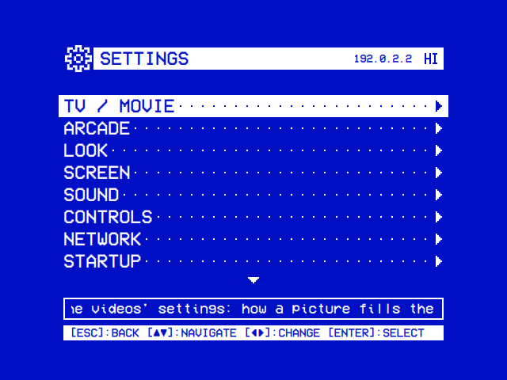

# Installation

How to get OSD/OS running, update it and remove it. It runs as the OSD/OS image on a Raspberry Pi, or as an app on Raspberry Pi OS, macOS, x86_64 Linux, Windows 11, FreeBSD or OpenBSD.


## Which way to choose

| | The OSD/OS image | App on Raspberry Pi OS | App on macOS | App on SteamOS / Linux x86_64 | App on Windows | App on FreeBSD / OpenBSD |
|---|---|---|---|---|---|---|
| Runs on | Raspberry Pi 4 or 5 ([Supported hardware](https://github.com/mehmetraif/OSD-OS/wiki/Installation#supported-hardware)) | Raspberry Pi OS Trixie, 64-bit | Apple Silicon Macs | x86_64 Linux with X11 or XWayland, glibc 2.39 or newer | Windows 11 on x64 | FreeBSD 15 or OpenBSD 8.0 on amd64, with a desktop |
| You download | `OSD-OS-<version>-raspberry-pi.img.xz` | `install.sh`, which fetches `OSD-OS-<version>-linux-arm64.tar.gz` | `OSD-OS-<version>-macOS-arm64.dmg` | `OSD-OS-linux-x86_64.AppImage` | `OSD-OS-<version>-windows-x64.zip` | `OSD-OS-<version>-freebsd-amd64.pkg` or `OSD-OS-<number>-openbsd-amd64.tgz` |
| Starts | At power-on | At boot (with the autostart service), or with `osdos` | Like any app | Like any app, or from Steam | `osdos.exe` | `osdos`, from a terminal |
| mpv | Included | Installed by `install.sh` | `brew install mpv` | Included | From [mpv.io](https://mpv.io/installation/) | The system's package |
| Transparent Background | Yes | Yes | Yes | No | No | Yes |
| Settings → Screen → Display Output | Yes | No | No | No | No | No |
| What YouTube, Netflix, Prime Video and Arcade run | Included | By hand ([below](https://github.com/mehmetraif/OSD-OS/wiki/Installation#optional-extras)) | By hand | By hand | MAME and RetroArch from Settings → Arcade; no Netflix or Prime Video | The system's packages; no Netflix or Prime Video |

The image is the simplest way. All the files are on the [latest release](https://github.com/mehmetraif/OSD-OS/releases/latest), each with its SHA-256 digest. To check a download, compare its digest (`shasum -a 256` on a Mac):

```sh
sha256sum OSD-OS-<version>-raspberry-pi.img.xz
```

Or let a terminal download the file for this computer and check it:

- macOS, Linux, Raspberry Pi OS: `curl -fsSL https://osdos.tv/get.sh | sh`
- FreeBSD: `fetch -qo - https://osdos.tv/get.sh | sh`
- OpenBSD: `ftp -MVo - https://osdos.tv/get.sh | sh`
- Windows PowerShell: `irm https://osdos.tv/get.ps1 | iex`, which also unzips it
- The OSD/OS image, on any of them: `curl -fsSL https://osdos.tv/get.sh | sh -s -- image`, or `iex "& { $(irm https://osdos.tv/get.ps1) } image"` in PowerShell

Each downloads into the current folder, deletes a file that doesn't match its SHA-256, and installs nothing.

## The OSD/OS image

The image is Raspberry Pi OS Lite (64-bit) that boots straight into OSD/OS, with what the modules need already on it ([The OSD/OS image](https://github.com/mehmetraif/OSD-OS/wiki/The-OSD-OS-Image)).

### What you need

- A Raspberry Pi 4 or 5 ([Supported hardware](https://github.com/mehmetraif/OSD-OS/wiki/Installation#supported-hardware)).
- A microSD card. The system keeps 8 GiB, and the rest holds films: about 6 GiB on a 16 GB card, none on an 8 GB card.
- A TV. The image starts on HDMI; for a CRT, see [below](https://github.com/mehmetraif/OSD-OS/wiki/Installation#composite-or-scart-from-the-first-boot).
- A USB keyboard, remote or gamepad. A Bluetooth one pairs later ([Controls](https://github.com/mehmetraif/OSD-OS/wiki/Controls#bluetooth)).

### Download

Download `OSD-OS-<version>-raspberry-pi.img.xz` from the [latest release](https://github.com/mehmetraif/OSD-OS/releases/latest). Don't unpack it.

An image from the **OS image** workflow (the Actions tab) comes as a zip, the run's `osdos-image` artifact: take the `.img.xz` out of it. Its app is a `dev` build, with in-app updates off.

### Flashing with Raspberry Pi Imager

1. Open [Raspberry Pi Imager](https://www.raspberrypi.com/software/), choose your Raspberry Pi, then **Use custom** for the operating system, and pick the `.img.xz`.
2. Choose the SD card and write.

Raspberry Pi Imager 2 skips OS customisation (Wi-Fi, a user, SSH, the hostname, the locale, the keyboard) for an image chosen with **Use custom**. In its place, use [OSD/OS Setup](https://github.com/mehmetraif/OSD-OS/wiki/Installation#osdos-setup-settings-on-the-card-before-the-first-boot), [Wi-Fi by hand](https://github.com/mehmetraif/OSD-OS/wiki/Installation#wi-fi-by-hand-network-config), or a local manifest, below.

#### A local manifest, for OS customisation

A manifest tells Imager which customisation an image takes: `"init_format": "cloudinit-rpi"` for the OSD/OS image ([Imager's notes](https://github.com/raspberrypi/rpi-imager/tree/main/doc/local_json)). Save this script as `make_manifest.py`:

```python
#!/usr/bin/env python3
# make_manifest.py: writes a Raspberry Pi Imager manifest for an OSD/OS image,
# so that Imager offers its OS customisation (Wi-Fi, user, SSH, locale) for it.
# Usage: python3 make_manifest.py OSD-OS-<version>-raspberry-pi.img.xz
import datetime, hashlib, json, lzma, pathlib, sys

image = pathlib.Path(sys.argv[1]).expanduser().resolve()
sha, size = hashlib.sha256(), 0
with lzma.open(image) as f:              # the .img inside the .img.xz
    while chunk := f.read(1 << 20):
        sha.update(chunk)
        size += len(chunk)

icons = "https://downloads.raspberrypi.com/imager/icons/"
manifest = {
    "imager": {"devices": [
        {"name": "Raspberry Pi 5", "tags": ["pi5-64bit", "pi5-32bit"],
         "icon": icons + "RPi_5.png", "matching_type": "exclusive",
         "description": "Raspberry Pi 5, 500 / 500+, and Compute Module 5"},
        {"name": "Raspberry Pi 4", "tags": ["pi4-64bit", "pi4-32bit"],
         "icon": icons + "RPi_4.png", "matching_type": "inclusive",
         "description": "Raspberry Pi 4 Model B, 400, and Compute Module 4 / 4S"},
        {"name": "Raspberry Pi 3", "tags": ["pi3-64bit", "pi3-32bit"],
         "icon": icons + "RPi_3.png", "matching_type": "inclusive",
         "description": "Raspberry Pi 3 Model A+ / B / B+ and Compute Module 3 / 3+"},
    ]},
    "os_list": [{
        "name": "OSD/OS",
        "description": "Raspberry Pi OS Lite (64-bit) that boots straight into OSD/OS",
        "icon": "https://downloads.raspberrypi.com/raspios_armhf/Raspberry_Pi_OS_(32-bit).png",
        "url": image.as_uri(),
        "extract_size": size,
        "extract_sha256": sha.hexdigest(),
        "image_download_size": image.stat().st_size,
        "release_date": datetime.date.fromtimestamp(image.stat().st_mtime).isoformat(),
        "init_format": "cloudinit-rpi",
        "devices": ["pi5-64bit", "pi4-64bit", "pi3-64bit"],
    }],
}
out = image.with_name("OSD-OS.rpi-imager-manifest")
out.write_text(json.dumps(manifest, indent=2) + "\n")
print("Wrote", out)
```

Run it on the downloaded image (Python 3.8 or later):

```sh
python3 make_manifest.py ~/Downloads/OSD-OS-*-raspberry-pi.img.xz
```

It writes `OSD-OS.rpi-imager-manifest` beside the image. Keep the image where it is. Open the manifest in one of three ways:

- double-click it;
- in Imager, **App Options** → **Content Repository** → **EDIT** → **Use custom file**, then **APPLY & RESTART**;
- `rpi-imager --repo ~/Downloads/OSD-OS.rpi-imager-manifest`.

**OSD/OS** is then on Imager's OS page, with its customisation.

### Flashing with another tool

Any tool that writes disk images works, balenaEtcher for example. On Linux, find the card's device with `lsblk`, then use `dd`, which overwrites whatever it is given:

```sh
xz -dc ~/Downloads/OSD-OS-*-raspberry-pi.img.xz | sudo dd of=/dev/sdX bs=4M conv=fsync status=progress
```

`/dev/sdX` is the card's whole disk (`/dev/sdb` or `/dev/mmcblk0`), not a partition (`/dev/sdb1`).

### OSD/OS Setup: settings on the card before the first boot

[OSD/OS Setup](https://osdos.tv/setup/) is a web page that chooses what the card starts with, for a **TV** or an **Arcade Cabinet**. Nothing you type leaves your browser. It sets the display output, the device's name, Wi-Fi and its country, `pi`'s password, SSH, the time zone, the keyboard, every setting of OSD/OS and the RetroAchievements account.

1. Choose your settings, then **Download for the card (zip)**. It holds `osdos-setup.json` and, with a display output chosen, `osdos-display.txt`.
2. After flashing, take the card out and put it back in. The computer shows the boot partition as a drive called **bootfs**.
3. Unpack the zip onto **bootfs**, letting `osdos-display.txt` replace the one there.
4. Put the card in the Pi and switch it on. The settings are applied as it starts, with a **SETTINGS** line on the boot screen. If the display output changed, the Pi restarts once.
5. `osdos-setup.log` on **bootfs** then says what was done, and why anything wasn't.

- Only what you change on the page goes into the file.
- **Export** saves `osdos-setup.json` alone. **Import** reads it back, or reads OSD/OS's own `config.json`.
- The file can also go on a card that has already been started.
- The file holds the Wi-Fi and RetroAchievements passwords as typed: keep it to yourself. It is deleted from the card once applied.
- A display output chosen for another kind of Pi is not applied, and the log says so.

[The OSD/OS image](https://github.com/mehmetraif/OSD-OS/wiki/The-OSD-OS-Image#osdos-setup) has how each setting is applied. A computer takes part of the settings too ([below](#osdos-setup-on-a-computer)).

### Wi-Fi by hand: network-config

Before the first boot, edit `network-config` on the card's **bootfs** drive. This [netplan](https://netplan.io/reference)-style file is applied on the first boot only. Add these lines at its end, with your network's name, its password and your two-letter country code:

```yaml
network:
  version: 2
  ethernets:
    eth0:
      dhcp4: true
      dhcp6: true
      optional: true
  wifis:
    wlan0:
      dhcp4: true
      regulatory-domain: "GB"
      access-points:
        "My Home WiFi":
          password: "correct battery horse staple"
      optional: true
```

- Keep the `ethernets` lines: they keep the Ethernet port working.
- `regulatory-domain` is the Wi-Fi country. Wi-Fi stays off without one.
- Indent with spaces, never tabs. Keep the quotes.
- For an open network, replace the `password:` line with `auth:` and, under it, `key-management: none`. For a hidden one, add `hidden: true` at the same level as `password:`.
- To change the Wi-Fi later, use Settings → Network → Wi-Fi.

### Composite or SCART from the first boot

For a CRT, copy one of the presets on **bootfs** over `osdos-display.txt` before the first boot. For composite PAL, on Linux or macOS (on Windows, copy and rename the file):

```sh
cp /media/$USER/bootfs/osdos-display-crt-pal.txt /media/$USER/bootfs/osdos-display.txt   # Linux
cp /Volumes/bootfs/osdos-display-crt-pal.txt /Volumes/bootfs/osdos-display.txt           # macOS
```

| Preset | Output | Pi 4 | Pi 5 |
|---|---|---|---|
| `osdos-display-hdmi.txt` | HDMI, resolution detected (the default) | ✓ | ✓ |
| `osdos-display-crt-ntsc.txt`, `osdos-display-crt-pal.txt` | Composite NTSC / PAL, 4:3: the AV jack, or a Pi 5's TV pads | ✓ | ✓ |
| `osdos-display-crt-gpio-ntsc.txt`, `osdos-display-crt-gpio-pal.txt` | Composite from a Pi 5's GPIO pins | | ✓ |
| `osdos-display-scart-rgb-ntsc.txt`, `osdos-display-scart-rgb-pal.txt` | SCART RGB on the GPIO pins, 480i / 576i | ✓ | ✓ |
| `osdos-display-scart-rgb-240p.txt`, `osdos-display-scart-rgb-288p.txt` | SCART RGB on the GPIO pins, 240p / 288p | ✓ | |
| `osdos-display-jamma-240p.txt` | A JAMMA arcade cabinet through a Raspberry Pi to JAMMA board in RGB-Pi's layout, 240p: its picture, sound and controls | ✓ | ✓ |
| `osdos-display-jamma-240p-native.txt`, `-240p-super.txt`, `-288p.txt`, `-288p-super.txt`, `-25k.txt`, `-31k.txt` | The same board in its other modes: 320×240, 1920×240, 720×288, 1920×288, and a 25 kHz or 31 kHz monitor's (only for such a monitor) | ✓ | ✓ |
| `osdos-display-jamma-480i.txt`, `osdos-display-jamma-480i-640.txt`, `osdos-display-jamma-576i.txt` | The same board interlaced, 480i at 720 or 640 across / 576i | ✓ | |

- A Pi 3 has the outputs of a Pi 4.
- A Pi 5's SCART RGB also needs `options drm_rp1_dpi force_csync=1` in `/etc/modprobe.d/osdos-display.conf`, on the system partition. OSD/OS Setup and Settings → Screen → Display Output both write it.
- Once running, Settings → Screen → Display Output switches outputs ([Display Output](https://github.com/mehmetraif/OSD-OS/wiki/Display-Output) has the cables).

### The first boot


Put the card in the Pi, connect the TV and the keyboard, remote or gamepad, and switch it on:

1. **The card is split**, once. The system keeps 8 GiB, and the rest becomes an exFAT partition labelled **OSD-OS**.
2. **The boot screen** shows a line per service, `[ OK ]` once it has started: `SETTINGS` (only with OSD/OS Setup's file), `WI-FI`, `BLUETOOTH`, `LOCAL NETWORK`, `SSH` (only when built with it) and `ONLINE`. It closes by itself, after a minute at most.
3. **The main menu** lists **Local Files** and **Playlists**, the modules on by default. Turn the others on in Settings ([Modules](https://github.com/mehmetraif/OSD-OS/wiki/Modules)).

- Keys do nothing while the boot screen is up, except Ctrl+Q, which powers the Pi off.
- Films go in the **Movies** folder of the card's **OSD-OS** partition, copied from a computer ([The OSD/OS image](https://github.com/mehmetraif/OSD-OS/wiki/The-OSD-OS-Image#copying-films-onto-it)).
- A USB stick or disk plugged into the Pi shows up in Local Files as `USB: <label>`.

### The user, the password and SSH

The image's own user is `pi`. You only need to log in for **Exit to Terminal** (Settings → Quit) or SSH.

- **The password.** A release image's `pi` has the password of the repository secret `OS_FIRST_USER_PASS`, if the release was built with one. Without one, Exit to Terminal logs `pi` in by itself, without `sudo`.
- **OSD/OS Setup** gives `pi` a password of your own, for SSH and `sudo`.
- **SSH** is off on a release image. Turn it on on OSD/OS Setup, or from a shell with `sudo`:

  ```sh
  sudo systemctl enable --now ssh
  ```

  Then connect by the hostname, `osdos` unless you set another, or by the IP address in Settings' title bar:

  ```sh
  ssh your-user@osdos.local
  ```



`journalctl -u osdos -b` shows OSD/OS's log for this boot.

### Ethernet

Plug the cable in: there is nothing to set up.

## As an app on Raspberry Pi OS

Installed this way, OSD/OS is an app on a Raspberry Pi OS you set up yourself. It starts at boot with the autostart service, or when you type `osdos`.

### What you need

- A Raspberry Pi with **Raspberry Pi OS Trixie (Debian 13), 64-bit**. These steps use Raspberry Pi OS Lite.
- An SD card of at least 4 GB.
- A keyboard, and network access.

### 1. Write Raspberry Pi OS Lite (64-bit)

In [Raspberry Pi Imager](https://www.raspberrypi.com/software/), choose **Raspberry Pi OS (other)** → **Raspberry Pi OS Lite (64-bit)**. In Imager's customisation, fill in the hostname, a user and the Wi-Fi, and turn SSH on.

### 2. config.txt, for a CRT or for HDMI

Replace `config.txt` on the card's **bootfs** drive with the one that matches your TV. The overclocking lines are optional.

**Composite to a CRT** (NTSC; set `sdtv_mode=2` for PAL):

```ini
# --- Global ---
auto_initramfs=1
disable_splash=1
disable_overscan=1
dtparam=audio=on

# Composite
enable_tvout=1
sdtv_mode=0      # 0 = NTSC, 2 = PAL
sdtv_aspect=1    # 1 = 4:3

# --- Pi 3B ---
[pi3]

# Drivers & Video
dtoverlay=vc4-fkms-v3d,cma-256

# Overclocking
over_voltage=4
arm_freq=1300
core_freq=450
sdram_freq=500

# --- Pi 3B+ ---
[pi3+]

# Drivers & Video
dtoverlay=vc4-fkms-v3d,cma-256

# Overclocking
over_voltage=2
arm_freq=1500
core_freq=500
sdram_freq=500

# --- Pi 4B ---
[pi4]

# Drivers & Video
dtoverlay=vc4-fkms-v3d,cma-256
dtoverlay=rpivid-v4l2

# Overclocking
over_voltage=2
arm_freq=1750
gpu_freq=600

# --- Pi 5 ---
[pi5]

# Drivers & Video
dtoverlay=vc4-kms-v3d,cma-512,composite=1

# --- Global ---
[all]
```

**HDMI to a modern TV:**

```ini
# --- Global ---
auto_initramfs=1
disable_splash=1
disable_overscan=1

# HDMI
display_auto_detect=1
hdmi_force_hotplug=1

# --- Pi 3B ---
[pi3]

# Drivers & Video
dtoverlay=vc4-fkms-v3d,cma-256

# Overclocking
over_voltage=4
arm_freq=1300
core_freq=450
sdram_freq=500

# --- Pi 3B+ ---
[pi3+]

# Drivers & Video
dtoverlay=vc4-fkms-v3d,cma-256

# Overclocking
over_voltage=2
arm_freq=1500
core_freq=500
sdram_freq=500

# --- Pi 4B ---
[pi4]

# Drivers & Video
dtoverlay=vc4-fkms-v3d,cma-256
dtoverlay=rpivid-v4l2

# Overclocking
over_voltage=2
arm_freq=1750
gpu_freq=600

# --- Pi 5 ---
[pi5]

# Drivers & Video
dtoverlay=vc4-kms-v3d

# --- Global ---
[all]
```

### 3. First boot and SSH

Put the card in the Pi and let it boot to a text login. Connect over SSH with the hostname and user you gave Imager, or the Pi's IP address (`hostname -I` on the Pi):

```sh
ssh your-user@your-hostname.local
```

Run `sudo raspi-config` and set **System Options → Auto Login → Yes** and **Advanced Options → Expand Filesystem**, then **Finish** and let the Pi restart.

### 4. Run the installer

Over SSH again, run:

```sh
bash <(curl -fsSL https://github.com/mehmetraif/OSD-OS/releases/latest/download/install.sh)
```

It installs the latest release. For a particular one, download that release's `install.sh` and give it the release's tag:

```sh
TAG=v0.0.1   # the release you want, as the Releases page names it
curl -fsSLO "https://github.com/mehmetraif/OSD-OS/releases/download/$TAG/install.sh"
bash install.sh "$TAG"
```

It asks two questions:

- `Install systemd autostart service? [y/N]`: **y** starts OSD/OS at every boot. **N** (the default) installs the app only, and keeps a service installed before as it is.
- `Run service as user [default: pi]:` (only after **y**): the user OSD/OS runs as.

On the OSD/OS image it asks neither, and keeps the image's own service. The install takes about 20 minutes over Wi-Fi. Then `osdos` starts OSD/OS, and `sudo journalctl -u osdos -f` follows the service's log.

#### What install.sh does

| Step | What |
|---|---|
| Packages | `libqt6quick6 libqt6qml6 libqt6opengl6 libqt6network6 libqt6svg6 qt6-svg-plugins qt6-wayland qml6-module-qtquick qml6-module-qtquick-controls qml6-module-qtquick-window libsdl2-2.0-0 libpcsclite1 libmpv2 mpv fluidsynth timgm6mb-soundfont openmpt123 polkitd`, and `qml6-module-qtquick3d qml6-module-qtquick3d-helpers` where the system has them |
| A udev rule | `/etc/udev/rules.d/99-osdos-tty.rules`: lets the `tty` group open `/dev/tty0` |
| The `bluetooth` group | Adds the user OSD/OS runs as |
| A polkit rule | With a service: `/etc/polkit-1/rules.d/50-osdos-networkmanager.rules`, for Settings → Network → Wi-Fi |
| The app | `OSD-OS-<version>-linux-arm64.tar.gz`, checked against its SHA-256, into `/opt/osdos` (`bin`, `lib`, `share`), owned by the user OSD/OS runs as |
| 240-MP | A 240-MP install (`/opt/240mp`, `240mp.service`) is removed. OSD/OS moves its data folder over on its first start |
| The launcher | `/usr/local/bin/osdos`: applies a downloaded update, then starts OSD/OS on Wayland, X11, or straight on the screen (Qt's EGLFS) |
| The service | After **y**: `/etc/systemd/system/osdos.service`, the login on `tty1` masked (`getty@tty1`, `autovt@`), and `/etc/systemd/logind.conf.d/osdos.conf`. With any service: `/usr/local/bin/osdos-stop`, `osdos-terminal.service`, and `osdos-display.socket`, `osdos-wifi.socket` and `osdos-name.socket` with their `@.service` units |

#### The autostart service

The service starts OSD/OS after `multi-user.target`, as the user you named. When OSD/OS exits, the stop helper `osdos-stop` acts on its exit code ([The OSD/OS image](https://github.com/mehmetraif/OSD-OS/wiki/The-OSD-OS-Image#osdos-stop) lists the codes):

| Exit | What happens |
|---|---|
| Quit → Power Off, or Ctrl+Q | The Pi powers off |
| Quit → Restart | The Pi reboots |
| Quit → Exit to Terminal | A login prompt on `tty1`. `sudo systemctl start osdos` brings OSD/OS back |
| `systemctl stop` / `restart` | The Pi stays on |
| A crash | OSD/OS starts again five seconds later. After three starts in two minutes a login prompt comes up; there, `sudo systemctl reset-failed osdos` and `sudo systemctl start osdos` try again |

To run OSD/OS by hand, stop the service first; quitting then returns to the shell:

```sh
sudo systemctl stop osdos
osdos
```

#### Optional extras

A few modules need more than `install.sh` installs:

- **YouTube** needs an up-to-date yt-dlp, and Deno ([YouTube](https://github.com/mehmetraif/OSD-OS/wiki/YouTube)). Raspberry Pi OS's own yt-dlp is too old:

  ```sh
  sudo wget https://github.com/yt-dlp/yt-dlp/releases/latest/download/yt-dlp -O /usr/local/bin/yt-dlp && sudo chmod a+rx /usr/local/bin/yt-dlp
  ```

  Install Deno following yt-dlp's [EJS guide](https://github.com/yt-dlp/yt-dlp/wiki/EJS). OSD/OS looks for yt-dlp in `~/.local/share/OSD-OS/bin/yt-dlp`, then next to its own program, then on the `PATH`.
- **Netflix and Prime Video** (and YouTube's sign-in) need Chromium with Widevine, `cage` and `wtype` ([Netflix and Prime Video](https://github.com/mehmetraif/OSD-OS/wiki/Netflix-and-Prime-Video)):

  ```sh
  sudo apt install chromium libwidevinecdm0 cage wtype
  ```

- **Arcade** plays its games in MAME. A MAME of your own at `~/.local/share/OSD-OS/bin/mame` is used first. [Arcade](https://github.com/mehmetraif/OSD-OS/wiki/Arcade) has the rest, RetroArch included:

  ```sh
  sudo apt install mame
  ```

- **An NFC reader** needs device access set up once ([NFC Reader](https://github.com/mehmetraif/OSD-OS/wiki/NFC-Reader)).
- **USB drives** are not mounted by themselves. Local Files lists a drive mounted under `/media`.
- **A gamepad that isn't seen**, with OSD/OS run by hand: `sudo usermod -aG input $USER`, then reboot.

#### On a CRT: picture and sound

- **A picture slightly squeezed or stretched.** On a CRT, OSD/OS tells mpv the screen is 4:3. To tune it, put this line in `~/.config/mpv/mpv.conf` and raise or lower it until a circle in a 4:3 test pattern is round:

  ```ini
  monitoraspect=1.333
  ```

  Remove a `monitorpixelaspect=0.888889` line if you have one.
- **Composite sound unusually quiet:** `amixer sset PCM 100%` raises the AV jack 4 dB above OSD/OS's 0 dB (loud sound can clip), and `sudo alsactl store` keeps it across reboots.
- **No sound at all:** Settings → Sound → Audio Output picks the sound card ([Audio Output](https://github.com/mehmetraif/OSD-OS/wiki/Audio-Output)).

## On macOS (Apple Silicon)

OSD/OS runs on Apple Silicon Macs (not Intel ones), and plays videos with Homebrew's mpv.

1. Download `OSD-OS-<version>-macOS-arm64.dmg` from the [latest release](https://github.com/mehmetraif/OSD-OS/releases/latest), or with the terminal command [above](#which-way-to-choose).
2. Open it and drag **osdos.app** onto the **Applications** folder beside it.
3. Install mpv with [Homebrew](https://brew.sh), and the optional extras you want:

   ```sh
   brew install mpv                  # required: plays the videos, and libmpv for Transparent Background
   brew install fluid-synth libopenmpt   # optional: menu music from MIDI files and trackers' XM, MOD, S3M and IT
   brew install yt-dlp deno          # optional: the YouTube module
   brew install mame                 # optional: the Arcade module
   ```

   A MIDI file needs a General MIDI SoundFont (`.sf2`) in `~/Library/Application Support/OSD-OS/soundfonts/`.
4. Open **osdos** from Applications. If macOS refuses to open it (a release that isn't notarized), choose **Open Anyway** in **System Settings → Privacy & Security**, or run this once:

   ```sh
   xattr -dr com.apple.quarantine /Applications/osdos.app
   ```

On a Mac:

- Settings dims Bluetooth, Display Output and Audio Output: use macOS's own settings.
- With several displays, OSD/OS opens on the main one. For another, find its number in the log (`[main] display index 1: …`) and set `display_index` in `config.json` ([Configuration files](https://github.com/mehmetraif/OSD-OS/wiki/Configuration-Files)):

  ```json
  {
    "app": {
      "display_index": 1
    }
  }
  ```

## On SteamOS and Linux x86_64 (AppImage)

The AppImage is a single file with Qt, SDL2 and mpv 0.40 inside. It needs X11, or Wayland with XWayland, and glibc 2.39 or newer (not Ubuntu 22.04, Debian 12 or an older SteamOS).

1. On SteamOS, switch to **Desktop Mode** first.
2. Download `OSD-OS-linux-x86_64.AppImage` from the [latest release](https://github.com/mehmetraif/OSD-OS/releases/latest), or with the terminal command [above](#which-way-to-choose).
3. Make it executable: right-click it → **Properties → Permissions** → tick **Is executable**, or:

   ```sh
   chmod +x OSD-OS-linux-x86_64.AppImage
   ```

4. Double-click it to start OSD/OS.

- **Gaming Mode.** In Desktop Mode, open Steam → **Games → Add a Non-Steam Game to My Library**, choose **Browse**, and pick the AppImage.
- **Transparent Background is dimmed**: the AppImage has no libmpv.
- **Gamepads.** With Steam's virtual gamepad present, OSD/OS listens to it alone ([Controls](https://github.com/mehmetraif/OSD-OS/wiki/Controls#gamepads)).
- **Displays.** `display_index` chooses the display, as on a Mac.
- **YouTube.** yt-dlp is not inside the AppImage. Put a copy in the data folder, where it can update itself ([EJS guide](https://github.com/yt-dlp/yt-dlp/wiki/EJS) for its JavaScript runtime):

  ```sh
  mkdir -p ~/.local/share/OSD-OS/bin
  curl -fsSL -o ~/.local/share/OSD-OS/bin/yt-dlp https://github.com/yt-dlp/yt-dlp/releases/latest/download/yt-dlp
  chmod +x ~/.local/share/OSD-OS/bin/yt-dlp
  ~/.local/share/OSD-OS/bin/yt-dlp -U    # later, to update it
  ```

## On Windows (x64)

On Windows 11 on x64, OSD/OS is a zip with one folder, `osdos`. Nothing is installed: the folder runs from wherever you put it.

1. Download `OSD-OS-<version>-windows-x64.zip` from the [latest release](https://github.com/mehmetraif/OSD-OS/releases/latest) and unzip it, for example in `C:\Games`. The PowerShell command [above](#which-way-to-choose) does both.
2. Download a Windows build of mpv from [mpv.io](https://mpv.io/installation/). Put its folder inside `osdos` as `mpv`, or `mpv.exe` beside `osdos.exe`, or mpv on the `PATH`.
3. Double-click `osdos.exe`. If Windows shows **Windows protected your PC**, choose **More info**, then **Run anyway**.

On Windows:

- **The log** is `osdos.log` in the data folder, the run before's `osdos-previous.log` ([Troubleshooting](https://github.com/mehmetraif/OSD-OS/wiki/Troubleshooting#where-the-log-is)).
- **Arcade.** FinalBurn Neo's core comes with OSD/OS. Settings → Arcade → **MAME** downloads MAME, and Settings → Arcade → **FinalBurn Neo** downloads RetroArch, in the versions the OSD/OS image has ([The same engines on every machine](https://github.com/mehmetraif/OSD-OS/wiki/Online-and-LAN-Play#the-same-engines-on-every-machine)).
- **YouTube.** Put `yt-dlp.exe` in `%APPDATA%\OSD-OS\bin\`, beside `osdos.exe` or on the `PATH`, and `deno.exe` on the `PATH`.
- **Window Mode.** Settings → Screen → Window Mode shows OSD/OS in a window. F11 or Alt+Enter switches at any time.
- Netflix and Prime Video aren't offered. Settings dims Transparent Background, Display Output, Audio Output, Bluetooth and Wi-Fi.

## On FreeBSD or OpenBSD (amd64)

On FreeBSD 15 and OpenBSD 8.0 on amd64, with a desktop, OSD/OS is a package of the system's. The packages are built and started in a virtual machine for every release, and haven't been tried on a BSD computer yet.

Download the package from the [latest release](https://github.com/mehmetraif/OSD-OS/releases/latest), or with the terminal command [above](#which-way-to-choose). Then, as root:

- **FreeBSD**: the packages it needs, then the app.
    ```sh
    pkg install -y qt6-base qt6-declarative qt6-svg sdl2 minizip mpv
    pkg add OSD-OS-<version>-freebsd-amd64.pkg
    ```
- **OpenBSD**: `-D unsigned`, as the package isn't signed with OpenBSD's key. Keep the file's name as downloaded (the release's number without its `v`). The package is made for OpenBSD 8.0 only.
    ```sh
    pkg_add -D unsigned OSD-OS-<number>-openbsd-amd64.tgz
    ```

Then start it from the desktop's terminal: `osdos`. On the BSDs:

- **Arcade.** `pkg install mame retroarch` (FreeBSD) or `pkg_add mame retroarch` (OpenBSD), as root. FinalBurn Neo's core comes with OSD/OS, in `/usr/local/lib/osdos/`.
- **YouTube.** `pkg install yt-dlp` or `pkg_add yt-dlp`.
- **Window Mode**, as on Windows.
- Netflix and Prime Video aren't offered. Settings dims Display Output, Audio Output, Bluetooth and Wi-Fi.

[INSTALL.md](https://github.com/mehmetraif/OSD-OS/blob/main/INSTALL.md#on-freebsd-amd64) has each system's steps in full.

## OSD/OS Setup on a computer

On any computer, OSD/OS takes two parts of what [OSD/OS Setup](https://osdos.tv/setup/) sets: its own settings, and the Arcade's RetroAchievements account.

- **Copy and paste.** On the page, choose **Copy for a computer**; then in OSD/OS, Settings → System → **Paste OSD/OS Setup**. On a Pi without a desktop the row is dimmed.
- **The file.** Export `osdos-setup.json` and put it in the [data folder](#the-data-folder), or beside `osdos.exe`, `osdos.app` or the AppImage. OSD/OS applies it as it starts and deletes it.

Either way, a window says what was set.

## The data folder

OSD/OS keeps your settings apart from the app, so reinstalling or updating never loses them:

| System | Data folder |
|---|---|
| Raspberry Pi (the image and `install.sh`), SteamOS, Linux, FreeBSD, OpenBSD | `~/.local/share/OSD-OS/`, in the home of the user OSD/OS runs as (`$XDG_DATA_HOME/OSD-OS` when `XDG_DATA_HOME` is set) |
| macOS | `~/Library/Application Support/OSD-OS/` |
| Windows | `%APPDATA%\OSD-OS\`, that is `C:\Users\<you>\AppData\Roaming\OSD-OS\` |

[Configuration files](https://github.com/mehmetraif/OSD-OS/wiki/Configuration-Files) describes every file in it. The environment variable `DATA_ROOT`, set to an existing folder, puts it elsewhere. On a Raspberry Pi, set it in the service too, or the launcher won't find downloaded updates.

## Updating


### Settings → System → Update

Settings → System → **Update** checks GitHub for the [latest release](https://github.com/mehmetraif/OSD-OS/releases/latest) and installs it. Select does each step:

- **CHECK** offers the latest release only when it is newer than the installed version (**You're up to date** otherwise). Pre-releases are never offered.
- **DOWNLOAD** fetches the file into the data folder's `updates` folder and checks its SHA-256. It needs three times the file's size free.
- **INSTALL** asks **Install update?**. Back, or **Discard Update**, leaves the installed version as it is.

| System | The choice | What happens |
|---|---|---|
| The OSD/OS image, or `install.sh` with the autostart service | **Apply & Restart** | The launcher swaps the new version into `/opt/osdos` and starts it |
| `install.sh` without the service | **Quit & Apply on Next Launch** | The launcher applies the update the next time you run `osdos` |
| macOS, the app in `/Applications` | **Apply & Relaunch** | The new app replaces the old one and opens |
| macOS, the app anywhere else | **Quit & Open Disk Image** | The `.dmg` opens, to drag the app into place yourself |
| Windows | None | The page names the new zip. Download it, close OSD/OS, and put its `osdos` folder in place of the old one, with mpv if it was inside |
| FreeBSD, OpenBSD | None | The page names the new package. As root, `pkg add OSD-OS-<version>-freebsd-amd64.pkg` or `pkg_add -D unsigned OSD-OS-<number>-openbsd-amd64.tgz` |
| The AppImage | **Quit & Apply on Next Launch** | The new AppImage replaces the old one in place. In Gaming Mode, start it again from Steam |

Your settings stay. Some installs can't update in place, and the page says why:

- an install from before in-app updates: run `install.sh` once more ([below](#updating-with-installsh));
- an install in a non-standard place;
- an AppImage in a read-only folder: download the new one by hand;
- a `dev` build, which can check but not download.

On a Raspberry Pi an update replaces OSD/OS alone. A system package a newer release needs comes with `install.sh` run again, or with a newer image: Qt Quick 3D, for a Pi set up before 0.0.31 ([Arcade → The Orb look](https://github.com/mehmetraif/OSD-OS/wiki/Arcade#the-orb-look)).

### Updating with install.sh

On Raspberry Pi OS, running the installer again updates OSD/OS and keeps your settings:

```sh
bash <(curl -fsSL https://github.com/mehmetraif/OSD-OS/releases/latest/download/install.sh)
```

- With the service installed, answer **y**: the service and its helpers are written afresh.
- **N** keeps the service as it is and brings its helpers up to date.
- On the OSD/OS image there is no question.

Then `sudo reboot`.

### Updating Raspberry Pi OS on the image

The system underneath (the kernel, the firmware, mpv, Qt, Chromium) updates with apt, by hand, as a user who can use `sudo`:

```sh
sudo apt update
sudo apt full-upgrade
sudo reboot
```

yt-dlp updates itself on the image (`osdos-yt-dlp-update.timer`).

## Uninstalling

**The OSD/OS image**: flash another image over the card. Copy your films off the **OSD-OS** partition first.

**On Raspberry Pi OS,** remove the service (if you installed it), then the app, its launcher and its udev rule, and last your settings:

```sh
sudo systemctl disable --now osdos.service osdos-display.socket osdos-wifi.socket osdos-name.socket
sudo systemctl unmask getty@tty1.service autovt@.service
sudo rm -f /etc/systemd/system/osdos.service /etc/systemd/system/osdos-terminal.service /usr/local/bin/osdos-stop
sudo rm -f /etc/systemd/system/osdos-display.socket /etc/systemd/system/osdos-display@.service
sudo rm -f /etc/systemd/system/osdos-wifi.socket /etc/systemd/system/osdos-wifi@.service
sudo rm -f /etc/systemd/system/osdos-name.socket /etc/systemd/system/osdos-name@.service
sudo rm -f /etc/polkit-1/rules.d/50-osdos-networkmanager.rules
sudo systemctl daemon-reload
sudo rm -rf /opt/osdos
sudo rm -f /usr/local/bin/osdos /etc/udev/rules.d/99-osdos-tty.rules
rm -rf ~/.local/share/OSD-OS
```

**Elsewhere**, remove the app, then the [data folder](#the-data-folder):

- **macOS**: drag **osdos** from Applications to the Bin.
- **The AppImage**: delete `OSD-OS-linux-x86_64.AppImage`, and remove it from Steam if you added it.
- **Windows**: delete the `osdos` folder. The data folder also holds the MAME and RetroArch OSD/OS downloaded.
- **FreeBSD or OpenBSD**: as root, `pkg delete osdos` or `pkg_delete OSD-OS`. On OpenBSD, `pkg_delete -a` removes the packages that came with it and nothing else uses.

## Supported hardware

OSD/OS is tested on a **Raspberry Pi 4** and a **Raspberry Pi 5 (8 GB)**, and as an app on a **Windows 11** PC (x64). On another board, please tell us how it went in an [issue](https://github.com/mehmetraif/OSD-OS/issues).

OSD/OS reads the board's model (`/proc/device-tree/model`) and sets its mpv flags and its display outputs to match:

| Board | With OSD/OS | Display driver | mpv's video flags | Settings → Screen → Display Output offers (on the image) |
|---|---|---|---|---|
| Raspberry Pi 4 | Tested | Fake KMS (`vc4-fkms-v3d`) | `--vo=drm --hwdec=drm-copy,v4l2m2m-copy` | HDMI, composite (AV jack), SCART RGB 480i/576i/240p/288p, JAMMA 240p/288p/480i/576i/25 kHz/31 kHz |
| Raspberry Pi 5 | Tested (8 GB) | Full KMS (`vc4-kms-v3d`) | `--vo=drm --hwdec=auto-safe` | HDMI, composite (TV pads, or GPIO), SCART RGB 480i/576i, JAMMA 240p/288p/25 kHz/31 kHz |
| Raspberry Pi 3B / 3B+ | Not tested | Fake KMS (`vc4-fkms-v3d`) | `--vo=gpu --gpu-context=drm --hwdec=v4l2m2m` | As a Pi 4 |
| Raspberry Pi 400 / 500 | Not tested | As a Pi 4 / Pi 5 | As a Pi 4 / Pi 5 | As a Pi 4 / Pi 5, without the AV jack's or the TV pads' composite |
| Any other board | Not tested | | `--vo=drm --hwdec=auto-safe` | Not offered |

Of the outputs, only the Pi 4's HDMI and composite have been tried on a TV. A new output that shows nothing goes back to the old one after 30 seconds.

### How a Raspberry Pi 5 differs

- **No AV jack.** Composite video comes from two pads on the board (J7), which need wires or a pin header soldered on, or from its GPIO pins through a DAC.
- **No analog sound.** Sound goes out over HDMI, or through a USB sound card, chosen in Settings → Sound → Audio Output.
- **SCART RGB** on its GPIO pins is 480i and 576i only.

[Display Output](https://github.com/mehmetraif/OSD-OS/wiki/Display-Output) and [Audio Output](https://github.com/mehmetraif/OSD-OS/wiki/Audio-Output) have the wiring and the settings.

### The other boards

- **Raspberry Pi 3B / 3B+.** Its mpv flags keep 1080p H.264 smooth but can't crop. Settings → TV / Movie → **1080p Playback** (shown on a Pi 3 only) trades that the other way ([Playback and mpv](https://github.com/mehmetraif/OSD-OS/wiki/Playback-and-mpv)). If a Pi 3 hangs booting from a USB drive, try an SD card.
- **Boards without a 64-bit Raspberry Pi OS** (the Pi 1 and the first Pi Zero, for example) can't run OSD/OS.

## See also

- [Using OSD/OS](https://github.com/mehmetraif/OSD-OS/wiki/Using-OSD-OS): every screen, from the boot screen on
- [Controls](https://github.com/mehmetraif/OSD-OS/wiki/Controls): keyboards, remotes, gamepads, Bluetooth
- [The OSD/OS image](https://github.com/mehmetraif/OSD-OS/wiki/The-OSD-OS-Image)
- [Display Output](https://github.com/mehmetraif/OSD-OS/wiki/Display-Output) and [Audio Output](https://github.com/mehmetraif/OSD-OS/wiki/Audio-Output)
- [Configuration files](https://github.com/mehmetraif/OSD-OS/wiki/Configuration-Files)
- [Troubleshooting](https://github.com/mehmetraif/OSD-OS/wiki/Troubleshooting)
- [Building from source](https://github.com/mehmetraif/OSD-OS/wiki/Building-from-Source)
