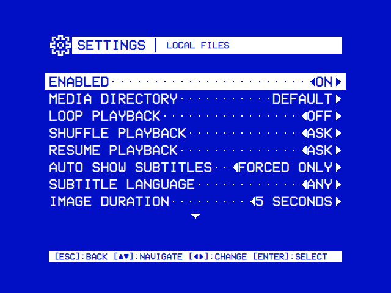
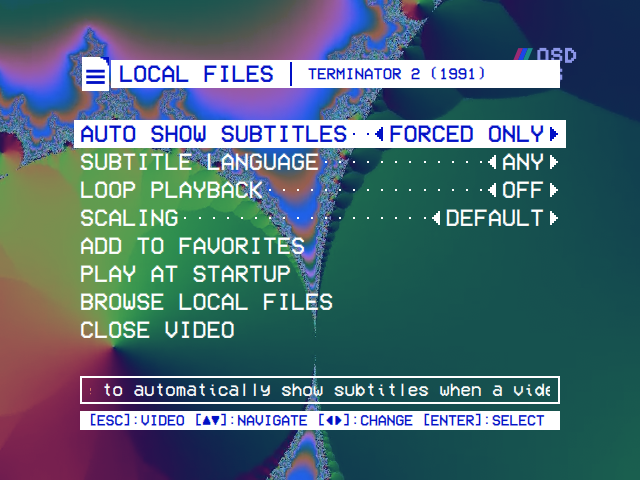

# Local Files

Local Files plays the films, videos, photos and playlists you keep yourself: in a folder on the device, on the OSD/OS image's film partition, or on a USB drive. It is on by default.

Its code is in [modules/local_files](https://github.com/mehmetraif/OSD-OS/tree/main/modules/local_files) and [src/modules/local_files](https://github.com/mehmetraif/OSD-OS/tree/main/src/modules/local_files).

<table>
<tr><th width="50%">Recently Watched</th><th width="50%">Favorites</th></tr>
<tr><td></td><td></td></tr>
<tr><td>The tree opens on what you played last, then Favorites, Search and your folders.</td><td>Files and playlists you marked from their options.</td></tr>
</table>

## What it plays

| Kind | File types | Notes |
|---|---|---|
| Video | `mp4` `mkv` `avi` `mov` `m4v` `webm` `wmv` `flv` `f4v` `mpg` `mpeg` `vob` | Played by mpv, so any codec your mpv decodes |
| Still image | `jpg` `jpeg` `png` `gif` `webp` `bmp` `tif` `tiff` | Shown for **Image Duration**, see [Still images](#still-images) |
| Playlist | `m3u` `m3u8` | Played in order or shuffled, see [Playlists (m3u)](#playlists-m3u-and-m3u8) |

- The extension decides, in any case (`FILM.MKV` counts). Other files (`.ts`, `.m2ts`, `.iso`, audio) are not listed, but play when an m3u names them.
- Hidden files and folders (names starting with a dot) are left out. So are `lost+found`, `System Volume Information` and `$RECYCLE.BIN`.
- Folders come first, then files, each sorted by name.

## Where it looks

Local Files shows one media folder, with the USB drives plugged in above it.

### The media folder

**Settings → TV / Movie → Local Files → Media Directory** names the folder Local Files shows. Until you pick one it reads **Default**:

| Where OSD/OS runs | Default media folder |
|---|---|
| The OSD/OS image | `/media/OSD-OS/Movies`, the **Movies** folder on the card's **OSD-OS** partition (see [below](#the-film-partition-on-the-osdos-image)) |
| Raspberry Pi OS, Linux, SteamOS | `~/.local/share/OSD-OS/media/Movies` |
| macOS | `~/Library/Application Support/OSD-OS/media/Movies` |
| Windows | `%APPDATA%\OSD-OS\media\Movies` |
| Any of them, with `DATA_ROOT` set | `media/Movies` in that folder |

- With `OSDOS_MEDIA_DIR` set, the default is the **Movies** folder in it. The image sets `OSDOS_MEDIA_DIR=/media/OSD-OS` (`/etc/systemd/system/osdos.service.d/osdos-media.conf`). `MP240_MEDIA_DIR` is read when it isn't set.
- The Movies folder is created if it isn't there.
- The [Arcade](https://github.com/mehmetraif/OSD-OS/wiki/Arcade) module's games go in `Games/Arcade` beside Movies.

Selecting **Media Directory** opens the folder picker, the same tree:

- It starts from **Default Folder** (the default above), Home, Media (`/media`), Drives (`/run/media/<user>`), Volumes (`/Volumes`, on a Mac) and Root (`/`).
- Each folder's first entry is **Use This Folder**, which picks that folder. The new folder is used at once.

<table>
<tr><th width="50%">A module's settings</th><th width="50%">Picking a folder</th></tr>
<tr><td></td><td></td></tr>
<tr><td>Local Files' settings.</td><td>USE THIS FOLDER picks the folder open, Default Folder the module's own.</td></tr>
</table>

### The film partition on the OSD/OS image

On its first boot the [OSD/OS image](https://github.com/mehmetraif/OSD-OS/wiki/The-OSD-OS-Image) keeps 8 GiB of the card for the system. The rest becomes an exFAT partition labelled **OSD-OS**, which Windows and macOS read:

1. Quit OSD/OS (Settings → Quit → **Power Off**) and take the card out.
2. Put it in the computer's card reader. It shows up as two drives, **bootfs** and **OSD-OS**. Copy your films into the **Movies** folder on **OSD-OS**.
3. Windows also offers to format the system's partition. Always answer **Cancel**: formatting it erases the system.
4. Put the card back in the Pi.

- The partition is mounted at `/media/OSD-OS`, read-write, `noexec,nosuid,nodev`, and checked with `fsck.exfat` at every boot.
- A card with less than 2 GiB to spare past the system gets no film partition; `/media/OSD-OS` is then an ordinary folder.
- More in the image's [os/README.md](https://github.com/mehmetraif/OSD-OS/blob/main/os/README.md#films-on-the-card).

### USB drives

A USB stick, disk or card reader shows at the top of the tree, after Search, as a folder named after its label: `USB: KINGSTON`. Pulled out, its row goes.

| System | What counts as a drive |
|---|---|
| Linux | A block device (`/dev/…`) mounted under `/media/` or `/run/media/` |
| macOS | A volume mounted under `/Volumes/` |
| Windows | A removable drive, named by its label or its letter |
| FreeBSD, OpenBSD | A device mounted under `/media/` or `/mnt/` |
| Never | A mount that `/etc/fstab` makes, the drive that holds the media folder, or one mounted inside it |

On the **OSD/OS image**:

- A drive is mounted by itself, **read-only**, under `/media/usb/<label>`, so it can be pulled out at any moment.
- It reads FAT32, exFAT, NTFS, ext2/3/4, HFS+, XFS, btrfs, F2FS, ISO 9660 and UDF.
- A second drive with the same label is named after its device too (`KINGSTON (sdb1)`); one without a label, after its UUID.
- To see what a drive was mounted as, or why it wasn't:

```sh
journalctl -u 'osdos-usb-mount@*'
```

- A manual install on Raspberry Pi OS Lite mounts nothing by itself. A drive you mount under `/media` is still listed.
- A drive's files drop out of Recently Watched and Favorites while it is out, and come back with it.

## The tree

<table>
<tr><th width="50%">Folders</th><th width="50%">Back to the menus</th></tr>
<tr><td></td><td></td></tr>
<tr><td>The open folders run along the line through the middle.</td><td>With Transparent Background the tree lies over a video playing on behind it.</td></tr>
</table>

| Key | What it does |
|---|---|
| ▲ ▼ | The entry above or below; the list wraps round |
| ► or select | Opens the folder under the cursor. On a file, select plays it and ► opens its [options](#options) |
| ◄ or back | Closes the open folder; at the top, back leaves Local Files |

[Using OSD/OS → The tree](https://github.com/mehmetraif/OSD-OS/wiki/Using-OSD-OS#the-tree) says how the tree is drawn.

### What the top level holds

1. **Recently Watched**
2. **Favorites**
3. **Search**
4. The USB drives plugged in, `USB: <label>`, by name
5. The media folder's folders, then its files

With an empty media folder and no drive, the screen reads **No items found — Please add items in the local files media directory**.

### Recently Watched

- What you played, newest first. The list keeps the last 30.
- A file played from Search, a USB drive or a playlist folder lands here too.
- An entry whose file has gone (deleted, or on a drive that is out) is hidden until the file is back.

### Favorites

- The files and playlists you marked, newest first, up to 100.
- Add or remove one from its [options](#options) or from the [player's menu](#the-players-menu).
- Favorites are kept per module. An entry whose file is gone is hidden until it is back.

### Search

<table>
<tr><th width="50%">Search</th><th width="50%">Search results</th></tr>
<tr><td></td><td></td></tr>
<tr><td>An on-screen keyboard: the arrows move, select types.</td><td>Names that match anywhere under the media folder.</td></tr>
</table>

Select on **Search** opens the on-screen keyboard, titled **Search Local Files** ([Using OSD/OS → Searching](https://github.com/mehmetraif/OSD-OS/wiki/Using-OSD-OS#searching)). A search takes up to 40 characters.

- **Names, not paths.** It searches every file and folder name under the media folder, then under each USB drive, at any depth.
- **Every word must match**, upper or lower case alike. `kill vol` finds `Kill Bill Vol 1 (2003).mp4`.
- **Folders and media files** are listed. Other files and hidden ones are skipped.
- **Not through symbolic links.** A symlinked folder can be browsed, but Search doesn't walk into it.
- **The first 200, by name.** When a search finds more, type more words.
- The results open as a folder of their own, `Search: <words>`.

### Folders

- Select or ► opens a folder; ◄ or back closes it.
- Coming back from a video lands in the same folders, on the same entry.
- Folders are read afresh each time Local Files opens, so a file copied in during a video shows the next time.

### Playlists (m3u and m3u8)

An `.m3u` or `.m3u8` file plays as one item: its entries in turn, in order or shuffled (**Shuffle Playback**), looping or not (**Loop Playback**).

- An entry is an absolute path, or a path relative to the playlist's own folder.
- An entry can be a video, a still image, or any other file mpv plays, whatever its extension.
- Lines starting with `#` are comments; mpv reads the titles from `#EXTINF` lines.
- YouTube links in an m3u don't play here: put them on a [Playlists](https://github.com/mehmetraif/OSD-OS/wiki/Playlists) list instead.
- **A playlist folder**: a folder whose name ends in `.m3u` or `.m3u8`, holding a playlist of the same name, shows as that playlist. Select plays it. See the [example](#a-playlist-folder).
- During playback the deck's menu has **<** and **>** for the previous and next entry.

### Hide File Extensions

With **Hide File Extensions** on (the default), the tree shows `Terminator 2 (1991)` rather than `Terminator 2 (1991).mp4`. Folder names are left whole.

## Options


► on a file or a playlist offers its options. Folders have none.

| Option | What it does |
|---|---|
| **Add to Favorites** / **Remove from Favorites** | Puts the file on Favorites, or takes it off. Taking off the file that plays at startup turns Play at Startup off too |
| **Play at Startup** / **Don't Play at Startup** | Makes the file the one OSD/OS plays as it starts, ahead of Start on Module. It goes on Favorites too. There is one for the whole app |
| **Add to Playlist** | Puts the file on a [Playlists](https://github.com/mehmetraif/OSD-OS/wiki/Playlists) list, or on a new one. Offered while the Playlists module is on |

[Using OSD/OS → Play at startup](https://github.com/mehmetraif/OSD-OS/wiki/Using-OSD-OS#play-at-startup) has the Startup settings.

## Playing a file

<table>
<tr><th width="50%">Resume</th><th width="50%">Loading</th></tr>
<tr><td></td><td></td></tr>
<tr><td>Pick up where you left off, or start from the beginning.</td><td>While a video starts, a tape loads.</td></tr>
</table>

Select on a file puts it at the top of Recently Watched and plays it in mpv, full screen.

### Where it starts

| Situation | What happens |
|---|---|
| The file is playing behind the menus (Transparent Background) | It comes back full screen, without asking |
| A playlist, with **Shuffle Playback** on **Always** | Shuffled, from the start |
| A single still image | Shown at once |
| The favourite played at startup | No question: **Startup From** decides |
| A saved position, **Resume Playback** on **Ask** | **Resume playback?** `Resume from 1:23` / `Start from the beginning`. A playlist: `Resume video 3 at 1:23`, plus `Shuffle` when Shuffle Playback is Ask (then **Start playback?**) |
| A saved position, **Resume Playback** on **Always** | Resumes at once. A playlist with Shuffle Playback on Ask still asks: `Resume video 3 at 1:23` / `Shuffle` |
| No saved position (or **Resume Playback** on **Never**), a playlist, Shuffle Playback on **Ask** | **Start playback?** `Play in order` / `Shuffle` |
| Anything else | Plays from the beginning |

Back on the question leaves it without playing.

### Resume

Positions are kept in `local_files_history.json` in the data folder:

- **A single video:** saved when stopped after its first 5 seconds; cleared when stopped in its last 5% or played to the end.
- **A playlist:** the entry it was on and the position in it are saved when it stops before its end; cleared once played through.
- **A still image** keeps no position.
- **Resume Playback** only decides whether to ask: positions are saved on **Never** too.

### Shuffle and loop

- **Shuffle Playback** applies to playlists only: **Ask** (the default) asks each time, **Always** shuffles, **Never** plays in order (`--shuffle`).
- **Loop Playback** repeats a single file, or a playlist from its first entry, until you stop it (`--loop-playlist=inf`).

### Subtitles and audio tracks

| Auto Show Subtitles | What mpv is told | What you see |
|---|---|---|
| **Forced Only** (default) | `--subs-with-matching-audio=forced --subs-fallback-forced=always` | Only forced subtitles: dialogue in another language |
| **On** | `--subs-with-matching-audio=yes --subs-fallback=yes --sid=auto` | A subtitle track always |
| **Off** | `--sid=no` | None |

- **Subtitle Language** is **Any** (the default) or one of 183 languages. It goes to mpv as `--slang=<code>` (`en` for English).
- mpv also loads a subtitle file beside the video under the same name: `Film.srt` or `Film.en.srt` next to `Film.mkv`.
- The audio track is mpv's choice: the file's default, or an `alang=` line in your `mpv.conf` (not read with Transparent Background).
- During playback the deck's menu (▲ or ▼) steps through the tracks with **AUDIO** and **SUBTITLE** ([Using OSD/OS → The deck's menu](https://github.com/mehmetraif/OSD-OS/wiki/Using-OSD-OS#the-decks-menu)).


- **Page Up** and **Page Down** (a remote's Channel + and −) play the folder's next or previous film, round the folder's end. In a playlist they go to its next or previous video.
- The film left is saved where it got to. The next carries on where it was left, without asking, unless Resume Playback is Never.

### Still images

- A still image is shown for **Image Duration** (5, 10, 30 or 60 seconds; mpv's `--image-display-duration`). Then mpv moves on: to the playlist's next entry, or back to the tree.
- An animated GIF plays as a clip.
- A playlist of images is a slideshow. Shuffle Playback shuffles it; Loop Playback runs it round for good.

### Scaling

- **Scaling** sets how a 16:9 picture fills a 4:3 screen in Local Files only: Letterbox, 14:9, Pan & Scan or Anamorphic ([Playback and mpv → Scaling](https://github.com/mehmetraif/OSD-OS/wiki/Playback-and-mpv#scaling)).
- **Default** follows **Settings → TV / Movie → Scaling**.
- It applies from the next video, or at once from the player's menu.
- The deck's **CROP** button steps through the four without saving.

## The player's menu

<table>
<tr><th width="50%">The video's menu</th><th width="50%">Main menu</th></tr>
<tr><td></td><td></td></tr>
<tr><td>Back during a video opens its menu.</td><td>The main menu leads with the video: select takes it back to full screen.</td></tr>
</table>

Back during a video (with the deck's menu closed) opens the video's own menu:

| Line | What it does |
|---|---|
| **Auto Show Subtitles**, **Subtitle Language** | ◄ ► change the module setting; the video reloads where it is as you go back to it |
| **Loop Playback**, **Scaling** | ◄ ► change it; with Transparent Background the playing video takes it at once |
| **Add to Favorites**, **Play at Startup** | As in the file's options |
| **Browse Local Files** | Back to the tree |
| **Close Video** | Stops the video and leaves Local Files for the main menu |

- Back in the menu returns to the video.
- A setting changed here is saved as the module's setting.
- [Using OSD/OS → The video's own menu](https://github.com/mehmetraif/OSD-OS/wiki/Using-OSD-OS#the-videos-own-menu) says how the menu behaves with and without Transparent Background.

## Settings

Settings → TV / Movie → Local Files.

| Setting | Values | Default | What it does | Config key |
|---|---|---|---|---|
| ENABLED | ON, OFF | ON | Shows Local Files on the main menu | `modules.com.osdos.local_files.enabled` |
| Media Directory | a folder, or Default | Default | The folder Local Files shows | `modules.com.osdos.local_files.media_directory` |
| Loop Playback | ON, OFF | OFF | Repeats a file or a playlist until stopped | `modules.com.osdos.local_files.loop_playback` |
| Shuffle Playback | Ask, Always, Never | Ask | Plays playlists in random order | `modules.com.osdos.local_files.shuffle_playback` |
| Resume Playback | Ask, Always, Never | Ask | Whether a video resumes where it was stopped | `modules.com.osdos.local_files.resume_playback` |
| Auto Show Subtitles | Forced Only, On, Off | Forced Only | Which subtitles show as a video starts | `modules.com.osdos.local_files.auto_subtitles` |
| Subtitle Language | Any, or a language | Any | The subtitle language mpv picks first | `modules.com.osdos.local_files.sub_lang` |
| Image Duration | 5, 10, 30, 60 Seconds | 5 Seconds | How long a still image is shown | `modules.com.osdos.local_files.image_duration` |
| Hide File Extensions | ON, OFF | ON | Leaves `.mkv` and the like off the names | `modules.com.osdos.local_files.hide_extensions` |
| Scaling | Default, Letterbox, 14:9, Pan & Scan, Anamorphic | Default | How a 16:9 picture fills the 4:3 screen here | `modules.com.osdos.local_files.video_scaling` |

### How the values are saved

`config.json` is in the data folder ([Configuration Files](https://github.com/mehmetraif/OSD-OS/wiki/Configuration-Files)).

| Key | Saved as |
|---|---|
| `enabled`, `loop_playback`, `hide_extensions` | `true` or `false` |
| `media_directory` | A folder's full path; `""` for the default |
| `shuffle_playback` | `"ask"`, `"yes"` (Always) or `"no"` (Never). `true` or `false` reads as Always or Never |
| `resume_playback` | `"ask"`, `"yes"` (Always) or `"no"` (Never) |
| `auto_subtitles` | `"forced"`, `"on"` or `"off"`. `true` reads as On, `false` as Forced Only |
| `sub_lang` | `"-"` (Any) or a two-letter ISO 639-1 code: `"en"`, `"de"`, `"tr"`… |
| `image_duration` | `"5"`, `"10"`, `"30"` or `"60"` |
| `video_scaling` | `"Default"`, `"Letterbox"`, `"14:9"`, `"Pan & Scan"` or `"Anamorphic"` |

Two app settings belong with Local Files: `app.startup_favorite` (`{ "module", "path", "name" }`, or `""` for none) and `app.startup_from` (`"Resume"`, the default, or `"Beginning"`).

## Files it keeps

All in the data folder:

| File | What is in it |
|---|---|
| `config.json` | The settings above, under `modules.com.osdos.local_files` |
| `lists.json` | Recently Watched (`recent`) and Favorites (`favorites`), under `com.osdos.local_files`, newest first. Each entry is `{ "isFolder": false, "name": "…", "path": "…" }` |
| `local_files_history.json` | Where each file was stopped: `pos` (milliseconds) and `plPos` (the playlist entry, counted from 0; `-1` for a single file), by path |

`local_files_history.json`:

```json
{
    "/media/OSD-OS/Movies/Anime/Spirited Away (2001).mp4": { "plPos": -1, "pos": 4354000 },
    "/media/OSD-OS/Movies/Rambo Marathon.m3u": { "plPos": 2, "pos": 61000 }
}
```

The first resumes at 1:12:34; the second at 1:01 into its third entry. Delete a line to forget a position, or the file to forget them all.

## Examples

### A media folder laid out for the tree

```text
/media/OSD-OS/Movies/
├── Action/
│   ├── Rambo Movies/
│   │   ├── Rambo - First Blood (1982).mp4
│   │   ├── Rambo - First Blood Part II (1985).mp4
│   │   └── Rambo III (1988).mp4
│   ├── Cliffhanger (1993).mp4
│   └── Kill Bill Vol 1 (2003).mp4
├── Anime/
│   ├── Spirited Away (2001).mp4
│   └── Your Name (2016).mp4
├── Photos/
│   └── Station Card.png
├── Rambo Marathon.m3u
└── Sci-Fi/
    ├── RoboCop (1987).mp4
    └── Terminator 2 (1991).mp4
```

### An m3u playlist

`/media/OSD-OS/Movies/Rambo Marathon.m3u`, with relative paths, an absolute path, a still image and a `.ts` recording:

```text
#EXTM3U
#EXTINF:-1,Station card
Photos/Station Card.png
#EXTINF:-1,Rambo - First Blood (1982)
Action/Rambo Movies/Rambo - First Blood (1982).mp4
#EXTINF:-1,Rambo - First Blood Part II (1985)
Action/Rambo Movies/Rambo - First Blood Part II (1985).mp4
#EXTINF:-1,Rambo III (1988)
/media/OSD-OS/Movies/Action/Rambo Movies/Rambo III (1988).mp4
#EXTINF:-1,Rambo (2008), recorded off air
/media/usb/KINGSTON/Recordings/Rambo (2008).ts
```

Save it as UTF-8 (`.m3u8` is the usual extension for a UTF-8 playlist). The last entry plays only while the drive is in.

### A playlist folder

```text
/media/OSD-OS/Movies/
└── Anime Night.m3u/                      ← a folder
    ├── Anime Night.m3u                   ← the playlist, of the same name
    ├── 01 My Neighbor Totoro (1988).mp4
    ├── 02 Kiki's Delivery Service (1989).mp4
    └── 03 Spirited Away (2001).mp4
```

The playlist names its videos by file name, one a line. The tree lists the folder as the playlist `Anime Night.m3u`.

### The module's settings in config.json

```json
{
    "modules": {
        "com.osdos.local_files": {
            "enabled": true,
            "media_directory": "/media/OSD-OS/Cartoons",
            "loop_playback": false,
            "shuffle_playback": "ask",
            "resume_playback": "yes",
            "auto_subtitles": "on",
            "sub_lang": "en",
            "image_duration": "10",
            "hide_extensions": true,
            "video_scaling": "14:9"
        }
    }
}
```

- Edit the file with OSD/OS stopped: `sudo systemctl stop osdos`, then `sudo systemctl start osdos`.
- A file that isn't valid JSON is read as empty, and the next setting saved writes the defaults over everything. Check it first:

```sh
python3 -m json.tool ~/.local/share/OSD-OS/config.json > /dev/null && echo OK
```

### A favourite that plays at startup

The usual way is ► on the file, **Play at Startup**. By hand, the file must be on Favorites in `lists.json` as well, and `config.json` holds:

```json
{
    "app": {
        "startup_favorite": {
            "module": "com.osdos.local_files",
            "name": "Rambo Marathon.m3u",
            "path": "/media/OSD-OS/Movies/Rambo Marathon.m3u"
        },
        "startup_from": "Beginning"
    }
}
```

### Another default folder for a manual install

To change the default itself on Raspberry Pi OS with `scripts/install.sh`, give the service the variable the image gives it:

```ini
# /etc/systemd/system/osdos.service.d/media.conf
[Service]
Environment=OSDOS_MEDIA_DIR=/mnt/films
```

Then run `sudo systemctl daemon-reload` and `sudo systemctl restart osdos`. The default is then `/mnt/films/Movies`, and the Arcade module's `/mnt/films/Games/Arcade`. Media Directory, once set, still wins over it.

## Tips

- **Name files the way you want to read them.** The tree sorts by name as on disk: `S01E01 …` sorts episodes.
- **Use a playlist as a channel.** An m3u with Shuffle Playback on Always and Loop Playback on never ends; make it Play at Startup and the TV turns on into it.
- **A network share** works when the system mounts it: point Media Directory at it.
- **A symlink** inside the media folder brings another folder into the tree. Search won't walk into it.

## Troubleshooting

| Problem | What to check |
|---|---|
| **No items found** | The media folder is empty, or isn't the one you think: Media Directory shows the path. On the image, the films go in the **Movies** folder on the **OSD-OS** drive, not on **bootfs** |
| A file isn't listed | Its extension isn't one of [those Local Files plays](#what-it-plays), or its name starts with a dot. Rename it, or list it in an m3u |
| A USB drive doesn't show | See [what counts as a drive](#usb-drives). On Linux a drive mounted at `/mnt/…` doesn't count: set Media Directory to it. On the image, `journalctl -u 'osdos-usb-mount@*'` says why it wasn't mounted (an encrypted volume, swap or a RAID member never is) |
| No resume question | The video was stopped in its first 5 seconds or its last 5%, or Resume Playback is Always or Never |
| No subtitles | Auto Show Subtitles is Forced Only (the default): set it to On. A sidecar `.srt` must have the video's name |
| A playlist entry is skipped | mpv couldn't open it: a relative path is taken from the playlist's folder; a drive is out; a YouTube link isn't played here |
| A video won't play at all | See [Playback and mpv → Troubleshooting playback](https://github.com/mehmetraif/OSD-OS/wiki/Playback-and-mpv#troubleshooting-playback). mpv's log is `/tmp/osdos-mpv.log` |
| A video from a USB drive stopped | The drive was pulled out, or went to sleep; plug it back in and choose the file again |
| Settings vanished after editing `config.json` | The file had a JSON error. Check it with `python3 -m json.tool` first |

## See also

- [Using OSD/OS](https://github.com/mehmetraif/OSD-OS/wiki/Using-OSD-OS): the tree, searching, options and the video's menu
- [Playlists](https://github.com/mehmetraif/OSD-OS/wiki/Playlists): lists of Local Files, YouTube, Jellyfin and Emby videos
- [The OSD/OS image](https://github.com/mehmetraif/OSD-OS/wiki/The-OSD-OS-Image): the film partition and USB drives
- [Playback and mpv](https://github.com/mehmetraif/OSD-OS/wiki/Playback-and-mpv): mpv's flags and troubleshooting
- [Settings](https://github.com/mehmetraif/OSD-OS/wiki/Settings) and [Configuration Files](https://github.com/mehmetraif/OSD-OS/wiki/Configuration-Files)
- [NFC Reader](https://github.com/mehmetraif/OSD-OS/wiki/NFC-Reader): play a file by tapping a card
