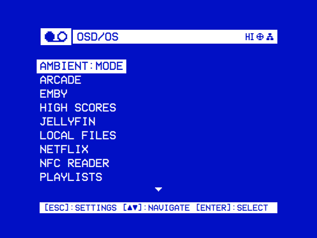
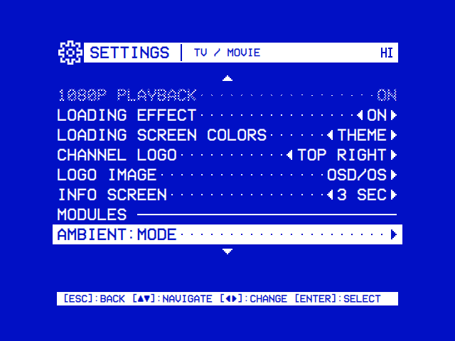

# Modules

Everything OSD/OS plays comes in through a module. **TV / Movie** modules are sources of video. **Arcade** has the games and their high scores ([Arcade](https://github.com/mehmetraif/OSD-OS/wiki/Arcade), [Online and LAN Play](https://github.com/mehmetraif/OSD-OS/wiki/Online-and-LAN-Play), [High Scores](https://github.com/mehmetraif/OSD-OS/wiki/High-Scores)). Each module's own page has its setup and settings.

<table>
<tr><th width="50%">The main menu</th><th width="50%">Settings → TV / Movie</th></tr>
<tr><td></td><td></td></tr>
<tr><td>The modules turned on. Select opens one; back opens Settings.</td><td>A module's row under Modules opens its settings.</td></tr>
</table>

## All of them

### TV / Movie

| Module | What it plays | On at first | What it needs |
|---|---|---|---|
| [Local Files](https://github.com/mehmetraif/OSD-OS/wiki/Local-Files) | Films, videos and photos from a folder, a USB drive or a network share | Yes | Nothing more |
| [Playlists](https://github.com/mehmetraif/OSD-OS/wiki/Playlists) | Lists of Local Files, YouTube, Jellyfin and Emby videos, streamed or downloaded | Yes | yt-dlp and ffmpeg for offline YouTube videos |
| [Plex](https://github.com/mehmetraif/OSD-OS/wiki/Plex) | A Plex Media Server's films, series and other videos | No | A Plex account and a server |
| [Jellyfin](https://github.com/mehmetraif/OSD-OS/wiki/Jellyfin) | A Jellyfin server's libraries | No | A server with Quick Connect |
| [Emby](https://github.com/mehmetraif/OSD-OS/wiki/Emby) | An Emby server's libraries | No | A server, or Emby Connect |
| [YouTube](https://github.com/mehmetraif/OSD-OS/wiki/YouTube) | Subscriptions, channels, playlists and search, no account needed | No | yt-dlp and Deno (on the OSD/OS image) |
| [Netflix and Prime Video](https://github.com/mehmetraif/OSD-OS/wiki/Netflix-and-Prime-Video) | The service's catalogue from TMDB, played in its own player | No | A TMDB API key; Chromium with Widevine, cage and wtype (on the OSD/OS image) |
| [NFC Reader](https://github.com/mehmetraif/OSD-OS/wiki/NFC-Reader) | The video an NFC card stands for | No | A PN532 USB reader, or a PC/SC reader with pcscd. On Linux, run `setup-nfc-reader.sh` for access; the image doesn't run it |
| [Weather](https://github.com/mehmetraif/OSD-OS/wiki/Weather) | A 90s cable weather channel | No | The network (Open-Meteo, and NWS in the US) |
| [Ambient:Mode](https://github.com/mehmetraif/OSD-OS/wiki/Ambient-Mode) | A video on a loop, with music of your choice | No | Nothing more |

### Arcade

| Module | What it plays | On at first | What it needs |
|---|---|---|---|
| [Arcade](https://github.com/mehmetraif/OSD-OS/wiki/Arcade) | Arcade games in MAME and FinalBurn Neo from a folder of ROM sets, alone or with others | No | MAME and its ROM sets; catver.ini and a snap folder for genres and pictures; RetroArch for FinalBurn Neo, RetroAchievements and playing with others. The OSD/OS image has MAME and RetroArch; FinalBurn Neo comes with OSD/OS |
| [High Scores](https://github.com/mehmetraif/OSD-OS/wiki/High-Scores) | Each game's high score table, as MAME kept it | No | Games played in Arcade |

### System

| Module | What it plays | On at first | What it needs |
|---|---|---|---|
| [Scripts](https://github.com/mehmetraif/OSD-OS/wiki/Scripts) | Your own shell scripts | No | Nothing more |

## Turning a module on or off

1. On the main menu, press back: Settings opens.
2. Open the module's page:
   - Arcade or High Scores: select **Arcade**.
   - Scripts: select **System**, then Scripts under **Modules**.
   - Any other module: select **TV / Movie**, then the module under **Modules**.
3. Turn **Enabled**, its first row, on or off. The main menu lists the module when it next opens.

The other rows are the module's own settings. All are saved in `config.json` in the data folder under the module's id, as in `modules.com.osdos.youtube.enabled`:

```json
{
    "modules": {
        "com.osdos.local_files": { "enabled": true },
        "com.osdos.youtube": { "enabled": true },
        "com.osdos.plex": { "enabled": false }
    }
}
```

| Module | Its id, in `config.json` | Its folder |
|---|---|---|
| Local Files | `com.osdos.local_files` | [modules/local_files](https://github.com/mehmetraif/OSD-OS/tree/main/modules/local_files) |
| Playlists | `com.osdos.playlists` | [modules/playlists](https://github.com/mehmetraif/OSD-OS/tree/main/modules/playlists) |
| Plex | `com.osdos.plex` | [modules/plex](https://github.com/mehmetraif/OSD-OS/tree/main/modules/plex) |
| Jellyfin | `com.osdos.jellyfin` | [modules/jellyfin](https://github.com/mehmetraif/OSD-OS/tree/main/modules/jellyfin) |
| Emby | `com.osdos.emby` | [modules/emby](https://github.com/mehmetraif/OSD-OS/tree/main/modules/emby) |
| YouTube | `com.osdos.youtube` | [modules/youtube](https://github.com/mehmetraif/OSD-OS/tree/main/modules/youtube) |
| Netflix | `com.osdos.netflix` | [modules/netflix](https://github.com/mehmetraif/OSD-OS/tree/main/modules/netflix) |
| Prime Video | `com.osdos.prime_video` | [modules/prime_video](https://github.com/mehmetraif/OSD-OS/tree/main/modules/prime_video) |
| NFC Reader | `com.osdos.nfc_reader` | [modules/nfc_reader](https://github.com/mehmetraif/OSD-OS/tree/main/modules/nfc_reader) |
| Weather | `com.osdos.weather` | [modules/weather](https://github.com/mehmetraif/OSD-OS/tree/main/modules/weather) |
| Arcade | `com.osdos.arcade` | [modules/arcade](https://github.com/mehmetraif/OSD-OS/tree/main/modules/arcade) |
| High Scores | `com.osdos.highscores` | [modules/highscores](https://github.com/mehmetraif/OSD-OS/tree/main/modules/highscores) |
| Scripts | `com.osdos.scripts` | [modules/scripts](https://github.com/mehmetraif/OSD-OS/tree/main/modules/scripts) |
| Ambient:Mode | `com.osdos.ambient_mode` | [modules/ambient_mode](https://github.com/mehmetraif/OSD-OS/tree/main/modules/ambient_mode) |

## What the modules share

- **One way to browse.** Local Files, YouTube, Netflix, Prime Video and Arcade's Original screen open as the same tree. It starts with Recently Watched (Recently Played in Arcade), Favorites and Search ([Using OSD/OS](https://github.com/mehmetraif/OSD-OS/wiki/Using-OSD-OS)).
- **Options with ►** on an entry: Add to Favorites, Play at Startup, Add to Playlist, where the module has them.
- **One player**: mpv, for every video but Netflix's and Prime Video's ([Playback and mpv](https://github.com/mehmetraif/OSD-OS/wiki/Playback-and-mpv)).
- **Scaling** for 16:9 pictures on a 4:3 screen, set in Settings → TV / Movie or in one module's settings.

## A module of your own

A module is a folder in `modules/` with a `manifest.json`, its QML views and, if needed, a C++ backend. OSD/OS finds it at startup ([Writing a module](https://github.com/mehmetraif/OSD-OS/wiki/Writing-a-Module)).

## See also

- [Using OSD/OS](https://github.com/mehmetraif/OSD-OS/wiki/Using-OSD-OS)
- [Settings](https://github.com/mehmetraif/OSD-OS/wiki/Settings)
- [Configuration files](https://github.com/mehmetraif/OSD-OS/wiki/Configuration-Files)
- [Writing a module](https://github.com/mehmetraif/OSD-OS/wiki/Writing-a-Module)
