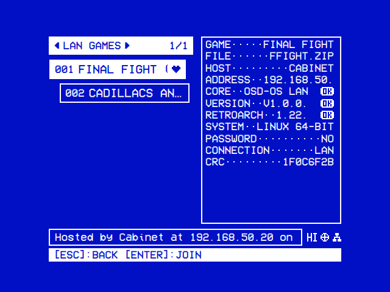
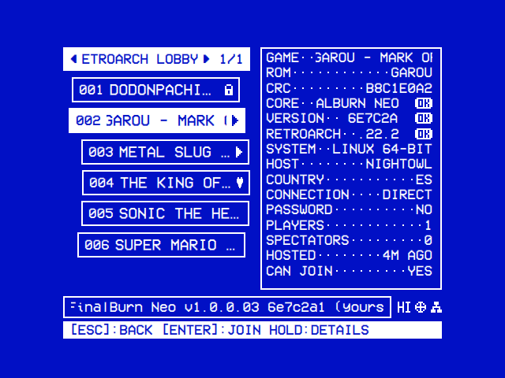

# Online and LAN Play

Every OSD/OS machine plays FinalBurn Neo's arcade games with the others: over the internet through RetroArch's lobby, or on the same network, straight from one machine to the other. Both are turned on in **Settings → Arcade**: **Online Play** and **LAN Play**. The games and the engines are on the [Arcade](https://github.com/mehmetraif/OSD-OS/wiki/Arcade) page.

<table>
<tr><th width="50%">LAN Games</th><th width="50%">RetroArch Lobby</th></tr>
<tr><td></td><td></td></tr>
<tr><td>The games hosted on your network that you have. Select joins one.</td><td>Every game hosted in RetroArch's lobby: ▶ on those you can join, a lock on those with a password.</td></tr>
</table>

## In short

| | Online | On the local network |
|---|---|---|
| **Turned on with** | Settings → Arcade → **Online Play** | Settings → Arcade → **LAN Play** |
| **Who plays** | Anyone with RetroArch and FinalBurn Neo, anywhere | The machines on your network: OSD/OS machines, in a game an OSD/OS hosts |
| **Found through** | RetroArch's lobby (lobby.libretro.com), the game going through a relay | The network itself: no internet, account, lobby or relay |
| **Players a machine brings** | The host as many as it has controllers for (one fewer than the game plays at once), each machine joining one | As many as it has controllers, up to six in all |
| **A CV1000 game** | 10 GB of memory to join, 18.8 GB to host | 2 GB to join, 3.1 GB to host |

- Every system plays with every other: a Raspberry Pi 4 or 5, a Windows PC, a Mac, a Linux PC or a Steam Deck, FreeBSD and OpenBSD.
- Every machine needs the same ROM set of the game in its games folder.
- A four-player game whose cabinet is set for two players (Ninja Baseball Bat Man, Growl...) plays on the local network with all four.

## On the local network, step by step

1. **On every machine**, set **Settings → Arcade → LAN Play** to **On**. The machines are on the same network, by cable or Wi-Fi.
2. **On the machine that hosts**: the game's options (right on it in the tree, select held on the Arcade screen) → **Host LAN Game**. The host's **player 1** in **Settings → Controls → Players** is player 1.
3. **On every other machine**: **LAN Games** lists the game, with who hosts it. Select joins it.
4. **Each player presses COIN** (or START) as they come in, and is the next player. `Player 3 is in`, on screen, says who has come.
5. **Coming back**: Coin and Start together, or Esc, as from any game.

## The same engines on every machine

Every system plays arcade games with the same engines, so machines stay in step and take the same ROM sets.

- **FinalBurn Neo comes with OSD/OS** on every system, built from one commit of it. Machines whose cores differ drift apart in a game, and RetroArch drops one of them.
- **RetroArch and MAME** are the OSD/OS image's versions, Debian's: RetroArch 1.20.0 and MAME 0.276. On Windows, OSD/OS downloads exactly these. Elsewhere they are the system's packages.
- **The newest core**: **Settings → Arcade → FinalBurn Neo → Upgrade to Latest** puts libretro's newest core in place of OSD/OS's. Play with others on OSD/OS's version: **Back to OSD/OS's Version** goes back to it.

## LAN play

**Settings → Arcade → LAN Play**, **On**, plays the games FinalBurn Neo has with someone on the same network. It is RetroArch's netplay, on a core of OSD/OS's own ([OSD/OS's LAN core](#osdoss-lan-core)). An OSD/OS can also join a game another RetroArch hosts with FinalBurn Neo.

### Joining

**LAN Games** lists the games hosted on your network that you have, each with who hosts it and at which address. Select joins one. It is a folder of the tree and a filter of the Arcade screen.

- The network is asked as Arcade opens, and every 5 seconds while LAN Games is shown.
- A game with a password isn't listed. While it lists no game, LAN Games says why.
- On the Arcade screen, the box on the right says what the host's machine answered. ✓ marks a version that is the same as yours, ✗ one that isn't.
- A game that can't be joined ends at once, and the screen says why in RetroArch's words: `Could not join the game: Failed to connect to host 192.168.1.20 on port 55435`. The host wasn't reached (its game ended, or a firewall there keeps the port closed), or it turned you away (another core, an old RetroArch, a full host).

### Hosting

**Host LAN Game**, in a game's options, starts the game for others on your network to join. It isn't put in the lobby and goes through no relay. A game that can't be hosted ends the same way: `Could not host the game: Failed to bind port 55435`, the port taken.

### Players

Up to six players play across the machines, in the games that take them, seated in the order they come in.

- The host's **player 1** in **Settings → Controls → Players** is player 1.
- Every other player, on any machine, comes in by pressing **COIN** or **START** and is the next player.
- A controller no one plays holds no player.
- Each controller of a machine takes a channel as the machine comes in, up to six in all: three for a machine on the 6-Button Panel layout. A machine given none watches.
- A player who left keeps their place for whoever comes in on the same channel.

The host's button layout holds for every machine:

| The host | Layout |
|---|---|
| A cabinet, in a game of up to four players | Its 6-Button Panel on every port. A pad joining has Y, X and LB above B, A and RB |
| A pad; a game of five or six players; a room joined through the lobby; a host that isn't OSD/OS | FinalBurn Neo's usual pad layout: the cabinet's buttons 1 to 6 are the game's first six by number |

An OSD/OS joining a game another RetroArch hosts brings its player 1 alone.

### Versions

The line under the tree, and the Arcade screen's help line, say who hosts the game and whether their FinalBurn Neo and RetroArch are yours:

`Hosted by den-tv at 192.168.1.20 on this network • sf2.zip • The same FinalBurn Neo and RetroArch as yours`

Where they differ, the line says so: `Its RetroArch is 1.21.0, yours 1.22.2`. Such a game can still be joined, though it may fall out of step.

### Cave's CV1000 games

Cave's CV1000 games (Akai Katana, Mushihime-sama, DoDonPachi DaiFukkatsu, Espgaluda II, Deathsmiles...) need 2 GB of memory to join on the local network and 3.1 GB to host. A machine with less leaves them out of LAN Games and Host LAN Game.

- Hosted, the game waits on a black, silent screen that says `Waiting for player 2: the game starts when a second player presses COIN or START.`
- It starts on every machine as player 2 comes in. Player 2 should be on a machine joining.
- A machine that joins a game already started says its picture may be wrong: ask the host to host it again.
- An OSD/OS built without the LAN core can't host or join them, and says so.

### Speed

**Settings → Arcade → LAN Sync** chooses how a game you host keeps its machines together. Every machine joining takes the host's choice.

| LAN Sync | How it plays | For |
|---|---|---|
| **Smooth** (the default) | The host's machine plays the game and the others follow it. A slow machine or a wait on Wi-Fi holds no one else up. A joining player's buttons answer a few frames later than the host's. Over Wi-Fi, a tap shorter than two frames can now and then go unseen | Machines of different speeds, a Raspberry Pi 4 among them; Wi-Fi; three players and more |
| **Responsive** | Every machine plays ahead on a guess of the others' buttons, with a frame of input latency. A machine that can't keep up takes up to three frames more. Every player's buttons answer alike, but a slow machine is felt on every machine | Two machines of the same speed on cables |

Online, a game plays ahead with no latency, and a machine that can't keep up takes up to four frames.

For a smooth game:

- **Screens of 60 Hz.** A screen of 50 Hz (Display Output's 288p and 576i modes, and PAL) is slower than most arcade games. Choose a mode of 60 Hz in **Settings → Screen → Display Output** on every machine.
- **A cable, or Wi-Fi kept awake.** A radio that saves power stutters the game. The OSD/OS image keeps its Wi-Fi awake ([The OSD/OS image → Wi-Fi](https://github.com/mehmetraif/OSD-OS/wiki/The-OSD-OS-Image#wi-fi)); a computer joining over Wi-Fi may need the same.
- **Bluetooth controllers** on a Raspberry Pi share an aerial with its 2.4 GHz Wi-Fi: use a 5 GHz network or a cable.

### Coming back, and the host leaving

Coin and Start together, or Esc, brings a player back to OSD/OS. When the host leaves the game, or stops answering for 10 seconds, OSD/OS ends the game on the machines joining and says `The host left the game`.

### Names, and how games are found

- **Online Name** is the name the others see. Unset, it is the device's name on the local network ([System Information](https://github.com/mehmetraif/OSD-OS/wiki/Settings#system-information)).
- OSD/OS asks every network it is on, with a broadcast to UDP port 55435, and each RetroArch hosting there answers.
- A game hosted online (**Host Online Game**) isn't found this way: host it with **Host LAN Game**.
- Both machines need an address of a private network: `192.168.x.x`, `10.x.x.x`, or `172.16.x.x` to `172.31.x.x`. A router gives one.
- Two machines joined by a cable alone need one set by hand on each (`192.168.50.1` and `192.168.50.2`, say).
- A network of other addresses (a VPN's, such as Tailscale's `100.x.x.x`) finds no game.

## OSD/OS's LAN core

Games on the local network play on a core OSD/OS builds for them: `osdos_lan_libretro` (`.so`; `.dll` on Windows, `.dylib` on a Mac), which comes with every OSD/OS package. It is FinalBurn Neo's core with OSD/OS's changes: [scripts/fbneo-lan.patch](https://github.com/mehmetraif/OSD-OS/blob/main/scripts/fbneo-lan.patch), built by [scripts/build-fbneo-lan.sh](https://github.com/mehmetraif/OSD-OS/blob/main/scripts/build-fbneo-lan.sh). The games are emulated exactly as on the usual core.

| | FinalBurn Neo's usual core | OSD/OS's LAN core |
|---|---|---|
| **Name** | `FinalBurn Neo`, in the file `fbneo_libretro` | `OSD-OS LAN Core`, in the file `osdos_lan_libretro`; **OSD/OS LAN Core (FinalBurn Neo)** in RetroArch's menus. Its version ends in `-lan`: `v1.0.0.03 261108 GIT77016b4-lan` |
| **Who can join** | Any RetroArch with FinalBurn Neo | Only a machine with the same core: OSD/OS machines |
| **Players** | Each netplay channel is the player of its number | Seated in the order they first press **COIN** or **START**, at any time while the game has a place free |
| **Players a game takes** | As its DIP switches' defaults say: a four-player game set for two reads no third or fourth player | The DIP switch for the cabinet's number of players (**Cabinet**, **Number of Players**, **Max Players**...) is set to the most the game has controls for |

- **Where it plays**: only on the local network, in a game an OSD/OS hosts. Alone, online, and in a game another RetroArch hosts, a game plays on the usual core.
- **Always OSD/OS's version**: **Upgrade to Latest** and **Back to OSD/OS's Version** don't touch it.
- **Built from source**, OSD/OS has it once it is built ([Building from Source](https://github.com/mehmetraif/OSD-OS/wiki/Building-from-Source)). Without it, LAN games play on the usual core, a player a machine, and CV1000 games not at all: `This OSD/OS has no core of its own for the local network`.

## Online play

**Settings → Arcade → Online Play**, **On**, plays the games FinalBurn Neo has with others over the internet, through RetroArch's netplay and its lobby (lobby.libretro.com). The Arcade screen's **Playable Online** filter lists those games of yours.

- **Joining**: **Online Games** lists the games hosted in the lobby that you have, each with who hosts it and where. Select joins one. A game with a password isn't listed.
- **Hosting**: **Host Online Game**, in a game's options, puts the game in the lobby under your name. It goes through the **Relay Server** chosen, so that no router has to let anyone in.
- **The whole lobby**: **RetroArch Lobby** lists every game hosted there, of every core. ▶ marks one you can join, a lock one with a password. It is a filter of the Arcade screen, and the last line of Online Games in the tree.
- **A room's page** has what the lobby says of it, with ✓ on the core and versions that are yours. Select opens it in the tree; on the Arcade screen, select held does, or select on a room you can't join. **Join** comes first on it.
- **Read again**: the lobby is read as Arcade opens, and every 20 seconds while it is shown.

A room's page says why it can't be joined: another core's, a host whose connection takes no players, a password, a RetroArch that can't be joined, or a game not in your folder. A room whose core version isn't yours can still be joined, though the game may fall out of step.

| Setting | What it is |
|---|---|
| **Online Name** | The name the others see. Unset: the RetroAchievements account's, else OSD-OS; never the device's name |
| **Relay Server** | Where a game you host goes through: New York (the default), Madrid, São Paulo, Singapore or Chuncheon. The nearest plays smoothest |

### A game too big for the machine's memory

RetroArch keeps a snapshot of the running game for every frame it may go back to: 62 joining and 124 hosting. A game whose snapshots need more memory than your machine has isn't played over the network.

| Game | A snapshot | Memory needed |
|---|---|---|
| Cave's CV1000 games, online | Up to 145 MB | 10 GB to join, 18.8 GB to host |
| Cave's CV1000 games, on the local network | Up to 17 MB | 2 GB to join, 3.1 GB to host |
| Killer Instinct | 8.6 MB | 2.1 GB to host |
| Every other game | Under 8 MB | Under 1 GB, even hosting |

Such a game is left out of Playable Online and Host Online Game, and its rooms out of Online Games. RetroArch Lobby says why: `Joining it over the network needs 10.0 GB of memory, and this machine has 7.9 GB`.

## The same settings on every machine

A game played with others doesn't play with your FinalBurn Neo options (**Core Options** in RetroArch's menu) but with OSD/OS's own, the same on every machine. Machines that run a game differently fall out of step.

- **At FinalBurn Neo's defaults**: the CPU at 100%, no frame skip, Force 60Hz off, the sound at 48000 Hz, a Neo Geo's BIOS by the game's own switch, no memory card, and SOCD.
- **Off**: high scores and patched ROM sets.
- **The diagnostic input**: as FinalBurn Neo sets it online. On the local network it is off: holding Start for it would open a board's service menu on one machine alone.
- **The game's DIP switches** (difficulty, lives, free play), cheats and IPS patches: at their defaults, except the cabinet's number of players on the LAN core.
- **Yours**: only the picture's options, which are vertical mode, 32-bit colour and the light gun's crosshair.

Your own options stay as they are for the games you play alone. A change made in RetroArch's menu during such a game lasts that game. The lobby is read over plain HTTP, as RetroArch reads it, and holds nothing of yours.

## See also

- [Arcade](https://github.com/mehmetraif/OSD-OS/wiki/Arcade): the games, their folder, the two screens and the engines
- [Controls → Players](https://github.com/mehmetraif/OSD-OS/wiki/Controls#players): which controller is which player
- [Settings → Arcade](https://github.com/mehmetraif/OSD-OS/wiki/Settings#arcade)
- [Troubleshooting](https://github.com/mehmetraif/OSD-OS/wiki/Troubleshooting): a game that can't be joined or hosted
