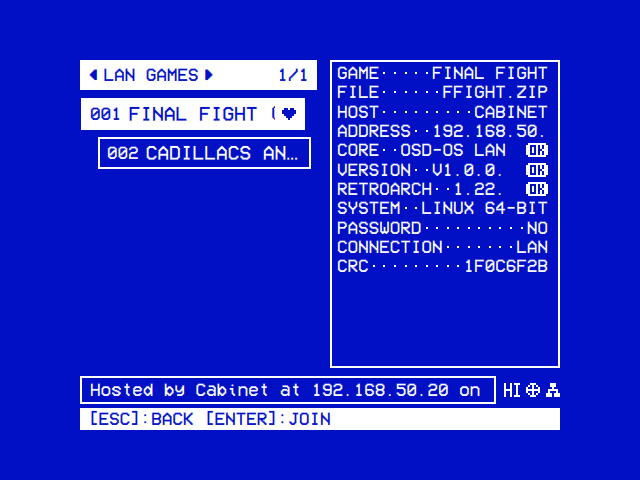
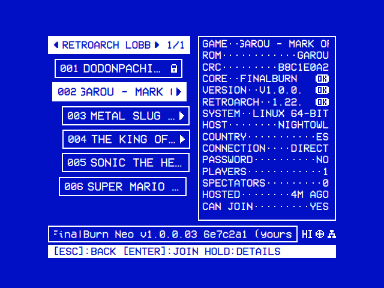

# Online and LAN Play

Every OSD/OS machine plays FinalBurn Neo's arcade games with the others: over the internet through RetroArch's lobby, or on the same network, straight from one machine to the other. Both are turned on in **Settings → Arcade**: **Online Play** and **LAN Play**. The games and the engines are on the [Arcade](https://github.com/mehmetraif/OSD-OS/wiki/Arcade) page.

<table>
<tr><th width="50%">LAN Games</th><th width="50%">RetroArch Lobby</th></tr>
<tr><td></td><td></td></tr>
<tr><td>The games hosted on your network that you have. Select joins one.</td><td>Every game hosted in RetroArch's lobby: ▶ on those you can join, a lock on those with a password.</td></tr>
</table>

## In short

| | Online | On the local network |
|---|---|---|
| **Turned on with** | Settings → Arcade → **Online Play** | Settings → Arcade → **LAN Play** |
| **Who plays** | Anyone with RetroArch and FinalBurn Neo, anywhere | The machines on your network: OSD/OS machines, in a game an OSD/OS hosts |
| **Found through** | RetroArch's lobby (lobby.libretro.com), the game going through a relay | The network itself: no internet, account, lobby or relay |
| **Players a machine brings** | The host as many as it has controllers for (one fewer than the game plays at once), each machine joining one | As many as it has controllers, up to six in all |
| **A CV1000 game** | 10 GB of memory to join, 18.8 GB to host | 2 GB to join, 3.1 GB to host |

- Every system plays with every other: a Raspberry Pi 4 or 5, a Windows PC, a Mac, a Linux PC or a Steam Deck, FreeBSD and OpenBSD.
- Every machine needs the same ROM set of the game in its games folder.
- A four-player game whose cabinet is set for two players (Ninja Baseball Bat Man, Growl...) plays on the local network with all four.

## On the local network, step by step

1. **On every machine**, set **Settings → Arcade → LAN Play** to **On**. The machines are on the same network, by cable or Wi-Fi.
2. **On the machine that hosts**: the game's options (right on it in the tree, select held on the Arcade screen) → **Host LAN Game**. The host's **player 1** in **Settings → Controls → Players** is player 1.
3. **On every other machine**: **LAN Games** lists the game, with who hosts it. Select joins it.
4. **Each player presses COIN** (or START) as they come in, and is the next player. `Player 3 is in`, on screen, says who has come.
5. **Coming back**: Coin and Start together, or Esc, as from any game.

## The same engines on every machine

Every system plays arcade games with the same engines, so machines stay in step and take the same ROM sets.

- **FinalBurn Neo comes with OSD/OS** on every system, built from one commit of it. Machines whose cores differ drift apart in a game, and RetroArch drops one of them.
- **RetroArch and MAME** are the OSD/OS image's versions, Debian's: RetroArch 1.20.0 and MAME 0.276. On Windows, OSD/OS downloads exactly these. Elsewhere they are the system's packages. The image and the Raspberry Pi tarball also bring that RetroArch built by OSD/OS with TLS, for [RetroAchievements](https://github.com/mehmetraif/OSD-OS/wiki/Arcade), and play in it.
- **The newest core**: **Settings → Arcade → FinalBurn Neo → Upgrade to Latest** puts libretro's newest core in place of OSD/OS's. Play with others on OSD/OS's version: **Back to OSD/OS's Version** goes back to it.

## LAN play

**Settings → Arcade → LAN Play**, **On**, plays the games FinalBurn Neo has with someone on the same network. It is RetroArch's netplay, on a core of OSD/OS's own ([OSD/OS's LAN core](#osdoss-lan-core)). An OSD/OS can also join a game another RetroArch hosts with FinalBurn Neo.

### Joining

**LAN Games** lists the games hosted on your network that you have, each with who hosts it and at which address. Select joins one. It is a folder of the tree and a filter of the Arcade screen.

- The network is asked as Arcade opens, and every 5 seconds while LAN Games is shown.
- A game with a password isn't listed. While it lists no game, LAN Games says why.
- On the Arcade screen, the box on the right says what the host's machine answered. ✓ marks a version that is the same as yours, ✗ one that isn't.
- A game that can't be joined ends at once, and the screen says why in RetroArch's words: `Could not join the game: Failed to connect to host 192.168.1.20 on port 55435`. The host wasn't reached (its game ended, or a firewall there keeps the port closed), or it turned you away (another core, an old RetroArch, a full host).

### Hosting

**Host LAN Game**, in a game's options, starts the game for others on your network to join. It isn't put in the lobby and goes through no relay. A game that can't be hosted ends the same way: `Could not host the game: Failed to bind port 55435`, the port taken.

### Players

Up to six players play across the machines, in the games that take them, seated in the order they come in.

- The host's **player 1** in **Settings → Controls → Players** is player 1.
- Every other player, on any machine, comes in by pressing **COIN** or **START** and is the next player.
- A controller no one plays holds no player.
- Each controller of a machine takes a channel as the machine comes in, up to six in all: three for a machine on the 6-Button Panel layout. A machine given none watches.
- A player who left keeps their place for whoever comes in on the same channel.
- A machine that leaves gives its channels back to the host. If that message is lost, or the machine crashed or lost its Wi-Fi, the host frees them once RetroArch has no connection from that machine (at the latest 45 seconds after it asked, for one that never connected), so the next machine to join still gets them.

The host's button layout holds for every machine:

| The host | Layout |
|---|---|
| A cabinet, in a game of up to four players | Its 6-Button Panel on every port. A pad joining has Y, X and LB above B, A and RB |
| A pad; a game of five or six players; a room joined through the lobby; a host that isn't OSD/OS | FinalBurn Neo's usual pad layout: the cabinet's buttons 1 to 6 are the game's first six by number |

A host's pad with Game Buttons chosen by hand counts as a cabinet here. A pad on **Auto**, as a pad SDL knows by its kind starts, counts as a pad: two machines whose pads are all on Auto play FinalBurn Neo's usual pad layout, as on Engine's.

An OSD/OS joining a game another RetroArch hosts brings its player 1 alone.

### Versions

The line under the tree, and the Arcade screen's help line, say who hosts the game and whether their FinalBurn Neo and RetroArch are yours:

`Hosted by den-tv at 192.168.1.20 on this network • sf2.zip • The same FinalBurn Neo and RetroArch as yours`

Where they differ, the line says so: `Its RetroArch is 1.21.0, yours 1.22.2`. Such a game can still be joined, though it may fall out of step.

### Cave's CV1000 games

Cave's CV1000 games (Akai Katana, Mushihime-sama, DoDonPachi DaiFukkatsu, Espgaluda II, Deathsmiles...) need 2 GB of memory to join on the local network and 3.1 GB to host. A machine with less leaves them out of LAN Games and Host LAN Game.

- Hosted, the game waits on a black, silent screen that says `Waiting for player 2: the game starts when a second player presses COIN or START.`
- It starts on every machine as player 2 comes in. Player 2 should be on a machine joining.
- A machine that joins a game already started says its picture may be wrong: ask the host to host it again.
- An OSD/OS built without the LAN core can't host or join them, and says so.

### Speed

**Settings → Arcade → LAN Sync** chooses how a game you host keeps its machines together. Every machine joining takes the host's choice.

| LAN Sync | How it plays | For | Who hosts |
|---|---|---|---|
| **Smooth** (the default) | The host's machine plays the game and the others follow it. A slow machine joining or a wait on its Wi-Fi holds no one else up. A joining player's buttons answer a few frames later than the host's. Over Wi-Fi, a tap shorter than two frames can now and then go unseen | Machines of different speeds, a Raspberry Pi 4 among them; Wi-Fi; three players and more | The fastest machine, on a cable: the PC, then a Raspberry Pi 5. A Pi 4, or a machine on Wi-Fi, joins |
| **Responsive** | Every machine plays ahead on a guess of the others' buttons, with a frame of input latency. A machine that can't keep up takes up to three frames more. Every player's buttons answer alike, but a slow machine is felt on every machine | Two machines of the same speed on cables | Either |

**Why the host matters in Smooth.** Every machine joining plays only the frames the host sends it, so the host's speed and its link are everyone's:

- The host plays the game, keeps RetroArch's snapshot of it at every frame, and sends each frame to every machine joining, up to five. A host that can't keep up slows every screen, where a machine joining that can't is slow alone.
- Every wait on the host's own link, a Wi-Fi radio busy or out of reach for a moment, reaches every machine joining at once.
- The host's own player answers with no delay at all: host on the machine whose player that suits.

On a Pi that hosts over Wi-Fi, `iw dev wlan0 station dump | grep -E 'tx retries|tx failed|signal'` shows how often what it sends has to go again.

**What Smooth costs**, beside a joining player's buttons coming a few frames late:

- **The machines joining also wait on the host's screen.** The host plays at its own screen's rate and the others play the frames it sends. A host whose screen runs at 59.94 Hz, as many TVs and CRTs do, sends a frame fewer every 17 seconds or so than a joiner at 60 Hz plays, and the joiner waits for it. Screens of one rate on every machine, the host's above all, keep that from happening.
- **Not every frame comes in time even so.** In OSD/OS's own measurement, six machines of mixed speeds following their host for 18 seconds had 57 frames come late, against 1440 with every machine playing ahead with no input latency and 252 with a frame of it.
- **A Raspberry Pi 4 on composite is slower** as a whole than on HDMI: Raspberry Pi's documentation has composite on a Pi 4 hold a clock others depend on, which slows the whole system a little, and the image's raised graphics clock (`gpu_freq`) may not hold there. Let such a Pi join rather than host. `vcgencmd measure_clock core` and `vcgencmd measure_clock v3d` on composite and on HDMI show the clocks it runs at ([Display Output → Composite](https://github.com/mehmetraif/OSD-OS/wiki/Display-Output#composite-the-av-jack-or-a-pi-5s-tv-pads)).

Online, a game OSD/OS hosts plays ahead with two frames of input latency, which every machine joining takes from it, and a machine that can't keep up takes up to four frames more. Over the internet a press comes some frames late: without that latency every such press has each machine play several frames again, more than a Raspberry Pi 4 has the time for. A room of the lobby another RetroArch hosts plays with its host's latency.

Under **Smooth** the host's machine sets everyone's speed: a hitch of its own, or of its link, reaches every screen. Host on the fastest machine on a cable (the PC, then a Raspberry Pi 5), and let a Raspberry Pi 4 or a machine on Wi-Fi join. **Host LAN Game** says so on a Pi 4, or on a machine whose way to the network is Wi-Fi: `The fastest machine on a cable should host`, under a game's options while the cursor is on Host LAN Game, and again on the page shown as the game is hosted.

For a smooth game:

- **Screens of 60 Hz.** A screen of 50 Hz (Display Output's 288p and 576i modes, and PAL) is slower than most arcade games. Choose a mode of 60 Hz in **Settings → Screen → Display Output** on every machine.
- **A cable, or Wi-Fi kept awake.** A radio that saves power stutters the game. The OSD/OS image keeps its Wi-Fi awake ([The OSD/OS image → Wi-Fi](https://github.com/mehmetraif/OSD-OS/wiki/The-OSD-OS-Image#wi-fi)); a Windows PC is set by hand ([A Windows PC](#a-windows-pc)).
- **A network game's packets ahead on Wi-Fi.** The OSD/OS image's Pis mark what they send in a LAN game so that Wi-Fi sends it ahead of other traffic ([The OSD/OS image → Wi-Fi](https://github.com/mehmetraif/OSD-OS/wiki/The-OSD-OS-Image#wi-fi)). A Windows PC marks nothing until an administrator sets a QoS policy once: [INSTALL.md → On Windows](https://github.com/mehmetraif/OSD-OS/blob/main/INSTALL.md#on-windows-x64) gives the command, the one that removes it, and how to see on a Pi that the PC's packets arrive marked.
- **Bluetooth controllers** on a Raspberry Pi share an aerial with its 2.4 GHz Wi-Fi: use a 5 GHz network or a cable. The Pi's radio serves the two in turn at 2.4 GHz, so the game's packets wait while the pads are served.
  - A router that gives both its bands one name lets the Pi pick either, and a Pi behind a TV may pick 2.4 GHz. Giving the 5 GHz band a name of its own, and joining that one, keeps it there.
  - A Pi whose Wi-Fi country isn't set to where it is may not hear the router's 5 GHz channel at all: **Settings → Network → Wi-Fi → Country**.
  - OSD/OS says so where you choose: a Pi on 2.4 GHz Wi-Fi with a Bluetooth pad connected has `Wi-Fi is on 2.4 GHz with Bluetooth pads: use 5 GHz or a cable` first on the line under a room of LAN Games (in the tree and on the Arcade screen), under the options on Host LAN Game, and on the page shown while it hosts, the advice on who should host after it. **Settings → Network → Wi-Fi** shows the band of each network, and of the one joined in the title bar.
  - To see the band a Pi is on: the app's log has `[Wi-Fi] On 2437 MHz (2.4 GHz) through wlan0` each time it changes, and on the Pi, `iw dev wlan0 link` gives `freq` (below 3000 is 2.4 GHz), `iw reg get` the country the radio keeps to, and `bluetoothctl devices Connected` the Bluetooth devices connected.
- **Each machine's own settings**, in **Settings → Arcade**, left on their defaults unless a game says otherwise:
  - **CPU at Full Speed** (EMULATORS, ON): a Pi's CPU at its full clock for the length of the game. Only on a Raspberry Pi.
  - **Sound Buffer** (EMULATORS, Auto): 48 ms of FinalBurn Neo's sound held, on a Pi 4 RetroArch's 64 ms with a lighter resampler; **RetroArch's** if the sound crackles.
  - **Frame Buffers** (Emulator Video, Auto): on a Pi 5's console, two frames queued for the screen rather than RetroArch's three, each frame a refresh sooner. Only on a Raspberry Pi.
  - **MAME Vsync** (Emulator Video, Auto): for MAME's games played alone, each frame held for the screen's refresh on a Pi 4 or 5.

#### A Windows PC

Windows leaves its own Wi-Fi and power settings to you. Each of these is set once, and each has a way to check it, in a Command Prompt or PowerShell:

| Set | What it does | To check |
|---|---|---|
| **A cable**, or else a 5 GHz network | A cable has no air to wait for. At 2.4 GHz the PC shares the band with every other network and device around | `netsh wlan show interfaces`: **Band** (`5 GHz`), **Channel** and **Signal**. No Wi-Fi interface listed while a cable is in is the cable |
| **The Wi-Fi adapter's power saving at Maximum Performance**: Control Panel → Power Options → **Change plan settings** → **Change advanced power settings** → **Wireless Adapter Settings** → **Power Saving Mode**, both On battery and Plugged in | An adapter that saves power sleeps between packets and wakes late for the next | `powercfg /query SCHEME_CURRENT 19cbb8fa-5279-450e-9fac-8a3d5fedd0c1`: both **Power Setting Index** values `0x00000000` are Maximum Performance |
| **The power mode at Best performance**: Settings → System → **Power & battery** → **Power mode** (on a PC that offers plans instead, the **High performance** plan) | The processor holds its speed rather than stepping down between frames | `powercfg /getactivescheme` names the plan in force |
| **The Wi-Fi list closed during a game** (the network list of the taskbar's Quick Settings) | Windows searches for networks while the list is open, which takes the radio off its channel for a moment | `ping -t <the Pi's address>` with the list open, then closed: the times jump while it is open |

The PC's packets also go ahead on Wi-Fi only under a QoS policy ([INSTALL.md → On Windows](https://github.com/mehmetraif/OSD-OS/blob/main/INSTALL.md#on-windows-x64)).

### How a game went

To tell whether a change (LAN Sync, a cable, another host) helped:

- **Settings → Arcade → Show Ping**, ON, shows each player's ping on RetroArch's screen during the game. It is under ONLINE AND LAN, after Online Name, usable while Online Play or LAN Play is On, and off by default.
- As a game over the network ends, the app's log has one line on it, which **Quit → Save Logs** carries:

  `arcade: network game: sf2, joined on the LAN, 12 min 40 s; peers: the host 12 ms; left 1; stalls 0, catch-ups 0, savestates 0, CRC mismatches 0, desyncs 0, pauses 0, netplay errors 0; achievements: signed in`

  It says how the game was played, how long, each player's ping as they joined, the players who left, RetroArch's netplay errors and its lines on CRC mismatches, desyncs and savestates, and what RetroAchievements said: whether the account signed in, and any line saying hardcore was paused or disabled.
- RetroArch 1.20 writes nothing in its log of stalls, catch-ups and the savestates it resends; those counts read 0 until a RetroArch that logs them. A CRC mismatch is logged only as RetroArch's warning, with its check frames off.
- Another line, `arcade: system during the game:`, says how the machine itself fared.

### Coming back, and the host leaving

Coin and Start together, or Esc, brings a player back to OSD/OS. When the host leaves the game, or stops answering for 10 seconds, OSD/OS ends the game on the machines joining and says `The host left the game`.

### Names, and how games are found

- **Online Name** is the name the others see. Unset, it is the device's name on the local network ([System Information](https://github.com/mehmetraif/OSD-OS/wiki/Settings#system-information)).
- OSD/OS asks every network it is on, with a broadcast to UDP port 55435, and each RetroArch hosting there answers.
- A game hosted online (**Host Online Game**) isn't found this way: host it with **Host LAN Game**.
- Both machines need an address of a private network: `192.168.x.x`, `10.x.x.x`, or `172.16.x.x` to `172.31.x.x`. A router gives one.
- Two machines joined by a cable alone need one set by hand on each (`192.168.50.1` and `192.168.50.2`, say).
- A network of other addresses (a VPN's, such as Tailscale's `100.x.x.x`) finds no game.

## OSD/OS's LAN core

Games on the local network play on a core OSD/OS builds for them: `osdos_lan_libretro` (`.so`; `.dll` on Windows, `.dylib` on a Mac), which comes with every OSD/OS package. It is FinalBurn Neo's core with OSD/OS's changes: [scripts/fbneo-lan.patch](https://github.com/mehmetraif/OSD-OS/blob/main/scripts/fbneo-lan.patch), built by [scripts/build-fbneo-lan.sh](https://github.com/mehmetraif/OSD-OS/blob/main/scripts/build-fbneo-lan.sh). The games are emulated exactly as on the usual core.

| | FinalBurn Neo's usual core | OSD/OS's LAN core |
|---|---|---|
| **Name** | `FinalBurn Neo`, in the file `fbneo_libretro` | `OSD-OS LAN Core`, in the file `osdos_lan_libretro`; **OSD/OS LAN Core (FinalBurn Neo)** in RetroArch's menus. Its version ends in `-lan`: `v1.0.0.03 261108 GIT77016b4-lan` |
| **Who can join** | Any RetroArch with FinalBurn Neo | Only a machine with the same core: OSD/OS machines |
| **Players** | Each netplay channel is the player of its number | Seated in the order they first press **COIN** or **START**, at any time while the game has a place free |
| **Players a game takes** | As its DIP switches' defaults say: a four-player game set for two reads no third or fourth player | The DIP switch for the cabinet's number of players (**Cabinet**, **Number of Players**, **Max Players**...) is set to the most the game has controls for |

- **Where it plays**: only on the local network, in a game an OSD/OS hosts. Alone, online, and in a game another RetroArch hosts, a game plays on the usual core.
- **Always OSD/OS's version**: **Upgrade to Latest** and **Back to OSD/OS's Version** don't touch it.
- **Built from source**, OSD/OS has it once it is built ([Building from Source](https://github.com/mehmetraif/OSD-OS/wiki/Building-from-Source)). Without it, LAN games play on the usual core, a player a machine, and CV1000 games not at all: `This OSD/OS has no core of its own for the local network`.

## Online play

**Settings → Arcade → Online Play**, **On**, plays the games FinalBurn Neo has with others over the internet, through RetroArch's netplay and its lobby (lobby.libretro.com). The Arcade screen's **Playable Online** filter lists those games of yours.

- **Joining**: **Online Games** lists the games hosted in the lobby that you have, each with who hosts it and where. Select joins one. A game with a password isn't listed.
- **Hosting**: **Host Online Game**, in a game's options, puts the game in the lobby under your name. It goes through the **Relay Server** chosen, so that no router has to let anyone in.
- **The whole lobby**: **RetroArch Lobby** lists every game hosted there, of every core. ▶ marks one you can join, a lock one with a password. It is a filter of the Arcade screen, and the last line of Online Games in the tree.
- **A room's page** has what the lobby says of it, with ✓ on the core and versions that are yours. Select opens it in the tree; on the Arcade screen, select held does, or select on a room you can't join. **Join** comes first on it.
- **Read again**: the lobby is read as Arcade opens, and every 20 seconds while it is shown.

A room's page says why it can't be joined: another core's, a host whose connection takes no players, a password, a RetroArch that can't be joined, or a game not in your folder. A room whose core version isn't yours can still be joined, though the game may fall out of step.

| Setting | What it is |
|---|---|
| **Online Name** | The name the others see. Unset: the RetroAchievements account's, else OSD-OS; never the device's name |
| **Relay Server** | Where a game you host goes through: New York, Madrid, São Paulo, Singapore or Chuncheon. The nearest plays smoothest. Unset, the nearest to the time zone of **Settings → System → Time Zone**: Madrid for Europe and Africa, São Paulo for South America, New York for the rest of the Americas, Chuncheon for Korea and Japan, Singapore for the rest of Asia and Oceania. The row shows that one until a relay is chosen; a relay chosen is kept |

### A game too big for the machine's memory

RetroArch keeps a snapshot of the running game for every frame it may go back to: 62 joining and 124 hosting. A game whose snapshots need more memory than your machine has isn't played over the network.

| Game | A snapshot | Memory needed |
|---|---|---|
| Cave's CV1000 games, online | Up to 145 MB | 10 GB to join, 18.8 GB to host |
| Cave's CV1000 games, on the local network | Up to 17 MB | 2 GB to join, 3.1 GB to host |
| Killer Instinct | 8.6 MB | 2.1 GB to host |
| Every other game | Under 8 MB | Under 1 GB, even hosting |

Such a game is left out of Playable Online and Host Online Game, and its rooms out of Online Games. RetroArch Lobby says why: `Joining it over the network needs 10.0 GB of memory, and this machine has 7.9 GB`.

## The same settings on every machine

A game played with others doesn't play with your FinalBurn Neo options (**Core Options** in RetroArch's menu) but with OSD/OS's own, the same on every machine. Machines that run a game differently fall out of step.

- **At FinalBurn Neo's defaults**: the CPU at 100%, no frame skip, Force 60Hz off, the sound at 48000 Hz, a Neo Geo's BIOS by the game's own switch, no memory card, and SOCD.
- **Off**: high scores and patched ROM sets.
- **The diagnostic input**: as FinalBurn Neo sets it online. On the local network it is off: holding Start for it would open a board's service menu on one machine alone.
- **The game's DIP switches** (difficulty, lives, free play), cheats and IPS patches: at their defaults, except the cabinet's number of players on the LAN core.
- **Yours**: only the picture's options, which are vertical mode, 32-bit colour and the light gun's crosshair.

Your own options stay as they are for the games you play alone. A change made in RetroArch's menu during such a game lasts that game. The lobby is read over plain HTTP, as RetroArch reads it, and holds nothing of yours.

## See also

- [Arcade](https://github.com/mehmetraif/OSD-OS/wiki/Arcade): the games, their folder, the two screens and the engines
- [Controls → Players](https://github.com/mehmetraif/OSD-OS/wiki/Controls#players): which controller is which player
- [Settings → Arcade](https://github.com/mehmetraif/OSD-OS/wiki/Settings#arcade)
- [Troubleshooting](https://github.com/mehmetraif/OSD-OS/wiki/Troubleshooting): a game that can't be joined or hosted
