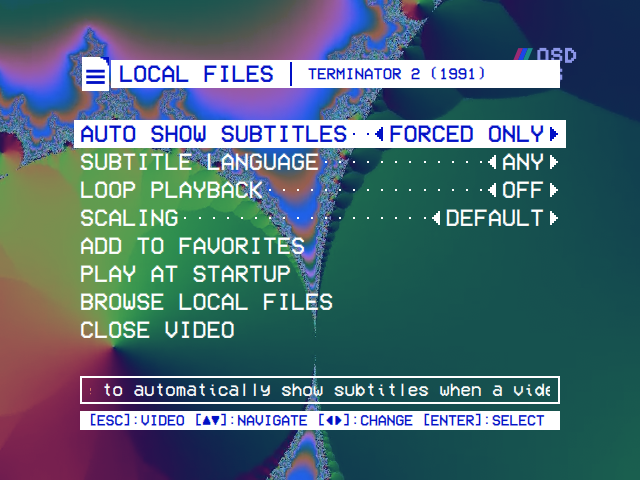

# Playback and mpv

[mpv](https://mpv.io) plays every video. By default it runs as a process, started for each video. With Settings → TV / Movie → Transparent Background it runs inside OSD/OS as a library, libmpv, so the menus can lie over the picture.

## Two ways to play

| | An mpv process (the default) | Inside the app (Transparent Background) |
|---|---|---|
| What plays | `mpv`, started for each video | libmpv inside OSD/OS |
| Who has the screen | mpv: handed the screen on the OSD/OS image and Raspberry Pi OS Lite, a full-screen window on a desktop | OSD/OS: the picture is part of its window |
| Back during a video | Ends it. A Local Files, YouTube or Playlists video opens its menu, then starts again where it was | Returns to the menus; the video plays on behind them |
| Decoder and output flags | The device's profile, or `mpv_video_args` | A list per device; `mpv_video_args` isn't used |
| Your `~/.config/mpv/mpv.conf` | Read | Not read |
| Needs | mpv | libmpv (`libmpv2`, or Homebrew's mpv on a Mac), in a build made with its headers |


## The mpv process

### Starting a video

- **mpv is found** beside the `osdos` binary first (the AppImage's), then on `PATH`. On a Mac, `/opt/homebrew/bin` and `/usr/local/bin` are searched too. On Windows, `mpv.exe` beside `osdos.exe` or in its `mpv` folder comes first.
- **No display server** (Linux with neither `DISPLAY` nor `WAYLAND_DISPLAY`: the OSD/OS image, Raspberry Pi OS Lite): OSD/OS hands mpv the screen, and mpv draws straight to the display (`--vo=drm`).
- **A desktop** (X11, Wayland, macOS): mpv opens a full-screen window. On Linux with `DISPLAY` set it runs on X11 or Xwayland. With `app.display_index` set it opens on that display.

**A video that shows no picture.** mpv has 25 seconds to open a file (90 for a server's stream), then 10 seconds (45) to show its first picture. When the time is up:

1. mpv is told to decode without the hardware decoder.
2. Still nothing: an mpv process is started again with `--hwdec=no`.
3. Still nothing: the player says `The video did not start`, with BACK and RETRY.

RETRY, or the next video, gets the device's decoders again.

### The control channel

OSD/OS controls each video's mpv over a socket, `osdos-mpv.sock` in its [run-time folder](https://github.com/mehmetraif/OSD-OS/wiki/Configuration-Files#logs-and-temporary-files) (`--input-ipc-server`; `/tmp/runtime-pi/` on the image, a named pipe on Windows).

- Keys reach mpv this way: on a Pi, mpv reads no keyboard itself.
- Settings changed during a video apply this way: the speed, looping, Scaling, the sound card.
- A watchdog warns in the log when no position has come for 30 seconds while the video isn't paused: `[MpvController] WATCHDOG: no IPC time-pos event for 40 s — possible freeze`.

### Back, and the end of a video

OSD/OS writes each video's key bindings to `osdos-input.conf` in the same folder:

```text
ESC script-message osdos-menu
BS script-message osdos-menu
ENTER cycle pause
```

- Your own `~/.config/mpv/input.conf` isn't read. mpv's built-in bindings stay (Space pauses, ◄ ► seek).
- A file that can't be written isn't given to mpv: that video plays with mpv's own bindings, back still ends it, and the log says `[MpvController] The keys' file for mpv couldn't be written`.
- While the deck menu or the screen saver is open, back closes that first.
- [Using OSD/OS → Back during a video](https://github.com/mehmetraif/OSD-OS/wiki/Using-OSD-OS#back-during-a-video) says what back does in each module.

A module's player gets one signal when the video is over, `playbackEnded(position, duration, reason)`:

| Reason | When |
|---|---|
| `eof` | The video, or the last of a playlist, played to its end. Plex, Jellyfin and Emby can play the next episode (Autoplay Next Episode) |
| `stopped` | Stopped before the end: back, STOP, a crash or a kill |
| `failed` | mpv couldn't play it (exit code 2, or libmpv's `error`), showed no picture, or never started. Plex, Jellyfin and Emby try a transcode first. The player then shows **Playback failed** with the reason, BACK and RETRY |
| `menu` | The process ended for its player's menu |

A video whose sound card couldn't be opened plays without sound. It ends as it played, `eof` or `stopped`, not as `failed`.

### Keys during a video

| Key | During a video |
|---|---|
| ▲ or ▼ | Opens the deck menu |
| ◄ ► (a pad's LB, RB too) | Seeks 5 seconds |
| Select, play/pause | Pauses and plays |
| Back | The video's menu, or back to the module |
| Page Up, Page Down (a remote's Channel + / −) | The folder's next or previous film (Local Files), or a playlist's video |
| Media keys | Volume by 5; mute; play/pause; stop; 30 seconds on; 10 seconds back; next or previous chapter |


- [Controls](https://github.com/mehmetraif/OSD-OS/wiki/Controls) has every key and button.
- **The deck menu** is drawn by mpv (`scripts/mpv-osc.lua`; Ambient:Mode has `mpv-osc-ambient.lua`). [Using OSD/OS](https://github.com/mehmetraif/OSD-OS/wiki/Using-OSD-OS#the-decks-menu) lists its buttons.
- `scripts/mpv-media-keys.lua` handles the media keys.
- `scripts/mpv-screensaver.lua` puts the bouncing logo over a paused video, unless Settings → Screen → Screen Saver is OFF.

### A full command line on a Pi 4

A Local Files film on a Pi 4 with the OSD/OS image, resumed at 12:34.2. All settings are at their defaults except Channel Logo, on Top Right:

```sh
/usr/bin/mpv \
  --input-ipc-server=/tmp/runtime-pi/osdos-mpv.sock \
  --log-file=/tmp/runtime-pi/osdos-mpv.log \
  --osc=no \
  --osd-level=0 \
  --script=/opt/osdos/share/osdos/scripts/mpv-osc.lua \
  --script=/opt/osdos/share/osdos/scripts/mpv-media-keys.lua \
  --script=/opt/osdos/share/osdos/scripts/mpv-logo.lua \
  --start=754.200 \
  --subs-with-matching-audio=forced \
  --subs-fallback-forced=always \
  --script-opts=logo-corner=tr \
  --image-display-duration=5.0 \
  --ytdl=no \
  --input-conf=/tmp/runtime-pi/osdos-input.conf \
  --input-ar-delay=150 \
  --input-ar-rate=6 \
  --video-sync=audio \
  --vo=drm \
  --hwdec=drm-copy,v4l2m2m-copy \
  --no-input-terminal \
  -- \
  '/media/OSD-OS/Movies/Sci-Fi/Terminator 2 (1991).mp4'
```

- Settings, the module and the device change the line: see How the flags are layered, below.
- A desktop has `--fullscreen --no-native-fs`, and no `--vo` or `--no-input-terminal`.
- `grep 'Command line' /tmp/runtime-pi/osdos-mpv.log` shows the last video's command line, tokens included. The file is readable by its owner only.

## Transparent Background: mpv inside the app

### What it needs

- **At build time**, libmpv's headers, found by `pkg-config mpv`: `libmpv-dev` on Debian and Raspberry Pi OS, Homebrew's `mpv` with `pkgconf` on a Mac. Without them CMake says `libmpv headers not found — Transparent Background will be unavailable`.
- The arm64 `.tar.gz` (the image's) and the Mac's `.dmg` are built with them. The x86_64 AppImage is not.
- **At run time**, libmpv. The first of these that loads:
  - Linux: `../lib/libmpv.so.2` beside the binary, `libmpv.so.2`, `libmpv.so.1`. On Raspberry Pi OS it is the package `libmpv2`.
  - macOS: `../Frameworks/libmpv.2.dylib` beside the binary, `/opt/homebrew/lib/libmpv.2.dylib`, `/usr/local/lib/libmpv.2.dylib`, `libmpv.2.dylib`.
- The log says `[EmbeddedMpv] using <file>`, or `[EmbeddedMpv] libmpv not found: Transparent Background is unavailable`.
- Without libmpv, the Settings row is dimmed and says `Needs libmpv, which isn't installed`.

### The same command line, as libmpv options

libmpv gets the process's command line as options and a playlist, with these differences:

- The decoder flags are the embedded ones (the second table below).
- No `mpv.conf` is read, and `mpv_video_args` isn't used.
- An option this libmpv doesn't know is left out with a warning, `[EmbeddedMpv] --name=value: <mpv's error>`.

### How the picture is drawn

- **On the GPU** wherever Qt Quick draws with OpenGL: `eglfs` on a Pi, and a Linux desktop.
- **On the CPU** otherwise: Metal on a Mac, `QT_QUICK_BACKEND=software`, or OpenGL that runs on the CPU (Mesa's llvmpipe). A Pi 3 is short of power for this.
- If the GPU fails to take a video, that one and the rest are drawn on the CPU.
- The log says which: `[EmbeddedMpv] pictures drawn on the GPU: <the GPU's name>`, or that mpv's software renderer draws them.
- **Slow pictures.** When pictures take 12 ms or more each for 48 in a row, OSD/OS turns mpv's scaling down a step, twice at most, for the rest of the run. The log says `[EmbeddedMpv] the pictures took 23 ms each to draw, …`.
- **Frames the GPU can't take** (mpv's `Mapping hardware decoded surface failed`): OSD/OS switches to the copy-back decoders. The log says `[EmbeddedMpv] the GPU can't take the decoder's frames: --hwdec=…`.
- `OSDOS_EMBEDDED_RENDER=sw` keeps to the CPU. `OSDOS_EMBEDDED_RENDER=gpu` uses OpenGL even when it runs on the CPU, for tests.

### Back to the menus, and back to the video

<table>
<tr><th width="33%">The video's menu</th><th width="33%">Back to the menus</th><th width="33%">Main menu</th></tr>
<tr><td></td><td></td><td></td></tr>
<tr><td>Back during a Local Files or YouTube video opens its menu over the picture.</td><td>Browse, or back from another module's video, returns to the menus. The video plays on behind them.</td><td>The main menu leads with the video. Select takes it back to full screen; play/pause stops it.</td></tr>
</table>

[Using OSD/OS → Transparent Background](https://github.com/mehmetraif/OSD-OS/wiki/Using-OSD-OS#transparent-background) has the setting, how to take the video back and what ends it.

## Per-device decode profiles

OSD/OS reads the board's model from `/proc/device-tree/model` and picks the flags. The log says which at start: `[MpvController] video profile: Pi 4 — drm + drm-copy,v4l2m2m-copy`. A Pi 400 counts as a Pi 4, a Pi 500 as a Pi 5.

**An mpv process:**

| Where | Boot driver | Flags |
|---|---|---|
| Pi 4, no display server | Fake KMS (`vc4-fkms-v3d`) | `--vo=drm --hwdec=drm-copy,v4l2m2m-copy` |
| Pi 3, no display server | Fake KMS (`vc4-fkms-v3d`) | 1080p Playback On: `--vo=gpu --gpu-context=drm --hwdec=v4l2m2m`. Off: `--vo=drm --hwdec=v4l2m2m-copy` |
| Pi 5, no display server | Full KMS (`vc4-kms-v3d`) | `--vo=drm --hwdec=auto-safe`, and `--drm-device`, `--drm-connector` and `--drm-mode` when the launcher exports them |
| Any other Linux, no display server | | `--vo=drm --hwdec=auto-safe` |
| A Linux desktop, X11 or Wayland (a Pi running a desktop too) | | `--hwdec=vaapi,nvdec,vaapi-copy,nvdec-copy,no` |
| macOS | | `--hwdec=videotoolbox` |
| Windows, FreeBSD, OpenBSD | | `--hwdec=auto-safe` |

**Inside the app** (Transparent Background):

| Device | Drawn on the GPU | Drawn on the CPU |
|---|---|---|
| Pi 4 | `--hwdec=drm,v4l2m2m,drm-copy,v4l2m2m-copy --fbo-format=rgba8 --profile=fast --dscale=hermite --correct-downscaling=yes --dither=fruit` | `--hwdec=drm-copy,v4l2m2m-copy` |
| Pi 3 | `--hwdec=v4l2m2m,v4l2m2m-copy` and the same five | `--hwdec=v4l2m2m-copy` |
| Pi 5 | `--hwdec=auto-copy-safe` and the same five | `--hwdec=auto-copy-safe` |
| Any other Linux | `--hwdec=nvdec,vaapi-copy,nvdec-copy,no --fbo-format=rgba8` | `--hwdec=vaapi-copy,nvdec-copy,no` |
| macOS | (Qt draws with Metal there, so the picture is drawn on the CPU) | `--hwdec=videotoolbox-copy`, and `--osd-fonts-dir` for the VCR font |

- **Pi 4.** `drm-copy` decodes HEVC; it needs `dtoverlay=rpivid-v4l2` under `[pi4]` in `config.txt`, as the image has it. `v4l2m2m-copy` decodes H.264. VP9 and AV1 decode in software.
- **Pi 3.** With Settings → TV / Movie → 1080p Playback **On** (the default), 1080p H.264 is smooth but can't be cropped. 14:9 and Pan & Scan then show the whole picture, and the deck menu has no CROP. **Off** crops, for videos of 720p and below. Inside the app the picture can always be cropped.
- **Pi 5.** The launcher exports `OSDOS_DRM_DEVICE`, `OSDOS_DRM_CONNECTOR` and `OSDOS_DRM_MODE`, so mpv plays on the output the display preset names ([Display Output](https://github.com/mehmetraif/OSD-OS/wiki/Display-Output)).
- **A Pi running a desktop** gets the desktop line, which has none of the Pi's decoders: set `mpv_video_args` (below).

## How the flags are layered

On mpv's command line a later flag overrides an earlier one, and the command line overrides `mpv.conf`:

| Layer | Flags | Set by |
|---|---|---|
| App constants | `--input-ipc-server`, `--log-file`, `--osc`, `--osd-level`, `--script`, `--input-conf`, `--input-ar-delay`, `--input-ar-rate`, `--video-sync`, `--no-input-terminal`, `--fullscreen`, `--no-native-fs` | OSD/OS only |
| Per video | `--start`, `--playlist-start`, `--aid`, `--sid` and the subtitle flags, `--sub-file`, `--slang`, `--script-opts`, `--loop-playlist`, `--shuffle`, `--image-display-duration`, `--no-audio`, `--ytdl`, and a module's own (`--ytdl-format`, `--http-header-fields`, `--speed` …) | The player, from its module's settings |
| Presentation | `--audio-device` (Audio Output), `--panscan` or `--keepaspect` (Scaling), `--video-output-levels=limited` or `full` (Video Levels), `--monitoraspect=4:3` (a CRT's output), `--video-rotate` (Monitor) | You, in Settings |
| Device decode | `--vo`, `--gpu-context`, `--hwdec`, `--drm-device`, `--drm-connector`, `--drm-mode` | OSD/OS by device; you, with `mpv_video_args` |
| Your preferences | Anything else: `deinterlace`, `cache`, `sub-scale`, `monitoraspect`, profiles … | You, in `~/.config/mpv/mpv.conf` (the process only) |

- **A setting at its default adds nothing**: Scaling on Letterbox, Video Levels on Auto, Audio Output on Auto. A `video-output-levels=`, `panscan=` or `audio-device=` line in `mpv.conf` then still applies.
- `mpv_video_args` comes after the Settings' flags, so it wins over them.

## mpv_video_args

`mpv_video_args` in `config.json` replaces the device decode layer: the `--vo`, `--gpu-context` and `--hwdec` flags, and on a Pi 5 the `--drm-*` flags too.

```json
{
    "app": {
        "mpv_video_args": "--vo=drm --hwdec=v4l2m2m-copy"
    }
}
```

- **Read at every video**, so a change applies to the next one. Edit `config.json` with OSD/OS stopped ([Configuration files](https://github.com/mehmetraif/OSD-OS/wiki/Configuration-Files#editing-by-hand)).
- **Split on spaces**, with no quoting: a value can't hold a space.
- **It replaces the whole line.** Without a display server, give `--vo` as well as `--hwdec`.
- **On a Pi 5** with an output named by its preset, add `--drm-device`, `--drm-connector` and `--drm-mode` yourself. The connector is the name after `cardN-` in `/sys/class/drm`, such as `HDMI-A-1`.
- **The process only**: Transparent Background ignores it.
- **Only video output and decoder flags belong here.** It overrides anything before it, Video Levels included.
- **To go back** to the device's own flags, delete the key or set it to `""`.

| Value | When |
|---|---|
| `--vo=drm --hwdec=no` | No display server: decode in software, to rule out the hardware decoder |
| `--hwdec=no` | The same on a desktop |
| `--vo=drm --hwdec=v4l2m2m-copy` | A Pi 4: H.264 in hardware, HEVC in software |
| `--hwdec=v4l2m2m-copy` | A Pi running a desktop: H.264 on the Pi's decoder |

**Cropping on a Pi 3 is a setting, not this override:** 1080p Playback → Off gives exactly `--vo=drm --hwdec=v4l2m2m-copy`. With it On, CROP stays hidden whatever `mpv_video_args` says.

## What the modules add

| Module | What its player adds |
|---|---|
| [Local Files](https://github.com/mehmetraif/OSD-OS/wiki/Local-Files) | Subtitle Language `--slang`; Loop Playback `--loop-playlist=inf`; for a playlist, Shuffle `--shuffle` and `--playlist-start`; Image Duration `--image-display-duration`; for photos, `scripts/mpv-slideshow-redraw.lua` |
| [YouTube](https://github.com/mehmetraif/OSD-OS/wiki/YouTube) | `--ytdl=yes`; `--ytdl-format=` from its Advanced settings; `--ytdl-raw-options=` with `write-subs=`, `sub-langs=<language>.*`, `write-auto-subs=` (With Auto) and, signed in, `cookies-from-browser=…`; `--speed=` for a Playback Speed other than 1x; `ytdl_hook-ytdl_path=` in the script options |
| [NFC Reader](https://github.com/mehmetraif/OSD-OS/wiki/NFC-Reader) | `--ytdl=yes`, and a `--ytdl-format=` capped at its YouTube Video Resolution; subtitles as Local Files |
| [Plex](https://github.com/mehmetraif/OSD-OS/wiki/Plex) | `--http-header-fields=X-Plex-Token:<token>`; `--aid`; `--sub-file`; `--tls-verify=no` for a server reached at `*.plex.direct` |
| [Jellyfin](https://github.com/mehmetraif/OSD-OS/wiki/Jellyfin), [Emby](https://github.com/mehmetraif/OSD-OS/wiki/Emby) | `--http-header-fields=Authorization:MediaBrowser Token="<token>"`; `--aid` and `--sub-file` for a file played whole. A Jellyfin transcode adds `--script-opts-append=transcode-sub=…`, `sub-cycle=…`, `transcode-audio=…` and `audio-cycle=…` |
| [Ambient:Mode](https://github.com/mehmetraif/OSD-OS/wiki/Ambient-Mode) | `mpv-osc-ambient.lua`, `--loop-playlist=inf`, `--shuffle`; `--no-audio` when its own music plays, in a second mpv (`--no-video --loop-playlist=inf`) |
| [Playlists](https://github.com/mehmetraif/OSD-OS/wiki/Playlists) | An m3u in the data folder's `playlists/`; its Subtitles and Loop Playback; a YouTube video's flags as the YouTube module makes them |

OSD/OS blanks every token out of what it logs: a URL's `ApiKey=`/`api_key=`, `X-Plex-Token`, and `Token="…"`.

## Scaling

Settings → TV / Movie → Scaling says how a picture of another shape fills the screen. A module's own Scaling overrides it unless it is Default.

| Scaling | mpv flag | What you see |
|---|---|---|
| Letterbox | none: mpv's own `panscan=0`, `keepaspect=yes` | All of the picture, bars above and below |
| 14:9 | `--panscan=0.43` | A little of the sides cut, thinner bars |
| Pan & Scan | `--panscan=1` | The screen filled, the sides cut |
| Anamorphic | `--keepaspect=no` | The screen filled, the picture squeezed, for a TV switched to 16:9 |

- **During a video**, the deck menu's CROP steps through the four at once. A Local Files, YouTube or Playlists video's own menu changes its module's Scaling, also at once.
- **On a Pi 3** with 1080p Playback On, only Anamorphic applies.
- **Netflix and Prime Video** apply their module's Scaling in their browser: 14:9 makes the video 8/7 larger, Pan & Scan 4/3 larger, Anamorphic 4/3 taller.
- `app.auto_crop` set to `On` reads as Pan & Scan until a Scaling is chosen.

## Subtitles and audio tracks

A player tells mpv which tracks to start with; the deck menu's AUDIO and SUBTITLE change them during the video.

| What the player asks | Flags |
|---|---|
| A track by number | `--sid=<n>` (subtitles), `--aid=<n>` (audio): Plex, Jellyfin and Emby, from the item's page |
| Forced subtitles only (dialogue in another language) | `--subs-with-matching-audio=forced --subs-fallback-forced=always` |
| Subtitles on | `--subs-with-matching-audio=yes --subs-fallback=yes`, and `--sid=auto` when no subtitle file is given |
| Subtitles off (or burnt in by a transcode) | `--sid=no` |
| A language first | `--slang=<code>`: Local Files' and the NFC Reader's Subtitle Language (Any adds nothing), YouTube's Subtitle Language |
| Subtitles in files beside the stream | `--sub-file=<url>` for each: a Plex, Jellyfin or Emby server's |

- **Module settings**: Auto Show Subtitles and Subtitle Language (Local Files, NFC Reader); Subtitles (Playlists); Subtitles, Subtitle Language and Audio Language (YouTube). Each module's page has the values.
- The forced-only flags need mpv 0.38 or later.
- A server's sidecar subtitles show their real names in the deck menu (`osdos-mpv-subinfo.json` in the run-time folder).
- **How subtitles look** is mpv's: `sub-scale`, `sub-font-size` and the like in `mpv.conf` apply to the process.

## Resume points

| Module | Where it keeps them | How |
|---|---|---|
| Local Files | `local_files_history.json` in the data folder, by file | Saved when you stop after 5 seconds; cleared at 95%. A playlist saves the video it was on and the point in it. Photos keep none |
| NFC Reader | `nfc_reader_history.json`, by file or URL | As Local Files |
| YouTube | `youtube_history.json`, by video | As Local Files. A video watched to 95% stays on Recently Watched at 0 |
| Playlists | `playlists.json`, the list's `resume` | The video a list in order stopped at and the point in it; forgotten once the list has played out |
| Plex, Jellyfin, Emby | The server | The player reports progress to the server (Continue Watching) |


- A module's Resume Playback is **Ask**, **Always** or, in Local Files and the NFC Reader, **Never**.
- A favourite played at startup never asks: it starts where Settings → Startup → Startup From says.
- The point reaches mpv as `--start=<seconds>`, for the first video only: a looped video or the next in a playlist starts from the beginning.

## The loading screen


- While a video starts, the player shows a tape loading, until mpv reports its first position ([Using OSD/OS → The tape loading](https://github.com/mehmetraif/OSD-OS/wiki/Using-OSD-OS#the-tape-loading)).
- On a Pi without Transparent Background it stands still once mpv has the screen.

## The channel logo

Settings → TV / Movie → Channel Logo and Logo Image put a logo in a corner of the picture ([Using OSD/OS → The channel logo](https://github.com/mehmetraif/OSD-OS/wiki/Using-OSD-OS#the-channel-logo)).

- mpv draws it (`scripts/mpv-logo.lua`, with `logo-corner=tl`, `tr`, `bl`, `br` or `all` in the script options), in both ways of playing.
- **Logo Image** is scaled to the logo's height and written to `osdos-logo.bgra` in the run-time folder. The script gets `logo-image`, `logo-width` and `logo-height`.
- A change applies from the next video.

## Audio Output and mpv

Settings → Sound → Audio Output (Linux with plain ALSA: the image and Raspberry Pi OS Lite) tells mpv the card: `--audio-device=alsa/default:CARD=<id>`.

- Every program OSD/OS starts gets `ALSA_CARD=<id>`.
- With Transparent Background, a video playing behind the menus moves to a newly chosen card at once.
- On **Auto** nothing is added, so `audio-device=` in `mpv.conf` or the default card in `/etc/asound.conf` still choose.
- `mpv --audio-device=help` lists the devices mpv can use.

More in [Audio Output](https://github.com/mehmetraif/OSD-OS/wiki/Audio-Output).

## mpv's own configuration

An mpv process reads your `~/.config/mpv/mpv.conf` (on the OSD/OS image `/home/pi/.config/mpv/mpv.conf`). Anything OSD/OS doesn't set on the command line can go there.

- **Ignored there**: `video-sync`, `osc`, `osd-level`, `input-ipc-server`, `log-file`, `ytdl`, `hwdec` and, without a display server, `vo`.
- **Applied only while the setting is at its default**: `panscan` and `keepaspect` (Scaling), `video-output-levels` (Video Levels), `audio-device` (Audio Output).
- **Not read**: your `~/.config/mpv/input.conf`.
- **Loaded as well**: scripts in `~/.config/mpv/scripts/`. One binding the same keys can get in the way of OSD/OS's own.
- **Transparent Background** reads no `mpv.conf`. The menu music's mpv is started with `--no-config`.

A `mpv.conf` with options that work with OSD/OS:

```ini
# A tube whose picture isn't quite 4:3 (see Troubleshooting below): the
# screen's shape, in place of the 4:3 OSD/OS gives mpv on a CRT's output.
monitoraspect=1.36

# Subtitles a little larger, for a TV across the room.
sub-scale=1.2

# Sound late or early against the picture (a TV or a receiver's own delay): seconds, + or -.
audio-delay=0.1

# The sound card for mpv only, while Settings → Sound → Audio Output is on Auto.
audio-device=alsa/default:CARD=Headphones
```

## Installing a modern mpv

OSD/OS needs **mpv 0.38 or later**: an older mpv refuses to start with Forced Only subtitles' `--subs-with-matching-audio=forced`. Check with `mpv --version`.

| System | mpv |
|---|---|
| The OSD/OS image | Comes with mpv and `libmpv2` from Raspberry Pi OS (Debian 13 "trixie") |
| Raspberry Pi OS (trixie) | `sudo apt install mpv libmpv2`; `install.sh` installs both |
| macOS | `brew install mpv`, which brings libmpv too. Add `pkgconf` to build OSD/OS with Transparent Background |
| SteamOS, Linux x86_64 | The AppImage carries its own mpv 0.40 |
| Another Linux, building from source | The distribution's mpv, if it is 0.38 or later; else build one |

`scripts/build-mpv.sh` builds mpv against the system's FFmpeg and prints the path of the binary:

```sh
MPV_BIN=$(scripts/build-mpv.sh)
"$MPV_BIN" --version
```

- It needs `meson`, `ninja-build`, `pkg-config` and the FFmpeg, libass, libplacebo, Lua 5.2 and VA-API development packages.
- `MPV_TAG` picks the version (`v0.40.0` by default), `MPV_SRC` the build folder (`.mpv-build`), `MPV_LUA` another Lua (`luajit`).
- It builds the player only: Transparent Background still needs the system's `libmpv.so.2`.
- Copy the binary next to `osdos` to make it OSD/OS's mpv. [Building from source](https://github.com/mehmetraif/OSD-OS/wiki/Building-from-Source) bundles it into an AppImage.

## Troubleshooting playback

### First, the logs

- **OSD/OS's log**: `journalctl -u osdos -b` under the autostart service, or the terminal `osdos` was started from. An mpv process's messages appear there as `[mpv] …`.
- **mpv's full log**: `/tmp/runtime-pi/osdos-mpv.log` on the image ([elsewhere](https://github.com/mehmetraif/OSD-OS/wiki/Configuration-Files#logs-and-temporary-files)), the last video's.
- **The profile**: `journalctl -u osdos -b | grep 'video profile'`. `generic` on a Pi means `/proc/device-tree/model` didn't name a Pi 3, 4 or 5.

### A video goes straight back to the menu

A video that can't play ends on a **Playback failed** notice: the reason, mpv's own line on it, BACK and, where it can be tried again, RETRY.

| Message | What to do |
|---|---|
| `mpv is not installed` | Install mpv, or put it on `PATH` |
| `mpv could not be started` | The mpv found can't run; the notice gives the system's error |
| `Another program has the screen` | A takeover script has it; let it end |
| `mpv could not play it` | Try the file in mpv by hand. An option mpv refused means it is older than 0.38 |
| `The video did not start` | No picture came, even without the hardware decoder. Press RETRY |
| `The player inside the window could not be set up` | libmpv could not be started (Transparent Background) |

### Judder or stutter

- **A Pi 4**: if you set `mpv_video_args`, delete it and try again.
- **A Pi 3**: keep 1080p Playback **On** for 1080p.
- **YouTube**: keep Video Codec on **H.264** and Playback Resolution at **480p**, and set Max Frame Rate to **30**. With **Any**, YouTube can send VP9 or AV1.
- **Transparent Background**: check whether the log says the picture is drawn on the CPU.

### No hardware decoding

- `grep -i 'hardware decoding' /tmp/runtime-pi/osdos-mpv.log` says which decoder played. No line means software decoding.
- **A Pi running a desktop**: set `"mpv_video_args": "--hwdec=v4l2m2m-copy"`.
- **HEVC on a Pi 4** needs `dtoverlay=rpivid-v4l2` in `config.txt`, and Raspberry Pi OS's own FFmpeg. VP9 and AV1 have no hardware decoder there.
- **A video that showed no picture** was tried again in software. The log says `[MpvController] The video plays without the hardware decoder`.

### A black screen

- **No picture as a video starts**: OSD/OS tries again without the hardware decoder, then says `The video did not start` (Starting a video, above).
- **Transparent Background at SOLID** hides the picture on purpose. Move the slider towards TRANSPARENT.
- **A Pi 5 with HDMI and a CRT**: if you set `mpv_video_args`, it must carry `--drm-device` and `--drm-connector` too.
- **Nothing on a new output**: Display Output switches back by itself after 30 seconds without Keep.
- **Transparent Background on the GPU**: to rule the GPU out, start OSD/OS with `OSDOS_EMBEDDED_RENDER=sw`.
- **A login prompt for a moment** as a video starts, where OSD/OS runs without the autostart service: that is a `getty`. The autostart service's install and the image mask it (`getty@tty1` and `autovt@`).

### Sound and picture out of step

- `Audio/Video desynchronisation detected!` in mpv's log means the decoding can't keep up: see Judder above, and check the hardware decoder.
- A constant offset in every video (a TV's or a receiver's delay) is mpv's `audio-delay` in `mpv.conf`, in seconds, for the process.

### The picture is squeezed or stretched

- **A CRT**: on a CRT's display output OSD/OS tells mpv the screen is 4:3 (`--monitoraspect=4:3`). A tube whose picture still isn't right takes `monitoraspect` or `monitorpixelaspect` from `mpv.conf` instead; adjust it with a 4:3 test pattern ([Installation](https://github.com/mehmetraif/OSD-OS/wiki/Installation)).
- **A Pi 5's composite output** sometimes reports a narrow raster (704×432 rather than 720×480); the same setting makes up for it.
- **A monitor turned on its side** (Settings → Screen → Monitor): an mpv process turns the picture alone (`--video-rotate=270` for a monitor turned right, `90` for left). Its subtitles and deck menu lie across the screen; inside the app they turn too ([Arcade → A monitor on its side](https://github.com/mehmetraif/OSD-OS/wiki/Arcade#a-monitor-on-its-side-tate)).
- **Anamorphic** squeezes on purpose, for a TV set to 16:9: choose another Scaling.

### Washed-out or crushed colours

Settings → TV / Movie → Video Levels: **Limited** if blacks crush and whites blow out, **Full** if blacks look grey.

### No sound

- Choose the card in Settings → Sound → Audio Output ([Audio Output](https://github.com/mehmetraif/OSD-OS/wiki/Audio-Output)).
- A video whose sound card can't be opened (busy, or none there) plays without sound. The log says `[MpvController] The video played without sound: the sound card could not be opened`.

### YouTube won't play

`Please check that yt-dlp is installed and up to date` means mpv's yt-dlp couldn't open the video. yt-dlp must be current, and needs Deno. OSD/OS uses `bin/yt-dlp` in the data folder first, which the image updates by itself ([YouTube](https://github.com/mehmetraif/OSD-OS/wiki/YouTube)).

## See also

- [Using OSD/OS](https://github.com/mehmetraif/OSD-OS/wiki/Using-OSD-OS): the deck menu, the video's menu, Transparent Background
- [Settings](https://github.com/mehmetraif/OSD-OS/wiki/Settings) and [Configuration files](https://github.com/mehmetraif/OSD-OS/wiki/Configuration-Files)
- [Display Output](https://github.com/mehmetraif/OSD-OS/wiki/Display-Output) and [Audio Output](https://github.com/mehmetraif/OSD-OS/wiki/Audio-Output)
- [Controls](https://github.com/mehmetraif/OSD-OS/wiki/Controls)
- [How it works](https://github.com/mehmetraif/OSD-OS/wiki/How-It-Works)
- [The OSD/OS image](https://github.com/mehmetraif/OSD-OS/wiki/The-OSD-OS-Image)
- [Troubleshooting](https://github.com/mehmetraif/OSD-OS/wiki/Troubleshooting)
- [Building from source](https://github.com/mehmetraif/OSD-OS/wiki/Building-from-Source)
