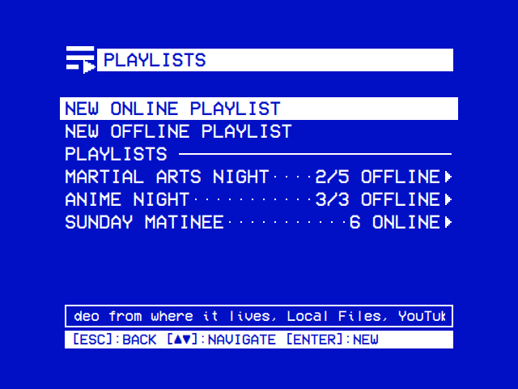

# Playlists

The Playlists module keeps your own lists of videos from several modules at once: Local Files, YouTube, Jellyfin and Emby. An **online** playlist plays each video from where it lives. An **offline** one downloads every video to the device once, then plays without the network.

The module is in [modules/playlists](https://github.com/mehmetraif/OSD-OS/tree/main/modules/playlists) and [src/modules/playlists](https://github.com/mehmetraif/OSD-OS/tree/main/src/modules/playlists). It is on by default; turn it off in **Settings → TV / Movie → Playlists → Enabled**.

<table>
<tr><th width="50%">Playlists</th><th width="50%">An offline playlist</th></tr>
<tr><td></td><td></td></tr>
<tr><td>Online playlists, and offline ones with how many of their videos are on the device.</td><td>Each video downloads once, in the background.</td></tr>
</table>

## Online and offline

A playlist is one or the other from the moment you make it.

| | Online playlist | Offline playlist |
|---|---|---|
| A Local Files file | Played where it is | Played where it is |
| A YouTube video | Streamed through yt-dlp, as the YouTube module plays it | Downloaded once with yt-dlp, then played from the file |
| A Jellyfin or Emby video | Streamed from the server as the original file | Downloaded once as the original file, where the server lets your user download |
| Needs the network | For YouTube and the servers | Only while downloading |
| Its row on the first page | `6 ONLINE`: how many videos | `3/5 OFFLINE`: how many of its videos are on the device, of how many |

- A playlist never asks a server for a transcode, whatever those modules' **Video Quality** says.
- A playlist doesn't report what you watch to Jellyfin or Emby.
- It doesn't touch any module's Recently Watched or resume points. It keeps one place of its own, where the list stopped.

## Making a playlist

1. Open **Playlists** from the main menu and select **New Online Playlist** or **New Offline Playlist**.
2. Name it on the on-screen keyboard. Names are in capitals, up to 40 characters.
3. The new playlist's page opens. Select **Add Videos** to fill it.

A playlist can also be made from the **Add to playlist?** window ([below](#from-another-module)); the video goes straight on it.

## A playlist's page

Select a playlist to open its page.

| Row | What it does |
|---|---|
| **Play** | Plays the list ([Playing](#playing)). Its value: `5 VIDEOS` on an online list, `3 OF 5 READY` on an offline one |
| **Order** | **In Order** or **Shuffle**: select or ◄ ► switch it |
| **Add Videos** | Browse Local Files, YouTube, Jellyfin and Emby for videos to add ([below](#from-the-module-add-videos)) |
| **Rename** | A new name, on the on-screen keyboard |
| **Retry Downloads** | Shown while a download has failed: tries the failed downloads again |
| **Delete Playlist** | Asks **Delete playlist?** On an offline list its downloads go too, unless another offline playlist has them |
| **Videos** | The videos, in the list's order |

Each video's line shows its title and a value:

| Value | On | Means |
|---|---|---|
| `LOCAL`, `YOUTUBE`, `JELLYFIN`, `EMBY` | Online lists | Where it plays from |
| `READY` | Offline lists | On the device (a Local Files file always is) |
| `42%` | Offline lists | Downloading now, this far |
| `QUEUED` | Offline lists | Waiting its turn |
| `FAILED` | Offline lists | The download failed; the help line gives the reason |
| `NOT ALLOWED` | Offline lists | The server doesn't let your user download it |
| `MISSING` | Both | A Local Files file that is gone. On an online list also a server video while you are signed out |

The help line gives a failed download's reason after the title: `the server doesn't let this user download it`, `no yt-dlp`, `signed out`, `can't write to /media/OSD-OS/Movies/Playlists`, or yt-dlp's own error.

Select on a video opens its choices:

| Choice | What it does |
|---|---|
| **Play from Here** | Plays the list starting with this video, without asking about where it stopped |
| **Move Up** / **Move Down** | Moves it one place in the list |
| **Remove from Playlist** | Takes it off. On an offline list its download is stopped or deleted, unless another offline playlist has the video |

## Adding videos

- A video can go on any number of playlists, but on each only once: a second time says **Already on …**.
- Series, seasons, collections and folders can't go on as a whole; open them and add their videos.

<table>
<tr><th width="50%">Adding videos</th><th width="50%">Add to Playlist</th></tr>
<tr><td></td><td></td></tr>
<tr><td>Local Files, YouTube, Jellyfin and Emby in one tree. Select adds a video and stays, for the next.</td><td>From a module itself: a video's options (►), or ► on PLAY in Jellyfin and Emby.</td></tr>
</table>

### From the module: Add Videos

**Add Videos** opens one tree with a branch for each source that is on:

| Branch | Shown when | What it holds |
|---|---|---|
| **Local Files** | The Local Files module is on | Its tree as Local Files shows it |
| **YouTube** | The YouTube module is on | Its home as the YouTube module shows it; **More** loads the next page of a list |
| **Jellyfin** | On and signed in | **Continue Watching**, **Next Up**, then every library with videos in it (whatever the module's Libraries setting hides), down to the episodes |
| **Emby** | On and signed in | The same, from the Emby server |

- The tree works as Local Files' does ([The tree](https://github.com/mehmetraif/OSD-OS/wiki/Local-Files#the-tree)).
- Select on a video adds it and leaves the cursor where it is, so several go on in a row.
- The help line says what became of it: `Added: <title>`, `Added, to download: <title>` (an offline list), `Already on <NAME>: <title>`, or `This one can't go on a playlist`.

### From another module

| Where | How |
|---|---|
| **Local Files** | ► on a file: **Add to Playlist** in its options |
| **YouTube** | ► on a video, then ► on its info screen (one ► with Settings → TV / Movie → Info Screen off): **Add to Playlist** in its options |
| **Jellyfin**, **Emby** | ► on **PLAY** on a film's, episode's or video's page (the hint bar shows `[►]:PLAYLIST`) |


- Each opens **Add to playlist?**: every playlist (an offline one marked `(Offline)`), then **New Online Playlist** and **New Offline Playlist**.
- The window then says **Added to <NAME>** (and **It downloads in the background, once** for an offline list), **Already on <NAME>**, or **Can't go on a playlist**.
- These choices are offered only while the Playlists module is on.

### What a video is called

| Source | Its title on the list |
|---|---|
| Local Files | The file's name, with its extension (`Bloodsport (1988).mp4`) |
| YouTube | The video's title |
| Jellyfin, Emby | The item's name; an episode as `SHOW - EPISODE` |

## Playing

Select **Play**, or **Play from Here** on a video.

| Situation | What happens |
|---|---|
| **Play from Here** | Starts at that video. On a shuffled list that video comes first and the rest follow shuffled |
| **Play**, the list **In Order**, and it stopped part-way last time | **Resume playback?** `Resume video 3 at 12:34` / `Start from the beginning` |
| **Play**, the list **In Order**, nothing to resume | From its first video |
| **Play**, the list on **Shuffle** | In a new order each time, from the start |
| **Play** while this list plays behind the menus (Transparent Background) | It comes back full screen where it is, without asking |

- **Where the list stopped** is kept by video, not by place. If that video has been removed or can't play now, the list starts from the beginning. Once the list has played to its end, the place is forgotten.
- **What can't play is left out**: a missing Local Files file, a server video while you are signed out, and on an offline list anything not downloaded yet.
- **During a video**, the deck's menu (▲ or ▼) has **<** and **>** for the previous and next video. Page Up and Page Down, or a remote's Channel + and −, do the same.
- **Loop Playback** starts the list again from its first video when it ends (`--loop-playlist=inf`).
- **Subtitles** is Forced Only (the default), On or Off, for every video on the list. On shows a streamed YouTube video's in the YouTube module's **Subtitle Language**.
- A server's subtitles kept as separate files aren't fetched, and a downloaded YouTube video has none.
- **YouTube videos on an online list** play with the YouTube module's **Advanced** settings, but always at normal speed.
- **Still images** from Local Files show for Local Files' **Image Duration**.
- **Scaling** is the module's own; **Default** follows **Settings → TV / Movie → Scaling**.

**When it can't play:**

| Message | Means |
|---|---|
| **Nothing to play** · Add videos to it first | The list is empty |
| **Nothing to play** · None of its videos is on the device yet | An offline list with nothing downloaded |
| **Nothing to play** · None of its videos can be reached | An online list whose every video is missing or on a server you are signed out of |
| **Could not play** · The list could not be written in … | Its m3u couldn't be written in the data folder's `playlists` folder: the disk is full or read-only. Make room, then play the list again |
| **Playback failed** · Its YouTube videos need yt-dlp, up to date, and the network | mpv stopped before showing anything, on a list with streamed YouTube videos. Select retries |
| **Playback failed** · None of its videos would play | The same, on any other list |
| **Playback failed** · mpv is not installed | mpv isn't there; the line under it says how to install it. Select retries |

## The player's menu

Back during a video (with the deck's menu closed) opens the list's own menu:

| Line | What it does |
|---|---|
| **Subtitles** | ◄ ► change the module setting; the video starts again where it is as you go back to it |
| **Loop Playback**, **Scaling** | ◄ ► change it; with Transparent Background the playing list takes it at once |
| **Browse Playlists** | Back to the list's page |
| **Close Video** | Stops the list and leaves Playlists for the main menu |

- Back in the menu returns to the video. A setting changed here is saved as the module's setting.
- **After Browse Playlists** the main menu leads with a row for the list, `► <NAME>`. That row, or **Play** on the list's page, takes the list back.
- **With Transparent Background** the list plays on behind the menus, and comes back full screen where it is.
- **Without it** the list stops for the menu. It starts again at the video it was on, without asking; a shuffled list starts shuffled afresh.


[Using OSD/OS → The video's own menu](https://github.com/mehmetraif/OSD-OS/wiki/Using-OSD-OS#the-videos-own-menu) has the rest.

## Downloads

- Every video on an offline list, other than a Local Files file, is downloaded once into the download folder.
- The file is shared: a video on three offline lists is fetched once and kept while any of them has it.
- A video's line shows `QUEUED`, the percent, then `READY`, or `FAILED` or `NOT ALLOWED` ([A playlist's page](#a-playlists-page)).

### Where they go


**Settings → TV / Movie → Playlists → Download Folder** names the folder, on the folder picker: **Use This Folder** picks the folder open, **Default Folder** the default. The default is a **Playlists** folder in Local Files' media folder:

| Local Files' media folder | Default download folder |
|---|---|
| The OSD/OS image's default, `/media/OSD-OS/Movies` | `/media/OSD-OS/Movies/Playlists` |
| The default elsewhere, `<data folder>/media/Movies` | `~/.local/share/OSD-OS/media/Movies/Playlists` on Linux, `~/Library/Application Support/OSD-OS/media/Movies/Playlists` on a Mac |
| Another folder ([Local Files → The media folder](https://github.com/mehmetraif/OSD-OS/wiki/Local-Files#the-media-folder)) | `<that folder>/Playlists` |

Each source has a folder of its own, and each file carries the video's id in brackets:

```text
/media/OSD-OS/Movies/Playlists/
├── YouTube/
│   └── Saturday Morning Commercials 1985 [aBcD3fGh1jK].mp4
├── Jellyfin/
│   └── Kickboxer (1989) [5f1c0a8e9b2d4c6f8a1e3b5d7c9f0a2b].mkv
└── Emby/
    └── Double Impact (1991) [20731].mp4
```

- Characters exFAT forbids (`\ / : * ? " < > |`) are replaced, and the title is cut at 80 characters (YouTube: 80 bytes).
- The default folder is inside Local Files' media folder, so Local Files lists it too. A video copied into it by hand isn't on any list.
- Changing the Download Folder affects what downloads next; files already downloaded stay where they are.
- The folder must be writable. On the OSD/OS image USB drives are mounted read-only, so they can't take downloads.

### YouTube videos

- YouTube videos download with yt-dlp, in the YouTube module's **Advanced** settings: **Playback Resolution**, **Video Codec**, **Max Frame Rate** and **Audio Language** ([YouTube](https://github.com/mehmetraif/OSD-OS/wiki/YouTube)).
- If you are signed in to YouTube, the download uses that sign-in (`--cookies-from-browser`).
- yt-dlp is looked for in `<data folder>/bin/yt-dlp` first (the image's, updated after each boot and daily), then beside the app, then on the `PATH`.
- **ffmpeg** joins picture and sound, which YouTube sends separately above 360p. The image has it; elsewhere install it (`sudo apt install ffmpeg`, `brew install ffmpeg`).
- Without ffmpeg, downloads are low resolution: `-f` is `best[height<=?480][vcodec^=avc1]/best[height<=?480]/best`, with no `--merge-output-format`.
- A download cut short leaves its part file, and yt-dlp carries on from it next time.

With the YouTube module's settings at their defaults (480p, H.264, any frame rate, the original audio) and ffmpeg there, the download is the same as running:

```sh
yt-dlp \
  -f 'bestvideo[height<=?480][vcodec^=avc1]+bestaudio/bestvideo[height<=?480]+bestaudio/best[height<=?480]/best' \
  --merge-output-format mp4 \
  --newline --no-playlist --no-mtime --windows-filenames \
  -o '/media/OSD-OS/Movies/Playlists/YouTube/%(title).80B [%(id)s].%(ext)s' \
  --print after_move:filepath --no-simulate --progress \
  -- 'https://www.youtube.com/watch?v=aBcD3fGh1jK'
```

Run it by hand to see yt-dlp's own error for a video that fails.

### Jellyfin and Emby videos

A server video downloads as its original file from `/Items/<id>/Download`, signed in as your user.

- **Your user must be allowed to download.** Without the right, the server answers 401 or 403 and the video shows **NOT ALLOWED**. Once an administrator has given the right, select **Retry Downloads**.
- **You must be signed in.** Otherwise the download fails with `signed out`: sign in again in the Jellyfin or Emby module and select **Retry Downloads**.
- A transfer that stops moving for 30 seconds fails.
- A server download that fails or is cut short starts again from the beginning.

### One at a time

- Downloads run one after another, in the order they were queued.
- Queued videos start downloading 15 seconds after OSD/OS starts. A video put on an offline list joins the queue at once.
- With the Playlists module turned off, nothing downloads; a download under way stops and waits. Turned on again, the queue goes on.
- A download stays at 100% for a moment while the file is written out to the card, and only then counts as **READY**.
- A failed download is tried again each time OSD/OS starts, and with **Retry Downloads**. A **NOT ALLOWED** one is tried only with Retry Downloads.
- A downloaded file deleted from outside OSD/OS shows **QUEUED** and downloads again the next time OSD/OS starts.

### When a download is deleted

- A download is deleted as soon as no offline playlist has the video: removed from its last offline list, or that list deleted.
- A download under way for it is stopped, and what it had fetched is deleted too.
- A video that is only on online lists has no download.

### A card flashed with an earlier image

If every download fails with `can't write to /media/…`, the film partition is mounted read-only:

- Flash the current image, or
- edit the film partition's line in `/etc/fstab` (`/media/240-MP`): change `ro` to `rw,noexec,nosuid,nodev`, and the last `0` to `2`. Then restart and select **Retry Downloads**.

## What can't go on a playlist

| Not on a playlist | Why |
|---|---|
| Netflix and Prime Video | They play in the service's own player, in Chromium, not in mpv |
| Plex | The Playlists module takes Local Files, YouTube, Jellyfin and Emby only |
| Series, seasons, collections, folders | Only videos go on; add their episodes or files one by one |

## Settings

Settings → TV / Movie → Playlists.

| Setting | Values | Default | What it does | Config key |
|---|---|---|---|---|
| ENABLED | ON, OFF | ON | Shows Playlists on the main menu, and Add to Playlist in the other modules | `modules.com.osdos.playlists.enabled` |
| Download Folder | Default, or a folder | Default | Where offline playlists' videos are downloaded | `modules.com.osdos.playlists.download_folder` |
| Subtitles | Forced Only, On, Off | Forced Only | Whether a video's subtitles show as it starts ([Playing](#playing)) | `modules.com.osdos.playlists.subtitles` |
| Loop Playback | ON, OFF | OFF | When a playlist ends, start it again from its first video | `modules.com.osdos.playlists.loop_playback` |
| Scaling | Default, Letterbox, 14:9, Pan & Scan, Anamorphic | Default | How a 16:9 picture fills the 4:3 screen in Playlists | `modules.com.osdos.playlists.video_scaling` |

### How the values are saved

| Key | Saved as |
|---|---|
| `enabled`, `loop_playback` | `true` or `false` |
| `download_folder` | `""` for the default, else the folder's full path |
| `subtitles`, `video_scaling` | The value as Settings shows it: `"Forced Only"`, `"14:9"` |

The module's entry in `config.json` ([Configuration Files](https://github.com/mehmetraif/OSD-OS/wiki/Configuration-Files)):

```json
{
    "modules": {
        "com.osdos.playlists": {
            "enabled": true,
            "download_folder": "/media/OSD-OS/Offline Videos",
            "subtitles": "On",
            "loop_playback": true,
            "video_scaling": "14:9"
        }
    }
}
```

## Files it keeps

| File | What it holds |
|---|---|
| `playlists.json` in the data folder | The playlists and the downloads ([below](#playlistsjson)) |
| `playlists/<playlist id>-<n>.m3u` in the data folder | What a list played last ([below](#the-m3u-it-writes)) |
| The download folder | The downloaded videos |

The data folder's `playlists` folder holds m3u files; the download folder's `Playlists` holds videos.

### playlists.json

Written whole each time anything changes.

| Field | What it is |
|---|---|
| `playlists` | The playlists, in the order they were made |
| `playlists[].id`, `playlists[].name` | The playlist's id (a UUID) and its name |
| `playlists[].kind` | `"online"` or `"offline"` |
| `playlists[].order` | `"inorder"` or `"shuffle"` |
| `playlists[].items` | Its videos, in order: each an `id` (a UUID of its own), the `module` it comes from, its `key`, its `title` and its `source` (`path` for Local Files, `videoId` and `channel` for YouTube, `itemId` for Jellyfin and Emby) |
| `playlists[].resume` | Where it stopped: the item's `id` (`itemId`) and `positionMs`. Absent once it has played out |
| `downloads` | By key: `{ "path", "state": "done", "bytes" }` for a finished download, `{ "state": "failed", "reason" }` for a failed one. A video not downloaded yet has no entry |

A video's **key** names it whatever list it is on, and so names its download: `local:<path>`, `youtube:<videoId>`, `jellyfin:<itemId>` or `emby:<itemId>`.

An offline playlist of two videos, as OSD/OS writes it:

```json
{
    "downloads": {
        "emby:20733": {
            "reason": "not allowed",
            "state": "failed"
        },
        "jellyfin:5f1c0a8e9b2d4c6f8a1e3b5d7c9f0a2b": {
            "bytes": 734003200,
            "path": "/media/OSD-OS/Movies/Playlists/Jellyfin/Kickboxer (1989) [5f1c0a8e9b2d4c6f8a1e3b5d7c9f0a2b].mkv",
            "state": "done"
        }
    },
    "playlists": [
        {
            "id": "3f2c9a1e-7b4d-4e8f-9a6b-1c2d3e4f5a6b",
            "items": [
                {
                    "id": "9d4a1f3e-2b7c-4e6a-8f5d-0c1b2a3e4d5f",
                    "key": "jellyfin:5f1c0a8e9b2d4c6f8a1e3b5d7c9f0a2b",
                    "module": "com.osdos.jellyfin",
                    "source": {
                        "itemId": "5f1c0a8e9b2d4c6f8a1e3b5d7c9f0a2b"
                    },
                    "title": "Kickboxer (1989)"
                },
                {
                    "id": "5a3c1e9b-7d2f-4c8a-b6e4-2f1d0c9b8a7e",
                    "key": "emby:20733",
                    "module": "com.osdos.emby",
                    "source": {
                        "itemId": "20733"
                    },
                    "title": "Street Fighter (1994)"
                }
            ],
            "kind": "offline",
            "name": "MOVIE NIGHT",
            "order": "inorder",
            "resume": {
                "itemId": "9d4a1f3e-2b7c-4e6a-8f5d-0c1b2a3e4d5f",
                "positionMs": 754000
            }
        }
    ]
}
```

- The list stopped 12 minutes 34 seconds into Kickboxer. This user can't download the Emby film.
- Edit the file only with OSD/OS stopped (`sudo systemctl stop osdos` on the image), and keep it valid JSON. A file that can't be read is taken as no playlists at all.

### The m3u it writes

- Each time a list starts, the videos that can play are written into `playlists/<playlist id>-<n>.m3u` in the data folder and handed to mpv.
- The file is readable by your user only: a Jellyfin or Emby address in it carries the server's token.
- A shuffled list is shuffled here, so the file is in the order it plays.

An online list with a Local Files film and an Emby film writes:

```text
#EXTM3U
#EXTINF:-1,Bloodsport (1988).mp4
/media/OSD-OS/Movies/Martial Arts/Bloodsport (1988).mp4
#EXTINF:-1,Street Fighter (1994)
http://192.168.1.30:8096/Videos/20733/stream?static=true&api_key=<token>
```

- A YouTube video is written as `https://www.youtube.com/watch?v=<id>`.
- A Jellyfin video is written as `<server>/Videos/<id>/stream?static=true&ApiKey=<token>&api_key=<token>`.
- On an offline list every line is a file on the device.

## Troubleshooting

| Problem | What to do |
|---|---|
| A YouTube video **FAILED**, `no yt-dlp` | Install yt-dlp ([Installation](https://github.com/mehmetraif/OSD-OS/wiki/Installation)): put a copy in `~/.local/share/OSD-OS/bin/yt-dlp` or on the `PATH`. Then **Retry Downloads** |
| A YouTube video **FAILED** with yt-dlp's error | Update yt-dlp (`~/.local/share/OSD-OS/bin/yt-dlp -U`; the image's updates itself daily), or sign in with Settings → TV / Movie → YouTube → Sign in. Run the [command above](#youtube-videos) by hand to see the whole error |
| YouTube downloads are low resolution | ffmpeg is missing: install it |
| Everything **FAILED**, `can't write to …` | Pick another **Download Folder**, or on a card from an earlier image [make the partition writable](#a-card-flashed-with-an-earlier-image) |
| **NOT ALLOWED**, or **FAILED** with `signed out` | See [Jellyfin and Emby videos](#jellyfin-and-emby-videos) |
| **MISSING** | The Local Files file was moved, renamed or deleted, or is on a USB drive that is out. A moved file has to be added again |
| A video stays **QUEUED** | Downloads run one at a time, start 15 seconds after OSD/OS does, and only while the Playlists module is on |
| The card fills up | Take videos off offline lists, or delete lists: their downloads go at once. `bytes` in `playlists.json` gives each file's size |
| A Jellyfin or Emby video doesn't play on an online list | The server must be reachable. The list streams the original file, so a file mpv can't decode won't play here |

- The app's log has the module's warnings: `journalctl -u osdos -b | grep Playlists`, such as `[Playlists] download of youtube:aBcD3fGh1jK failed: <reason>` or `[Playlists] can't write playlists.json`.
- mpv's own log is `/tmp/runtime-pi/osdos-mpv.log` on the image ([elsewhere](https://github.com/mehmetraif/OSD-OS/wiki/Configuration-Files#logs-and-temporary-files); [Troubleshooting](https://github.com/mehmetraif/OSD-OS/wiki/Troubleshooting)).

## See also

- [Local Files](https://github.com/mehmetraif/OSD-OS/wiki/Local-Files): the media folder, its own m3u playlists, and the film partition
- [YouTube](https://github.com/mehmetraif/OSD-OS/wiki/YouTube): the Advanced settings downloads follow, yt-dlp and signing in
- [Jellyfin](https://github.com/mehmetraif/OSD-OS/wiki/Jellyfin) and [Emby](https://github.com/mehmetraif/OSD-OS/wiki/Emby): ► on PLAY, and downloading rights
- [Playback and mpv](https://github.com/mehmetraif/OSD-OS/wiki/Playback-and-mpv) and [Using OSD/OS](https://github.com/mehmetraif/OSD-OS/wiki/Using-OSD-OS)
- [The OSD/OS Image](https://github.com/mehmetraif/OSD-OS/wiki/The-OSD-OS-Image): the card's OSD-OS partition, yt-dlp and ffmpeg on the image
- [Settings](https://github.com/mehmetraif/OSD-OS/wiki/Settings) and [Configuration Files](https://github.com/mehmetraif/OSD-OS/wiki/Configuration-Files)
