# Settings

Settings is OSD/OS's own menu. This page lists every page and row in screen order: values, default, what it does and its key in `config.json`.

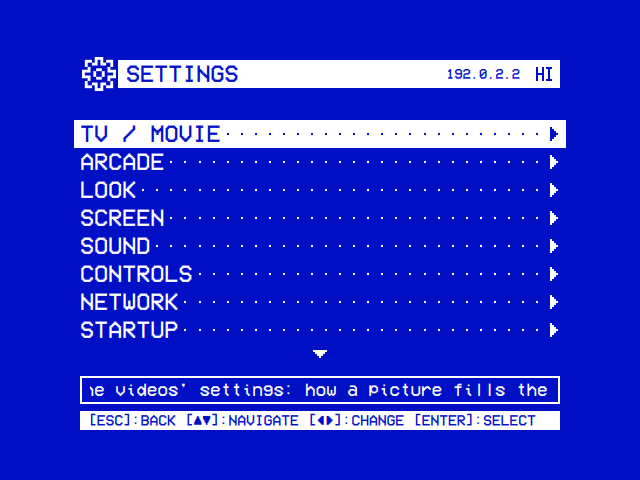

## Getting around

Back on the main menu opens Settings (`[ESC]:SETTINGS` in the hint bar). Its first screen lists the pages: **TV / Movie**, **Arcade**, **Look**, **Screen**, **Sound**, **Controls**, **Network**, **Startup**, **System**, then **Quit**.

| Action | Keyboard | Gamepad | What it does in Settings |
|---|---|---|---|
| ▲ ▼ | Up, Down | D-pad, left stick | Moves a row, round at the ends |
| ◄ ► | Left, Right | D-pad, left stick, LB, RB | Changes the value. A slider moves by 10. ► opens a row ending in ► |
| Select | Enter | A | Opens a row ending in ►. Turns Transparent Background on or off |
| Back | Esc, Backspace | B, or the pad's Back/Select button | Back to the row that opened the page, or to the main menu |

- A change is saved at once, under `app.<key>` in `config.json` ([Configuration files](https://github.com/mehmetraif/OSD-OS/wiki/Configuration-Files#configjson)).
- Most rows apply at once. Scaling, Video Levels, Channel Logo, Logo Image, 1080p Playback and Screen Saver during a video apply from the next video; Scaling and Video Levels also at once on a video playing behind the menus (Transparent Background).
- A value that can't be saved (a full or read-only disk) isn't applied. The log says `[AppCore] Setting not saved: …`.
- The first screen's title bar shows a release's version and the device's IP address. A page shows its name: `SETTINGS | LOOK`.
- No row is hidden. One that can't be used is dimmed, and its help line starts with why ([Troubleshooting](https://github.com/mehmetraif/OSD-OS/wiki/Troubleshooting#rows-dimmed-in-settings)).

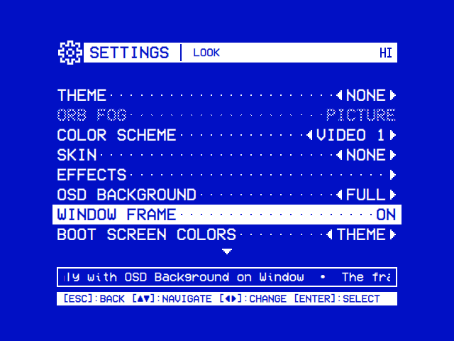

## TV / Movie

`SETTINGS | TV / MOVIE`: the videos' rows, then each video module under **MODULES**. What the rows do to mpv is in [Playback and mpv](https://github.com/mehmetraif/OSD-OS/wiki/Playback-and-mpv).

| Setting | Values | Default | What it does | Config key |
|---|---|---|---|---|
| Scaling | Letterbox, 14:9, Pan & Scan, Anamorphic | Letterbox | How a 16:9 picture fills a 4:3 screen, in every module whose own Scaling is Default. **Letterbox**: bars above and below. **14:9**: thinner bars, the sides cut a little. **Pan & Scan**: no bars, the sides cut. **Anamorphic**: squeezed, for a TV set to 16:9. CROP in the deck menu changes it during a video | `app.video_scaling` |
| Transparent Background | Off, or a slider from TRANSPARENT to SOLID, 0 to 100 in steps of 10 | Off | Plays the video inside OSD/OS's own window: back returns to the menus with the picture behind them, and the main menu's first row returns to the video. The slider sets how solid the menus are; at SOLID the picture is hidden but plays on. Select turns it on (at 40) or off. Needs libmpv | `app.transparent_background`: a number from 0 to 100, or `"Off"` |
| Video Levels | Auto, Limited, Full | Auto | The colour range mpv sends: **Limited** if blacks look crushed, **Full** if they look grey | `app.video_output_levels` |
| 1080p Playback | On, Off | On | Raspberry Pi 3 only. **On**: smooth 1080p; 14:9 and Pan & Scan show the whole picture, and the deck menu has no CROP. **Off**: cropping works, 1080p stutters | `app.smooth_playback` |
| Loading Effect | On, Off | On | A tape's noise and tracking bands on the loading screen | `app.loading_effect` |
| Loading Screen Colors | Theme, Default | Theme | The loading screen in the theme's or colour scheme's colours, or white on blue | `app.loading_colors` |
| Channel Logo | Off, Top Left, Top Right, Bottom Left, Bottom Right, All Corners | Off | A logo in a corner of the picture while a video plays | `app.video_logo`: `off`, `tl`, `tr`, `bl`, `br` or `all` |
| Logo Image | OSD/OS Logo, or a PNG, JPG, JPEG, SVG, GIF, BMP or WebP picked on the file browser | OSD/OS | Your own picture as the channel logo, as tall as OSD/OS's. A PNG with a clear background works best. Only while Channel Logo isn't Off | `app.video_logo_image`: the file's full path, `""` for OSD/OS's |
| Info Screen | Off, Key, 1 sec, 2 sec, 3 sec, 5 sec | 3 sec | A film's details in Netflix, Prime Video and YouTube. **Key**: with ► on a film. **A number**: also by itself once the cursor has rested that long. **Off**: ► offers the film's options instead | `app.info_screen`: `off`, `key`, `1`, `2`, `3` or `5` |

<table>
<tr><th width="50%">Channel Logo</th><th width="50%">Under the menus</th></tr>
<tr><td></td><td></td></tr>
<tr><td>The logo in a corner of the picture.</td><td>With Transparent Background the menus lie over it.</td></tr>
</table>

<table>
<tr><th width="50%">Logo Image</th><th width="50%">Picking the picture</th></tr>
<tr><td></td><td></td></tr>
<tr><td>Your own picture in its place.</td><td>Select on a picture, or <b>OSD/OS Logo</b> to go back to it.</td></tr>
</table>

**The file browser** that Music File and Logo Image open is Local Files' tree. At its top is the default (**No File**, **OSD/OS Logo**), then **Home**, **Media** (`/media`), **Drives** (`/run/media/<user>`), **Volumes** (`/Volumes`, on a Mac) and **Root** (`/`); on Windows, in Root's place, each drive by its letter (**C:**, **D:**).

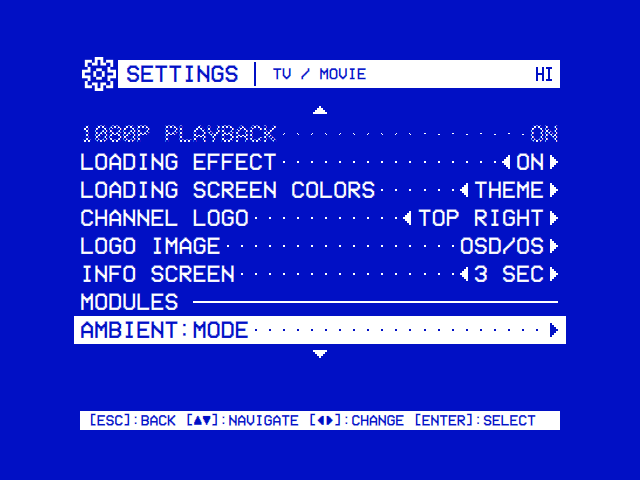

### The video modules

Under **MODULES** is a row for each module of the TV / Movie group (`"settings_group": "tv"` in its manifest). Select opens the module's page ([Modules](#modules)).

## Arcade

`SETTINGS | ARCADE` is one page for the Arcade group (`"settings_group": "arcade"`): the [Arcade](https://github.com/mehmetraif/OSD-OS/wiki/Arcade#settings) module's rows, then the [High Scores](https://github.com/mehmetraif/OSD-OS/wiki/High-Scores#settings) module's **Enabled** under a **HIGH SCORES** heading. Each row is saved in its own module, under `modules.com.osdos.arcade` or `modules.com.osdos.highscores` ([Modules](#modules)).

## Look

`SETTINGS | LOOK`. A theme sets the part rows: Color Scheme, Skin, the effects and Menu Music.

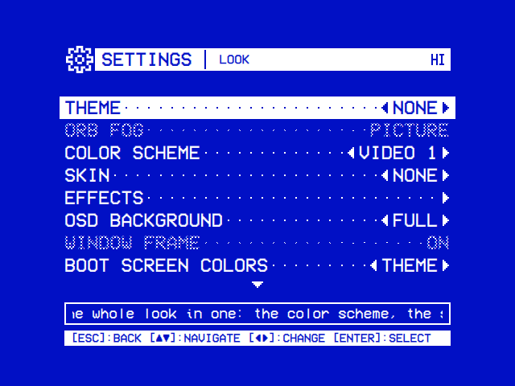

- **THEME** in a part row (saved as `""`) means the theme's. **Off** (saved as `"Off"`) means none. A choice of its own (saved by its name) replaces the theme's.
- Choosing a theme sets every part row back to THEME.
- Without a theme the rows have no THEME, and `""` shows as Video 1, None or Off.

| Setting | Values | Default | What it does | Config key |
|---|---|---|---|---|
| Theme | None, Arcade, Demoscene, Green Screen, Inferno, Late Show, Matrix, Orb, Trinitron, Winter, and those in the data folder's `themes` | None | The colour scheme, skin, effects and menu music in one ([Themes](https://github.com/mehmetraif/OSD-OS/wiki/Themes)) | `app.osd_theme`: the theme's folder name (`trinitron`, `late-show`), `""` for None |
| Orb Fog | Picture, Live | Picture | The fog behind the Arcade screen's panels in the [Orb look](https://github.com/mehmetraif/OSD-OS/wiki/Arcade#the-orb-look). **Live** is thicker and quicker, and more work for a Raspberry Pi's GPU. Only with a theme in the Orb look | `app.orb_fog` |
| Color Scheme | THEME (with a theme), Video 1, Late Night, Synthwave, Terminal, T-120, Amber, Kinescope, SMPTE ECR 1-1978, and your own | THEME; without a theme, Video 1 | The two colours everything is drawn in ([below](#color-schemes)). It has no Off | `app.color_scheme`: the scheme's name, `""` for THEME |
| Skin | THEME (with a theme), None, DOS, Rounded, and those in the data folder's `skins` | THEME; without a theme, None | The shapes of the window's frame, bars and selected line, and its icons ([Skins](https://github.com/mehmetraif/OSD-OS/wiki/Skins)) | `app.skin`: the skin's folder name (`dos`, `rounded`), `"Off"` for None, `""` for THEME |
| Effects | A page | | [Below](#effects) | |
| Menu Layout | Standard, Camcorder, Studio Monitor, Broadcast, Flat Panel | Standard | How Settings and the main menu are laid out ([below](#menu-layout)) | `app.menu_layout` |
| OSD Background | Full, Off, Window | Full | What the menus are drawn on. **Full**: the scheme's background over the whole screen. **Off**: black, the menus in the scheme's lighter colour. **Window**: a framed window of the scheme's background, black or a playing video around it | `app.osd_background` |
| Window Frame | On, Off, Shadow | On | The window's frame: a line (or the skin's frame), none, or the line with a shadow at the right and the foot. Only with OSD Background on Window | `app.osd_frame` |
| Boot Screen Colors | Theme, Default | Theme | The OSD/OS image's boot screen in the theme's or colour scheme's colours, or white on blue | `app.boot_colors` |
| Hint Bar | On, Off | On | The key hints at the foot of every screen. Off gives every menu a row more; the keys work as before | `app.hint_bar` |
| Help Line | On, Off | On | The line about the selected row under a menu. Off hides it everywhere but About | `app.help_line` |
| Status Icons | On, Off | On | What is on, at the right end of every title bar ([below](#status-icons)) | `app.status_icons` |

### Effects

`SETTINGS | LOOK / EFFECTS`. Each row is a part of the theme. Its default is THEME; without a theme, Off.

| Setting | Values | What it does | Config key |
|---|---|---|---|
| Text Effect | THEME, Off, Rainbow, Shimmer, Glow, Flicker | What the text, the lines and the bars do. Needs a GPU | `app.text_effect` |
| Background Effect | THEME, Off, Matrix, Fire, Stars, Snow, Checkered Flag, Plasma | What goes on behind the menus, in the window. Needs a GPU | `app.background_effect` |
| Selector Effect | THEME, Off, Sparkles, Welding, Lightning, Rainbow, Snow | What goes on round the selected line. Works everywhere | `app.selector_effect` |
| Screen Effect | THEME, Off, Scanlines, CRT, VHS | A picture tube's or a tape's look over the whole screen. Needs a GPU | `app.screen_effect` |
| Transition | THEME, Off, Fade, Cube, Ripple, Wave, Drop | How one window gives way to the next. Ripple, Wave and Drop need a GPU; without one a theme's falls back to Fade | `app.transition` |

The effects and the menu music rest while a video plays, loads or has its menu open, and while a player has the screen ([Effects](https://github.com/mehmetraif/OSD-OS/wiki/Effects)).

### Menu Layout

<table>
<tr><th width="50%">Settings in Camcorder</th><th width="50%">The main menu in Camcorder</th></tr>
<tr><td>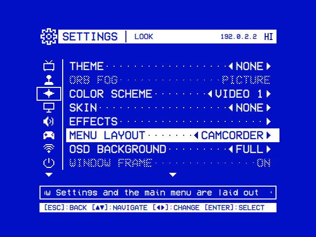</td><td>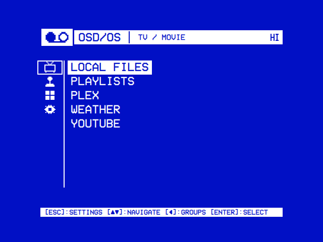</td></tr>
<tr><td>The pages as icons, the selected one's rows beside them.</td><td>The modules in groups: TV / Movie, Arcade, More, and Settings.</td></tr>
</table>

Every layout has the same pages and rows, and changes at once.

| Layout | How it looks | Keys |
|---|---|---|
| Standard | A list, a page at a time | As [above](#getting-around) |
| Camcorder | The pages as icons in a column, the selected page's rows beside it. The column stays on the pages opened from there (Wi-Fi, Bluetooth, Controls, About, a module's settings) | ▲ ▼ go from page to page, ► or select into the rows, back out to the icons |
| Studio Monitor | A black window, the pages' icons in a blue strip. Its first page, **Status**, shows what is set | As Camcorder |
| Broadcast | Plain blue, a three-line key guide | A list. A value changes in two steps |
| Flat Panel | Black, mixed case, a page of rows at a time (`1/2`) | As Broadcast. ◄ goes back |

<table>
<tr><th width="50%">Settings</th><th width="50%">The main menu</th></tr>
<tr><td>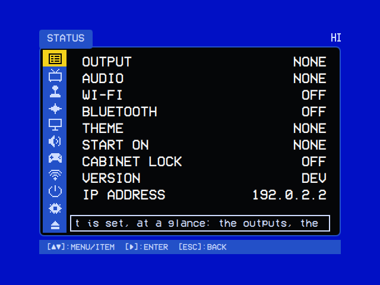</td><td>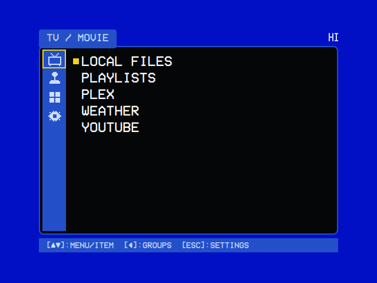</td></tr>
<tr><td colspan="2"><b>Studio Monitor.</b></td></tr>
<tr><td>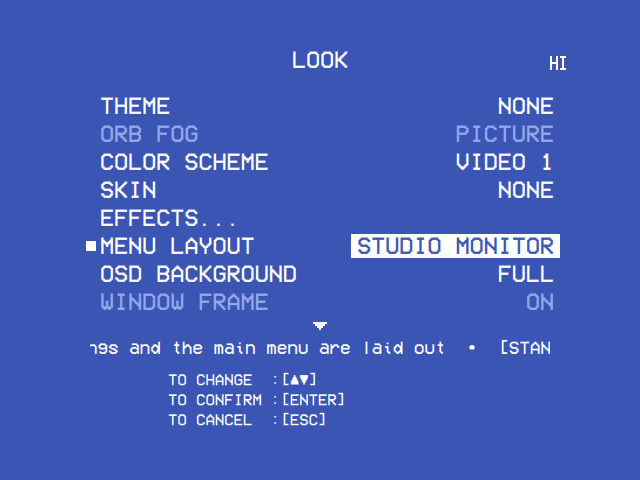</td><td>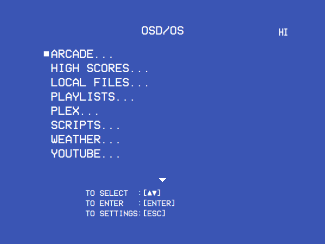</td></tr>
<tr><td colspan="2"><b>Broadcast.</b></td></tr>
<tr><td>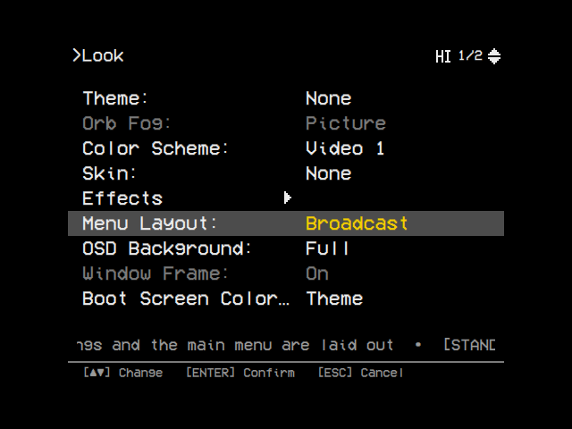Look at the top left and 1/2 at the top right, the rows in mixed case as Label: Value, Menu Layout's value Broadcast in yellow while it is being changed on a grey bar" /></td><td>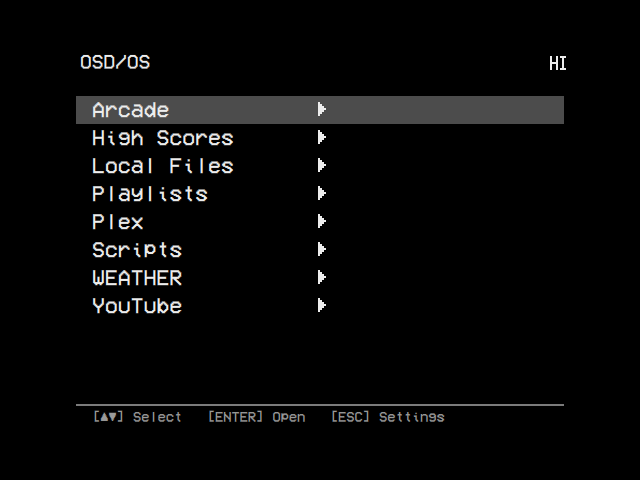</td></tr>
<tr><td colspan="2"><b>Flat Panel.</b> The title is the path to the page (<code>&gt;Look &gt;Effects</code>).</td></tr>
</table>

- **Two steps** (Broadcast, Flat Panel): select starts the change, ▲ ▼ go through the choices, select saves, back cancels. ◄ ► change nothing.
- **Key Protect**, the last row of the first screen in Broadcast and Flat Panel, is Cabinet Lock.
- **The main menu** in Camcorder and Studio Monitor groups the modules: **TV / Movie**, **Arcade**, **More** (Scripts), then **Settings**. Broadcast's ends with a row for Settings.
- Studio Monitor, Broadcast and Flat Panel use colours of their own, whatever the theme. A row that can't be used is paler, not checkered.
- A module's page is laid out as in Standard in those three. The Arcade screen keeps its own layout.

### Color schemes

The eight colour schemes, by their two colours (`primary` on `surface`):

| Scheme | Text, lines, selection | Background |
|---|---|---|
| Video 1 | `#FFFFFF` | `#0110C5`, the blue of a VCR's menu |
| Late Night | `#FFFFFF` | `#000000` |
| Synthwave | `#FFFFFF` | `#12012B` |
| Terminal | `#4AF626` | `#000000` |
| T-120 | `#000000` | `#FAF5E8` |
| Amber | `#FFB000` | `#000000` |
| Kinescope | `#FFFFFF` | `#121212` |
| SMPTE ECR 1-1978 | `#BFBFBF` | `#131313` |

Your own come from two files in the data folder: `custom_color_schemes.json` adds any number by name, and `custom_color_scheme.json` adds one called **Custom** ([Configuration files](https://github.com/mehmetraif/OSD-OS/wiki/Configuration-Files#custom-color-schemes)).

### OSD Background and Window Frame

<table>
<tr><th width="33%">OSD Background: Window</th><th width="33%">OSD Background: Off</th><th width="33%">Window Frame: Shadow</th></tr>
<tr><td></td><td></td><td></td></tr>
<tr><td>A framed window of the scheme's background, black around it.</td><td>The menus on black, in the scheme's lighter colour.</td><td>Skin DOS gives the frame a double line; Shadow adds a shadow.</td></tr>
</table>

### Status Icons

With **Status Icons** on, the right end of every title bar shows what is on:

| Icon | Shown while |
|---|---|
| **HI** | Arcade's **Save High Scores** is on ([Arcade](https://github.com/mehmetraif/OSD-OS/wiki/Arcade#high-scores)) |
| A trophy | Arcade's **Online High Scores** is RetroAchievements and its account is signed in, or signs in at the next game |
| A globe | Arcade's **Online Play** is on |
| A network, two machines joined to a third | Arcade's **LAN Play** is on |
| Bluetooth's rune | Bluetooth is on; with a dot either side while a device is connected |
| Wi-Fi's bars | Wi-Fi is on: the signal of the network joined, or the bars' feet alone while none is |

The Arcade screen shows them at its bottom right. A module turned off takes its icons with it.

## Screen

`SETTINGS | SCREEN`.

| Setting | Values | Default | What it does | Config key |
|---|---|---|---|---|
| Display Output | Those this Pi has of: HDMI, Composite NTSC, Composite PAL, GPIO Composite NTSC, GPIO Composite PAL, SCART RGB NTSC, SCART RGB PAL, SCART RGB 240p, SCART RGB 288p, JAMMA 240p 15 kHz (720x240), JAMMA 240p 15 kHz (320x240), JAMMA 240p 15 kHz (1920x240), JAMMA 288p 15 kHz (720x288), JAMMA 288p 15 kHz (1920x288), JAMMA 480i 15 kHz (720x480), JAMMA 480i 15 kHz (640x480), JAMMA 576i 15 kHz (720x576), JAMMA 25 kHz (496x384), JAMMA 31 kHz (640x480) | The image's build setting, HDMI unless built otherwise | Where the picture goes ([below](#display-output)). On the OSD/OS image only | None: the preset is copied over `/boot/firmware/osdos-display.txt` |
| Monitor | Horizontal, Turned Right, Turned Left | Horizontal | For a monitor turned on its side (TATE): menus, games and videos stand upright on it. **Turned Right**: its top is on the right as you face it. **Turned Left**: on the left ([A monitor on its side](https://github.com/mehmetraif/OSD-OS/wiki/Arcade#a-monitor-on-its-side-tate)). On a desktop, turn the screen in the system's settings instead. For a monitor turned only for a vertical game, use Arcade → Emulator Video → Vertical Games | `app.monitor` |
| Test Patterns | A page | | Pictures to set the screen up by ([below](#test-patterns)) | None |
| Screen Saver | OFF, 30, 60, 120 | OFF | Seconds without a key or a mouse move before a black screen with the OSD/OS logo bouncing across it, in the menus and over a paused video. The first key only wakes it | `app.screensaver_timeout`: `"OFF"` or the seconds |
| Mouse Pointer | Off, 2 sec, 5 sec, 10 sec, 30 sec, Always | 5 sec | How long the pointer stays after the mouse stops. **Off**: never shown, and the selection doesn't follow the mouse. Clicks and the wheel work whatever this is set to ([Controls](https://github.com/mehmetraif/OSD-OS/wiki/Controls#the-mouse)) | `app.mouse_pointer`: `off`, `2`, `5`, `10`, `30` or `always` |
| Window Mode | Off, On | Off | The menus in a desktop window, 960×720 to start with. F11 or Alt+Enter switches at any time. On Windows and on a Linux or BSD desktop only | `app.window_mode` |

### Display Output

Select opens the list of this Pi's outputs, with the one in use (`Now: HDMI`). Choose another, then:

| Choice | What happens |
|---|---|
| **Switch and Restart** | The Pi restarts on it |
| **At Next Start** | The Pi starts on it the next time. Until then the row reads **Next: <output>**; choosing the output in force again takes it back (**Stay on <output>?**, **Stay**) |
| **Switch and Power Off** | The Pi powers off, and starts on it when switched on: for a screen that isn't connected yet |

- On the new output OSD/OS asks **Keep this display output?**. **Keep** keeps it. **Switch Back**, back, or 30 seconds without an answer returns to the output before.
- JAMMA 25 kHz and 31 kHz warn first: too high a scan rate can damage a 15 kHz monitor.

The outputs, the cables, the launcher each choice needs and putting a card right from a computer are in [Display Output](https://github.com/mehmetraif/OSD-OS/wiki/Display-Output).

### Test Patterns

Full-screen pictures to set up a TV or monitor by, from Artemio Urbina's [240p Test Suite](https://github.com/ArtemioUrbina/240pTestSuite) (GPL v2 or later). **◄ ►** go through the patterns and **▲ ▼** through a pattern's kinds. **Select** shows or hides the pattern's name and how to set the screen with it.

<table>
<tr><th width="50%">Grid</th><th width="50%">Monoscope</th></tr>
<tr><td>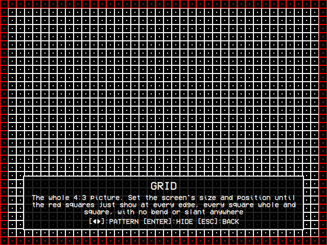</td><td>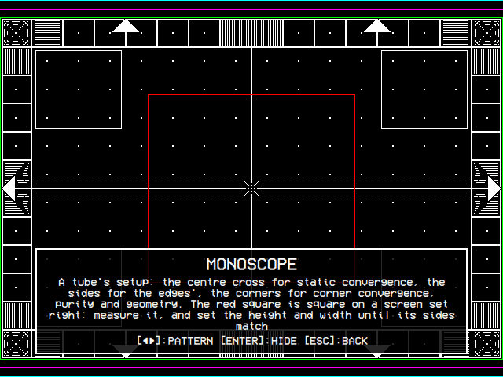</td></tr>
<tr><td>Size, position and geometry.</td><td>A tube's convergence, purity and geometry.</td></tr>
</table>

| Pattern | Kinds | What to set with it |
|---|---|---|
| Grid | | Size, position and geometry: the red squares just show at every edge |
| Monoscope | | A tube's convergence, purity and geometry |
| Convergence | Lines, Crosses, Dots, Colors, Colors on Black | Red, green and blue landing on one another, at a lowered brightness |
| PLUGE | | Black level, with Brightness |
| Color Bars | | White level with Contrast, then each colour's |
| SMPTE Color Bars | | Colour and tint, with a blue filter or the set's blue-only mode |
| Gray Ramp | | Colour balance: every bar grey |
| Sharpness | | Sharpness (aperture on a monitor) |
| Solid Color | White, Black, Red, Green, Blue | Purity and white balance |

While a pattern is up the screen effects rest and the screen saver waits.

## Sound

`SETTINGS | SOUND`: the sound card that plays, and the music under the menus.

| Setting | Values | Default | What it does | Config key |
|---|---|---|---|---|
| Audio Output | Auto, then each sound card that can play: AV Jack, HDMI (HDMI 0 and HDMI 1 when there are two), a USB card by its name | Auto | Which sound card plays, from the moment you choose it ([below](#audio-output)). On Linux with plain ALSA only | `app.audio_output`: `""` for Auto, or `{ "card", "name" }` |
| Menu Music | THEME, Off, File | THEME; without a theme, Off | A tune under the menus: the theme's, if it has one, or the file below ([Menu music](https://github.com/mehmetraif/OSD-OS/wiki/Menu-Music)) | `app.menu_music`: `""`, `"Off"` or `"File"` |
| Music File | No File, or an MP3, WAV, OGG, Opus, FLAC, M4A, AAC, MID, MIDI, XM, MOD, S3M or IT picked on the file browser | None | The menu music's own file, played over and over. Only with Menu Music on File | `app.menu_music_file`: the file's full path |
| Music Volume | A slider from QUIET to LOUD, 0 to 100 in steps of 10 | 60 | How loud the menu music is. Dimmed while Menu Music is Off | `app.menu_music_volume`: a number |

### Audio Output

- **Auto** is the Pi's own default; `audio-device` in `mpv.conf` and `/etc/asound.conf` still choose. While that card can't play, the first card that can plays, and the row says so: **Auto (USB Audio Device)**.
- A card chosen and then unplugged shows as `NAME (Unplugged)`. Sound goes as on Auto until it is back.
- Without a USB sound card to choose, the help line says what the system sees of one.

More in [Audio Output](https://github.com/mehmetraif/OSD-OS/wiki/Audio-Output).

## Controls

Controls is a page of its own, explained in [Controls](https://github.com/mehmetraif/OSD-OS/wiki/Controls#settings--controls).

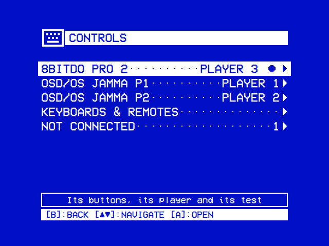

| Line | What it does |
|---|---|
| **All Keyboards & Remotes** | One more button for each of **Up**, **Down**, **Left**, **Right**, **Select / OK** and **Back**, on every keyboard and remote. The default key keeps working. Saved as `app.remote_keymap.up`, `.down`, `.left`, `.right`, `.select` and `.back`, a number each, `0` for none |
| **Player 1** to **Player 6** | The pad each player has in games: one of the pads connected, or Auto |
| A controller | Each gamepad and, on Linux, each keyboard and remote. A ● marks the one used last. Select opens its page: **Button Labels**, **Test Buttons** or **Test Keys**, **Arcade Buttons**, a button for each action, **Clear a Button** or **Remove a Key**, and **Reset to Defaults**. Saved under `app.controllers`, by its key |
| **Not Connected** | Controllers that are away and have settings of their own |

Every gamepad's starting map can also be set in the data folder's `input.cfg`.

## Network

`SETTINGS | NETWORK`: **Wi-Fi** and **Bluetooth**, a page each. Neither is saved in `config.json`: NetworkManager keeps the networks, BlueZ the pairings.

### Wi-Fi

<table>
<tr><th width="50%">Wi-Fi</th><th width="50%">The country</th></tr>
<tr><td>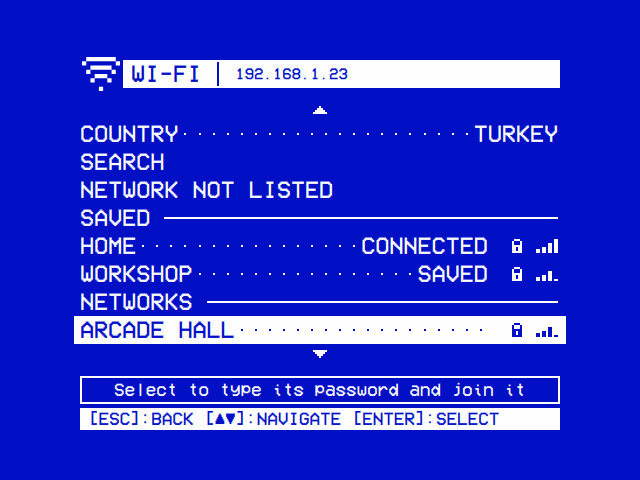</td><td>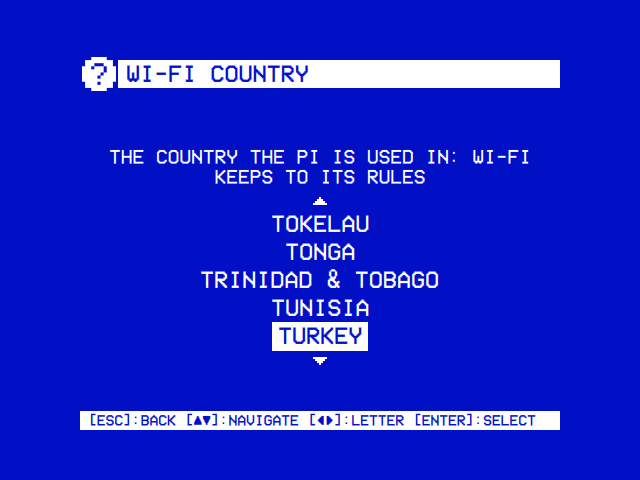</td></tr>
<tr><td>Each network with its lock and its signal in bars.</td><td>▲ ▼ move a country at a time, ◄ ► from letter to letter.</td></tr>
</table>

| Row | What it does |
|---|---|
| **Wi-Fi** | Turns it on or off. **Blocked** means a switch keeps the radio off |
| **Country** | The country the Pi is used in. Wi-Fi stays off until it is set |
| **Search** | Looks for networks for a minute; select stops it early |
| **Network Not Listed** | Joins a network that doesn't say its name: type its name, then choose open or type its password |
| **Saved** | The networks NetworkManager keeps, those out of reach as **Not Here**. Select offers **Connect**, **New Password** and **Forget**; on the one joined, **Disconnect** and **Forget** |
| **Networks** | The others, the strongest first. Select one and type its password; an open one is joined at once |

- A network joined is saved and joined by itself from then on.
- A network that wants a user name too (WPA Enterprise) can't be joined here.
- A character the on-screen keyboard hasn't (`/`, `:`, a bracket) can be typed on a real keyboard.
- The help line says how it went: **Connected to …**, or why not (**wrong password?**, **it gave no address (DHCP)**, **it is out of reach**).
- Without NetworkManager or Wi-Fi hardware the page says **No Wi-Fi**. On a Mac, join networks in the Mac's own settings.

Problems are in [Troubleshooting](https://github.com/mehmetraif/OSD-OS/wiki/Troubleshooting#wi-fi-on-the-image).

### Bluetooth

<table>
<tr><th width="50%">Bluetooth</th><th width="50%">Pairing a keyboard</th></tr>
<tr><td></td><td></td></tr>
<tr><td>Select pairs a device found and connects it.</td><td>Type the code the keyboard asks for, then its Enter.</td></tr>
</table>

| Row | What it does |
|---|---|
| **Bluetooth** | Turns the adapter on or off. If it won't turn on, a **Details** line shows what the system says ([Troubleshooting](https://github.com/mehmetraif/OSD-OS/wiki/Troubleshooting#bluetooth-wont-turn-on)) |
| **Search** | Looks for devices for a minute; select stops it early. Put the device in pairing mode first |
| **Found** | What the search found. Select pairs a device, trusts it so it reconnects after a restart, and connects it |
| **Paired** | The paired devices. Select offers **Connect** or **Disconnect**, and **Forget** |

- A keyboard shows a code to type on it. A phone shows the same code on both, to confirm. A gamepad or mouse asks nothing.
- Back cancels a pairing. Leaving the page stops a search.
- Without BlueZ or an adapter the page says **No Bluetooth**. On a Mac, pair devices in the Mac's own Bluetooth settings.

## Startup

`SETTINGS | STARTUP`: what OSD/OS opens on, and keeping it there.

| Setting | Values | Default | What it does | Config key |
|---|---|---|---|---|
| Start on Module | None, then each module that is turned on, by name | None | Opens that module straight after start. A module turned off later is never opened | `app.startup_module`: the module's id, such as `com.osdos.local_files`; `"None"` |
| Play at Startup | None, or the name of the favourite chosen | None | A favourite played straight after start, ahead of Start on Module. Choose it in its module (► on the entry, then **Play at Startup**); here you can only turn it off | `app.startup_favorite`: `{ "module", "path", "name" }`, or `""` for None |
| Startup From | Resume, Beginning | Resume | Where that favourite begins, without asking. Only with a Play at Startup favourite | `app.startup_from` |
| Cabinet Lock | A page: On, Off | Off | Keeps OSD/OS on Start on Module's module ([below](#cabinet-lock)) | `app.cabinet_lock`: `"On"` or `"Off"`; the buttons `app.unlock_buttons` |

The Scripts module's **Auto-Run On Startup** needs Start on Module set to Scripts ([Scripts](https://github.com/mehmetraif/OSD-OS/wiki/Scripts)).

### Cabinet Lock

Cabinet Lock keeps OSD/OS on Start on Module's module, such as a cabinet's Arcade screen. The main menu, Settings and Quit open only with the unlock buttons.

| Row | What it does |
|---|---|
| Cabinet Lock | ◄ ► or select turn it on or off. On asks first, **Lock the cabinet?**. It needs a Start on Module and unlock buttons. On with no module to stay on any more (Start on Module set to None since, or its module turned off) it locks nothing, and the row reads **On (No Module)** |
| Unlock Buttons | Select, then hold one to four buttons together for two seconds, of any pads and keyboards. The window names them as they are held (`P1 START + P2 START`) |

<table>
<tr><th width="33%">Cabinet Lock</th><th width="33%">Unlock Buttons</th><th width="33%">Lock the cabinet?</th></tr>
<tr><td>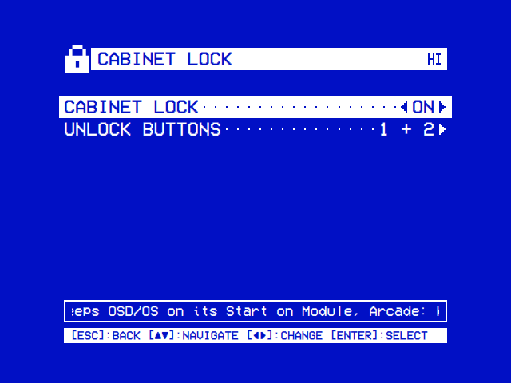</td><td>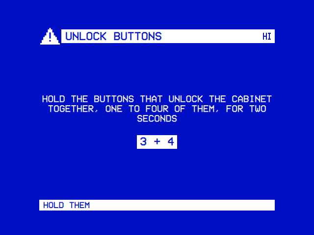</td><td>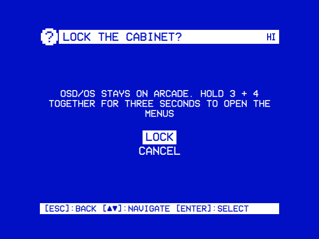</td></tr>
<tr><td>The lock and the buttons that open it.</td><td>The buttons held, kept after two seconds.</td><td>Asked before it locks.</td></tr>
</table>

While it is locked:

- **Back** on the start module goes nowhere, and **Ctrl+Q** doesn't quit.
- **The unlock buttons**, held together for three seconds, open the main menu. Held again, or after a restart, OSD/OS is locked again.
- An unlock button pressed alone acts 0.3 seconds late; a direction acts at once.

To turn the lock off from outside (forgotten buttons, a pad that is gone), either:

- put an `osdos-setup.json` holding `{"osdos_setup": 1, "config": {"app": {"cabinet_lock": "Off"}}}` on the card's boot partition (**bootfs**) or in the data folder and start OSD/OS ([Installation](https://github.com/mehmetraif/OSD-OS/wiki/Installation#osdos-setup-settings-on-the-card-before-the-first-boot)); or
- set `app.cabinet_lock` to `"Off"` in `config.json` over SSH with OSD/OS stopped ([Configuration files](https://github.com/mehmetraif/OSD-OS/wiki/Configuration-Files#editing-by-hand)).

## System

`SETTINGS | SYSTEM`: OSD/OS Setup, the update and About, then under **MODULES** the modules of no group ([Modules](#modules)).

| Setting | Values | Default | What it does | Config key |
|---|---|---|---|---|
| Paste OSD/OS Setup | An action | | Sets the settings copied on [OSD/OS Setup](https://osdos.tv/setup/) ([below](#paste-osdos-setup)). Only where there is a clipboard, so not on the image | Those it sets |
| Export to OSD/OS Setup | A page | | This device's settings as QR codes for a phone ([below](#export-to-osdos-setup)) | None |
| Update | A page | | Checks for a newer release, downloads it and installs it | None |
| About | A page | | This device's System Information, then what OSD/OS is made of and its licenses | None: the device's name is the system's hostname |

### Paste OSD/OS Setup

1. On [OSD/OS Setup](https://osdos.tv/setup/), choose the settings, then **Copy for a computer**.
2. Select on this row. OSD/OS's own settings and the RetroAchievements account are set at once.

- A window says what was set. What only an OSD/OS card sets stays as it is: the device's name, the display output, Wi-Fi, the password, SSH, the time zone, the keyboard.
- The page's file does the same at the next start, put in the data folder or beside the app ([Installation](https://github.com/mehmetraif/OSD-OS/wiki/Installation#osdos-setup-on-a-computer)).

### Export to OSD/OS Setup

This device's settings as QR codes. A phone's camera opens [OSD/OS Setup](https://osdos.tv/setup/) from them with its form filled in, to change and make a card's file of.

- **What goes**: every setting on the form that isn't at its default; the Arcade's favorites; the RetroAchievements user name, Web API key and sign-in token. On an OSD/OS card also the device's name, the display output, Wi-Fi with its password, the time zone, the keyboard, and SSH with its keys.
- **What can't go**: pi's password, of which only the hash is kept.
- **Show the codes?** is asked first: anyone who sees the screen can read them.
- **Several codes** (**1/3**, **2/3**…) come where one can't hold the settings; ◄ ► go through them. The page takes them in any order.
- The settings go after the `#` of the page's address, which a browser never sends to a server.

### Update

Update compares the installed version with the latest release of [mehmetraif/OSD-OS](https://github.com/mehmetraif/OSD-OS/releases/latest) and shows its notes. Select does the step the hint bar names:

1. **CHECK** offers a release only when it is newer; otherwise **You're up to date**.
2. **DOWNLOAD** fetches this platform's file (`-linux-arm64.tar.gz` on a Pi, `-linux-x86_64.AppImage`, `-macOS-arm64.dmg`) into the data folder's `updates` and checks its SHA-256 digest. Back cancels it.
3. **INSTALL** asks **Install update?**:

| Answer | Offered | What it does |
|---|---|---|
| **Apply & Restart** | A Pi under the autostart service | OSD/OS exits, and the launcher swaps the new release into `/opt/osdos` before it starts again |
| **Quit & Apply on Next Launch** | A Pi run by hand; an AppImage | A Pi's launcher applies it at the next start. An AppImage swaps the new file over itself, keeping a `.bak`, and starts again; in Steam's Gaming Mode it quits for Steam to start it |
| **Apply & Relaunch** | A Mac, the app in `/Applications` | Installs it and starts again |
| **Quit & Open Disk Image** | A Mac, the app elsewhere | Opens the disk image, to install by hand |
| **Discard Update** | Always | Deletes the download |

- A build from source (`DEV`), and an OSD/OS image built from a branch, can check but not download.
- An install that can't apply updates says why under the status line: run the installer once more, or, outside `/opt/osdos`, update by hand.
- On Windows, FreeBSD and OpenBSD, CHECK names the new release's file, to install by hand.

More in [Installation](https://github.com/mehmetraif/OSD-OS/wiki/Installation).

### About

<table>
<tr><th width="50%">About</th><th width="50%">The license</th></tr>
<tr><td>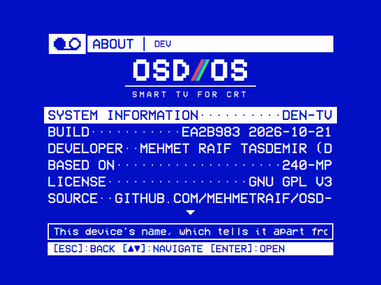</td><td></td></tr>
<tr><td>System Information, then a line for each part of OSD/OS.</td><td>The notice, then the GNU GPL's text, a page at a time.</td></tr>
</table>

- **System Information** is the first line: this device's name. Select opens its page ([below](#system-information)).
- **Build** has the commit and the day of the build. The version is in the title bar.
- The other lines say who makes OSD/OS and what it is made of; under **ARCADE**, the arcade's software and sites ([Credits](https://github.com/mehmetraif/OSD-OS/wiki/Credits)).
- Each line's detail is in the help line, shown even with Help Line off.
- Select on **License**, **Test Patterns**, **QR Code generator** or an Arcade software line shows its license, a page at a time with ▲ ▼.

#### System Information

<table>
<tr><th width="50%">System Information</th><th width="50%">Renaming the device</th></tr>
<tr><td>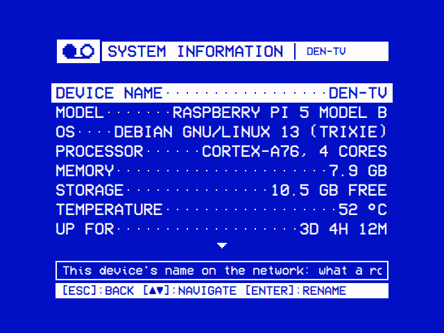</td><td>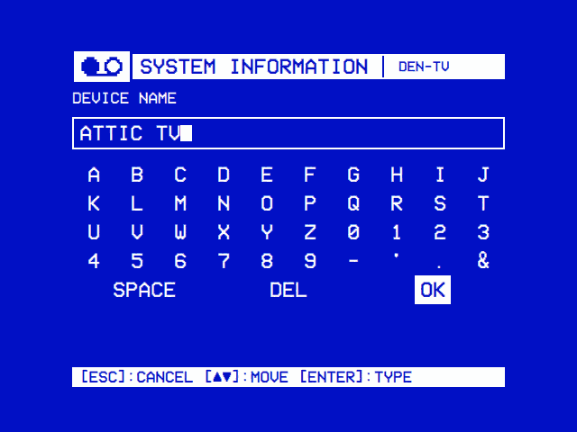</td></tr>
<tr><td>The device's name, what it is, and each connection's addresses.</td><td>On the image, select on the name types a new one.</td></tr>
</table>

| Line | What it shows |
|---|---|
| **Device Name** | The system's hostname: what a router lists the device under, and what others reach it at, `<name>.local`. LAN Play hosts under it unless Arcade → Online Name says another ([LAN play](https://github.com/mehmetraif/OSD-OS/wiki/Online-and-LAN-Play#lan-play)) |
| **Model**, **OS**, **Processor**, **Memory** | The board or computer, the operating system, the processor and the memory. The help line adds a Pi's revision and serial number, the versions and the free memory |
| **Storage**, **Media Storage** | What is free on the data folder's drive, and on the films' own drive where it is another |
| **Temperature**, **Up For** | The processor's temperature, and the time since the system started |
| **Network** | Each connection, Ethernet first, then Wi-Fi: its **IP** address (every one in the help line) or **Not Connected**, and its **MAC** address |

Every OSD/OS image starts as `osdos`, so give each device a name of its own:

- **On the OSD/OS image**, select on Device Name types a new one: letters, digits and hyphens, 63 at most, neither end a hyphen. The help line says **Now called …**, or why not ([Troubleshooting](https://github.com/mehmetraif/OSD-OS/wiki/Troubleshooting#two-osdos-on-one-network)).
- **Elsewhere**, rename the computer in its own settings: `sudo hostnamectl set-hostname <name>` on Raspberry Pi OS.

## Modules

All fourteen modules have settings, defined in their `manifest.json` ([Writing a module](https://github.com/mehmetraif/OSD-OS/wiki/Writing-a-Module)). Where a module's row is depends on `settings_group` in the manifest:

| Group | Where the module's page is | Modules, in the order of their folders |
|---|---|---|
| None | Under **MODULES** on System's page ([above](#system)) | Scripts, and a module of your own that names no group |
| `"tv"` | Under **MODULES** on TV / Movie's page ([above](#the-video-modules)) | Ambient:Mode, Emby, Jellyfin, Local Files, Netflix, NFC Reader, Playlists, Plex, Prime Video, Weather, YouTube |
| `"arcade"` | The Arcade page, which the group shares ([above](#arcade)) | Arcade, High Scores |

<table>
<tr><th width="50%">A module's settings</th><th width="50%">Picking a folder</th></tr>
<tr><td>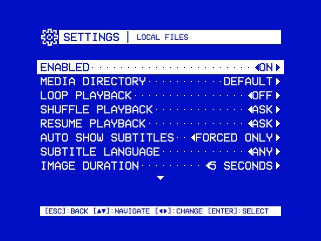</td><td></td></tr>
<tr><td>Local Files' page.</td><td><b>Use This Folder</b> picks the folder open, <b>Default Folder</b> the module's own.</td></tr>
</table>

### Turning a module on

Every module's first row is **Enabled**, saved as `modules.<module id>.enabled`, `true` or `false`.

- A module turned off is left off the main menu, can't be chosen in Start on Module, and an NFC card can't hand off to it.
- By default only **Local Files** and **Playlists** are on.
- The main menu picks up a change the next time you go back to it.

Marks in the table: \* only with Screen on Arcade; † only once signed in.

| Module | Module id | Its rows, in order |
|---|---|---|
| [Ambient:Mode](https://github.com/mehmetraif/OSD-OS/wiki/Ambient-Mode) | `com.osdos.ambient_mode` | Enabled, Media Directory, Auto-Launch Playback, Scaling |
| [Arcade](https://github.com/mehmetraif/OSD-OS/wiki/Arcade) | `com.osdos.arcade` | Enabled, Games Folder, Hide Hacks and Bootlegs, Hide Incomplete Games, Regions, Screen, Start Filter\*, Menu Filters\*, Play at Startup, List Style\*, Border\*, Info Background\*, Screen Adjustment\*, Hint Bar\*, Help Line\*, Attract Mode\*, Attract After (with Attract Mode on In Order or Random), Start Info Screen, Play Mode, Save High Scores, Online High Scores, RetroAchievements Account, Pictures From, Game Pictures, Online Play, Relay Server (with Online Play on), LAN Play, LAN Sync (Smooth or Responsive, default Smooth; with LAN Play on), Online Name (with Online Play or LAN Play on), MAME, FinalBurn Neo, Emulator Video (Game Picture, Screen Shape, Integer Scale, Vertical Games, MAME Video), Favorites, Check ROMs, Read the Games Again |
| [Emby](https://github.com/mehmetraif/OSD-OS/wiki/Emby) | `com.osdos.emby` | Enabled, Libraries†, Video Quality†, Resume Playback†, Autoplay Next Episode†, Intro Skip†, Credit Skip†, Scaling, Sign out† |
| [High Scores](https://github.com/mehmetraif/OSD-OS/wiki/High-Scores) | `com.osdos.highscores` | Enabled, on the Arcade page under the **HIGH SCORES** heading |
| [Jellyfin](https://github.com/mehmetraif/OSD-OS/wiki/Jellyfin) | `com.osdos.jellyfin` | Enabled, Libraries†, Video Quality†, Resume Playback†, Autoplay Next Episode†, Intro Skip† and Credit Skip† (where the server has the Intro Skipper plugin), Scaling, Sign out† |
| [Local Files](https://github.com/mehmetraif/OSD-OS/wiki/Local-Files) | `com.osdos.local_files` | Enabled, Media Directory, Loop Playback, Shuffle Playback, Resume Playback, Auto Show Subtitles, Subtitle Language, Image Duration, Hide File Extensions, Scaling |
| [Netflix](https://github.com/mehmetraif/OSD-OS/wiki/Netflix-and-Prime-Video) | `com.osdos.netflix` | Enabled, Catalogue Region, Catalogue Language, Scaling, Sign in, Sign out |
| [NFC Reader](https://github.com/mehmetraif/OSD-OS/wiki/NFC-Reader) | `com.osdos.nfc_reader` | Enabled, Tags Directory, Resume Playback, YouTube Video Resolution, Auto Show Subtitles, Subtitle Language, Scaling |
| [Playlists](https://github.com/mehmetraif/OSD-OS/wiki/Playlists) | `com.osdos.playlists` | Enabled, Download Folder, Subtitles, Loop Playback, Scaling |
| [Plex](https://github.com/mehmetraif/OSD-OS/wiki/Plex) | `com.osdos.plex` | Enabled, Current User†, Auto Sign In†, Server†, Libraries†, Video Quality†, Resume Playback†, Autoplay Next Episode†, Scaling, Sign out† |
| [Prime Video](https://github.com/mehmetraif/OSD-OS/wiki/Netflix-and-Prime-Video) | `com.osdos.prime_video` | Enabled, Catalogue Region, Catalogue Language, Scaling, Sign in, Sign out |
| [Scripts](https://github.com/mehmetraif/OSD-OS/wiki/Scripts) | `com.osdos.scripts` | Enabled, Scripts Directory, Auto-Run On Startup, Rescan Scripts |
| [Weather](https://github.com/mehmetraif/OSD-OS/wiki/Weather) | `com.osdos.weather` | Enabled, Displays, Music, Units, Screen Time, Hours Format |
| [YouTube](https://github.com/mehmetraif/OSD-OS/wiki/YouTube) | `com.osdos.youtube` | Enabled, Advanced (Playback Resolution, Video Codec, Max Frame Rate, Scaling, Audio Language, Subtitles, Subtitle Language, Playback Speed, Resume Playback, Display Shorts), Delete Watch Later, Delete Recently Watched, Sign in, Sign out |

Each module's wiki page explains its rows. A module's own **Scaling** is **Default** (follow Settings → TV / Movie → Scaling) or one of the four, for that module only.

### The kinds of row a module can have

| Kind (`type` in the manifest) | Keys | Saved in `modules.<id>` as |
|---|---|---|
| `toggle` | ◄ ► or select flips it | `true` or `false` |
| `list_single` | ◄ ► step through the choices | The choice's text, or its id for a list the module supplies |
| `multiselect_submenu` | Select opens a page of on/off lines | `{ "<id>": true, "<id>": false }` |
| `submenu` | Select opens a page of its own rows | Its rows' keys, flat under the module |
| `directory_browser` | Select opens the folder picker: **Default Folder**, the places, and **Use This Folder** in every folder | The folder's path; `""` for the module's own |
| `slider` | ◄ ► move it a step | A number from 0 to 100 |
| `action` | Select runs it at once (Sign out) | Nothing |
| `module_view` | Select opens one of the module's own screens (Sign in) | Nothing |

The manifest's fields are in [Writing a module](https://github.com/mehmetraif/OSD-OS/wiki/Writing-a-Module#the-manifest). A row is dimmed, its help line saying why, until:

| In the manifest | Dimmed until | The help line starts |
|---|---|---|
| `requires_auth` | The module is signed in, from inside the module | `Only once signed in` |
| `requires_capability` | The server offers it (Jellyfin's Intro Skip and Credit Skip) | `Not offered by the server` |
| `shown_with` | Another row has a given value (Arcade's Relay Server) | `Only with Online Play on` |

## Quit

The first screen's last row.

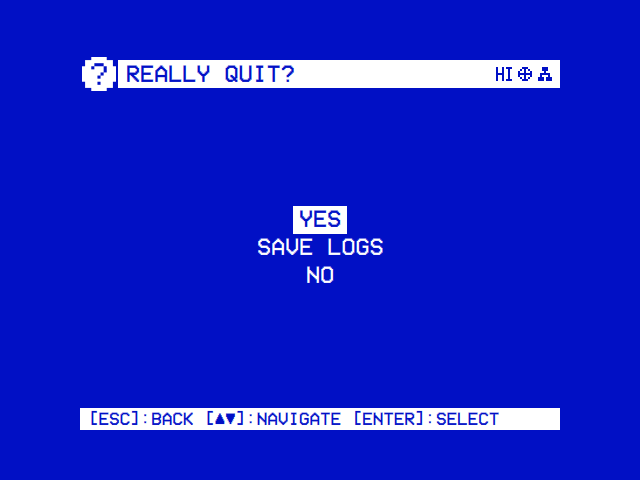

Select asks **Really quit?**. Run by hand, or on a Mac, the answers are **Yes** and **No**. Started by the autostart service (`OSDOS_AUTOSTART` is set, as on the OSD/OS image), they are:

| Answer | What it does |
|---|---|
| Power Off | Powers the Pi off |
| Restart | Reboots. Offered with `OSDOS_LAUNCHER_API` 2 or later |
| Exit to Terminal | Starts a login shell on `tty1`; `sudo systemctl start osdos` brings OSD/OS back |
| Cancel | Nothing |

- On the OSD/OS image both questions also offer **Save Logs**, which copies the logs to the card's OSD-OS partition ([Troubleshooting](https://github.com/mehmetraif/OSD-OS/wiki/Troubleshooting#where-the-log-is)).
- Ctrl+Q quits too; under the service that is Power Off.
- `sudo systemctl stop osdos` over SSH stops the app and leaves the Pi on.

## Settings without a row

A few app settings have no row. Set them in `config.json` by hand, with OSD/OS stopped ([Configuration files](https://github.com/mehmetraif/OSD-OS/wiki/Configuration-Files#editing-by-hand)):

| Key | Values | What it does |
|---|---|---|
| `app.display_index` | A number, `0` by default | The display the menus open on, and mpv plays on, when a Mac or a Linux desktop has several. The log lists them at start: `[main] display index 1: "…" 1280x720 at (3840,0)`. Out of range falls back to 0 |
| `app.mpv_video_args` | A string of mpv flags, separated by spaces | Replaces the video output and decoder flags OSD/OS picks for the device ([Playback and mpv](https://github.com/mehmetraif/OSD-OS/wiki/Playback-and-mpv#mpv_video_args)) |
| `app.auto_crop` | `On`, `Off` | Read only while `app.video_scaling` is unset: `On` means Pan & Scan |
| `app.theme` | A skin's folder name | Read as the Skin only while `app.skin` is unset |

## See also

- [Configuration files](https://github.com/mehmetraif/OSD-OS/wiki/Configuration-Files): `config.json` and the data folder
- [Playback and mpv](https://github.com/mehmetraif/OSD-OS/wiki/Playback-and-mpv)
- [Themes](https://github.com/mehmetraif/OSD-OS/wiki/Themes), [Skins](https://github.com/mehmetraif/OSD-OS/wiki/Skins), [Effects](https://github.com/mehmetraif/OSD-OS/wiki/Effects) and [Menu music](https://github.com/mehmetraif/OSD-OS/wiki/Menu-Music)
- [Display Output](https://github.com/mehmetraif/OSD-OS/wiki/Display-Output) and [Audio Output](https://github.com/mehmetraif/OSD-OS/wiki/Audio-Output)
- [Controls](https://github.com/mehmetraif/OSD-OS/wiki/Controls): keyboards, remotes, gamepads and `input.cfg`
- [Modules](https://github.com/mehmetraif/OSD-OS/wiki/Modules): what each module does
- [Using OSD/OS](https://github.com/mehmetraif/OSD-OS/wiki/Using-OSD-OS)
