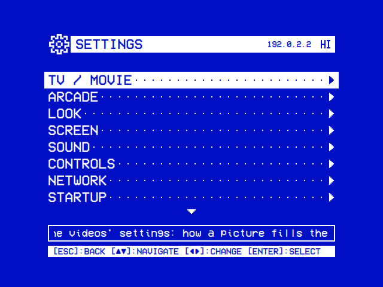
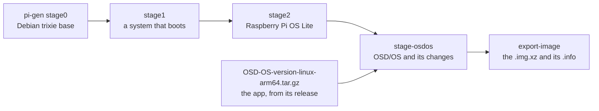
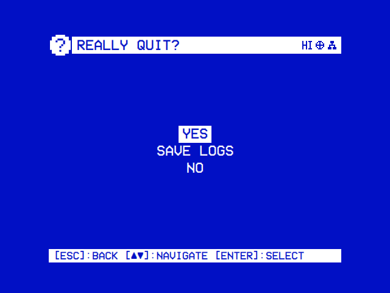
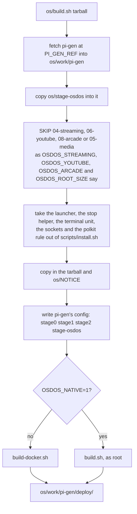

# The OSD/OS image

On a Raspberry Pi, OSD/OS can be the whole system: one image, flashed to an SD card, that starts straight into OSD/OS. Its source is the [`os/`](https://github.com/mehmetraif/OSD-OS/tree/main/os) folder of the repository, with its [README](https://github.com/mehmetraif/OSD-OS/blob/main/os/README.md).

<table>
<tr><th width="50%">The boot screen</th><th width="50%">Settings, once it is up</th></tr>
<tr><td></td><td></td></tr>
<tr><td>Each service gets <code>[ OK ]</code> once it is up.</td><td>The title bar shows the version and the Pi's network address.</td></tr>
</table>

## An operating system, not an app

Installed as an app ([Installation](https://github.com/mehmetraif/OSD-OS/wiki/Installation)), OSD/OS runs on a system that is already set up. The image is the system itself: it boots into OSD/OS, with no splash, boot text, login prompt or desktop. The boot screen is in the theme's colours, or white on blue with Settings → Look → Boot Screen Colors → Default.

### What it is built on

- **Raspberry Pi OS Lite (64-bit)**, based on **Debian 13 "trixie"**, arm64. Its kernel, firmware, drivers and patched FFmpeg are unchanged.
- **pi-gen**, Raspberry Pi's image builder, at a pinned commit of its `arm64` branch (`PI_GEN_REF` in [`os/build.sh`](https://github.com/mehmetraif/OSD-OS/blob/main/os/build.sh), today `4d8ee447dd3d37e8b0ef8752e460d9082d9d435d`).
- **One stage of OSD/OS's own**, [`os/stage-osdos`](https://github.com/mehmetraif/OSD-OS/tree/main/os/stage-osdos), on top.
- The release name is **OSD/OS** (`PI_GEN_RELEASE`), written to `/boot/firmware/issue.txt`.



### Compared with an app install

Against Raspberry Pi OS Lite with `scripts/install.sh` and its autostart service:

| | Raspberry Pi OS Lite + `install.sh` | The OSD/OS image |
|---|---|---|
| OSD/OS starts | After `multi-user.target` | After `basic.target` |
| First on screen | The boot messages | Black, then the boot screen |
| Wi-Fi, Bluetooth, mDNS, SSH | Start ahead of OSD/OS | Wait for its first frame |
| apt, man-db, e2scrub and dpkg-backup timers, cron | Running | Off |
| Raspberry Pi Connect agent | Installed | Removed |
| cloud-init | Every boot | First boot only |
| Films | `~/.local/share/OSD-OS/media/Movies` | `/media/OSD-OS/Movies`, an exFAT partition |
| USB drives | Not mounted | Mounted read-only under `/media/usb` |
| Chromium, Widevine, cage, wtype | Install yourself | Included |
| yt-dlp, Deno | Install yourself | Included; yt-dlp updates itself |
| MAME, RetroArch | Install yourself | Included: Debian's MAME 0.276 and RetroArch, and OSD/OS's own RetroArch with TLS |
| Settings → Screen → Display Output | Not offered | Offered |
| Bluetooth blocked by rfkill | Stays blocked | Unblocked |
| Wi-Fi power saving | On | Off ([Wi-Fi](#wi-fi)) |

The rest is the same: the launcher, the in-app updater, Exit to Terminal and the data folder `~/.local/share/OSD-OS`.

## Getting it onto a card

Download `OSD-OS-<version>-raspberry-pi.img.xz` from the [latest release](https://github.com/mehmetraif/OSD-OS/releases/latest) and flash it with Raspberry Pi Imager (**Use custom**). [Installation](https://github.com/mehmetraif/OSD-OS/wiki/Installation) has the steps, and [os/README.md → Flashing](https://github.com/mehmetraif/OSD-OS/blob/main/os/README.md#flashing) the details.

Raspberry Pi Imager 2 offers no OS customisation for an image chosen with **Use custom**. Use [OSD/OS Setup](https://github.com/mehmetraif/OSD-OS/wiki/The-OSD-OS-Image#osdos-setup) instead, or give Imager a local manifest ([Installation](https://github.com/mehmetraif/OSD-OS/wiki/Installation#a-local-manifest-for-os-customisation)).

### OSD/OS Setup

[OSD/OS Setup](https://osdos.tv/setup/) is a web page that chooses what a card starts with ([Installation](https://github.com/mehmetraif/OSD-OS/wiki/Installation#osdos-setup-settings-on-the-card-before-the-first-boot) has the steps). Its file, `osdos-setup.json`, goes on the boot partition (**bootfs**). `/usr/local/sbin/osdos-setup` applies it in two stages:

1. **`osdos-setup-app.service`**, before OSD/OS starts, moves the file to `/var/lib/osdos-setup/pending.json` (root's alone). It sets OSD/OS's settings and the RetroAchievements account.
2. **`osdos-setup.service`**, once OSD/OS is on screen, sets the rest. The boot screen lists it as **SETTINGS**: `[ OK ]` when all was set, `[FAIL]` when anything wasn't. It then writes `osdos-setup.log` on the boot partition, without passwords.

The journal has the same lines: `journalctl -u osdos-setup-app -u osdos-setup`. Each part is applied on its own:

| Part | How it is applied |
|---|---|
| The device's name, the Wi-Fi country, the display output | `osdos-stop device-name`, `wifi-country` and `next-start`. The Pi restarts once if the output changed. An output the Pi doesn't have is left as it is |
| Wi-Fi | `/etc/NetworkManager/system-connections/osdos-setup-<network>-<id>.nmconnection` |
| `pi`'s password | `chpasswd -e`, with the SHA-512 crypt hash (100,000 rounds) the page made |
| SSH | `ssh.service` on or off; keys in `pi`'s `~/.ssh/authorized_keys`; password login in `/etc/ssh/sshd_config.d/00-osdos-setup.conf` |
| The time zone, the keyboard | `timedatectl set-timezone`; `raspi-config nonint do_configure_keyboard` |
| OSD/OS's settings | Merged into `~/.local/share/OSD-OS/config.json` |
| The RetroAchievements account | `~/.local/share/OSD-OS/arcade/retroachievements-setup.json`. RetroArch signs in once the network is up, tried every 30 seconds, ten times at most |

- SSH password login needs `pi`'s password set in the same file. SSH is not turned on without a key or that password.
- A file that can't be read is deleted, and the log says why.
- The file can also go on a card that has already started.
- Until the card takes it, the file holds the Wi-Fi and RetroAchievements passwords as typed.

### The first boot

The first boot does a few things once:

1. The card is split ([Films on the card](https://github.com/mehmetraif/OSD-OS/wiki/The-OSD-OS-Image#films-on-the-card)).
2. cloud-init applies Raspberry Pi Imager's customisation or `network-config`, and is then switched off.
3. An `osdos-setup.json` is applied. The Pi restarts once if the display output changed.

## The boot: OSD/OS first


OSD/OS starts as soon as systemd reaches `basic.target`. Wi-Fi, Bluetooth, the local network and SSH (when enabled) wait for its first frame, then start one after another.

### Step by step

1. **Firmware**: no splash (`disable_splash=1`), no pause (`boot_delay=0`).
2. **Kernel**: quiet, logging to `tty3`: `console=tty3 quiet loglevel=3 logo.nologo vt.global_cursor_default=0 consoleblank=0` in `cmdline.txt`.
3. **`basic.target`**: `osdos.service` starts. `wait-for-display` holds it, five seconds at most, until the display driver has a connector.
4. **The launcher** (`/usr/local/bin/osdos`) applies a staged update, picks the display, and starts the app.
5. **The first frame**: the app writes `/run/osdos/ready`, after five seconds at the latest.
6. **The held-back services** start in turn: NetworkManager, Bluetooth, avahi-daemon, and SSH if built with it.
7. **The online check** follows (`NetworkManager-wait-online.service`, 20 seconds at most).
8. **The boot screen closes** once every step has settled, or after a minute. The startup module opens.

### How the services are held back

Each held-back unit has a drop-in, `/etc/systemd/system/<unit>.d/osdos-defer.conf`. It runs `/usr/lib/osdos/wait-for-app` before the unit starts and orders it after the unit before it ([below](#changing-what-the-boot-screen-shows) writes one). `wait-for-app` returns when `/run/osdos/ready` exists, or after 20 seconds, and never fails.

`/etc/osdos/boot-units` lists the units and their labels, in start order. On an image built without SSH:

```text
# Services OSD/OS's boot screen follows, as unit|LABEL, in start order;
# unit|LABEL|optional for one it lists only once it starts. All but the
# last hold back until the app is on screen (see their osdos-defer.conf
# drop-ins); the last is the network-online check.
osdos-setup.service|SETTINGS|optional
NetworkManager.service|WI-FI
bluetooth.service|BLUETOOTH
avahi-daemon.service|LOCAL NETWORK
NetworkManager-wait-online.service|ONLINE
```

An image built with `ENABLE_SSH=1` has `ssh.service|SSH` before the last line. **SETTINGS** is listed only on a start with OSD/OS Setup's file.

### The boot screen

The boot screen shows **PLAY ▶**, the cassette, a progress bar, `LOADING...` (or `READY`) with a percentage, and a line per service:

| Mark | Means |
|---|---|
| `[    ]` | Waiting its turn |
| `[ .  ]`, `[ .. ]`, `[ ...]` | Starting |
| `[ OK ]` | Started |
| `[FAIL]` | Failed |
| `[ -- ]` | Skipped: not installed, masked, or its condition failed |

- It closes 1.2 seconds after every step has settled, and never stays more than a minute.
- Keys do nothing while it is up, except Ctrl+Q, which powers the Pi off.
- It shows only during the boot, and only on the image (`OSDOS_BOOT_UNITS_FILE`).
- After a display switch, it asks whether to keep the new output ([Display Output](https://github.com/mehmetraif/OSD-OS/wiki/Display-Output#keep-or-go-back)).

### Changing what the boot screen shows

- **A label** is the text after the `|` in `/etc/osdos/boot-units` (`sudo nano /etc/osdos/boot-units`). It shows from the next boot. A third field, `|optional`, lists a step only once its unit starts.
- **Another service**: give it the same drop-in, after the last held-back unit, and add a line before `ONLINE` (16 lines at most). For `example.service`:

  ```sh
  sudo mkdir -p /etc/systemd/system/example.service.d
  sudo tee /etc/systemd/system/example.service.d/osdos-defer.conf > /dev/null << 'EOF'
  [Unit]
  After=avahi-daemon.service

  [Service]
  ExecStartPre=+-/usr/lib/osdos/wait-for-app
  EOF
  sudo sed -i 's/^NetworkManager-wait-online.service|ONLINE$/example.service|EXAMPLE\n&/' /etc/osdos/boot-units
  sudo systemctl daemon-reload
  ```

### Measuring the boot

```sh
journalctl -b -u osdos | grep '\[boot\]'
systemd-analyze critical-chain osdos.service
systemd-analyze blame
```

The `[boot]` lines give the first frame's time and when each service settled, in milliseconds from the app's start.

## What runs, and what doesn't

| Unit | On the image |
|---|---|
| `osdos.service` | Enabled. OSD/OS, as the first user (`pi`) |
| `NetworkManager.service`, `bluetooth.service`, `avahi-daemon.service`, `ssh.service` (with `ENABLE_SSH=1`) | Held back until OSD/OS's first frame, then started in that order |
| `NetworkManager-wait-online.service` | Gives up after 20 seconds (`NM_ONLINE_TIMEOUT=20`) |
| `osdos-cloud-init-once.service` | After the first boot, writes `/etc/cloud/cloud-init.disabled`. Delete that file to run cloud-init again |
| `osdos-setup-app.service`, `osdos-setup.service` | Run only with an `osdos-setup.json` on the boot partition |
| `osdos-yt-dlp-update.timer` | Updates yt-dlp two minutes after each boot and once a day |
| `osdos-usb-mount@<device>.service` | One per USB drive plugged in |
| `osdos-media-folders.service` | Makes **Movies** on the film partition as it is mounted |
| `osdos-netplay-priority.service` | Enabled. Marks a network game's packets for Wi-Fi's video queue ([Wi-Fi](#wi-fi)) |
| `osdos-jamma.service` | Enabled. A JAMMA board's controls as two gamepads ([Controls](https://github.com/mehmetraif/OSD-OS/wiki/Controls#a-jamma-cabinet)). Exits without the JAMMA display preset |
| `osdos-display.socket` | Enabled. Display Output's At Next Start |
| `osdos-wifi.socket` | Enabled. The Wi-Fi country |
| `osdos-name.socket` | Enabled. The device's name |
| `osdos-system.socket` | Enabled. The time zone and the keyboard |
| `osdos-terminal.service` | Not enabled. Started by Exit to Terminal |
| `getty@tty1.service`, `autovt@.service` | Masked. `/etc/systemd/logind.conf.d/osdos.conf` sets `NAutoVTs=0`, `ReserveVT=0` |
| `serial-getty@ttyAMA10.service` | Masked: no login on the Pi 5's debug UART |
| `udisks2.service` | Masked |
| `apt-daily.timer`, `apt-daily-upgrade.timer`, `man-db.timer`, `e2scrub_all.timer`, `dpkg-db-backup.timer`, `cron.service` | Disabled |
| `rpi-connect-lite` | Purged |

### The service

`osdos.service`, as the image has it (`systemctl cat osdos` shows it with its drop-in):

```ini
[Unit]
Description=OSD/OS Media Player
After=sound.target
Wants=network-online.target
StartLimitIntervalSec=120
StartLimitBurst=3
OnFailure=osdos-terminal.service

[Service]
Type=simple
User=pi
SupplementaryGroups=tty video input
AmbientCapabilities=CAP_SYS_TTY_CONFIG
Environment=QT_QPA_PLATFORM=eglfs
Environment=QT_QPA_EGLFS_ALWAYS_SET_MODE=1
Environment=QT_QPA_EGLFS_KMS_ATOMIC=1
Environment=QML2_IMPORT_PATH=/usr/lib/aarch64-linux-gnu/qt6/qml
Environment=OSDOS_AUTOSTART=1
Environment=OSDOS_BOOT_UNITS_FILE=/etc/osdos/boot-units
Environment=OSDOS_READY_FILE=/run/osdos/ready
RuntimeDirectory=osdos
ExecStartPre=+-/usr/bin/systemctl stop osdos-terminal.service
ExecStartPre=-/usr/lib/osdos/wait-for-display
ExecStart=/usr/local/bin/osdos
Restart=on-failure
RestartForceExitStatus=11
RestartSec=5s
RestartMode=direct
SuccessExitStatus=10 11 12 20 21 22 23 24 25 26 27 28 29 30 31 32 33 34 35 36 37 38 39 40 41 42 43 44 45 46 47 48 49 50 51 52 53 54 55 56 57 58 59 129 130 143
ExecStopPost=+/usr/local/bin/osdos-stop
StandardOutput=journal
StandardError=journal
LogRateLimitIntervalSec=30s
LogRateLimitBurst=1000

[Install]
WantedBy=multi-user.target
```

- **`OSDOS_AUTOSTART=1`**: Quit offers Power Off, Restart and Exit to Terminal, and Settings offers Display Output.
- **A crash** starts OSD/OS again after five seconds. When the third start in two minutes fails too, a login prompt comes up (`osdos-terminal.service`). The Pi stays on.
- **The drop-in** `/etc/systemd/system/osdos.service.d/osdos-media.conf` sets `OSDOS_MEDIA_DIR=/media/OSD-OS`. Local Files then opens **Movies** there and the Arcade module **Games/Arcade**, while their folder settings are unset.

## Nothing between the app and the screen


The image has no display server: OSD/OS draws through Qt's EGLFS straight to the kernel's KMS/DRM driver. It hands the screen over, and takes it back, for:

- mpv (`--vo=drm`), for a video;
- Chromium, in the `cage` kiosk compositor, for Netflix, Prime Video and YouTube's sign-in;
- MAME or RetroArch, for an Arcade game;
- a takeover script from the Scripts module.

With **Transparent Background**, mpv runs inside OSD/OS as libmpv. See [How it works → The display path](https://github.com/mehmetraif/OSD-OS/wiki/How-It-Works#the-display-path) and [Display Output](https://github.com/mehmetraif/OSD-OS/wiki/Display-Output).

## Films on the card

The card's free space becomes an exFAT partition labelled **OSD-OS**. Films copied into its **Movies** folder from a computer show up in Local Files.

### How the card is split

On the first boot of a freshly flashed card, the image's own [`resize_early`](https://github.com/mehmetraif/OSD-OS/blob/main/os/stage-osdos/05-media/files/resize_early) runs in the initramfs:

1. It grows the system partition to `OSDOS_ROOT_SIZE` GiB, 8 by default.
2. It makes a third partition from the next 4 MiB boundary to the end of the card, MBR type 0x07.
3. It formats it with `mkfs.exfat -L OSD-OS`.

With less than **2 GiB** left, or with `OSDOS_ROOT_SIZE=0`, there is no film partition: the system takes the whole card. A step that fails is logged and never stops the boot.

| Partition | Label | File system | Size | Mounted at |
|---|---|---|---|---|
| 1 | `bootfs` | FAT32 | 512 MiB | `/boot/firmware` |
| 2 | `rootfs` | ext4 | 8 GiB (`OSDOS_ROOT_SIZE`) | `/` |
| 3 | `OSD-OS` | exFAT | the rest of the card | `/media/OSD-OS` |

- A card needs about 10.5 GiB (11.3 GB as cards are sold) for a film partition. A 16 GB card gets about 6 GiB of films, a 32 GB card about 21 GiB.
- The partition table is MBR: on a disk over 2 TiB the partitions stop at 2 TiB.
- On a USB disk the system boots from, the film partition is `sda3` instead of `mmcblk0p3`.

### How it is mounted

`/etc/fstab` has this line (`1000` is the first user's id):

```text
LABEL=OSD-OS  /media/OSD-OS  exfat  rw,noexec,nosuid,nodev,nofail,noatime,uid=1000,gid=1000,umask=0022,x-systemd.device-timeout=3s  0  2
```

It is mounted read-write, nothing on it can run, and `fsck.exfat` checks it at every boot. A card without the partition holds the boot 3 seconds at most.

The Playlists module downloads into a **Playlists** folder in **Movies** (its Download Folder setting can name another).

### Copying films onto it

1. Quit OSD/OS (Settings → Quit → Power Off) and take the card out.
2. In a computer the card shows up as two drives, **bootfs** and **OSD-OS**. Copy films into **Movies** on **OSD-OS**.
3. If Windows offers to format the system's partition, choose **Cancel**: formatting erases the system.
4. Put the card back. Local Files opens `/media/OSD-OS/Movies` until its Media Directory setting names another folder.

Arcade games go in **Games/Arcade** beside **Movies** ([Arcade](https://github.com/mehmetraif/OSD-OS/wiki/Arcade#setting-it-up)).

> **Flashing an image again erases the whole card**, films included. Copy them off first ([Moving to a new image](https://github.com/mehmetraif/OSD-OS/wiki/The-OSD-OS-Image#moving-to-a-new-image)).

### A card flashed with an earlier image

If offline playlists' downloads fail, naming the folder as the reason, the film partition is mounted read-only (`ro` in `/etc/fstab`). Flash a new image, or edit its line in `/etc/fstab` (`/media/240-MP` on those images): change `ro` to `rw,noexec,nosuid,nodev`, and the last `0` to `2`.

## USB drives

A USB stick or disk plugged into the Pi is mounted read-only under `/media/usb`, in a folder named after its label. Local Files lists it at the top of its tree as `USB: <label>`.

- **Read-only**: a drive can be pulled out at any moment. Nothing on it can run (`noexec`).
- **Name**: its label, else its UUID, else its device. A second drive with the same label gets its device added (`KINGSTON (sdb1)`).
- **Never the system's own**: a partition already mounted, or on the disk the system boots from, is left alone.

| File system | Mounted as | Options besides `ro,nosuid,nodev,noexec` |
|---|---|---|
| FAT32 (`vfat`) | `vfat` | owner, `umask=0022`, `utf8` |
| exFAT | `exfat` | owner, `umask=0022` |
| NTFS | `ntfs3`, the kernel's driver; `ntfs-3g` where that fails | owner, `umask=0022` |
| HFS+ (a Mac's) | `hfsplus` | owner |
| ext3, ext4 | as is | `noload`: the journal isn't replayed |
| XFS | `xfs` | `norecovery` |
| btrfs | `btrfs` | `nologreplay` |
| ext2, F2FS, ISO 9660, UDF (a disc in a USB drive) | as is | none |
| Swap, RAID or LVM members, encrypted volumes | not mounted | |

"Owner" is `uid` and `gid` of the user OSD/OS runs as.

### How it works

A udev rule, `/etc/udev/rules.d/99-osdos-usb-mount.rules`, starts `osdos-usb-mount@<device>.service` for each file system on a USB drive. It runs `/usr/lib/osdos/usb-mount add <device>` as the drive comes and `usb-mount remove <device>` as it goes. The journal has each mount, and why a drive couldn't be mounted:

```sh
journalctl -u 'osdos-usb-mount@*'
```

```text
usb-mount: /dev/sda1 (vfat) mounted read-only at /media/usb/KINGSTON
```

## Network, Wi-Fi and Bluetooth

The network is NetworkManager's, as on Raspberry Pi OS.

### Wi-Fi

- **In OSD/OS**: Settings → Network → Wi-Fi ([Settings](https://github.com/mehmetraif/OSD-OS/wiki/Settings#wi-fi)). The polkit rule `/etc/polkit-1/rules.d/50-osdos-networkmanager.rules` lets OSD/OS's user use NetworkManager.
- **The country**: Raspberry Pi OS keeps Wi-Fi off until it is set. Settings → Network → Wi-Fi asks for it. An image built with `WPA_COUNTRY` has it, and in `network-config` it is `regulatory-domain`.
- **Power saving is off**: `/etc/NetworkManager/conf.d/osdos-wifi-powersave.conf` holds `wifi.powersave = 2` under `[connection]`. `iw dev wlan0 get power_save` says `off` once connected.
- **A network game's packets go first**: `osdos-netplay-priority.service` has nftables read `/usr/lib/osdos/netplay-priority.nft`. Its table, `inet osdos_netplay`, marks TCP to and from RetroArch's port 55435 at private network addresses as CS4, which Wi-Fi sends from its video queue.
- **To see or remove that marking**: `sudo nft list table inet osdos_netplay` shows the rules, and `sudo systemctl disable --now osdos-netplay-priority.service` removes them.
- **Before the first boot**: add the network to `network-config` on **bootfs** ([Installation → Wi-Fi by hand](https://github.com/mehmetraif/OSD-OS/wiki/Installation#wi-fi-by-hand-network-config)).
- **After the first boot**, from a shell with `sudo` ([The user, its password and sudo](https://github.com/mehmetraif/OSD-OS/wiki/The-OSD-OS-Image#the-user-its-password-and-sudo)): `sudo raspi-config` (System Options), or:

  ```sh
  sudo nmcli device wifi connect "MyHomeWiFi" password "my-wifi-password"
  ```

### The local network

- The hostname is `osdos` (`TARGET_HOSTNAME`), published as `osdos.local`.
- Settings → System → About → System Information renames the device. Give each OSD/OS on one network its own name.
- Settings shows the Pi's IPv4 address in its title bar, Ethernet's before Wi-Fi's.

### Bluetooth

Settings → Network → Bluetooth pairs and connects keyboards, gamepads and remotes through BlueZ ([Controls](https://github.com/mehmetraif/OSD-OS/wiki/Controls)). For it:

- The user OSD/OS runs as is in the `bluetooth` group.
- The drop-in `/etc/systemd/system/bluetooth.service.d/osdos-unblock.conf` unblocks Bluetooth as bluetoothd starts:

  ```ini
  # OSD/OS image: Bluetooth is switched in the app, through BlueZ; rfkill never blocks it.
  [Service]
  ExecStartPre=+-/usr/sbin/rfkill unblock bluetooth
  ```

## SSH

SSH is off on the image as it comes (`ENABLE_SSH=0`). Three ways to have it:

- **OSD/OS Setup** turns it on, with password login or keys only.
- **Raspberry Pi Imager's customisation** enables it, with the user it creates.
- **An image built with `ENABLE_SSH=1`** has it. `PUBKEY_SSH_FIRST_USER` adds a public key for `pi`, and `PUBKEY_ONLY_SSH=1` turns password logins off.

Then, from a computer on the same network:

```sh
ssh pi@osdos.local
```

The address in Settings' title bar works in place of `osdos.local`.

## The user, its password and sudo

- The first user is `pi` (`FIRST_USER_NAME`). OSD/OS runs as it, whatever user Raspberry Pi Imager creates.
- Its groups are pi-gen's (`adm dialout cdrom audio users sudo video games plugdev input gpio spi i2c netdev render`) and `bluetooth`.
- pi-gen's first-boot rename wizard is off (`DISABLE_FIRST_BOOT_USER_RENAME=1`).

| Built | Logging in as `pi` | Exit to Terminal | `sudo` |
|---|---|---|---|
| With `FIRST_USER_PASS` (in CI, the secret `OS_FIRST_USER_PASS`) | With that password, on the console and over SSH | A login prompt | Asks for that password |
| Without one (the account is locked) | Over SSH with a key only (`PUBKEY_SSH_FIRST_USER`, `ENABLE_SSH=1`) | Logs `pi` in by itself | Unusable |

For `sudo` on an image built without a password, give `pi` a password on OSD/OS Setup, or log in as the user Imager's customisation creates.

## Quitting, restarting and Exit to Terminal

<table>
<tr><th width="50%">Quit</th><th width="50%">Update</th></tr>
<tr><td></td><td></td></tr>
<tr><td>Settings → Quit, run by hand. On the image it offers the choices below.</td><td>Settings → System → Update.</td></tr>
</table>

Settings → **Quit** on the image asks **Really quit?** with:

| Choice | OSD/OS exits with | Then |
|---|---|---|
| **Power Off** | 0 | The Pi powers off |
| **Restart** | 12 | The Pi reboots |
| **Exit to Terminal** | 10 | A login shell on the screen (`tty1`); the Pi stays on |
| **Save Logs** | | The logs are copied to the film partition's `Logs` folder (offered with that partition) |
| **Cancel** | | Back to Settings |

Ctrl+Q on a keyboard quits at once, as Power Off does.

### osdos-stop

`/usr/local/bin/osdos-stop` runs as root each time OSD/OS ends (`ExecStopPost=`), with the exit code in `EXIT_STATUS`. That is how OSD/OS powers off, reboots and writes to the boot partition without `sudo`.

| Exit | From | Effect |
|---|---|---|
| 0 | Quit → Power Off, Ctrl+Q | Power off |
| 10 | Quit → Exit to Terminal | `osdos-terminal.service` starts |
| 11 | Update → Apply & Restart | systemd starts OSD/OS again, and the launcher applies the update first |
| 12 | Quit → Restart | Reboot |
| 20 to 28, 30 to 39 | Settings → Screen → Display Output | That output's preset written, then a reboot ([Display Output](https://github.com/mehmetraif/OSD-OS/wiki/Display-Output#what-the-switch-writes)) |
| 29 | A new display output not kept | The previous preset written back, then a reboot |
| 40 to 48, 50 to 59 | Display Output → Switch and Power Off | That output's preset written, then power off |
| 129, 130, 143, or SIGHUP, SIGINT, SIGTERM, SIGKILL | `systemctl stop`, `systemctl restart`, a shutdown | Nothing: the Pi stays on |
| anything else: a crash, an error exit | | systemd starts OSD/OS again five seconds later. After the third failure in two minutes, a login prompt comes up |

### The launcher API

The launcher exports `OSDOS_LAUNCHER_API`. OSD/OS offers only what the launcher and its stop helper can do:

| `OSDOS_LAUNCHER_API` | What it adds |
|---|---|
| set at all | Staged updates: Settings → System → Update installs them |
| 2 | Exit 12: Quit offers Restart |
| 3 | Exits 20 to 29: Settings offers Display Output |
| 4 | Exit 30: JAMMA 240p 15 kHz (720x240) |
| 5 | Exits 40 to 50 and `osdos-display.socket`: Switch and Power Off, At Next Start |
| 6 | Exits 31 to 38 and 51 to 58: the JAMMA board's other modes |
| 7 | The polkit rule and `osdos-wifi.socket`: Settings offers Wi-Fi |
| 8 | `osdos-name.socket`: System Information renames the device |
| 9 | Exits 39 and 59: JAMMA 480i at 640 across |
| 10 | `osdos-system.socket`: Settings → System sets the time zone and the keyboard |

The image's launcher is level 10, as `install.sh`'s is.

### At Next Start's socket

Display Output's **At Next Start** writes a preset while OSD/OS runs ([Display Output → At the next start](https://github.com/mehmetraif/OSD-OS/wiki/Display-Output#at-the-next-start)). `osdos-display.socket` (`/run/osdos-display.sock`) has `osdos-stop next-start` write it, as root. `/run/osdos-display-boot.txt` keeps the output this boot started on, the one to go back to.

```sh
journalctl -u 'osdos-display@*' -b    # what At Next Start did
```

### The Wi-Fi country's socket

Settings → Network → Wi-Fi sets the country through `osdos-wifi.socket` (`/run/osdos-wifi.sock`) and `osdos-stop wifi-country`. It takes only a two-letter code that `/usr/share/zoneinfo/iso3166.tab` lists. `raspi-config nonint do_wifi_country` then writes it into `/boot/firmware/cmdline.txt` (`cfg80211.ieee80211_regdom=`) and turns Wi-Fi on.

```sh
journalctl -u 'osdos-wifi@*' -b    # what setting the Wi-Fi country did
```

### The device name's socket

Settings → System → About → System Information renames the device through `osdos-name.socket` (`/run/osdos-name.sock`) and `osdos-stop device-name` ([Settings](https://github.com/mehmetraif/OSD-OS/wiki/Settings#system-information)). The name is the hostname, and the name LAN Play's games are hosted under: letters, digits and hyphens, 63 at most, neither end a hyphen. `hostnamectl set-hostname` sets it, and avahi-daemon restarts.

```sh
journalctl -u 'osdos-name@*' -b    # what renaming the device did
```

### The time zone's and the keyboard's socket

Settings → System → **Time Zone** and **Keyboard** go through `osdos-system.socket` (`/run/osdos-system.sock`) and `osdos-stop system-setting`. It takes a zone that `/usr/share/zoneinfo` has, set with `timedatectl set-timezone`, or a layout that `/usr/share/X11/xkb/symbols` has, set with `raspi-config nonint do_configure_keyboard`: the console's keyboard, in which a name and a password are typed at Exit to Terminal.

```sh
journalctl -u 'osdos-system@*' -b    # what setting the time zone or the keyboard did
```

### Exit to Terminal

Exit to Terminal starts `osdos-terminal.service`, a login prompt on `tty1` (`agetty --noclear tty1 linux`). On an image built without a password, the drop-in `osdos-terminal.service.d/osdos-autologin.conf` logs `pi` in by itself. To come back to OSD/OS from that shell:

- `sudo systemctl start osdos` or `sudo reboot` (both need the password);
- `osdos`: the app run by hand, whose Quit returns to the shell;
- or switch the Pi off and on again.

## Updates

### OSD/OS itself

Settings → System → **Update** installs a newer release ([Installation → Updating](https://github.com/mehmetraif/OSD-OS/wiki/Installation#updating) has the steps). On the image:

- The download is `OSD-OS-<version>-linux-arm64.tar.gz`, kept in `~/.local/share/OSD-OS/updates`.
- **Apply & Restart** has the launcher swap the new version into `/opt/osdos`. Settings stay.
- An update brings OSD/OS alone. A package a newer release needs comes with a newer image, or with `install.sh` run again.
- Qt Quick 3D is such a package: a card flashed before 0.0.31 needs it installed once ([Arcade → The Orb look](https://github.com/mehmetraif/OSD-OS/wiki/Arcade#the-orb-look)).
- An image built from a branch has a `dev` app. Its Update screen says **Dev build — self-update is disabled.**

### yt-dlp

The image carries yt-dlp's latest nightly build in `~/.local/share/OSD-OS/bin/yt-dlp`. `osdos-yt-dlp-update.timer` replaces it with the newest build two minutes after each boot and once a day.

- A run is skipped unless the YouTube module is on, or a playlist holds a YouTube video.
- It is also skipped without a connection within five minutes.
- The YouTube module starts the update itself the first time it opens.
- `journalctl -u osdos-yt-dlp-update` shows each run, and why one was skipped.

### The system's packages

Nothing updates the system's packages by itself. A newer image brings newer packages. To update by hand, with `sudo`:

```sh
sudo apt update && sudo apt full-upgrade
```

### Moving to a new image

Flashing a new image erases the system, OSD/OS's data folder and the film partition. First copy the settings onto the film partition from a shell, then everything off the card with a computer:

```sh
cp ~/.local/share/OSD-OS/config.json ~/.local/share/OSD-OS/lists.json /media/OSD-OS/
```

After the new image's first boot, put the films back from the computer, and the two files back from Exit to Terminal:

```sh
cp /media/OSD-OS/config.json /media/OSD-OS/lists.json ~/.local/share/OSD-OS/
```

[Configuration files](https://github.com/mehmetraif/OSD-OS/wiki/Configuration-Files) lists the other files in the data folder.

## Where things live

| Path | What |
|---|---|
| `/opt/osdos/bin/osdos` | The app |
| `/opt/osdos/bin/osdos-jamma` | A JAMMA board's controls, run by `osdos-jamma.service` |
| `/opt/osdos/bin/osdos-modetest` | Shows a few single games' video modes on the DPI output, then puts back the mode it found. Run it from Exit to Terminal (`--help` says how) |
| `/opt/osdos/share/osdos/` | QML, modules, assets, mpv scripts and `LICENSE` (the app's `APP_ROOT`) |
| `/opt/osdos/lib/osdos/fbneo_libretro.so`, `osdos_lan_libretro.so`, `/opt/osdos/share/osdos/fbneo/` | The FinalBurn Neo cores, their list of games and licence |
| `/usr/local/bin/osdos`, `/usr/local/bin/osdos-stop` | The launcher and the stop helper |
| `/usr/local/sbin/osdos-setup` | Applies OSD/OS Setup's file |
| `/etc/systemd/system/` | The `osdos` units above, and the drop-ins `osdos.service.d/osdos-media.conf` and `<unit>.d/osdos-defer.conf` |
| `/etc/systemd/system/osdos-netplay-priority.service`, `/usr/lib/osdos/netplay-priority.nft` | A network game's packets marked CS4 for Wi-Fi's video queue |
| `/usr/lib/osdos/wait-for-app`, `wait-for-display`, `usb-mount`, `yt-dlp-wanted` | The image's helpers |
| `/etc/osdos/boot-units` | What the boot screen follows |
| `/etc/polkit-1/rules.d/50-osdos-networkmanager.rules` | Lets OSD/OS's user use NetworkManager for Wi-Fi |
| `/etc/NetworkManager/conf.d/osdos-wifi-powersave.conf` | Wi-Fi power saving off |
| `/etc/modules-load.d/osdos-jamma.conf` | The JAMMA controls' kernel modules (`i2c-dev`, `uinput`) |
| `/etc/udev/rules.d/99-osdos-tty.rules`, `99-osdos-usb-mount.rules`, `99-osdos-uinput.rules` | `/dev/tty0` for the `tty` group, USB drives, `/dev/uinput` for the `input` group |
| `/etc/initramfs-tools/scripts/local-premount/resize_early` | The first boot's card split |
| `/run/osdos/ready` | Written at OSD/OS's first frame |
| `/run/osdos-display.sock`, `/run/osdos-wifi.sock`, `/run/osdos-name.sock`, `/run/osdos-system.sock` | The four sockets |
| `/run/osdos-display-boot.txt` | The display preset this boot started on |
| `/var/lib/osdos-setup/pending.json` | What of OSD/OS Setup's file is still to be set |
| `/home/pi/.local/share/OSD-OS/` | The data folder: `config.json`, `lists.json`, sign-ins, `bin/yt-dlp`, `updates/` |
| `/media/OSD-OS` | The film partition: `Movies`, `Games/Arcade` |
| `/media/usb/<label>` | USB drives, read-only |
| `/boot/firmware/config.txt`, `cmdline.txt` | The firmware's settings (they include `osdos-display.txt`) and the kernel's command line |
| `/boot/firmware/osdos-display.txt`, `osdos-display-*.txt` | The display output in force, and the presets |
| `/boot/firmware/overlays/osdos-jamma-dpi.dtbo` | A JAMMA board's DPI pins on a Pi 5 |
| `/boot/firmware/osdos-jamma.txt` | A JAMMA board's pins, if you write it |
| `/boot/firmware/network-config`, `user-data`, `meta-data` | cloud-init's first-boot files |
| `/boot/firmware/osdos-setup.json`, `osdos-setup.log` | OSD/OS Setup's file, and what became of it |
| `/usr/local/bin/deno` | The JavaScript runtime yt-dlp needs |
| `/usr/games/mame`, `/etc/mame/mame.ini`, `/usr/bin/retroarch` | MAME, its settings, and RetroArch |
| `/opt/osdos/lib/osdos/retroarch` | The RetroArch the games play in: the same version, built by OSD/OS with TLS. It comes with the app, and an update brings a new one |
| `/usr/share/doc/osdos/NOTICE` | What the image is made of, and its licences |
| `/tmp/runtime-pi/osdos-mpv.log` | mpv's own log |

## Logs

OSD/OS logs to the journal. The first user is in the `adm` group and reads it without `sudo`:

```sh
journalctl -u osdos -b                    # this boot
journalctl -u osdos -f                    # as it happens
journalctl -u osdos -b | grep '\[boot\]'   # the boot screen's timings
journalctl -u 'osdos-usb-mount@*'         # USB drives
journalctl -u osdos-yt-dlp-update         # yt-dlp's updates
journalctl -u osdos-jamma                 # a JAMMA board's controls
journalctl -u 'osdos-display@*'           # Display Output's At Next Start
journalctl -u 'osdos-wifi@*'              # Settings → Network → Wi-Fi's country
```

mpv's own log of the last video is `/tmp/runtime-pi/osdos-mpv.log`, readable only by `pi`. See [Troubleshooting](https://github.com/mehmetraif/OSD-OS/wiki/Troubleshooting) and [How it works → Logs](https://github.com/mehmetraif/OSD-OS/wiki/How-It-Works#logs).

## What it is made of: NOTICE and licences

[`os/NOTICE`](https://github.com/mehmetraif/OSD-OS/blob/main/os/NOTICE), on the image as `/usr/share/doc/osdos/NOTICE`, lists what the image is made of and under which licences:

- **OSD/OS**, under the GNU GPL version 3 (`/opt/osdos/share/osdos/LICENSE`, and Settings → System → About → License), with what is built into it.
- **Raspberry Pi OS's and Debian's packages**, each with its licence in `/usr/share/doc/<package>/copyright`. `dpkg-query -W` lists them.
- **What the stage adds**: yt-dlp, Deno, MAME, RetroArch, FinalBurn Neo (Team FB Neo's own licence, in `/opt/osdos/share/osdos/fbneo/license.txt`) and Widevine (Google's, proprietary).
- **The rest**: the notices for TMDB, Open-Meteo and Wikidata, pi-gen's and the Raspberry Pi firmware's licences, and the trademarks.

OSD/OS offers the source of the GPL and LGPL software on an image for three years after it is published. [Credits](https://github.com/mehmetraif/OSD-OS/wiki/Credits) has who made OSD/OS and what it stands on.

## Building the image yourself

pi-gen builds the image from the app's arm64 tarball, `OSD-OS-<version>-linux-arm64.tar.gz`. `os/build.sh` does the rest.

### On GitHub

1. Fork the repository and enable Actions on the fork.
2. Optionally, add the repository secret `OS_FIRST_USER_PASS` (Settings → Secrets and variables → Actions), which becomes `pi`'s password.
3. Run the **OS image** workflow ([`os-image.yml`](https://github.com/mehmetraif/OSD-OS/blob/main/.github/workflows/os-image.yml)) from the Actions tab, on the branch you want.
4. The image is the run's `osdos-image` artifact (the `.img.xz` and its `.info`), kept for 30 days. A failed run uploads `pi-gen-logs`.

- The workflow also runs on pull requests that touch `os/`, `src/boot/`, `views/BootScreen.qml`, `views/Components/VhsCassette.qml`, `scripts/install.sh` or the workflow itself.
- It runs on `ubuntu-24.04-arm`, with up to three hours for the image. Its app is built as `dev`.
- A release's tag ([Building from source](https://github.com/mehmetraif/OSD-OS/wiki/Building-from-Source)) builds the image from that release's tarball and attaches it as `OSD-OS-<tag>-raspberry-pi.img.xz`.

### Locally

You need Docker, on an arm64 Linux host (an x86 host takes hours). First the tarball, built on an arm64 Debian or Ubuntu machine with the dependencies in [Building from source](https://github.com/mehmetraif/OSD-OS/wiki/Building-from-Source):

```sh
cmake -B build -DCMAKE_BUILD_TYPE=Release -DCMAKE_INSTALL_PREFIX="$PWD/install/usr/local"
cmake --build build --parallel
cmake --install build
tar -czf OSD-OS-dev-linux-arm64.tar.gz -C install .
```

This tarball has no FinalBurn Neo cores, which the `08-arcade` part requires. Build them into `install/usr/local` first ([BUILDING.md](https://github.com/mehmetraif/OSD-OS/blob/main/BUILDING.md#finalburn-neos-cores)), or set `OSDOS_ARCADE=0`.

Or download a release's tarball:

```sh
curl -fLO https://github.com/mehmetraif/OSD-OS/releases/download/<tag>/OSD-OS-<tag>-linux-arm64.tar.gz
```

Then the image:

```sh
FIRST_USER_PASS='choose-a-password' os/build.sh OSD-OS-dev-linux-arm64.tar.gz
```

The image lands in `os/work/pi-gen/deploy/`, as `image_<date>-osdos.img.xz` with `<date>-osdos.info`.

### Its settings

All of them come through the environment:

| Variable | Default | What it does |
|---|---|---|
| `FIRST_USER_PASS` | none | The first user's password. Without one the account is locked |
| `FIRST_USER_NAME` | `pi` | The first user, as which OSD/OS runs |
| `OSDOS_DISPLAY` | `hdmi` | The display preset the image starts on: `hdmi`, `crt-ntsc`, `crt-pal`, `crt-gpio-ntsc`, `crt-gpio-pal`, `scart-rgb-ntsc`, `scart-rgb-pal`, `scart-rgb-240p`, `scart-rgb-288p`, `jamma-240p`, `jamma-240p-native`, `jamma-240p-super`, `jamma-288p`, `jamma-288p-super`, `jamma-480i`, `jamma-480i-640`, `jamma-576i`, `jamma-25k`, `jamma-31k` ([Display Output](https://github.com/mehmetraif/OSD-OS/wiki/Display-Output)) |
| `OSDOS_STREAMING` | `1` | `0` leaves out Chromium, Widevine, cage and wtype, about 400 MB |
| `OSDOS_YOUTUBE` | `1` | `0` leaves out yt-dlp, Deno and ffmpeg, about 90 MB |
| `OSDOS_ARCADE` | `1` | `0` leaves out MAME (`mame`, `mame-data`), about 450 MB, and RetroArch with FinalBurn Neo, about 230 MB |
| `OSDOS_ROOT_SIZE` | `8` | GiB the system keeps of the card, a whole number. `0`: no film partition |
| `ENABLE_SSH` | `0` | `1` enables SSH |
| `TARGET_HOSTNAME` | `osdos` | The hostname |
| `IMG_NAME` | `osdos` | Part of the image's file name |
| `DEPLOY_COMPRESSION` | `xz` | pi-gen's compression for the image |
| `WPA_COUNTRY` | unset | The Wi-Fi country |
| `LOCALE_DEFAULT` | pi-gen's, `en_GB.UTF-8` | The locale |
| `KEYBOARD_KEYMAP`, `KEYBOARD_LAYOUT` | pi-gen's, `gb` and `English (UK)` | The console keyboard |
| `TIMEZONE_DEFAULT` | pi-gen's, `Europe/London` | The time zone |
| `PUBKEY_SSH_FIRST_USER` | unset | A public key for the first user's SSH logins |
| `PUBKEY_ONLY_SSH` | pi-gen's, `0` | `1` turns SSH's password logins off |
| `OSDOS_NATIVE` | `0` | `1` runs pi-gen's `build.sh` directly, as root on a Debian host, instead of in Docker |
| `OSDOS_PREPARE_ONLY` | `0` | `1` sets up the pi-gen tree and its config, then stops |
| `PI_GEN_REF` | the pinned commit | The pi-gen commit to build from |
| `PI_GEN_REPO` | `https://github.com/RPi-Distro/pi-gen` | Where pi-gen is fetched from |
| `WORK` | `os/work` | The scratch folder |
| `OSDOS_TARBALL` | none | The tarball, when it isn't given as the argument |

For example, a US keyboard, a PAL composite start, SSH and a bigger system partition:

```sh
FIRST_USER_PASS='choose-a-password' ENABLE_SSH=1 OSDOS_DISPLAY=crt-pal OSDOS_ROOT_SIZE=16 \
  WPA_COUNTRY=US KEYBOARD_KEYMAP=us KEYBOARD_LAYOUT='English (US)' \
  os/build.sh OSD-OS-dev-linux-arm64.tar.gz
```

### What build.sh does



Without `FIRST_USER_PASS` it prints `note: no FIRST_USER_PASS; the first user's password will be locked.`

### The stage, part by part

The parts are the folders of [`os/stage-osdos`](https://github.com/mehmetraif/OSD-OS/tree/main/os/stage-osdos):

| Part | What it does | Left out by |
|---|---|---|
| `00-packages` | What `install.sh` installs, without `qt6-wayland`, plus alsa-utils | |
| `01-app` | The tarball unpacked into `/opt/osdos`, owned by `pi`; the launcher; the NOTICE | |
| `02-system` | The service, its helpers and sockets, the polkit rule, Wi-Fi power saving, the network game marking (`nftables`), OSD/OS Setup, the JAMMA controls, the boot order, the masked and disabled units | |
| `03-boot` | `config.txt`, the display presets and `osdos-display.txt` (from `OSDOS_DISPLAY`), the JAMMA preset's Pi 5 overlay, the quiet `cmdline.txt` | |
| `04-streaming` | `chromium`, `rpi-chromium-mods`, `libwidevinecdm0`, `libgl1-mesa-dri`, `fonts-liberation`, `cage`, `wtype` | `OSDOS_STREAMING=0` |
| `05-media` | `exfatprogs`, the `resize_early` override, `/media/OSD-OS`, its `fstab` line, `osdos-media-folders.service` and `OSDOS_MEDIA_DIR` | `OSDOS_ROOT_SIZE=0` |
| `06-youtube` | Python with pycryptodome, requests and brotli; ffmpeg; yt-dlp's nightly build; Deno, pinned (today `v2.9.7`); the update timer | `OSDOS_YOUTUBE=0` |
| `07-usb` | `ntfs-3g`, the USB rule, unit and script, `/media/usb` | |
| `08-arcade` | Debian's `mame`, `mame-data` and `retroarch`, checked against the versions `scripts/engines.env` names, and the app's own RetroArch started once | `OSDOS_ARCADE=0` |

To put another package on the image, add its name to [`os/stage-osdos/00-packages/00-packages-nr`](https://github.com/mehmetraif/OSD-OS/blob/main/os/stage-osdos/00-packages/00-packages-nr), for example a line with `mc` for Midnight Commander.

## See also

- [Installation](https://github.com/mehmetraif/OSD-OS/wiki/Installation)
- [Display Output](https://github.com/mehmetraif/OSD-OS/wiki/Display-Output): HDMI, composite and SCART RGB
- [Audio Output](https://github.com/mehmetraif/OSD-OS/wiki/Audio-Output)
- [How it works](https://github.com/mehmetraif/OSD-OS/wiki/How-It-Works)
- [Local Files](https://github.com/mehmetraif/OSD-OS/wiki/Local-Files)
- [Configuration files](https://github.com/mehmetraif/OSD-OS/wiki/Configuration-Files)
- [Troubleshooting](https://github.com/mehmetraif/OSD-OS/wiki/Troubleshooting)
- [Building from source](https://github.com/mehmetraif/OSD-OS/wiki/Building-from-Source)
