# Themes

A theme is the whole look of OSD/OS in one folder: two colours, a [skin](https://github.com/mehmetraif/OSD-OS/wiki/Skins), [effects](https://github.com/mehmetraif/OSD-OS/wiki/Effects) and [menu music](https://github.com/mehmetraif/OSD-OS/wiki/Menu-Music). Settings → Look → **Theme** picks one. Each part can then be changed or turned off on a row of its own.

## The nine themes

| Theme | Colors | Skin | Effects | Transition | Music |
|---|---|---|---|---|---|
| **Trinitron** | Video 1 | Rounded | Screen: CRT | Cube | a calm arpeggio |
| **Late Show** | Late Night | DOS | Screen: VHS · Text: Flicker | Fade | a slow, swung tune |
| **Green Screen** | green, its own | DOS | Screen: numbers of its own · Text: Glow | Wave | none |
| **Matrix** | green on black, its own | DOS | Background: Matrix · Text: Glow · Selector: Lightning | Ripple | a dark, pulsing tune |
| **Inferno** | amber on brown, its own | Rounded | Background: Fire · Selector: Welding | Cube | a fast, driving tune |
| **Arcade** | Synthwave | Rounded | Background: Stars · Text: Rainbow · Selector: Rainbow | Cube | a bouncy chiptune |
| **Winter** | ice on night blue, its own | Rounded | Background: Snow · Text: Shimmer · Selector: Sparkles | Drop | a music box |
| **Demoscene** | gold on purple, its own | DOS | Background: Stars · Text: Glow · Selector: Sparkles | Cube | a tracker's XM |
| **Orb** | lime on dark green, its own | none | none; the Arcade screen in 3D | none | none |

<table>
<tr><th width="50%">Trinitron</th><th width="50%">Late Show</th></tr>
<tr><td>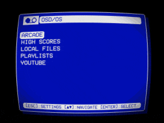</td><td>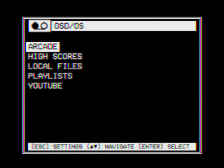</td></tr>
</table>

<table>
<tr><th width="50%">Green Screen</th><th width="50%">Matrix</th></tr>
<tr><td>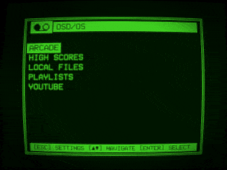</td><td>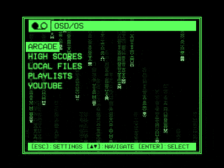</td></tr>
</table>

<table>
<tr><th width="50%">Inferno</th><th width="50%">Arcade</th></tr>
<tr><td>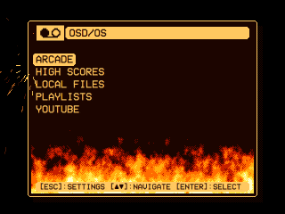</td><td>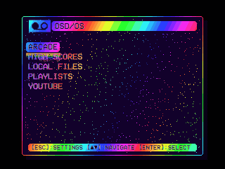</td></tr>
</table>

<table>
<tr><th width="50%">Winter</th><th width="50%">Demoscene</th></tr>
<tr><td>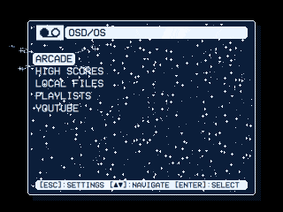</td><td>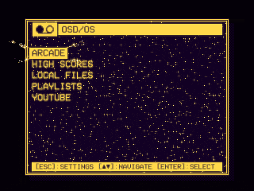</td></tr>
</table>

<table>
<tr><th width="50%">Orb: the Arcade screen</th><th width="50%">Orb: a game starting</th></tr>
<tr><td>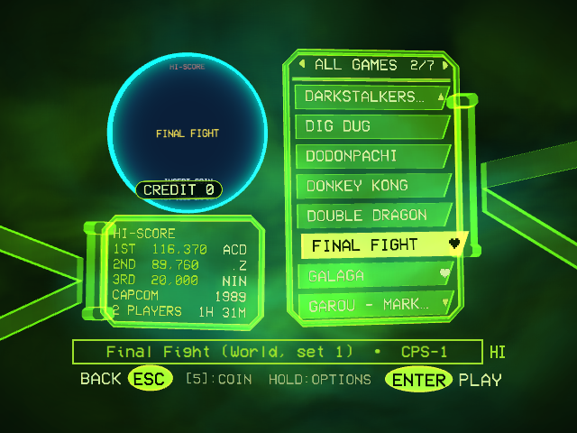</td><td>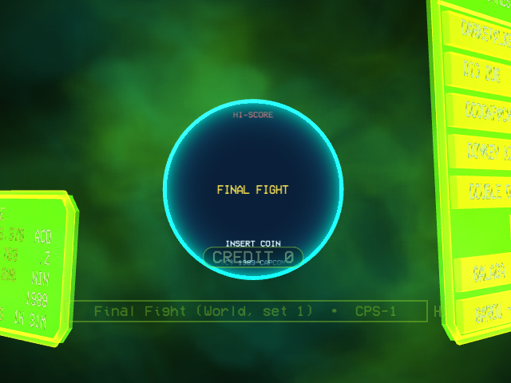</td></tr>
</table>

Orb changes the [Arcade screen](https://github.com/mehmetraif/OSD-OS/wiki/Arcade#the-orb-look); its other menus are plain. The [Setup page](https://osdos.tv/setup/) offers it too.

Theme: None gives Video 1's colours, OSD/OS's own window, no effects and no music.

<p align="center">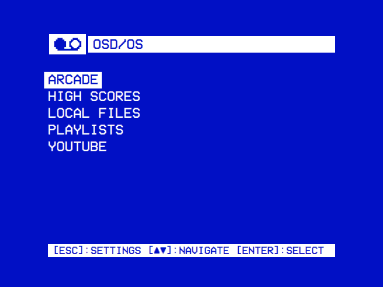</p>

## What each theme is made of

Each is a folder in [assets/themes](https://github.com/mehmetraif/OSD-OS/tree/main/assets/themes): a `theme.json` and, for seven of them, a tune ([Menu music](https://github.com/mehmetraif/OSD-OS/wiki/Menu-Music#making-tunes-with-make-menu-musicpy)). The `theme.json` gives the parts the table above lists, by name unless shown here.

### Trinitron

`trinitron/`: `theme.json`, `trinitron.ogg`.

### Late Show

`late-show/`: `theme.json`, `late-show.ogg`.

### Green Screen

`green-screen/`: `theme.json` alone, with two colours and screen numbers of its own:

```json
{
    "name": "Green Screen",
    "colors": { "primary": "#4AF626", "surface": "#001A00" },
    "skin": "dos",
    "effects": {
        "screen": { "scanlines": 0.6, "glow": 0.6, "curvature": 0.3, "vignette": 0.5 },
        "text": "Glow",
        "transition": "Wave"
    }
}
```

### Matrix

`matrix/`: `theme.json`, `matrix.ogg`. Its colours: `primary` `#5CFF5C`, `surface` `#000000`.

### Inferno

`inferno/`: `theme.json`, `inferno.ogg`. Its colours: `primary` `#FFC860`, `surface` `#1C0500`.

### Arcade

`arcade/`: `theme.json`, `arcade.ogg`.

### Winter

`winter/`: `theme.json`, `winter.ogg`. Its colours: `primary` `#EAF4FF`, `surface` `#0B1E3A`.

### Demoscene

`demoscene/`: `theme.json`, `demoscene.xm`. Its colours: `primary` `#FFD84A`, `surface` `#120024`.

### Orb

`orb/`: `theme.json` alone. Its `arcade` key enables Settings → Look → **Orb Fog**: Picture (the default) or Live ([Settings](https://github.com/mehmetraif/OSD-OS/wiki/Settings#look)).

```json
{
    "name": "Orb",
    "colors": { "primary": "#9BE02B", "surface": "#061206" },
    "arcade": "orb"
}
```

## How a theme is applied

### Theme and the rows under it

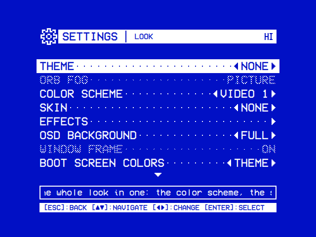

**Theme** lists None (the default) and every theme by name. It is saved as `app.osd_theme`: the theme's folder name, `""` for None.

Each part has a row of its own ([Settings](https://github.com/mehmetraif/OSD-OS/wiki/Settings#look)): Color Scheme and Skin on Look, the effects on Look → **Effects**, Menu Music on Settings → Sound.

| Row | The theme's part | Config key | Off | Choices of its own |
|---|---|---|---|---|
| Color Scheme | `colors` | `app.color_scheme` | — (no Off) | the color schemes, by name |
| Skin | `skin` | `app.skin` | **None** (saved as `"Off"`) | the skins, by name (saved by folder name) |
| Text Effect | `effects.text` | `app.text_effect` | Off | Rainbow, Shimmer, Glow, Flicker |
| Background Effect | `effects.background` | `app.background_effect` | Off | Matrix, Fire, Stars, Snow, Checkered Flag, Plasma |
| Selector Effect | `effects.selector` | `app.selector_effect` | Off | Sparkles, Welding, Lightning, Rainbow, Snow |
| Screen Effect | `effects.screen` | `app.screen_effect` | Off | Scanlines, CRT, VHS |
| Transition | `effects.transition` | `app.transition` | Off | Fade, Cube, Ripple, Wave, Drop |
| Menu Music | `music` | `app.menu_music` | Off | File: the Music File row's file |

- **Choosing a theme** sets all these rows back to **THEME** (saved as `""`). Music File and Music Volume keep their values.
- **Off** and a choice of its own stay until the next theme is chosen.
- **Without a theme** the rows have no THEME, and `""` shows as Video 1, None or Off.
- **Without a GPU or Qt Shader Tools**, Text, Background and Screen Effect are dimmed, and Transition has no Ripple, Wave or Drop ([Effects](https://github.com/mehmetraif/OSD-OS/wiki/Effects#what-needs-a-gpu-and-qt-shader-tools)).

### What is in force

Each part is worked out on its own, from its row:

- **A choice** is in force, and replaces the theme's part whole: Screen Effect: CRT replaces a theme's own screen shader.
- **Off** is none of it.
- **THEME** is the theme's part. Where the theme leaves it out, or there is no theme, it is none: Video 1's colours, OSD/OS's own window, no effect, no music.

### In config.json

Settings saves the rows under `app` in `config.json` ([Configuration files](https://github.com/mehmetraif/OSD-OS/wiki/Configuration-Files)). Here Matrix is chosen and its selector effect turned off:

```json
{
    "app": {
        "osd_theme": "matrix",
        "color_scheme": "",
        "skin": "",
        "text_effect": "",
        "background_effect": "",
        "selector_effect": "Off",
        "screen_effect": "",
        "transition": "",
        "menu_music": ""
    }
}
```

- A key that is `""` or left out lets the theme's part apply. Any other value overrides it: `"color_scheme": "Video 1"` hides a theme's colours.
- Edit the file with OSD/OS stopped, or restart it afterwards.
- `app.theme`, an earlier key for the skin, is read while `app.skin` is unset.

## Where themes live

| What | Where |
|---|---|
| OSD/OS's nine | `/opt/osdos/share/osdos/assets/themes/` on Raspberry Pi OS and the OSD/OS image, `/Applications/osdos.app/Contents/Resources/assets/themes/` on a Mac, [assets/themes](https://github.com/mehmetraif/OSD-OS/tree/main/assets/themes) in the repository |
| Yours | `~/.local/share/OSD-OS/themes/` on Linux (`/home/pi/.local/share/OSD-OS/themes/` on the OSD/OS image), `~/Library/Application Support/OSD-OS/themes/` on a Mac, `%APPDATA%\OSD-OS\themes\` on Windows, or `themes` in the folder `DATA_ROOT` names ([the data folder](https://github.com/mehmetraif/OSD-OS/wiki/Configuration-Files#the-data-folder)) |

- A theme is a folder with a `theme.json`. Settings saves the folder's name: keep it short and plain (`my-theme`).
- Yours replaces OSD/OS's of the same folder name, unless its `theme.json` isn't JSON.
- Of two themes with one name, Settings shows the second as `Name (folder)`.
- Settings reads the list each time it opens. The theme in use is read at start and each time it is chosen.
- A `theme.json` with `window`, `titleBar`, `hintBar` or `selection` and none of `colors`, `skin`, `effects` and `music` is listed under Skin ([Skins](https://github.com/mehmetraif/OSD-OS/wiki/Skins#early-skins-themejson-in-themes)).

## theme.json reference

The [theme template](https://github.com/mehmetraif/OSD-OS/tree/main/docs/theme-template)'s file uses every kind of value:

```json
{
    "name": "Template",
    "colors": { "primary": "#F2E6C9", "surface": "#1B2A4A" },
    "skin": {
        "window":    { "image": "window.png", "border": 4 },
        "titleBar":  { "image": "titlebar.png", "border": [2, 2, 5, 2] },
        "hintBar":   { "image": "hintbar.png", "border": 3, "tile": "repeat" },
        "selection": { "image": "selection.png", "border": 3 },
        "icons":     { "logo": "logo.png" }
    },
    "effects": {
        "text":       { "shimmer": 0.6, "glow": 0.4 },
        "background": { "shader": "plasma.frag.qsb" },
        "selector":   "Sparkles",
        "screen":     { "shader": "tube.frag.qsb", "animate": true, "scanlines": 0.4 },
        "transition": "Drop"
    },
    "music": "tune.mid"
}
```

| Key | Type | What it takes | Left out |
|---|---|---|---|
| `name` | string | What Settings → Look → Theme shows, 28 characters at most | The folder's name |
| `colors` | string or object | A color scheme's name, or `{ "primary": "#rrggbb", "surface": "#rrggbb" }` | Video 1's colours |
| `skin` | string or object | A skin's folder name, or a skin's parts as in a `skin.json` | OSD/OS's own window |
| `effects` | object | Any of `text`, `background`, `selector`, `screen` and `transition` | No effects |
| `music` | string | A sound file in the theme's folder | No music |
| `arcade` | string | The Arcade screen's look: `"orb"` | The Arcade screen's own |

Every key is optional. `null` counts as left out. Unknown keys are ignored.

### name

Runs of spaces count as one. If it is empty or longer than 28 characters, the folder's name is shown.

### colors

`primary` draws the text, the lines and the selection, `surface` the background. Either:

- **A color scheme's name**, matched exactly: `"Video 1"`, `"Late Night"`, `"Synthwave"`, `"Terminal"`, `"T-120"`, `"Amber"`, `"Kinescope"`, `"SMPTE ECR 1-1978"` ([Settings](https://github.com/mehmetraif/OSD-OS/wiki/Settings#look)). One from `custom_color_schemes.json` or `custom_color_scheme.json` (`"Custom"`) works too ([Configuration files](https://github.com/mehmetraif/OSD-OS/wiki/Configuration-Files#custom-color-schemes)). An unknown name is drawn as Video 1, with no line in the log.
- **Two colours of its own**: `{ "primary": "#FFD84A", "surface": "#120024" }`, each `#` and six hex digits. `secondary`, `tertiary` and `accent` are ignored. If either is missing or isn't `#rrggbb` (`"black"`, `"#000"`), Video 1's are used and the log says so.

With Settings → Look → OSD Background: Off, the menus are drawn on black in the lighter of the two.

### skin

Either:

- **A skin's folder name**: `"dos"`, `"rounded"`, or one in the data folder's `skins`. `"Off"` isn't a skin: leave `skin` out for OSD/OS's own window.
- **A skin of its own**: an object with the parts of a `skin.json` (`window`, `titleBar`, `hintBar`, `selection`, `icons`), its pictures in the theme's folder ([skin.json reference](https://github.com/mehmetraif/OSD-OS/wiki/Skins#skinjson-reference)).

A missing skin, or any other value, is logged and the window is OSD/OS's own.

### effects

Each key takes an effect's name, `"Off"`, or, for three of them, an object of its own:

| Key | Names | An object of its own |
|---|---|---|
| `text` | `Rainbow`, `Shimmer`, `Glow`, `Flicker` | Any of `rainbow`, `shimmer`, `glow`, `flicker`: numbers from 0 (none) to 1 |
| `background` | `Matrix`, `Fire`, `Stars`, `Snow`, `Checkered Flag`, `Plasma` | `shader`: a compiled shader (`.qsb`) in the theme's folder; `area`: `"window"` (when left out) or `"foot"` |
| `selector` | `Sparkles`, `Welding`, `Lightning`, `Rainbow`, `Snow` | None: a name only |
| `screen` | `Scanlines`, `CRT`, `VHS` | Any of `scanlines`, `curvature`, `glow`, `bleed`, `noise`, `vignette`: numbers from 0 to 1; `shader`: a `.qsb` in the theme's folder; `animate`: `true` for a shader that moves |
| `transition` | `Fade`, `Cube`, `Ripple`, `Wave`, `Drop` | None: a name only |

What each looks like, and the numbers behind each name: [Effects](https://github.com/mehmetraif/OSD-OS/wiki/Effects). A shader of your own: [Shaders](https://github.com/mehmetraif/OSD-OS/wiki/Shaders).

- **Names are matched exactly**: `"CRT"`, not `"crt"`. `Cube Left`, `Cube Right`, `Cube Up` and `Cube Down` are read as `Cube`.
- **An unknown name**, or an object for `selector` or `transition`, is drawn as none, with no line in the log.
- **Numbers are held to 0 to 1.**
- **`text`** is drawn by OSD/OS's screen shader. A theme with a screen `shader` of its own has to draw it itself ([Shaders](https://github.com/mehmetraif/OSD-OS/wiki/Shaders#4-keeping-the-text-effects)).
- **`"area": "foot"`** draws the background from the window's top down to the screen's foot.
- **`screen`** with a `shader` runs it instead of OSD/OS's, with the numbers given to it. Without one, the numbers drive OSD/OS's own.

### music

A sound file in the theme's folder, looped under the menus. The extension says which kind, in capitals or not:

- a recording: OGG, Opus, MP3, FLAC, WAV, M4A or AAC;
- a tracker's module: XM, MOD, S3M or IT;
- a MIDI file: MID or MIDI, played with a SoundFont (`tune.sf2` beside `tune.mid` is the theme's own).

What each needs installed: [Menu music](https://github.com/mehmetraif/OSD-OS/wiki/Menu-Music#formats). For no music, leave `music` out.

### arcade

`"orb"` draws the Arcade screen in 3D ([Arcade → The Orb look](https://github.com/mehmetraif/OSD-OS/wiki/Arcade#the-orb-look)). It needs Qt Quick 3D and a GPU. Without them, or with `arcade` left out, the Arcade screen keeps its own look.

### Files a theme names

Its skin's pictures, its shaders and its music:

- are named relative to the theme's folder; a folder inside it is allowed (`"music": "sounds/menu.ogg"`);
- must be inside the theme's folder: an absolute path, a `../` or a link out of it is refused and logged;
- are told apart by extension: `.png`, `.gif` or `.bmp` for a skin's pictures, also `.svg`, `.jpg` and `.jpeg` for an icon, `.qsb` for a shader, the types above for music.

### What the log says

For a theme in the folder `my-theme`:

| Line | What happened | What is drawn |
|---|---|---|
| `[AppCore] theme my-theme: /home/pi/.local/share/OSD-OS/themes/my-theme` | The theme was read, from there. This line comes last | The theme |
| `[AppCore] theme my-theme: not found, none used` | The saved theme has no folder with a `theme.json` | No theme |
| `[AppCore] /home/pi/.local/share/OSD-OS/themes/my-theme/theme.json: object is missing after a comma` | The file isn't JSON. The reason follows the colon | Not listed in Settings |
| `[AppCore] theme my-theme: its colors are not a color scheme's name or a #rrggbb primary and surface: drawn in Video 1's` | `colors` is neither a name nor two `#rrggbb` colours | Video 1's colours |
| `[AppCore] skin doss: not found, none used` | `skin` names a skin that isn't there | OSD/OS's own window |
| `[AppCore] theme my-theme: its skin is not a skin's name or an object: none` | `skin` is a number or a list | OSD/OS's own window |
| `[AppCore] theme my-theme: its screen effect is not a name or an object: none` | An effect is a number, a list or `true` | No such effect |
| `[AppCore] theme my-theme: its text effect's glow is not a number from 0 to 1: none` | One of an effect's numbers isn't a number | That number left out |
| `[AppCore] theme my-theme: its background effect's area is not "window" or "foot": the window` | `area` is something else | The window |
| `[AppCore] theme my-theme: its background shader, "../rain.frag.qsb", is not a qsb file in its folder` | The shader file is missing, out of the folder, or not `.qsb` | That effect without a shader |
| `[AppCore] theme my-theme: its music, "tune.wma", is not a ogg/opus/mp3/flac/wav/m4a/aac/mid/midi/xm/mod/s3m/it file in its folder` | The music file is missing, out of the folder, or of another type | No music |
| `[AppCore] theme my-theme: its arcade, "cube", is not a look the Arcade screen has` | `arcade` isn't `"orb"` | The Arcade screen's own look |
| `qml: [Arcade] the Orb look needs Qt Quick 3D: the Arcade screen's own is drawn` | Qt Quick 3D is missing. A Raspberry Pi set up before 0.0.31 needs it [installed once](https://github.com/mehmetraif/OSD-OS/wiki/Arcade#the-orb-look) | The Arcade screen's own look |

Lines about a picture of the theme's own skin: [Skins](https://github.com/mehmetraif/OSD-OS/wiki/Skins#what-the-log-says). `[Effect]` lines: [Shaders](https://github.com/mehmetraif/OSD-OS/wiki/Shaders#loading-fallback-and-the-log). `[MenuMusic]` lines: [Menu music](https://github.com/mehmetraif/OSD-OS/wiki/Menu-Music#troubleshooting).

## Make your own theme

Start from the [theme template](https://github.com/mehmetraif/OSD-OS/tree/main/docs/theme-template), which has a skin, a background shader, a screen shader and a MIDI tune of its own.


### 1. Get the template

It isn't installed with OSD/OS. On the Pi (over SSH), on Linux or on a Mac:

```sh
curl -L https://github.com/mehmetraif/OSD-OS/archive/refs/heads/main.tar.gz | tar -xz -C /tmp
ls /tmp/OSD-OS-main/docs/theme-template
```

| File | What it is |
|---|---|
| `theme.json` | The theme |
| `window.png`, `titlebar.png`, `hintbar.png`, `selection.png`, `logo.png` | Its skin's pictures and its icon |
| `plasma.frag`, `plasma.frag.qsb` | Its background shader: the source, and compiled, which is what OSD/OS reads |
| `tube.frag`, `tube.frag.qsb` | Its screen shader, the same way |
| `tune.mid` | Its music, a MIDI file |
| `README.md` | Notes, not needed to run it |

### 2. Copy it into the themes folder

Under a folder name of your own. On Linux:

```sh
mkdir -p ~/.local/share/OSD-OS/themes
cp -r /tmp/OSD-OS-main/docs/theme-template ~/.local/share/OSD-OS/themes/my-theme
```

On a Mac the folder is `~/Library/Application\ Support/OSD-OS/themes`.

On the OSD/OS image:

- Work as `pi`, over SSH or from Settings → Quit → Exit to Terminal ([The OSD/OS image](https://github.com/mehmetraif/OSD-OS/wiki/The-OSD-OS-Image)).
- Without a network, copy the folder onto the card's **OSD-OS** partition from a computer, then on the Pi: `cp -r /media/OSD-OS/my-theme ~/.local/share/OSD-OS/themes/`.
- A USB drive's files are under `/media/usb/<its label>/`.

### 3. Name it

In `theme.json`, 28 characters at most:

```json
{ "name": "My Theme" }
```

### 4. Choose it

Open Settings and set **Theme** to My Theme. To see the skin's window frame, set **OSD Background** to Window and **Window Frame** to On or Shadow.

The template's text numbers (`shimmer`, `glow`) don't show, because its screen shader doesn't draw them. Take its `screen` line out to see them.

### 5. Make it yours

Change one key at a time ([reference](#themejson-reference)).

- **`skin`**: redraw the template's pictures ([Skins](https://github.com/mehmetraif/OSD-OS/wiki/Skins#drawing-the-pictures)), or name a skin (`"skin": "rounded"`) and delete the pictures.
- **`effects`**: names first, then numbers, then a shader of your own.
- To drop a part, take its key out. Delete the files `theme.json` no longer names.

### 6. See your changes

- **`theme.json` changed**: choose another theme in Settings, then yours again.
- **A picture or a shader changed under the same file name**: restart OSD/OS (Settings → Quit). Or save it under a new name, change `theme.json` to match, and choose the theme again.
- **The log** says what couldn't be used ([below](#when-something-is-wrong)).

### Starting from one of OSD/OS's themes

Copy one into your themes folder. Under its own folder name it replaces OSD/OS's; under another it is a new theme:

```sh
# Arcade, changed in place: your copy is used instead of OSD/OS's
cp -r /opt/osdos/share/osdos/assets/themes/arcade ~/.local/share/OSD-OS/themes/arcade

# A theme of your own, starting from Winter
cp -r /opt/osdos/share/osdos/assets/themes/winter ~/.local/share/OSD-OS/themes/blizzard
```

On a Mac, the nine are in `/Applications/osdos.app/Contents/Resources/assets/themes/`. Give a copy under another folder name a `name` of its own.

## Three example themes

For each, make the folder in the data folder's `themes`, put the files in it and choose it in Settings.

### Amber Terminal

Only `themes/amber-terminal/theme.json`: every part is OSD/OS's own.

```json
{
    "name": "Amber Terminal",
    "colors": { "primary": "#FFB000", "surface": "#140C00" },
    "skin": "dos",
    "effects": {
        "text": "Glow",
        "screen": "Scanlines",
        "transition": "Fade"
    }
}
```

- `"colors": "Amber"` would draw the same `#FFB000` on pure black.
- For a curved tube, write numbers: `"screen": { "scanlines": 0.6, "curvature": 0.4, "vignette": 0.4 }`.

### Sunday Morning

`themes/sunday-morning/` holds `theme.json` and `theme-song.mp3`, any MP3 of your own under that name.

```json
{
    "name": "Sunday Morning",
    "colors": { "primary": "#FFF4D6", "surface": "#2E1A8C" },
    "skin": "rounded",
    "effects": {
        "text": "Rainbow",
        "selector": "Sparkles",
        "transition": "Cube"
    },
    "music": "theme-song.mp3"
}
```

`"text": { "rainbow": 0.5 }` would mix the rainbow halfway with the cream.

### Copperlist

A background shader of the theme's own behind the menus, and a tracker's module for music.

```text
themes/copperlist/
├── theme.json
├── copper.frag        the shader's source (not read by OSD/OS)
├── copper.frag.qsb    the shader compiled with qsb (what OSD/OS reads)
└── copperlist.xm      a module of your own
```

```json
{
    "name": "Copperlist",
    "colors": { "primary": "#8FE3FF", "surface": "#0A0730" },
    "skin": "dos",
    "effects": {
        "text": { "glow": 0.5 },
        "background": { "shader": "copper.frag.qsb" },
        "selector": "Lightning",
        "transition": "Cube"
    },
    "music": "copperlist.xm"
}
```

- `copper.frag` is a background shader of your own. [Shaders](https://github.com/mehmetraif/OSD-OS/wiki/Shaders#worked-examples) has complete ones, and the command that compiles it ([qsb](https://github.com/mehmetraif/OSD-OS/wiki/Shaders#compiling-with-qsb)).
- `copperlist.xm` is any XM of your own; a MOD, S3M or IT works too. Without one, take the `music` line out.

## When something is wrong

### Reading the log

| Where OSD/OS runs | Its log |
|---|---|
| The OSD/OS image, or Raspberry Pi OS with the autostart service | `journalctl -u osdos -b` |
| Started by hand (`osdos`, or `./build/osdos` from source) | The terminal it was started in |
| A Mac | Start it from Terminal: `/Applications/osdos.app/Contents/MacOS/osdos` |
| Windows | `osdos.log` in the data folder |

Only what concerns the look:

```sh
journalctl -u osdos -b | grep -E '\[(AppCore|Effect|MenuMusic)\]'
```

More: [Configuration files](https://github.com/mehmetraif/OSD-OS/wiki/Configuration-Files#logs-and-temporary-files) and [Troubleshooting](https://github.com/mehmetraif/OSD-OS/wiki/Troubleshooting).

### Symptoms

| What you see | Why | What to do |
|---|---|---|
| The theme isn't in Settings → Look → Theme | Settings was open when the folder was made. Or `theme.json` isn't JSON (logged), is misnamed, or isn't in the data folder's `themes`. Or it holds only window pictures and is under Skin | Open Settings again. Fix the JSON: a trailing comma is the usual cause |
| Video 1's colours instead of its own | Color Scheme isn't THEME. Or `colors` isn't two `#rrggbb` (logged) or names no scheme: a typo, or a custom scheme added without a restart | Choose the theme again. Check the spelling |
| One part doesn't show | Its row isn't THEME. A name is misspelt (not logged). A file is out of the folder or of the wrong type (logged) | Check the row, the spelling, the log |
| No window frame | OSD Background isn't Window, or Window Frame is Off | Settings → Look → OSD Background: Window, Window Frame: On or Shadow |
| Text, Background and Screen Effect are dimmed; no Ripple, Wave or Drop | No Qt Shader Tools in this build, or Qt draws without a GPU | [Above](#theme-and-the-rows-under-it) |
| The menus vanish with a theme's screen shader; the log has `Failed to build graphics pipeline state` (after `No GLSL shader code found` with OpenGL) | The `.qsb` lacks the variant for this graphics API: OpenGL on the Pi and Linux, Metal on a Mac | Take the theme out ([below](#getting-back-from-a-theme-that-hides-the-menus)), then compile with the full command |
| No music | Menu Music isn't THEME, the theme has none, or it couldn't play | The `[MenuMusic]` line in the log |
| No effects or music while a video plays | By design | [Effects](https://github.com/mehmetraif/OSD-OS/wiki/Effects#never-over-a-video) |

### Getting back from a theme that hides the menus

A screen shader that draws nothing readable hides every menu, Settings included. Over SSH, move the theme out of `themes` and restart OSD/OS: no theme is then used.

```sh
mv ~/.local/share/OSD-OS/themes/my-theme ~/my-theme.off
sudo systemctl restart osdos     # under the autostart service, which leaves the Pi on
```

- Started by hand: stop OSD/OS in its terminal (Ctrl+C) and start it again.
- To lose only the screen effect: stop OSD/OS (`sudo systemctl stop osdos`), set `"screen_effect": "Off"` under `app` in `config.json`, and start it (`sudo systemctl start osdos`).

## See also

- [Skins](https://github.com/mehmetraif/OSD-OS/wiki/Skins), [Effects](https://github.com/mehmetraif/OSD-OS/wiki/Effects), [Shaders](https://github.com/mehmetraif/OSD-OS/wiki/Shaders), [Menu music](https://github.com/mehmetraif/OSD-OS/wiki/Menu-Music): a theme's parts
- [Settings](https://github.com/mehmetraif/OSD-OS/wiki/Settings#look): the look's rows, and the color schemes
- [Configuration files](https://github.com/mehmetraif/OSD-OS/wiki/Configuration-Files): the data folder, `config.json` and the logs
- [Troubleshooting](https://github.com/mehmetraif/OSD-OS/wiki/Troubleshooting)
