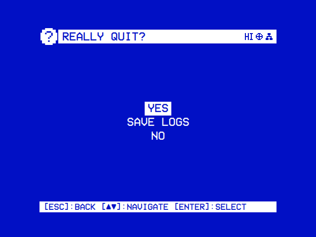

# Troubleshooting

What to do when something doesn't work: where the log is and how to read it, then the usual problems by what you see, each with its cause and fix.

## Where the log is

OSD/OS writes one line per event. Where the lines go depends on how it was started:

| How OSD/OS runs | Where the log goes | How to read it |
|---|---|---|
| The [OSD/OS image](https://github.com/mehmetraif/OSD-OS/wiki/The-OSD-OS-Image), or `install.sh`'s autostart service | The systemd journal, and `osdos.log` in the data folder (the run before's in `osdos-previous.log`) | `journalctl -u osdos -b` (this boot), `journalctl -u osdos -f` (as it happens); no `sudo` needed on the image |
| `osdos` typed in a shell (SSH, or Exit to Terminal) | That shell | Keep it with `osdos 2>&1 \| tee ~/osdos.log` |
| A build from source | The terminal it runs in | `APP_ROOT=$(pwd) ./build/osdos` |
| The Mac app opened from the Finder | macOS's log | Console.app, or run `/Applications/osdos.app/Contents/MacOS/osdos` in Terminal |
| The AppImage | The terminal it was started from | `./OSD-OS-linux-x86_64.AppImage` |
| Windows | `osdos.log` in the data folder, the run before's in `osdos-previous.log` | Open `%APPDATA%\OSD-OS\osdos.log` in Notepad |

**The logs on the card: Settings → Quit → Save Logs.** On the image it copies the logs to the card's **OSD-OS** partition, which a computer shows as a drive, into `Logs\<date_time>\`:

| File | What it holds |
|---|---|
| `osdos.log`, `system.log` | OSD/OS's journal since the Pi started, and the whole journal |
| `app-this-run.log`, `app-previous-run.log` | OSD/OS's own log files, of this run and the run before |
| `stall-report.txt`, `crash-report.txt` | The reports, when there is one |
| `retroarch-last.log` | RetroArch's log of the last FinalBurn Neo game |

- Tokens in addresses are blanked, and mpv's own log is left out. The newest ten folders are kept.
- After a problem: Quit → Save Logs, then Power Off, and put the card in a computer.
- When the Pi is stuck: wait a minute, switch it off and on, then Save Logs. The stuck run is in `app-previous-run.log`.

**When OSD/OS crashes.** Under the autostart service a crash leaves the Pi on, and systemd starts OSD/OS again five seconds later. After three failures in two minutes a login prompt comes instead.

- `journalctl -u osdos -b` shows why it ended; `journalctl -u osdos -b -1` the boot before, if the system keeps its journal.
- `sudo systemctl reset-failed osdos`, then `sudo systemctl start osdos`, tries again. So does switching the Pi off and on.
- To read a crash at your own pace, run OSD/OS by hand ([BUILDING.md → Debugging & logs](https://github.com/mehmetraif/OSD-OS/blob/main/BUILDING.md#debugging--logs)):

  ```sh
  sudo systemctl stop osdos
  osdos 2>&1 | tee ~/osdos.log
  ```

- Settings → Quit → **Exit to Terminal** stops the app without `sudo` and leaves a login shell on the TV. `sudo systemctl start osdos`, or a reboot, brings the service back.
- An image built without a password has no `sudo` ([The user, its password and sudo](https://github.com/mehmetraif/OSD-OS/wiki/The-OSD-OS-Image#the-user-its-password-and-sudo)).

<table>
<tr><th width="50%">Settings → Quit, run by hand</th><th width="50%">The boot screen (the image)</th></tr>
<tr><td></td><td></td></tr>
<tr><td>Run by hand: Yes, Save Logs (on the image) and No. Started by the service: Power Off, Restart, Exit to Terminal, Save Logs and Cancel.</td><td><code>[ OK ]</code> once a service is up, <code>[FAIL]</code> if it failed, <code>[ -- ]</code> if it was skipped.</td></tr>
</table>

### When it crashes or freezes: the reports

On Linux OSD/OS writes a report to the [data folder](https://github.com/mehmetraif/OSD-OS/wiki/Configuration-Files#the-data-folder). Each file holds the latest report only.

| Event | In the log | File |
|---|---|---|
| A crash | `[crash] OSD/OS … ended by SIGSEGV …` | `crash-report.txt`: the functions it was in |
| The screens not answering for 5 seconds | `[watchdog] …` | `stall-report.txt`: when it began, the memory, and where each thread is stuck |

- Started by the service, OSD/OS still frozen at 20 seconds ends itself, and systemd starts it again on the main menu.
- On the image the files are in `/home/pi/.local/share/OSD-OS/`. Save Logs copies them ([above](#where-the-log-is)), or copy them by hand after Exit to Terminal:

```sh
cp ~/.local/share/OSD-OS/crash-report.txt ~/.local/share/OSD-OS/stall-report.txt /media/OSD-OS/
```

- `OSDOS_WATCHDOG=0` turns freeze reports off, for a debugger.

### mpv's own log

- mpv's messages reach OSD/OS's log as `[mpv] …` lines, with every token blanked.
- mpv also writes a verbose log of the latest video, `osdos-mpv.log`, in a folder only OSD/OS's user can open: `/tmp/runtime-pi/` on the image and under the autostart service, `$XDG_RUNTIME_DIR` (`/run/user/1000`, say) when OSD/OS is started from a terminal or a desktop, and the temporary folder on a Mac or Windows ([Configuration files](https://github.com/mehmetraif/OSD-OS/wiki/Configuration-Files#logs-and-temporary-files)). It starts afresh for each video, so copy it before playing the next.
- That file holds each video's full address, and a media server's token with it. Look through it before you post it.

### What a build from source adds

A Release build (every release, and the image) leaves out OSD/OS's debug lines. A build configured without `-DCMAKE_BUILD_TYPE=Release` keeps them ([Building from source](https://github.com/mehmetraif/OSD-OS/wiki/Building-from-Source)):

- `[main] dataRoot = …` at start;
- `[AppCore] Loaded manifest: com.osdos.youtube` for each module;
- `[AppCore] Setting saved: app.video_scaling = 14:9` at each change;
- `[MpvController] launch: mpv …`, each video's full command line, tokens blanked.

### Qt's own switches

Three environment variables make Qt say more ([BUILDING.md → Qt / QML debugging knobs](https://github.com/mehmetraif/OSD-OS/blob/main/BUILDING.md#qt--qml-debugging-knobs)):

```sh
QT_LOGGING_RULES="qt.qml.*=true"   # verbose QML engine logging
QML_IMPORT_TRACE=1                 # how each QML import is found, or not
QT_QPA_EGLFS_DEBUG=1               # the KMS/DRM output, on a Pi without a desktop
```

Put them in front of the command (`QML_IMPORT_TRACE=1 APP_ROOT=$(pwd) ./build/osdos`). For the service, add them with a drop-in, `sudo systemctl edit osdos`:

```ini
[Service]
Environment=QML_IMPORT_TRACE=1
```

Then `sudo systemctl restart osdos` and read `journalctl -u osdos -b`. To take it out, edit again and delete the line. Don't use `systemctl revert`: on the image it removes the image's own drop-ins too.

## Reading the log

Every line starts with the part it comes from, in brackets. Lines from the screens (QML) start with `qml:`. A start on a Linux PC, then Local Files opened:

```text
[main] display index 0: "screen" 640x480 at (0,0)
[main] UI target display index 0 -> 640x480 at (0,0)
[NfcReader] Polling disabled by configuration
[MpvController] video profile: generic
[input] SDL game-controller subsystem ready
[input] keyboard: Logitech K380 (/dev/input/event4, kbd-0005-046d-b342)
[Bluetooth] No system bus: Failed to connect to socket /run/dbus/system_bus_socket: No such file or directory
[boot] first frame 166 ms after start
qml: Routing to: modules/local_files/views/Root.qml
```

| Prefix | Part of OSD/OS | What it writes |
|---|---|---|
| `[main]` | Start-up | The screens found and the one used, `QML engine failed to load Main.qml`, the memory as the menus come up |
| `[AppCore]` | Modules, settings, themes, skins | A bad `manifest.json`, what in a theme or skin can't be used, a setting that couldn't be saved |
| `[MpvController]` | Playback | The video profile, the memory as each video starts, `mpv not found`, mpv's exit code when it isn't 0 |
| `[mpv]`, `[EmbeddedMpv]` | mpv's own output, and libmpv (Transparent Background) | Why a file won't open, whether libmpv was found, where the pictures are drawn |
| `[DisplayHandoff]` | A Pi without a desktop handing its screen to mpv, a script, MAME or a web player | A step that failed: the lines behind a black screen after a video |
| `[crash]`, `[watchdog]` | Crashes and freezes (Linux) | As in the reports; and the screens answering late: `The main thread was away for 640 ms (app 372 MB, …)` |
| `[AtomicFile]` | Saving state | `Could not write <path>: <reason>`: the file is left as it was |
| `[Scripts]` | Scripts, and MAME's and RetroArch's runs | Each run, how it ended and its exit code (`'mame' finished: failed (exit 2)`) |
| `[Arcade]` | Arcade | The games folder, a game that didn't play and why (`mslug: Missing sp-s2.sp1, …`) |
| `[boot]`, `[legacy]` | The image's boot screen; moving over from 240-MP | Each held-back service settling; the data folder moved over |
| `[DisplayOutput]`, `[AudioOutput]`, `[MenuMusic]`, `[Bluetooth]`, `[Wi-Fi]`, `[input]` | The Settings row or page of that name; gamepads, keyboards and remotes | What was chosen or found, and why something failed |
| `[LocalFiles]`, `[HighScores]`, `[NfcReader]`, `[Weather]`, `[AmbientMode]`, `[Playlists]`, `[WebPlayer]`, `[TMDB]` | The module of that name; the web players; Netflix's and Prime Video's catalogue | What it couldn't find, read, fetch or write, and why |
| `[PlexBackend]`, `[Plex]`, `[PlexAuth]`, `[JellyfinBackend]`, `[Jellyfin]`, `[EmbyBackend]`, `[Emby]` | The media servers | Token refreshes, a token or device the server rejected, playback reports that failed |
| `qml:` | The screens | `qml: [Effect] … can't be used`, `qml: Routing to: modules/…/Root.qml`, a module screen's error |

## A module is missing from the main menu

Only Local Files and Playlists are on at first. Turn the module's **Enabled** on:

| Module | Where |
|---|---|
| The video modules and Weather | Settings → TV / Movie → *the module's name* → Enabled |
| Arcade, High Scores | Settings → Arcade → Enabled; High Scores' is under its heading on the same page |
| Scripts | Settings → System → Scripts → Enabled |

With every module off, the main menu says **No modules enabled**.

## Black screen or no picture

| Cause | Fix |
|---|---|
| Settings → Screen → Display Output switched to an output the TV doesn't show | Wait 30 seconds: without **Keep**, OSD/OS goes back to the old output by itself |
| Nothing at all, even after that | On a computer, copy `osdos-display-hdmi.txt` (or an output you know works) over `osdos-display.txt` on the card's **bootfs** drive |
| A Pi 4 on composite or SCART RGB, and HDMI went dark | As it should be: a Pi 4 has one output on at a time |
| An app install on Raspberry Pi OS, a CRT showing nothing | Composite needs `enable_tvout=1`, `sdtv_mode` and `sdtv_aspect`, and fake KMS on a Pi 3 or 4 (`dtoverlay=vc4-fkms-v3d,cma-256`). Use the composite `config.txt` in [INSTALL.md](https://github.com/mehmetraif/OSD-OS/blob/main/INSTALL.md) ([Installation](https://github.com/mehmetraif/OSD-OS/wiki/Installation)) |
| The menus run off the edges of a CRT | The TV hides more than the safe area allows for ([Overscan and the safe area](https://github.com/mehmetraif/OSD-OS/wiki/Display-Output#overscan-and-the-safe-area)) |
| Black after a video, the sound still going or the menus never coming back | The `[DisplayHandoff]` lines say which step failed. Take an `mpv_video_args` of your own out of `config.json` ([Playback and mpv](https://github.com/mehmetraif/OSD-OS/wiki/Playback-and-mpv)) |
| Black at start | OSD/OS failed to start: see [The app won't start](#the-app-wont-start) |

More in [Display Output → Troubleshooting a black screen](https://github.com/mehmetraif/OSD-OS/wiki/Display-Output#troubleshooting-a-black-screen).

## A video won't play

The loading screen comes, then **Playback failed** with why: *mpv is not installed*, *mpv could not play it* with mpv's own line, or the server's message. **Select** tries again, **back** leaves. The log says more:

| What the log says | Cause | Fix |
|---|---|---|
| `[MpvController] mpv not found (no bundled sibling, none on PATH)` | mpv isn't installed, or isn't on the `PATH` of OSD/OS's user | Install it as the screen says (`sudo apt install mpv` on Raspberry Pi OS). On Windows, unpack mpv from mpv.io beside OSD/OS as a folder named `mpv` |
| `Error parsing option subs-with-matching-audio (option parameter could not be parsed)`, then `[MpvController] mpv exited with code 1` | mpv is older than 0.38 | Install a newer mpv, or build 0.40 with `scripts/build-mpv.sh` ([Building from source](https://github.com/mehmetraif/OSD-OS/wiki/Building-from-Source#the-appimage-and-mpv-038)) |
| `[mpv] …` lines about the file, then `mpv exited with code 2` | mpv couldn't play the file: a codec, a file cut short, a stream refused | Try `mpv <file>` in a terminal: if mpv can't either, the file is the problem. mpv's log (`/tmp/runtime-pi/osdos-mpv.log` on the image) has the details |
| `[YouTube Player] "A Talk" (abc123): playback failed: mpv could not play it: …`, or the same from `[NfcReader Player]`, `[Playlists Player]`, `[AmbientMode Player]`, `[LivePlayer]` or `[Extras]` | The video failed and its player went back to the menus without a **Playback failed** screen: a YouTube, card or playlist video once its picture had shown, an Ambient:Mode clip, a Plex live channel or extra | The words after `playback failed:` are mpv's own, or the server's. The line names the video by its title; of an address it keeps the host alone |
| `[MpvController] The video has shown nothing N s after mpv (pid …) started` | mpv started and showed no picture | OSD/OS starts the video again without the hardware decoder. If that fails too it says **The video did not start**. Send the lines with a bug report |
| `MESA: error: Failed to export gem bo … to dmabuf` and `Export failed` by the thousand, then `Too many open files`, on a Pi 4 with Transparent Background | In older releases mpv left a file open for every picture it drew inside the app; after some 45 minutes of video nothing more could be opened, and OSD/OS ended and started again | Update OSD/OS. The line `memory as a video starts: … N of 65536 files open` says how many are open |
| `[MpvController] The video played without sound: the sound card could not be opened` | Another program has the sound card, or there is none | See [No sound](#no-sound) |
| `[MpvController] Cannot start playback: <owner> has the screen` | A takeover script or a web player holds the Pi's screen | Let it finish, or stop it |
| `[MpvController] WATCHDOG: no IPC time-pos event for N s — possible freeze` | mpv stopped moving: a stream stalled, a network share or USB drive gone | mpv's log says what it was waiting for |
| Nothing from mpv, and Transparent Background is on | The video plays through libmpv, which logs as `[EmbeddedMpv]` | Turn Transparent Background off to compare with an mpv process |

## Judder or stutter

| Cause | Fix |
|---|---|
| An `mpv_video_args` override in `config.json` | Take it out of `"app"` and compare: OSD/OS picks the decoder and output for each board itself ([Playback and mpv](https://github.com/mehmetraif/OSD-OS/wiki/Playback-and-mpv)) |
| A Pi 3 with Settings → TV / Movie → 1080p Playback **Off** | Keep the films to 720p, or turn it back **On** (smooth 1080p, no crop) |
| A film the board can't decode in hardware | A Pi 4 plays 1080p HEVC, but not 4K HEVC. On YouTube, keep **Video Codec** at H.264 and set **Max Frame Rate** to 30 |
| Transparent Background drawing on the CPU | The log says `pictures drawn by mpv's software renderer` when Qt doesn't draw with OpenGL |
| A 24 fps film on a 50 or 60 Hz output | None: OSD/OS doesn't change the output's rate for a film |

## No sound

1. **Choose the card** in Settings → Sound → Audio Output: AV Jack, HDMI or a USB sound card. A Pi 5 has no AV jack: use HDMI, or a USB sound card on a CRT.
2. **See the cards ALSA has**: `aplay -l`, or `cat /proc/asound/cards`.
3. **Quiet AV jack**: OSD/OS keeps the card at 0 dB. `amixer sset PCM 100%` raises it 4 dB (`sudo alsactl store` keeps it); loud sound can clip there.
4. **Read the log**: `journalctl -b -u osdos | grep AudioOutput` shows `Sound through <card>`. mpv's log (`/tmp/runtime-pi/osdos-mpv.log` on the image) says why a video's sound couldn't open.

A dimmed Audio Output row means a sound server (PipeWire, PulseAudio) runs: choose the output in the system's sound settings. More in [Audio Output → When there is no sound](https://github.com/mehmetraif/OSD-OS/wiki/Audio-Output#when-there-is-no-sound); `/etc/asound.conf` and `audio-device=` in `mpv.conf` are in [INSTALL.md](https://github.com/mehmetraif/OSD-OS/blob/main/INSTALL.md).

## YouTube

YouTube searches, lists and plays through yt-dlp. A problem shows in the help line at the foot of the tree:

| What the help line says | Cause | Fix |
|---|---|---|
| **Searching needs yt-dlp, which is not installed**, then how to install it | No yt-dlp at `bin/yt-dlp` in the data folder, beside OSD/OS's binary, or on the `PATH` | Install it as the line says (`sudo apt install yt-dlp` on Raspberry Pi OS). On the AppImage, put it at `~/.local/share/OSD-OS/bin/yt-dlp` and `chmod +x` it |
| **Could not search YouTube: check the network, and that yt-dlp is up to date** | No network, or a yt-dlp too old | Update yt-dlp (below) |
| **Could not load the playlists: check the network, and that yt-dlp is installed** | The same, for the playlists in Settings and in `youtube_playlists.txt` | The same |
| **Could not load the subscriptions: check the network** | The channels' feeds didn't come | Check the network, and the channel ids in Settings' Subscriptions and in `youtube_subscriptions.txt` |

- **Updating yt-dlp.** The image updates its own after each boot, once a day, and as the YouTube module opens; `~/.local/share/OSD-OS/bin/yt-dlp --update` updates it now, and `journalctl -u osdos-yt-dlp-update` shows the last update. Elsewhere: `sudo yt-dlp -U` for a copy in `/usr/local/bin`, `brew upgrade yt-dlp` on a Mac.
- **Deno.** yt-dlp needs a JavaScript runtime for YouTube; without one, a video plays in few formats or none ([yt-dlp's EJS notes](https://github.com/yt-dlp/yt-dlp/wiki/EJS)). Deno must be on the `PATH` of the user or service that runs OSD/OS, such as `/usr/local/bin`. The image has it; `brew install deno` on a Mac.
- **"Sign in to confirm you're not a bot".** Sign in under YouTube's settings → **Sign in**, with a spare account: YouTube can block one used through yt-dlp. Or compare IPv4 and IPv6; if only IPv4 gets the check, the cause is the IPv4 route:

  ```sh
  yt-dlp --verbose --simulate --force-ipv4 'https://www.youtube.com/watch?v=VIDEO_ID'
  yt-dlp --verbose --simulate --force-ipv6 'https://www.youtube.com/watch?v=VIDEO_ID'
  ```

More in [YouTube](https://github.com/mehmetraif/OSD-OS/wiki/YouTube) and [BUILDING.md](https://github.com/mehmetraif/OSD-OS/blob/main/BUILDING.md#raspberry-pi-os-arm64).

## Netflix and Prime Video

The catalogue comes from TMDB. A title plays in the service's own web player, in Chromium with Widevine.

| What you see | Cause | Fix |
|---|---|---|
| **No TMDB API key: type one in Settings, in the module's TMDB Key (free from themoviedb.org, Settings, API)** | No key | Type a TMDB v3 key in Settings → TV / Movie → NETFLIX or PRIME VIDEO → TMDB Key. A v4 read access token (it starts `eyJ`) is too long to type: put it on the first line of `tmdb_api_key.txt` |
| **TMDB turned the API key down: check the TMDB Key in Settings** | TMDB answered 401 | The key was copied short, or shares its line with something else |
| **Could not reach TMDB: check the network** | No network, or TMDB unreachable | Check the network |
| **Chromium is not installed** | No Chromium or Chrome on the `PATH` | `sudo apt install chromium libwidevinecdm0 cage wtype` on Raspberry Pi OS (the image has it). Not on Windows; on a Mac it plays in Chrome |
| **cage is not installed** | No desktop, and no kiosk compositor for the browser | `sudo apt install cage wtype` |
| **Google Chrome is not installed** (a Mac, YouTube's sign-in) | YouTube's sign-in needs Chrome on a Mac | Install Google Chrome |
| The service's page says it can't play protected video | No Widevine | `sudo apt install libwidevinecdm0` |
| The sign-in is gone next time | The browser was stopped before it saved its cookies, which it does every half minute | Install `wtype`, or wait half a minute after signing in before you leave |
| Back does nothing in the browser | Back must be held for two seconds there, and Backspace doesn't count | Hold back for two seconds, or close the browser with Ctrl+W |

More in [Netflix and Prime Video](https://github.com/mehmetraif/OSD-OS/wiki/Netflix-and-Prime-Video).

## Plex, Jellyfin and Emby

| What you see | Cause | Fix |
|---|---|---|
| Plex: a code, **Visit plex.tv/link and enter the code above** | Not signed in yet | Type the code at plex.tv/link in any browser, signed in to your Plex account |
| Plex: the Server, Current User and Libraries settings are dimmed | The module isn't signed in | Open Plex and sign in first |
| Plex asks for a profile's PIN | The Plex Home profile has a PIN | Type it. A card tapped on the NFC Reader never asks for one |
| Plex asks to sign in again | `[PlexBackend] Device no longer authorized — triggering reauth`: plex.tv answered 401, as for a device removed from the account | Sign in again |
| Jellyfin: **CONNECTION FAILED: Host requires authentication** as Quick Connect starts | The server answered 401 to Quick Connect | Turn Quick Connect on in the server's settings, then enter the code at `<server>/web/#quickconnect` |
| Jellyfin or Emby: **CONNECTION FAILED: …**, or nothing | The server URL lacks the scheme or the port | Type the whole URL (`http://192.168.1.20:8096`). A self-signed certificate on your own server is accepted; an expired one isn't |
| Signed out by itself | `Token rejected — signing out`: a password changed, or the device was removed | Sign in again |
| A Plex film fails, then plays after a while | Plex retries with a transcode when mpv can't play the file directly | Set Settings → TV / Movie → Plex → Video Quality to one of its Mbps choices, or read the server's log |
| Plex: **LOADING...** for half a minute, then an error such as **LOAD LIBRARY FAILED: …** | The server stopped answering (a NAS asleep, the Wi-Fi dropped) | Wake the server or check the network, then open the list again |
| **Not Allowed** on an offline playlist's video | The Jellyfin or Emby user may not download | Allow downloads for that user on the server, then Retry Downloads |

Each module's settings has **Sign out**. The sign-ins are in the data folder: `plex_auth.json` (with `plex_key.pem`), `jellyfin_auth.json`, `emby_auth.json`. More in [Plex](https://github.com/mehmetraif/OSD-OS/wiki/Plex), [Jellyfin](https://github.com/mehmetraif/OSD-OS/wiki/Jellyfin) and [Emby](https://github.com/mehmetraif/OSD-OS/wiki/Emby).

## Arcade

A problem with the list shows under the tree, or on the screen itself when there are no games. A game that couldn't start stays on its screen with what went wrong.

| What you see | Cause | Fix |
|---|---|---|
| `MAME is not installed`, or `RetroArch is not installed` for a game FinalBurn Neo plays | The emulator isn't where the module looks ([Arcade](https://github.com/mehmetraif/OSD-OS/wiki/Arcade#setting-it-up)) | Install it as the screen says (`sudo apt install mame`, `sudo apt install retroarch`). On Windows: **Settings → Arcade → MAME → Download MAME**, or **FinalBurn Neo → Download RetroArch** |
| `No games found` | The sets aren't straight in the games folder, as zip or 7z files | Move them there; the screen names the folder |
| `The games folder can't be read: …` | A drive not plugged in, or a Games Folder that is gone | Plug the drive in, or choose **Settings → Arcade → Games Folder** again |
| A game under **Not Recognized** | Its file isn't named as MAME names the game (`pacman.zip`, not `Pac-Man.zip`), or neither this MAME nor FinalBurn Neo plays it | Use a set made for this MAME (the image's is 0.276), or one FinalBurn Neo has |
| `Missing …, looked for in …` | The set lacks files this MAME needs: a clone's parent set, or a BIOS set such as `neogeo.zip` | Put the sets it names in the games folder; a BIOS set there or in its `bios` folder |
| `MAME stopped: …` about OpenGL, video or a window, or `MAME closed unexpectedly` | MAME couldn't draw the way it was asked, or crashed | Try another **Settings → Arcade → Emulator Video → MAME Video** |
| Coin and Start don't bring you back | They count together, on one player's controller | Press them together on a controller that Settings → Controls gives a player, or Esc on a keyboard |
| After a game the LOADING screen or a black screen stays; a keyboard's 5 and 1 do nothing in a FinalBurn Neo game | Defects of an older release | Update OSD/OS. If the screen still stays: wait a minute, switch the Pi off and on, then Quit → Save Logs |
| On Windows: `This game is known but one of your romsets is missing files for THIS VERSION of FBNeo … None of those archives was found in your paths` for a set that plays on the Pi, or `… fbneo-arcade.dat could not be put in place` | Defects of an older release | Update OSD/OS. With a reason after the second message (`Access is denied`), close RetroArch and download again |
| RetroAchievements isn't reached on the OSD/OS image or a Raspberry Pi (`login failed: No response`) though the network is up | The clock is wrong: OSD/OS's RetroArch checks the site's certificate, dates included, and sends nothing to one that fails | Wait until the clock is set from the network, a few seconds after it comes up, and start the game again |
| `Hardcore paused. Setting not allowed: …` as a FinalBurn Neo game starts, and no score reaches RetroAchievements | A core option or a cheat that hardcore mode disallows | Update OSD/OS. For a game with options of its own, turn the option or the cheat off in RetroArch's menu (F1 → Core Options) |
| `Could not join the game: Failed to connect to host …` | RetroArch couldn't reach the host | Check the host still hosts the game and its firewall lets RetroArch's port through ([LAN play](https://github.com/mehmetraif/OSD-OS/wiki/Online-and-LAN-Play#lan-play)) |
| `Could not host the game: Failed to bind port …` | Another RetroArch, or another program, holds the port | Close it, or wait for the other game to end |
| `This OSD/OS has no core of its own for the local network: OSD/OS's packages bring it` | A build from source without OSD/OS's own FinalBurn Neo core | Install a release's package, or build the core ([BUILDING.md → FinalBurn Neo's cores](https://github.com/mehmetraif/OSD-OS/blob/main/BUILDING.md#finalburn-neos-cores)) |
| `Hosting it over the network needs … of memory, and this machine has …` (or `Joining it`), or a game missing from Playable Online, Online Games or LAN Games | The game needs more memory over the network than this machine has: Cave's CV1000 games online | Play it on the local network or alone ([Online play](https://github.com/mehmetraif/OSD-OS/wiki/Online-and-LAN-Play#online-play)) |
| A LAN game's picture skips and its sound breaks up on every machine, with a Raspberry Pi 4 in the game or over Wi-Fi | **LAN Sync** is **Responsive** on the host, or the host's OSD/OS is old | On the host, set **Settings → Arcade → LAN Sync** to **Smooth**, and update OSD/OS on every machine. Then try a cable, and a 60 Hz mode on every screen ([Speed](https://github.com/mehmetraif/OSD-OS/wiki/Online-and-LAN-Play#speed)) |
| On a machine that joined a LAN game, the buttons answer late | **LAN Sync** is **Smooth** on the host | With machines of the same speed on cables, set **LAN Sync** to **Responsive** on the host and host again; or let the player who needs the fastest buttons host |
| The Orb theme's Arcade screen is drawn flat on a Raspberry Pi, and the log says `the Orb look needs Qt Quick 3D` | The system lacks Qt Quick 3D; Update never changes system packages | Install `qml6-module-qtquick3d` and `qml6-module-qtquick3d-helpers` and restart, or run `install.sh` again |
| Back does nothing on the Arcade screen, and the main menu can't be reached | Settings → Startup → **Cabinet Lock** is on | Hold the unlock buttons together for three seconds. If they are forgotten or gone, turn the lock off from outside ([Cabinet Lock](https://github.com/mehmetraif/OSD-OS/wiki/Settings#cabinet-lock)) |
| The Arcade screen moves from game to game by itself | Settings → Arcade → **Attract Mode** is on | Any button or key ends it; set Attract Mode to Off |

The module's and MAME's lines: `journalctl -u osdos -b | grep -E 'Arcade|Scripts|DisplayHandoff'`. RetroArch's log of the last FinalBurn Neo game is `~/.local/share/OSD-OS/arcade/retroarch/last.log`. More in [Arcade → Troubleshooting](https://github.com/mehmetraif/OSD-OS/wiki/Arcade#troubleshooting).

## High Scores

A problem shows on the module's screen. A game whose file can't be read is under **Not Readable**, with why on the line under the tree.

| What you see | Cause | Fix |
|---|---|---|
| `This build of OSD/OS reads no high score tables: it was built without minizip` | A build of your own without minizip | Install `libminizip-dev` (or Homebrew's `minizip`) and build again ([Building from source](https://github.com/mehmetraif/OSD-OS/wiki/Building-from-Source)) |
| `hi2txt's game definitions are missing: …` | `modules/highscores/data/hi2txt.zip` isn't there | Install OSD/OS again |
| `No high scores yet` | No game has a file yet | Turn on **Settings → Arcade → Save High Scores**, play a game, and leave it with Coin and Start |
| A game played isn't listed | Its table isn't one the hiscore plugin or hi2txt knows | See [High Scores → Troubleshooting](https://github.com/mehmetraif/OSD-OS/wiki/High-Scores#troubleshooting) |
| A game under **Not Readable** | hi2txt has no definition of the game, or its file isn't laid out as the definition says | The line under the tree says which ([Not Readable](https://github.com/mehmetraif/OSD-OS/wiki/High-Scores#not-readable)) |

The module's lines: `journalctl -u osdos -b | grep HighScores`.

## Bluetooth won't turn on

After a second refusal the page's help line says **Couldn't turn Bluetooth on: …**, and a **Details** line appears with what the system says about the adapter. It is made to be photographed.

| The message ends in | Cause | Fix |
|---|---|---|
| **rfkill blocks it** | A software block | `sudo rfkill unblock bluetooth`; `rfkill list bluetooth` shows the switches. The image unblocks it itself |
| **a switch blocks it (rfkill)** | A hard block: a switch or the firmware | Nothing in software lifts it |
| anything else | BlueZ's own answer | Read Details, and `journalctl -u bluetooth -b` |

- **No Bluetooth** on the page means BlueZ isn't running or there is no adapter.
- A dimmed Bluetooth row in Settings means a Mac (pair devices in macOS's own settings) or a build without Qt D-Bus.
- On Linux, OSD/OS's user must be in the `bluetooth` group: `sudo usermod -aG bluetooth $USER`, then log in again. `install.sh` and the image do this.

## Wi-Fi on the image

Settings → Network → **Wi-Fi** joins a network ([Settings](https://github.com/mehmetraif/OSD-OS/wiki/Settings#wi-fi)). The boot screen's last line, **ONLINE**, ends with `[FAIL]` after 20 seconds without a network, and OSD/OS carries on.

| What you see | Cause | Fix |
|---|---|---|
| The Wi-Fi row in Settings is dimmed | An image or `install.sh` run older than launcher level 7, a Mac, or a build without Qt D-Bus | Run `install.sh` again, or join from a shell (below) |
| **No Wi-Fi** on the page | NetworkManager isn't running, or there is no Wi-Fi | `systemctl status NetworkManager`; a USB Wi-Fi stick may want its firmware |
| Wi-Fi turns on, then goes off again | No country set | Settings → Network → Wi-Fi → **Country** |
| **NetworkManager didn't allow it (polkit)** | The polkit rule for OSD/OS's user is missing | Run `install.sh` again. `ls /etc/polkit-1/rules.d/` should list `50-osdos-networkmanager.rules` |
| **Couldn't set the country: …** | `osdos-wifi.socket` isn't listening, or raspi-config refused the code | `sudo systemctl enable --now osdos-wifi.socket` |
| **wrong password?** | The password, or a network whose password changed | Select it: **New Password**, or Forget it and join it again |
| **it gave no address (DHCP)** | The router answered but gave no address | Restart the router; check how many devices it lets in |
| **it is out of reach** | The network isn't heard, or doesn't say its name | Search again, or join it with **Network Not Listed** |
| A LAN game stutters, a stream's buffer runs dry, SSH pauses, or Wi-Fi drops after a while | The Wi-Fi radio's power saving is on (`iw dev wlan0 get power_save` says `on`) | A current image keeps the radio awake. Elsewhere add `/etc/NetworkManager/conf.d/osdos-wifi-powersave.conf` with the two lines `[connection]` and `wifi.powersave = 2`, then `sudo systemctl restart NetworkManager`. Should a Bluetooth pad stop connecting after it, take the file out |

To join from a shell (it needs `sudo`, so an image built with a password):

```sh
sudo nmcli device wifi connect "MyHomeWiFi" password "my-wifi-password"
```

Setting Wi-Fi before the first boot is in [Installation → Wi-Fi by hand](https://github.com/mehmetraif/OSD-OS/wiki/Installation#wi-fi-by-hand-network-config). More in [The OSD/OS image → Wi-Fi](https://github.com/mehmetraif/OSD-OS/wiki/The-OSD-OS-Image#wi-fi).

## Two OSD/OS on one network

Every OSD/OS image starts as `osdos`, so two of them share a name on the network and in LAN Play. Give each a name: select on **Device Name** in **Settings → System → About → System Information** ([Settings](https://github.com/mehmetraif/OSD-OS/wiki/Settings#system-information)), or name each card in Raspberry Pi Imager's customisation.

| What you see | Cause | Fix |
|---|---|---|
| Select on Device Name does nothing, and the hint bar has no RENAME | Not the OSD/OS image, or an image or `install.sh` run older than launcher level 8 | Run `install.sh` again; elsewhere, `sudo hostnamectl set-hostname <name>` |
| **Couldn't rename it: osdos-name.socket isn't listening** | The socket isn't enabled | `sudo systemctl enable --now osdos-name.socket` |
| **Couldn't rename it: …** with another reason | hostnamectl, or `/etc/hosts`, refused it | `journalctl -u 'osdos-name@*' -b` has the answer |
| **Letters, digits and hyphens only, and no hyphen first or last** | A name the network can't take | Type it again with letters, digits and hyphens |

## A USB drive doesn't show

Local Files lists a drive as `USB: <label>`.

| Where | Cause | Fix |
|---|---|---|
| The image | A file system it doesn't mount, a partition already mounted, or the disk the system boots from | `journalctl -u 'osdos-usb-mount@*'` says what each drive was mounted as, or why not. It mounts FAT32, exFAT, NTFS, ext2/3/4, HFS+, XFS, btrfs, F2FS, ISO 9660 and UDF, read-only, under `/media/usb/<label>` |
| An app install on Raspberry Pi OS Lite | Raspberry Pi OS Lite mounts nothing by itself | Mount it under `/media/` or `/run/media/` |
| Any | The drive is mounted by `/etc/fstab`, holds the media folder, or is inside it | None: those are left out on purpose |
| A Mac | Not mounted | It lists what is mounted under `/Volumes` |

A video on a drive that was pulled out drops out of Recently Watched and Favorites until the drive is back.

## The films partition (the image)

| What you see | Cause | Fix |
|---|---|---|
| No **OSD-OS** drive on the card | The first boot keeps 8 GiB for the system and makes the rest the exFAT **OSD-OS** partition. A card with less than 2 GiB to spare gets none | Use a bigger card |
| No **OSD-OS** drive after a first boot that was cut short | The partition was made but not yet formatted | Switch the Pi on again: the next boot formats it |
| Windows offers to format a drive | It can't read the system's partition | Always **Cancel**: formatting it erases the system |
| Films copied on, not in Local Files | Local Files opens the partition's **Movies** folder (`/media/OSD-OS/Movies`), unless its Media Directory names another | Move them into **Movies**, or choose Settings → TV / Movie → Local Files → Media Directory → Default Folder |
| Offline playlists fail, naming the folder | A card flashed with an old image mounts the partition read-only (`ro` in `/etc/fstab`) | Flash the current image, or change `ro` to `rw,noexec,nosuid,nodev` and the line's last `0` to `2` |

The partition is checked with `fsck.exfat` at every boot. More in [The OSD/OS image → Films on the card](https://github.com/mehmetraif/OSD-OS/wiki/The-OSD-OS-Image#films-on-the-card).

## A theme or skin isn't listed, or is partly ignored

Themes are read from `assets/themes` and the data folder's `themes`, skins from `assets/skins` and the data folder's `skins`. The log says what couldn't be used:

```text
[AppCore] /home/pi/.local/share/OSD-OS/themes/broken/theme.json: object is missing after a comma
[AppCore] theme mine: its colors are not a color scheme's name or a #rrggbb primary and surface: drawn in Video 1's
[AppCore] theme mine: its background effect's area is not "window" or "foot": the window
[AppCore] theme mine: its background shader, "fire.qsb", is not a qsb file in its folder
[AppCore] theme mine: its screen effect's glow is not a number from 0 to 1: none
[AppCore] theme mine: its music, "../outside.ogg", is not a ogg/opus/mp3/flac/wav/m4a/aac/mid/midi/xm/mod/s3m/it file in its folder
[AppCore] theme mine: /home/pi/.local/share/OSD-OS/themes/mine
[AppCore] skin myskin: its window, "window.png", is not a png/gif/bmp file in its folder
[AppCore] skin myskin: "My Icon!" is not an icon's name
[AppCore] skin myskin: /home/pi/.local/share/OSD-OS/skins/myskin
```

| What you see | Why |
|---|---|
| Not in Settings → Look → Theme at all | Its `theme.json` isn't JSON, or it isn't in a folder of its own under `themes` |
| Listed by its folder's name | Its `name` is missing, or longer than 28 characters |
| A built-in theme gone | A theme in the data folder with the same folder name takes its place |
| A `theme.json` in the data folder's `themes` listed under Skin instead | It holds only window pictures (`window`, `titleBar`, `hintBar`, `selection`) |
| A part drawn as none | That part couldn't be used, and the log says why: colours become Video 1's, a skin OSD/OS's own window, an effect nothing |
| A file "not in its folder" | Every file must be inside the theme's or skin's own folder. A skin's pictures must be PNG, GIF or BMP; its icons PNG, SVG, GIF, BMP or JPEG named in `a-z`, `0-9`, `_` and `-` |
| A number above 1 doing no more than 1 | Effect numbers are held between 0 and 1 |

The format is in [Themes](https://github.com/mehmetraif/OSD-OS/wiki/Themes) and [Skins](https://github.com/mehmetraif/OSD-OS/wiki/Skins).

## A shader "can't be used"

A theme's own shader must be a `.qsb` compiled by Qt Shader Tools' `qsb`, for every graphics API Qt may draw with. One that isn't is replaced, and the log says so:

```text
ShaderEffect: Failed to deserialize QShader from /home/pi/.local/share/OSD-OS/themes/tube/tube.qsb. Either the filename is incorrect, or it is not a valid .qsb file. …
qml: [Effect] file:///home/pi/.local/share/OSD-OS/themes/tube/tube.qsb can't be used, OSD/OS's own in its place
```

- A theme's screen shader gives way to OSD/OS's own. A background shader that can't be used leaves the background empty.
- Compile it again, with a Qt no newer than the one OSD/OS runs on, as the [theme template](https://github.com/mehmetraif/OSD-OS/tree/main/docs/theme-template) does:

```sh
qsb --glsl "100 es,120,150" --hlsl 50 --msl 12 -o plasma.frag.qsb plasma.frag
```

- `qsb` comes with `sudo apt install qt6-shader-baker` on Debian and Raspberry Pi OS (`/usr/lib/qt6/bin/qsb`), or in the `bin` folder of a Qt from Qt's installer.

More in [Shaders](https://github.com/mehmetraif/OSD-OS/wiki/Shaders).

## No menu music

The menu music plays only in the menus, never under a video, the boot screen, the screen saver or Weather's and Ambient:Mode's own music. Settings → Sound → Menu Music must be THEME (with a theme that has music) or **File** with a Music File, and Music Volume above QUIET. The log says the rest:

| What the log says | Cause | Fix |
|---|---|---|
| `[MenuMusic] playing <file>` | It plays | Check the sound card in Settings → Sound → Audio Output |
| `[MenuMusic] <file>: a MIDI file needs FluidSynth and a SoundFont: fluidsynth is not installed` | A MIDI file, and no FluidSynth | `sudo apt install fluidsynth timgm6mb-soundfont` (`install.sh` and the image have them); `brew install fluid-synth` on a Mac |
| `… needs FluidSynth and a SoundFont: no SoundFont found` | No General MIDI SoundFont | Put a `.sf2` beside the MIDI file with its name, or in the data folder's `soundfonts`, or install `timgm6mb-soundfont` |
| `[MenuMusic] mpv couldn't play <file>, and openmpt123 is not installed` | A tracker's module (XM, MOD, S3M, IT) this mpv can't play | `sudo apt install openmpt123`; `brew install libopenmpt` on a Mac |
| `[MenuMusic] mpv couldn't play <file> (exit N)` | The file is damaged, or of a kind mpv can't play | Pick another file: this one isn't tried again until the music or the sound card changes |
| `[MenuMusic] no sound card to play <file> through: waiting for one` | No sound card can play now: a USB sound card unplugged, or not up yet | Plug it in: the music starts by itself |
| `[MenuMusic] <file>: no such file` | The file moved | Pick it again in Settings → Sound → Music File |
| `[MenuMusic] mpv not found: no menu music` | No mpv | Install mpv |

Nothing in `mpv.conf` reaches the menu music's mpv. More in [Menu music](https://github.com/mehmetraif/OSD-OS/wiki/Menu-Music).

## Rows dimmed in Settings

Settings never hides a row. One that can't be used is dimmed, a checkerboard over it, and its help line starts with why.

| Row | Can be used when |
|---|---|
| Transparent Background (TV / Movie) | libmpv is found (`libmpv2` on Raspberry Pi OS, part of Homebrew's mpv) and the build has libmpv's headers. Else the log says `[EmbeddedMpv] libmpv not found: Transparent Background is unavailable` |
| 1080p Playback (TV / Movie) | On a Raspberry Pi 3 |
| Logo Image (TV / Movie) | Channel Logo isn't Off |
| Orb Fog (Look) | The theme has the Arcade screen's Orb look |
| Window Frame (Look) | OSD Background is Window |
| Text Effect, Background Effect, Screen Effect (Look → Effects) | The build has Qt Shader Tools and Qt draws on a GPU, not with its software renderer. Without them Transition lists no Ripple, Wave or Drop |
| Selector Effect, and Fade and Cube (Look → Effects) | Always |
| Display Output (Screen) | On the OSD/OS image, started by its service, on a Pi with more than one output |
| Window Mode (Screen) | On Windows, or a Linux or BSD desktop (X11 or Wayland) |
| Audio Output (Sound) | On Linux with ALSA's cards (`/proc/asound/cards`) and no sound server |
| Music File, Music Volume (Sound) | Menu Music is File; Menu Music isn't Off |
| Wi-Fi (Network) | On Linux, in a build with Qt D-Bus, with NetworkManager running |
| Bluetooth (Network) | On Linux, in a build with Qt D-Bus, with BlueZ running |
| Startup From (Startup) | A favourite is set to Play at Startup |
| Paste OSD/OS Setup (System) | There is a clipboard: on a computer, not on the image's console |

A build without Qt Shader Tools says so when CMake configures it: `Qt Shader Tools not found — the shader effects will be unavailable` ([Building from source](https://github.com/mehmetraif/OSD-OS/wiki/Building-from-Source#qt-shader-tools)). More in [Effects](https://github.com/mehmetraif/OSD-OS/wiki/Effects).

## The menus freeze, or OSD/OS starts again by itself

| What you see | What happened | What to do |
|---|---|---|
| The screen stops answering, then goes on | The app was stuck: `[watchdog] … the main thread hasn't answered for 5.0 s` | Send `stall-report.txt` with a bug report |
| The menus answer late while a film plays behind them (Transparent Background) | The GPU draws the menus and the film: `[EmbeddedMpv] the pictures took 23 ms each to draw, …` ([Playback and mpv](https://github.com/mehmetraif/OSD-OS/wiki/Playback-and-mpv#how-the-picture-is-drawn)) | Films at the screen's own resolution draw fastest. If the menus still lag, send the log |
| The picture goes, and OSD/OS comes back on its main menu | Frozen for 20 seconds it ended itself, or it crashed (`[crash] …`), and the service started it again | Send `stall-report.txt` or `crash-report.txt` ([the reports](https://github.com/mehmetraif/OSD-OS/wiki/Troubleshooting#when-it-crashes-or-freezes-the-reports)) |
| A login prompt in place of OSD/OS | It failed three times in two minutes ([When OSD/OS crashes](https://github.com/mehmetraif/OSD-OS/wiki/Troubleshooting#where-the-log-is)) | `sudo systemctl reset-failed osdos`, then `sudo systemctl start osdos`, or switch the Pi off and on |
| Ended with no report: `status=9/KILL` in the log | The system ran out of memory: `journalctl -k -b \| grep -i -e oom -e 'out of memory'` says so | Send the log |

## The app won't start

| What the log says | Cause | Fix |
|---|---|---|
| `…/Main.qml: No such file or directory`, then `[main] QML engine failed to load Main.qml` | OSD/OS's own files aren't where it looks: `APP_ROOT`, the binary's folder, or `share/osdos` beside it | From source, start it with `APP_ROOT=$(pwd)` in the repository's folder. On Windows, keep `osdos.exe` in its folder with `Main.qml` beside it |
| `module "…" is not installed` | A QML module is missing | `sudo apt install qml6-module-qtquick qml6-module-qtquick-controls qml6-module-qtquick-window`, or run `install.sh` |
| `This application failed to start because no Qt platform plugin could be initialized.` | Qt's platform plugin is missing, or the wrong one is asked for | Without a desktop use `QT_QPA_PLATFORM=eglfs`, which the launcher sets; on a desktop, `xcb` or `wayland`. The AppImage needs X11, or Wayland with XWayland |
| EGLFS errors about the DRM device, such as `drmModeGetResources failed` | On a Pi 5 Qt can take the GPU's render node for the display's card | Start it through the launcher (`/usr/local/bin/osdos`), or `scripts/rpi-run-local.sh` for a build of your own |
| Nothing on screen when started over SSH | The service holds the screen | `sudo systemctl stop osdos` first |
| macOS: it won't open | The release isn't notarized | System Settings → Privacy & Security → **Open Anyway**, or `xattr -dr com.apple.quarantine /Applications/osdos.app` |
| The AppImage: ``version `GLIBC_2.39' not found`` | It is built on Ubuntu 24.04 | Use a newer distribution, or build it on yours ([Building from source](https://github.com/mehmetraif/OSD-OS/wiki/Building-from-Source#the-appimage-and-mpv-038)) |
| A gamepad does nothing | `[input]` lines: SDL failed, the controller not found, `input.cfg` lines ignored | On Linux, add the user to the `input` group (`sudo usermod -aG input $USER`, then reboot). For one button only: Reset to Defaults on its page in Settings → Controls ([Controls](https://github.com/mehmetraif/OSD-OS/wiki/Controls)) |
| A keyboard or remote isn't in Settings → Controls | No `[input] keyboard:` or `[input] remote:` line for it | Linux only, with the `input` group as above. A mouse, the Pi's HDMI-CEC device and a device with gamepad buttons aren't listed ([Controls](https://github.com/mehmetraif/OSD-OS/wiki/Controls#how-osdos-tells-keyboards-apart)) |
| A remote's arrows work, its OK does nothing | Its OK is a key OSD/OS doesn't know, or a left click on a desktop | Give the button Select / OK in Settings → Controls, with a keyboard to get there. On many air mice a button turns the pointer off, and OK then arrives as a key |

## Resetting settings

Every setting is in `config.json` in the data folder, under `"app"` for OSD/OS's own and `"modules"` for each module's ([Configuration files](https://github.com/mehmetraif/OSD-OS/wiki/Configuration-Files)):

| System | Data folder |
|---|---|
| The OSD/OS image | `/home/pi/.local/share/OSD-OS/` |
| Raspberry Pi OS, other Linux, the AppImage, FreeBSD, OpenBSD | `~/.local/share/OSD-OS/` (`$XDG_DATA_HOME/OSD-OS/` when it is set) |
| macOS | `~/Library/Application Support/OSD-OS/` |
| Windows | `%APPDATA%\OSD-OS\` |
| Any, with `DATA_ROOT` set | That folder |

To start from the defaults, quit OSD/OS, move the file aside, and start it again:

```sh
cd ~/.local/share/OSD-OS
mv config.json config.json.old
```

- Under the autostart service, quit with **Exit to Terminal**, move the file in that shell, then `sudo systemctl start osdos` or switch the Pi off and on.
- A `config.json` that isn't JSON reads as none, and the first change writes the defaults over it. Keep a copy before editing it by hand.
- To take back one setting, copy its key from `config.json.old`.

Other files stay when only `config.json` goes: the lists (`lists.json`), resume points, playlists, sign-ins, browser profiles, the Arcade's data and your own files ([What is in it](https://github.com/mehmetraif/OSD-OS/wiki/Configuration-Files#what-is-in-it)). Moving the whole data folder aside starts OSD/OS as new. On the image, keep `bin/yt-dlp` from it.

## How to report a bug

Open an issue at [github.com/mehmetraif/OSD-OS/issues](https://github.com/mehmetraif/OSD-OS/issues). Questions go to [Discussions → Q&A](https://github.com/mehmetraif/OSD-OS/discussions/categories/q-a). Report a security problem privately, as [SECURITY.md](https://github.com/mehmetraif/OSD-OS/blob/main/SECURITY.md) says.

The bug report form asks for the steps, the module, the platform and how OSD/OS is installed. Have ready:

- **The hardware**: the board (`cat /proc/device-tree/model` on a Pi), or the Mac or PC.
- **The output**: composite, SCART RGB or HDMI, and the Display Output preset in use (`cat /boot/firmware/osdos-display.txt` on the image).
- **The version**: in Settings' title bar for a release; Settings → System → About → Build has the commit and the day.
- **mpv's version**: the first line of `mpv --version`.
- **The log**, as text: Quit → Save Logs or `journalctl -u osdos -b --no-pager > osdos.log` on the image, or the terminal's output. For a playback problem mpv's log too (`/tmp/runtime-pi/osdos-mpv.log` on the image), once you have looked through it for addresses and tokens.
- **After a crash or a freeze**: `crash-report.txt` or `stall-report.txt` from the data folder.
- **A photo of the screen** where it helps, such as Bluetooth's Details page.

## See also

- [Configuration files](https://github.com/mehmetraif/OSD-OS/wiki/Configuration-Files): the data folder, `config.json`, the environment variables
- [Playback and mpv](https://github.com/mehmetraif/OSD-OS/wiki/Playback-and-mpv)
- [Display Output](https://github.com/mehmetraif/OSD-OS/wiki/Display-Output) and [Audio Output](https://github.com/mehmetraif/OSD-OS/wiki/Audio-Output)
- [The OSD/OS image](https://github.com/mehmetraif/OSD-OS/wiki/The-OSD-OS-Image)
- [Building from source](https://github.com/mehmetraif/OSD-OS/wiki/Building-from-Source)
- [How it works](https://github.com/mehmetraif/OSD-OS/wiki/How-It-Works)
- [FAQ](https://github.com/mehmetraif/OSD-OS/wiki/FAQ)
