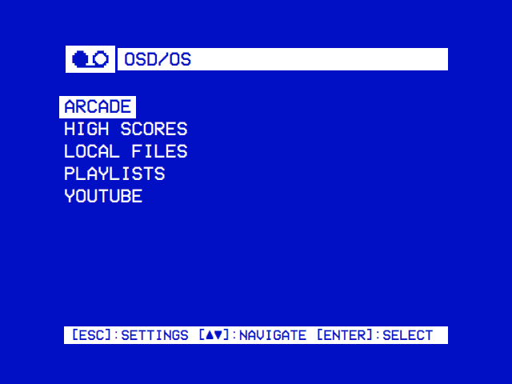
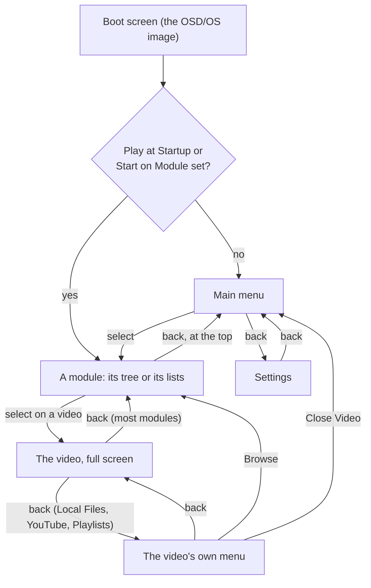
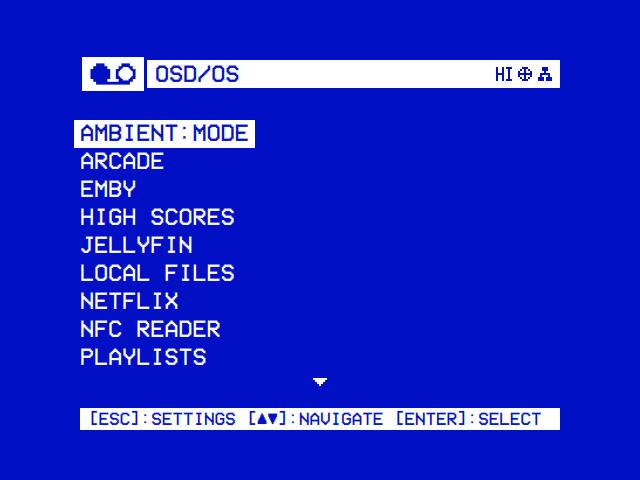
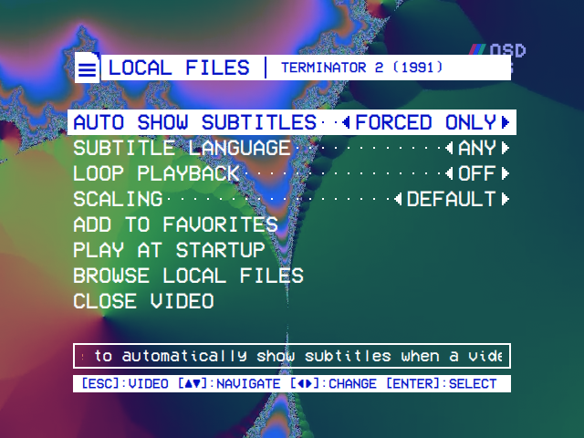
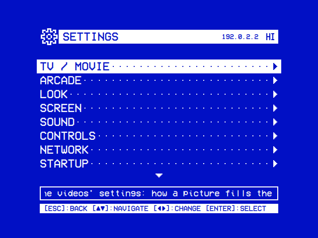
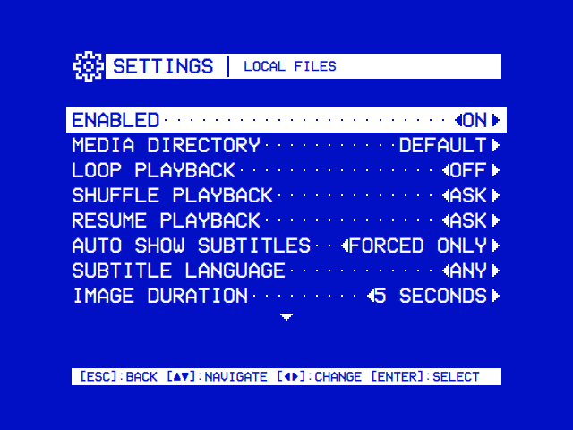
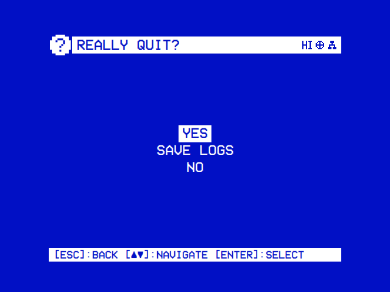
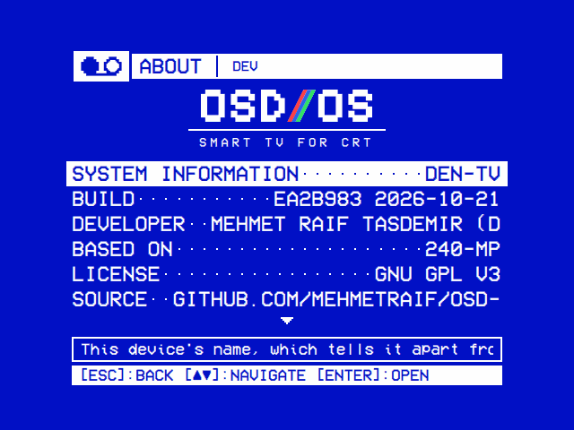

# Using OSD/OS

A tour of OSD/OS, screen by screen. Every screen works with the arrows, select and back; [Controls](https://github.com/mehmetraif/OSD-OS/wiki/Controls) lists which key or button does each.

## The basics

| Action | Keyboard | Gamepad | What it does |
|---|---|---|---|
| The arrows | ▲ ▼ ◄ ► | D-pad, left stick | ▲ ▼ move through a list. ◄ ► change a value, or move through a tree. ► opens a row that ends in ► |
| Select | Enter | A | Opens, plays, chooses |
| Back | Esc, Backspace or Right Shift | B or Back | One step back. On the main menu it opens Settings |
| ► on an entry | ► | D-pad right | A video's options, or its info screen |
| Play/pause | Space | Start | Pauses a video; stops one playing behind the menus |
| The mouse | Left click, right click, the wheel | | Select, back, and up or down |

- The hint bar at the foot of every screen names the keys that work there: `[ESC]:BACK [▲▼]:NAVIGATE [ENTER]:SELECT`.
- A ▲ above a list or a ▼ below it means more lines that way.
- A line too long for the screen scrolls while the cursor is on it.

How you move between the screens:

With [Transparent Background](https://github.com/mehmetraif/OSD-OS/wiki/Using-OSD-OS#transparent-background) on, the video plays on behind wherever back leads.

## The boot screen

On the [OSD/OS image](https://github.com/mehmetraif/OSD-OS/wiki/The-OSD-OS-Image) the boot screen shows the system's services coming up, a line each:

| Line | Means |
|---|---|
| `[ OK ] WI-FI` | Started (NetworkManager, which runs Ethernet too) |
| `[ .. ] BLUETOOTH` | Starting now; the line is inverted |
| `[    ] LOCAL NETWORK` | Waiting its turn (avahi, which makes the Pi `osdos.local`) |
| `[FAIL] …` | It failed to start |
| `[ -- ] …` | Skipped, as its conditions weren't met |

- `SSH` has a line when the image was built with SSH on.
- The last line, `ONLINE`, waits until the network is up, or 20 seconds.
- The screen closes once every line has settled, or after a minute. Until then the only key that works is Ctrl+Q, which powers the Pi off.
- Any other install has no boot screen.
- **After a Display Output change** the new output asks **Keep this display output?** **Keep** keeps it. **Switch Back**, back, or 30 seconds without an answer returns to the old output ([Display Output](https://github.com/mehmetraif/OSD-OS/wiki/Display-Output)).

## The main menu

The main menu lists the modules that are turned on, in the order of their folders' names. Select opens one; back opens Settings.

- **On by default**: Local Files and Playlists.
- **Turning one on**: the **Enabled** row on the module's Settings page. The video modules and Weather are on **TV / Movie**, Arcade and High Scores on **Arcade**, Scripts on **System**.
- With none on, the menu says **No modules enabled** and **Please enable one in settings**.
- A script marked in [Scripts](https://github.com/mehmetraif/OSD-OS/wiki/Scripts) has a row of its own, which runs it.
- A video playing behind the menus leads the list as `► <its title>` ([Transparent Background](https://github.com/mehmetraif/OSD-OS/wiki/Using-OSD-OS#transparent-background)).
- ▲ ▼ go round from the last row to the first. The menu remembers the row you left.
- Settings → Look → **Menu Layout** lays the menu out differently ([Settings → Menu Layout](https://github.com/mehmetraif/OSD-OS/wiki/Settings#menu-layout)).

[Modules](https://github.com/mehmetraif/OSD-OS/wiki/Modules) describes each module.

## The tree

Local Files, YouTube, Netflix, Prime Video, Arcade and High Scores are browsed as a horizontal tree. So are Playlists' Add Videos and the folder and file pickers in Settings. The other modules have screens of their own.

<table>
<tr><th width="50%">Recently Watched</th><th width="50%">Folders</th></tr>
<tr><td></td><td></td></tr>
<tr><td>The tree opens on what you played last, then Favorites, Search and your folders.</td><td>The open folders run along the line through the middle.</td></tr>
</table>

- The folders you opened run left to right along a line through the middle of the screen. Each branches to its entries, so two levels show ahead.
- The title bar names the folder you are in.
- A folder still being read shows `loading…`. An empty folder under the cursor shows `(empty)`.

| Key | What it does |
|---|---|
| ▲ ▼ | Move through the folder, round from the last entry to the first |
| ► or select on a folder | Open it |
| ◄ or back | Back up to the folder before. At the top, back leaves the module |
| Select on a video | Play it |
| ► on a video | Its options, or in Netflix, Prime Video and YouTube its [info screen](https://github.com/mehmetraif/OSD-OS/wiki/Using-OSD-OS#info-screens) |

- The hint bar follows the entry under the cursor: `[ENTER]:OPEN` on a folder, `[►]:OPTIONS [ENTER]:PLAY` on a file.
- Each folder remembers the entry you left it on. Coming back from a video reopens the tree where it was.

Every module's tree but High Scores' starts with the same three entries, then the module's own (see its page):

- **Recently Watched**: what you played last, newest first (in Arcade, **Recently Played**).
- **Favorites**: what you marked from its [options](https://github.com/mehmetraif/OSD-OS/wiki/Using-OSD-OS#options).
- **Search**: select opens the [on-screen keyboard](https://github.com/mehmetraif/OSD-OS/wiki/Using-OSD-OS#searching).

<table>
<tr><th width="50%">Favorites</th><th width="50%">Search results</th></tr>
<tr><td></td><td></td></tr>
<tr><td>What you marked from its options.</td><td>Names that match anywhere under the media folder.</td></tr>
</table>

## Searching

Select on **Search** opens an on-screen keyboard: the letters A to Z, the digits, `-`, `'`, `.` and `&`, then **SPACE**, **DEL** and **OK**.

| Key | What it does |
|---|---|
| The arrows | Move the box, round from one edge to the other |
| Select | Types what is in the box, or presses SPACE, DEL or OK |
| Backspace | Deletes the last letter (here it isn't back) |
| Back (Esc, or a gamepad's back) | Cancels |
| A real keyboard's keys | Type straight in; Enter then searches |
| The mouse | A click types the key under the pointer |

- A search takes up to 40 characters. OK with nothing typed does nothing.
- The results open as a folder in the tree, `Search: <what you typed>`. Each module's page says what its search covers.
- **A password, an address or a name** gets both cases (**SHIFT**) and two rows of signs: `@ _ ! ? # $ % * + =`, then `/ : , ; ( ) [ ] " \`. SHIFT turns the second row into `/ : ^`, the backtick, and `< > { } ~ |`.
- A password shows as stars. **SHOW** shows it as typed; **HIDE** hides it again.

## Info screens

<table>
<tr><th width="50%">A film's info screen</th><th width="50%">A video's info screen</th></tr>
<tr><td></td><td></td></tr>
<tr><td>Story, genre, director, cast and rating, from TMDB.</td><td>Channel, date, length, views and description.</td></tr>
</table>

In Netflix, Prime Video and YouTube a title has an info screen: a **PLAY ►** box, the title, a line of facts, the story and the details.

| Key | What it does |
|---|---|
| Select | Plays the title |
| ▲ ▼ | Close it and move to the entry before or after in the tree |
| ► | The title's [options](https://github.com/mehmetraif/OSD-OS/wiki/Using-OSD-OS#options) |
| ◄, back, play/pause, I, or a remote's Info key | Close it |

| Setting | Values | Default | What it does | Config key |
|---|---|---|---|---|
| Info Screen (Settings → TV / Movie) | Off, Key, 1 sec, 2 sec, 3 sec, 5 sec | 3 sec | **Key**: with ► on a title (or play/pause, I, or a remote's Info key). **1–5 sec**: also by itself, once the cursor has rested on a title that long. **Off**: none; ► gives the options | `app.info_screen` (`off`, `key`, `1`, `2`, `3`, `5`) |

## Options

<table>
<tr><th width="50%">Options</th><th width="50%">Add to Playlist</th></tr>
<tr><td></td><td></td></tr>
<tr><td>► on any video.</td><td>From a video's options, or ► on PLAY in Jellyfin and Emby.</td></tr>
</table>

► on a video in a tree, or on its info screen, opens **Options**. ▲ ▼ choose, select does it, back closes. Folders and Search have none.

| Option | What it does |
|---|---|
| **Add to Favorites** / **Remove from Favorites** | Puts it in the module's Favorites, or takes it out |
| **Play at Startup** / **Don't Play at Startup** | Makes it the favourite OSD/OS plays as it starts, or stops that |
| **Add to Playlist** | Puts it on a [Playlists](https://github.com/mehmetraif/OSD-OS/wiki/Playlists#from-another-module) list. Offered while that module is on, for videos from Local Files, YouTube, Jellyfin and Emby |
| **Save to Watch Later** / **Remove from Watch Later** | YouTube only: its Watch Later list |

Favorites and Recently Watched are each module's own lists, kept in `lists.json` in the data folder ([Configuration files](https://github.com/mehmetraif/OSD-OS/wiki/Configuration-Files)).

### Play at startup

- One favourite can play by itself as OSD/OS starts, without a resume question.
- **Play at Startup** on a video also adds it to Favorites. Taking it out of Favorites stops it playing at startup.
- Back from it goes to its module's tree, in Favorites.

| Setting (Settings → Startup) | Values | Default | What it does | Config key |
|---|---|---|---|---|
| Play at Startup | None, or the favourite's name | None | Shows the favourite; here it can only be turned off | `app.startup_favorite` (`{ "module", "path", "name" }`, or `""`) |
| Startup From | Resume, Beginning | Resume | Where it begins. Dimmed without a favourite | `app.startup_from` |
| Start on Module | None, or a module that is on | None | Opens that module instead of the main menu. The favourite goes first | `app.startup_module` (a module id, such as `com.osdos.youtube`) |

## Playing a video

### Resume

A video stopped partway asks **Resume playback?**: **Resume from 1:12:34** or **Start from the beginning**. Back returns to the tree.

- The place is saved when you stop after the first 5 seconds. It is forgotten once you have watched 95%.
- A Local Files playlist (`.m3u`) resumes at the video it was on: **Resume video 3 at 12:40**.
- With Shuffle Playback on Ask, a playlist asks **Start playback?**: **Play in order** or **Shuffle**.
- Local Files, YouTube, Plex, Jellyfin, Emby and NFC Reader each have a **Resume Playback** setting, described on their pages.
- A video played at startup, or taken back from behind the menus, never asks.

### The tape loading

While a video starts, a tape loads, until the picture comes:

- **TAPE A PLAY** counts where the video starts from.
- **TAPE B LOADING** blinks over the video's length once it is known; until then, the seconds it has taken.
- **SLP▶** names the module.
- The theme's effects and the menu music rest while a video plays, loads, or has its menu open.

| Setting (Settings → TV / Movie) | Values | Default | What it does | Config key |
|---|---|---|---|---|
| Loading Effect | On, Off | On | **Off**: the deck's display alone, without the noise and the bands | `app.loading_effect` |
| Loading Screen Colors | Theme, Default | Theme | **Default**: white on blue, whatever the theme | `app.loading_colors` |

### The deck's menu

During a video, ▲ or ▼ opens the deck's menu. Its top left names the audio track, the subtitle track and the Scaling in force (`AUDIO:`, `SUBTITLE:`, `CROP:`). Below are the position bar and the buttons:

| Button | What it does |
|---|---|
| **SKIP** | Skips an intro or the credits, when Jellyfin or Emby marks one |
| **AUDIO** | The next audio track |
| **SUBTITLE** | The next subtitle track (only when there are subtitles) |
| **CROP** | The next Scaling: Letterbox, 14:9, Pan & Scan, Anamorphic (not on a Pi 3 with 1080p Playback on) |
| **<** and **>** | The previous and next video of a playlist |
| **STOP** | Ends the video |

- ▲ goes to the position bar, ▼ to the buttons.
- On the bar, ◄ ► jump 10 seconds. On the buttons they move, and select presses one.
- Back closes the menu. It closes by itself after 5 seconds without a key.
- With the menu closed, ◄ ► jump 5 seconds, and select and play/pause pause.
- [Controls](https://github.com/mehmetraif/OSD-OS/wiki/Controls#during-playback) has the media keys.

### Back during a video

| | Transparent Background off (the default) | Transparent Background on |
|---|---|---|
| **Local Files, YouTube, Playlists** | The video stops and [its menu](https://github.com/mehmetraif/OSD-OS/wiki/Using-OSD-OS#the-videos-own-menu) opens. Back from the menu starts it again from there | [Its menu](https://github.com/mehmetraif/OSD-OS/wiki/Using-OSD-OS#the-videos-own-menu) opens over the picture, which plays on |
| **The other modules** | The video stops, its place saved, and you are back where you chose it | You are back where you chose it, the video playing on behind the menus |

### The video's own menu

Local Files, YouTube and Playlists give a video a menu of its own:

| Module | Its lines |
|---|---|
| Local Files | Auto Show Subtitles, Subtitle Language, Loop Playback, Scaling; Add to Favorites, Play at Startup, Browse Local Files, Close Video |
| YouTube | Playback Resolution, Video Codec, Max Frame Rate, Scaling, Audio Language, Subtitles, Subtitle Language, Playback Speed; Add to Favorites, Play at Startup, Save to Watch Later, Browse YouTube, Close Video |
| Playlists | Subtitles, Loop Playback, Scaling; Browse Playlists, Close Video |

- **◄ ►** change a setting. It is saved at once, as the module's own setting.
- Loop Playback, Scaling and Playback Speed apply at once. The rest apply as you go back to the video, which reloads where it is.
- **Browse** returns to the module's menus. **Close Video** ends the video and goes to the main menu.
- **Back** returns to the video. Play/pause still pauses it. The hint bar reads `[ESC]:VIDEO`.
- **Without Transparent Background** the video stops for the menu, and starts again where it was as the menu closes.
- **Browse** then leaves the video stopped. The main menu leads with `► <title>`: select starts it again there, without asking. The row stays until another video plays.

### A service's own player

Netflix and Prime Video play in the service's own web player, in Chromium. To come back, **hold back for two seconds**, or close the browser with Ctrl+W ([Netflix and Prime Video](https://github.com/mehmetraif/OSD-OS/wiki/Netflix-and-Prime-Video)).

## Transparent Background

<table>
<tr><th width="33%">The video's menu</th><th width="33%">Back to the menus</th><th width="33%">Main menu</th></tr>
<tr><td></td><td></td><td></td></tr>
<tr><td>The video's menu over the picture, here at 40% solid.</td><td>Browse, or back from another module's video: the video plays on behind the menus.</td><td>The main menu leads with the video.</td></tr>
</table>

With Settings → TV / Movie → **Transparent Background**, back from a video returns to the menus while the video plays on behind them.

- **The slider** runs from **TRANSPARENT** to **SOLID** in steps of 10%: how solid the menus' background is over the video. ◄ ► move it and turn it on. Select turns it off and back on.
- At SOLID none of the picture shows, but the video plays on, sound and all.
- **Taking it back.** The main menu's first row is `► <its title>`: select brings it back full screen where it is. Choosing the same video in its module does the same.
- Only YouTube, Local Files and Playlists videos have this row.
- **Stopping it.** Play/pause on the main menu stops it (`[SPACE]:STOP` in the hint bar).
- **It also ends** when its playlist has played out, when you play anything else, and when you turn the setting off.
- It ends too when something else takes the screen: a script, an Arcade game, Netflix or Prime Video's browser.
- **With OSD Background on Window**, only the window lies over the video.
- The effects and the menu music rest while a video plays behind the menus. The screen saver comes over the menus as usual, and the video plays on under it.

| Setting | Values | Default | What it does | Config key |
|---|---|---|---|---|
| Transparent Background | Off, or TRANSPARENT (0) to SOLID (100) in steps of 10 | Off (turned on, the bar starts at 40) | How solid the menus are over a video playing behind them | `app.transparent_background` (`"Off"` or `0`–`100`) |

- It needs libmpv: `libmpv2` on Raspberry Pi OS (on the image, and installed by `install.sh`), part of Homebrew's mpv on a Mac.
- Without libmpv, as in the AppImage, the row is dimmed and says `Needs libmpv, which isn't installed`.
- [Playback and mpv](https://github.com/mehmetraif/OSD-OS/wiki/Playback-and-mpv) explains how it works.

## The channel logo

<table>
<tr><th width="50%">Channel Logo</th><th width="50%">Under the menus</th></tr>
<tr><td></td><td></td></tr>
<tr><td>OSD/OS's logo in a corner of the picture while a video plays.</td><td>It is in the picture itself, so the menus lie over it.</td></tr>
</table>

<table>
<tr><th width="50%">Logo Image</th><th width="50%">Picking the picture</th></tr>
<tr><td></td><td></td></tr>
<tr><td>A picture of your own instead, as tall as OSD/OS's logo.</td><td>Select on a picture, or OSD/OS Logo at the top to go back to it.</td></tr>
</table>

- The logo is 7% of the picture's height tall, and 10% of the picture in from its corner.
- Both settings apply from the next video.

| Setting (Settings → TV / Movie) | Values | Default | What it does | Config key |
|---|---|---|---|---|
| Channel Logo | Off, Top Left, Top Right, Bottom Left, Bottom Right, All Corners | Off | Where the logo sits | `app.video_logo` (`off`, `tl`, `tr`, `bl`, `br`, `all`) |
| Logo Image | OSD/OS, or a picture (PNG, JPEG, SVG, GIF, BMP, WebP) | OSD/OS | The logo's picture; a PNG with a clear background works best. Dimmed while Channel Logo is Off | `app.video_logo_image` (a path; unset for OSD/OS's) |

## The screen saver

- The screen saver puts OSD/OS's logo bouncing across a black screen, to spare a CRT's phosphor.
- It comes in the menus after the set seconds without a key, and during a video paused that long.
- The first key only wakes it. Moving the mouse wakes it too, unless Mouse Pointer is Off.
- It never comes while a video plays full screen, while a script runs, or over the boot screen. With a video playing behind the menus it comes over the menus as usual.
- It waits while a page that is read with no key pressed is up: a Test Pattern, Export to OSD/OS Setup's codes, a Bluetooth pairing's code.

| Setting (Settings → Screen) | Values | Default | Config key |
|---|---|---|---|
| Screen Saver | OFF, 30, 60, 120 (seconds) | OFF | `app.screensaver_timeout` |

## The hint bar and the help line

- **The hint bar** at the foot of every screen says which keys do what there. It shows the keyboard's keys (`[ESC]`, `[ENTER]`, `[SPACE]`) until you press a gamepad button, then that gamepad's (`[B]`, `[A]`, `[START]`) ([Controls](https://github.com/mehmetraif/OSD-OS/wiki/Controls#the-hints-at-the-foot-of-the-screen)).
- **The help line** is the box under a menu with a line about the selected row. A line too long for the box scrolls through it.

| Setting (Settings → Look) | Values | Default | What it does | Config key |
|---|---|---|---|---|
| Hint Bar | On, Off | On | **Off**: no key hints; the menus take the bar's room | `app.hint_bar` |
| Help Line | On, Off | On | **Off**: no box, and a row more in the menu. About keeps its own | `app.help_line` |

## The mouse pointer

- A mouse or a touchpad shows OSD/OS's own pointer while it moves.
- Over a menu the selection follows the pointer. A left click is select, a right click back, the wheel ▲ ▼.
- In a file tree the wheel moves the cursor, and a click opens what it is on.
- A mouse button bound in Settings → Controls → All Keyboards & Remotes does that action instead ([Controls](https://github.com/mehmetraif/OSD-OS/wiki/Controls#the-mouse)).

| Setting (Settings → Screen) | Values | Default | What it does | Config key |
|---|---|---|---|---|
| Mouse Pointer | Off, 2 sec, 5 sec, 10 sec, 30 sec, Always | 5 sec | How long the pointer stays after the mouse stops | `app.mouse_pointer` (`off`, `2`, `5`, `10`, `30`, `always`) |

## Settings

Back on the main menu opens Settings. A line has its value between the arrows that change it (`COLOR SCHEME······◄ VIDEO 1 ►`), or a ► when it leads somewhere (`TV / MOVIE······►`). The title bar shows the version and the IP address.

- ▲ ▼ move, round from the bottom to the top. ◄ ► change the value, saved at once.
- Select, or ►, opens a line that ends in ►. Select turns a slider on or off.
- Nothing is hidden: a line that can't be used is dimmed, and the help line says why (`Only with OSD Background on Window`).
- The first screen has a line for each page, then Quit: **TV / Movie**, **Arcade**, **Look**, **Screen**, **Sound**, **Controls**, **Network**, **Startup** and **System**.
- Look → **Menu Layout** offers Standard, Camcorder, Studio Monitor, Broadcast and Flat Panel. In Broadcast and Flat Panel a value changes in two steps: select, ▲ ▼, then select to save or back to leave it.

<table>
<tr><th width="50%">A module's settings</th><th width="50%">Picking a folder</th></tr>
<tr><td></td><td></td></tr>
<tr><td>Local Files' settings.</td><td>Folders are picked on the same tree: USE THIS FOLDER picks the one open, Default Folder the module's own.</td></tr>
</table>

[Settings](https://github.com/mehmetraif/OSD-OS/wiki/Settings) describes every page and row.

## Quit, Restart, Power Off, Exit to Terminal

**Quit** is the last line of Settings. It asks **Really quit?**:

| Started | Choices |
|---|---|
| By hand (`osdos`), on a Mac, as an AppImage | **Yes**, **No**; on the OSD/OS image, **Save Logs** between them |
| With the system: the OSD/OS image, or `install.sh`'s autostart service | **Power Off**, **Restart**, **Exit to Terminal**, **Save Logs** (on the image), **Cancel** |

- **Power Off** quits OSD/OS and switches the Pi off. To switch it on again, unplug its power and plug it back in (a Pi 5 also has a power button).
- **Restart** reboots the Pi. If it is missing, run `install.sh` once more ([Installation](https://github.com/mehmetraif/OSD-OS/wiki/Installation#updating-with-installsh)).
- **Exit to Terminal** drops to a text login and leaves the service in place for the next boot. An image built without a password logs `pi` in by itself.
- From the terminal, `sudo systemctl start osdos` brings OSD/OS back, `sudo reboot` restarts the Pi, and `osdos` runs OSD/OS by hand.
- **Cancel**, or back, stays.
- **Save Logs** copies OSD/OS's logs to the card's **OSD-OS** partition, to send with a report ([Troubleshooting](https://github.com/mehmetraif/OSD-OS/wiki/Troubleshooting)).
- Ctrl+Q (⌘Q on a Mac) quits at once from most screens, without asking. With the system, that switches the Pi off.

## About and the license

<table>
<tr><th width="50%">About</th><th width="50%">The license</th></tr>
<tr><td></td><td></td></tr>
<tr><td>System Information, then a line for each part of OSD/OS.</td><td>Behind the LICENSE line: the notice, then the GNU GPL's text.</td></tr>
</table>

Settings → System → **About** lists what OSD/OS is, who makes it and what it is made of. The help line gives each line's detail, even with Help Line off.

| Line | Says |
|---|---|
| System Information | This device's name. Select opens its page; on the OSD/OS image, select on the name renames the device ([System Information](https://github.com/mehmetraif/OSD-OS/wiki/Settings#system-information)) |
| Build | The commit this build was made from, and the day |
| License | GNU GPL v3. Select opens the notice, then the license's text; ▲ ▼ turn a page |
| Test Patterns, QR Code generator, and the *Arcade* software lines | Select opens each one's license |
| The other lines | Who makes OSD/OS, what it is made of, and the arcade's services |

[Credits](https://github.com/mehmetraif/OSD-OS/wiki/Credits) has every credit in full.

## See also

- [Controls](https://github.com/mehmetraif/OSD-OS/wiki/Controls): every key, button and remote button
- [Settings](https://github.com/mehmetraif/OSD-OS/wiki/Settings): every row of Settings
- [Modules](https://github.com/mehmetraif/OSD-OS/wiki/Modules): what each module shows
- [Playback and mpv](https://github.com/mehmetraif/OSD-OS/wiki/Playback-and-mpv): how videos play
- [Themes](https://github.com/mehmetraif/OSD-OS/wiki/Themes), [Skins](https://github.com/mehmetraif/OSD-OS/wiki/Skins) and [Effects](https://github.com/mehmetraif/OSD-OS/wiki/Effects)
- [Features](https://github.com/mehmetraif/OSD-OS/wiki/Features)
- [The screen tour](https://github.com/mehmetraif/OSD-OS/blob/main/docs/TOUR.md): every screen, module by module
