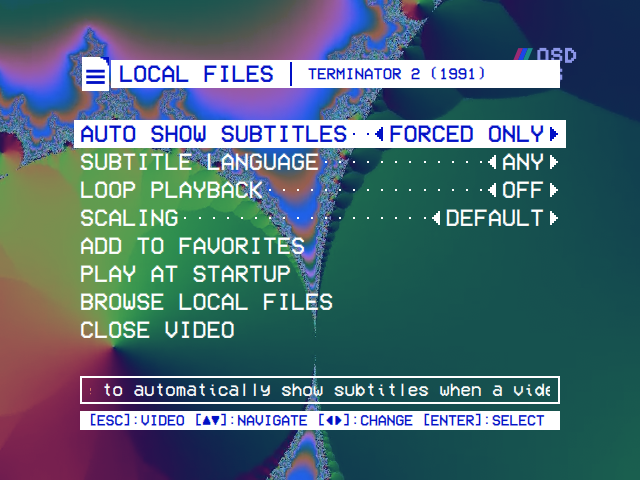

# YouTube

YouTube without the YouTube app. Subscriptions come from each channel's RSS feed, playlists and search through yt-dlp, and every video plays full screen in mpv. No account is needed; signing in is optional.

<table>
<tr><th width="50%">YouTube</th><th width="50%">Subscriptions</th></tr>
<tr><td></td><td></td></tr>
</table>

<table>
<tr><th width="50%">A video's info screen</th><th width="50%">The video's menu (Local Files' is shown)</th></tr>
<tr><td></td><td></td></tr>
</table>

## What it needs

| Piece | What it does | Where it comes from |
|---|---|---|
| **mpv** | Plays the video. | Installed with OSD/OS; `brew install mpv` on a Mac. |
| **yt-dlp** | Finds streams, searches, lists playlists, fills info screens. Must be recent: a copy a few weeks old stops finding videos. | On the image, kept up to date. Elsewhere, install it. |
| **Deno** | JavaScript runtime for yt-dlp ([EJS notes](https://github.com/yt-dlp/yt-dlp/wiki/EJS)). Without one, yt-dlp warns `No supported JavaScript runtime could be found` and finds few formats or none. | On the image. Elsewhere, install it. |
| Network | Feeds, search and streams. | |
| Chromium (Google Chrome on a Mac) | Only for [Sign in](https://github.com/mehmetraif/OSD-OS/wiki/YouTube#signing-in). Without a desktop, also `cage` and `wtype`. | On the image. |
| ffmpeg | Only for [Playlists](https://github.com/mehmetraif/OSD-OS/wiki/Playlists)' offline lists above 360p. | On the image. |

Subscriptions and Channels list videos without yt-dlp or Deno. Playing needs them.

### On the OSD/OS image

Nothing to install. The image has:

- yt-dlp's nightly build at `/home/pi/.local/share/OSD-OS/bin/yt-dlp`.
- `osdos-yt-dlp-update.timer`: runs `yt-dlp --update` two minutes after each boot, then daily, while the YouTube module is on or a playlist has a YouTube video.
- Deno in `/usr/local/bin/deno`, and `ffmpeg`.

To check or update over SSH:

```sh
systemctl list-timers osdos-yt-dlp-update.timer
journalctl -u osdos-yt-dlp-update.service
sudo systemctl start osdos-yt-dlp-update.service
```

An image built with `OSDOS_YOUTUBE=0` ([The OSD/OS image](https://github.com/mehmetraif/OSD-OS/wiki/The-OSD-OS-Image)) has no yt-dlp, Deno or ffmpeg.

### On Raspberry Pi OS, SteamOS and macOS

Raspberry Pi OS's packaged yt-dlp is too old. Take the latest from GitHub, on the `PATH`:

```sh
sudo wget https://github.com/yt-dlp/yt-dlp/releases/latest/download/yt-dlp -O /usr/local/bin/yt-dlp
sudo chmod a+rx /usr/local/bin/yt-dlp
```

or in the data folder, where `yt-dlp -U` updates it without `sudo` (the way on SteamOS):

```sh
mkdir -p ~/.local/share/OSD-OS/bin
curl -fL https://github.com/yt-dlp/yt-dlp/releases/latest/download/yt-dlp -o ~/.local/share/OSD-OS/bin/yt-dlp
chmod +x ~/.local/share/OSD-OS/bin/yt-dlp
```

Deno must be on the `PATH` of the user or service that runs OSD/OS. On a 64-bit Raspberry Pi:

```sh
curl -fL -o /tmp/deno.zip https://github.com/denoland/deno/releases/latest/download/deno-aarch64-unknown-linux-gnu.zip
sudo python3 -m zipfile -e /tmp/deno.zip /usr/local/bin/
sudo chmod 755 /usr/local/bin/deno
```

On a Mac: `brew install yt-dlp deno`. Other systems: [yt-dlp's EJS guide](https://github.com/yt-dlp/yt-dlp/wiki/EJS).

### How OSD/OS finds yt-dlp

yt-dlp is not bundled. OSD/OS uses the first of:

1. `bin/yt-dlp` in the [data folder](https://github.com/mehmetraif/OSD-OS/wiki/YouTube#files-and-config-keys), if it is executable.
2. `yt-dlp` beside the `osdos` program.
3. `yt-dlp` on the `PATH` (on a Mac, with `/opt/homebrew/bin` and `/usr/local/bin` added).

That one copy serves search, playlists, info screens and playback.

## Turning it on

Settings → TV / Movie → **YouTube** → **Enabled**: On. The tree starts with Recently Watched, Favorites and Search. Subscriptions, Channels and Playlists appear once the two lists below hold something; Watch Later once a video is saved to it.

## Channels and subscriptions

Settings → TV / Movie → **YouTube** → **Subscriptions** lists the channels you follow, a line each, typed on the on-screen keyboard. [OSD/OS Setup](https://osdos.tv/setup/) has the same list as a box of lines, where an ID can be pasted.

A text file in the data folder adds its own channels after those:

| System | File |
|---|---|
| OSD/OS image, Raspberry Pi OS, SteamOS | `~/.local/share/OSD-OS/youtube_subscriptions.txt` |
| macOS | `~/Library/Application Support/OSD-OS/youtube_subscriptions.txt` |

- One channel per line: its **channel ID** (24 characters, starting `UC`), or a URL with `/channel/<ID>` in it.
- `#` starts a comment, at the start of a line only. A comment after an ID breaks the ID.
- Blank lines are ignored. A channel listed twice counts once.
- Handle URLs (`https://www.youtube.com/@name`) are **not** understood.

To find an ID on YouTube's website: the channel's **more** link → **Share channel** → **Copy channel ID**. Or ask yt-dlp (on the image, `~/.local/share/OSD-OS/bin/yt-dlp`); this prints `UCy0tKL1T7wFoYcxCe0xjN6Q`:

```sh
yt-dlp --flat-playlist -I 1 --print playlist_channel_id "https://www.youtube.com/@TechnologyConnections"
```

An example, written over SSH:

```sh
cat > ~/.local/share/OSD-OS/youtube_subscriptions.txt <<'EOF'
# Technology Connections
UCy0tKL1T7wFoYcxCe0xjN6Q
# The 8-Bit Guy, pasted as a URL
https://www.youtube.com/channel/UC8uT9cgJorJPWu7ITLGo9Ww
# NASA
UCLA_DiR1FfKNvjuUpBHmylQ
EOF
```

- An edit, in Settings or in the file, shows the next time you open YouTube.
- Each channel's feed gives its 15 or so newest videos. Feeds are kept for 15 minutes.
- **Subscriptions** merges every channel's videos, newest first, at most 100. **Channels** has a folder per channel.

## Playlists

Settings → TV / Movie → **YouTube** → **Playlists** lists them, a line each, and OSD/OS Setup has the same list. `youtube_playlists.txt` in the data folder adds its own after those. Either way:

- One playlist per line: a URL with `list=<ID>` in it, or the bare playlist ID.
- Optionally a name first, then `|`: `My Name | <URL or ID>`. Without one, the folder takes YouTube's title.
- `#` comments and duplicates as above. The folders keep the file's order.

```text
# Named here
Television, by Technology Connections | https://www.youtube.com/playlist?list=PLv0jwu7G_DFUGEfwEl0uWduXGcRbT7Ran
# A watch link from inside a playlist: its list= is used
https://www.youtube.com/watch?v=Eg8tK1LpLS8&list=PLv0jwu7G_DFUoByWSHHoSTlUIxY7VkJLi
# A bare ID: named as YouTube names it (James Webb Space Telescope, from NASA)
PL2aBZuCeDwlQTMjNAeDU5wVqqm4KPECIT
```

yt-dlp lists a playlist when you open it: up to 500 videos, without private and deleted ones. A fetch is given up after a minute. The list is kept for 15 minutes.

## Browsing

### The tree

YouTube uses the same tree, with the same keys, as Local Files ([Using OSD/OS](https://github.com/mehmetraif/OSD-OS/wiki/Using-OSD-OS)).

| Entry | What it holds | Shown when |
|---|---|---|
| **Recently Watched** | Videos you played, newest first, at most 100. | Always |
| **Favorites** | Videos you added, newest first, at most 100. | Always |
| **Search** | YouTube's search. | Always |
| **Subscriptions** | Your channels' newest videos, merged. | Subscriptions in Settings, or `youtube_subscriptions.txt`, lists a channel |
| **Channels** | A folder per channel. | As above |
| **Playlists** | A folder per playlist. | Playlists in Settings, or `youtube_playlists.txt`, lists a playlist |
| **Watch Later** | Videos you saved, newest saved first. | It holds something |

On a video, ► opens its info screen and select plays it.

### Search

Select **Search**, type on the on-screen keyboard and choose OK. The results are a folder, `Search: <words>`, with the first 20 matches and **More…** for the next 20. Live streams that have not started are left out.

### Info screens

A video's info screen shows its title, channel, date and description, then CHANNEL, DATE, LENGTH and VIEWS.

- It opens with ► on a video, or by itself once the cursor rests on one.
- **Settings → TV / Movie → Info Screen** sets when: after 1, 2, 3 (the default) or 5 seconds, **Key** for ► only, or **Off**.
- Length and views take a few seconds on a Pi.
- Select plays. ▲ ▼ close it and move through the list. ◄ or back closes it. ► offers the options.

### Options

► on a video's info screen (or on the video, with Info Screen off) offers:

- **Add to Favorites** / **Remove from Favorites**
- **Play at Startup** / **Don't Play at Startup**: OSD/OS plays this video straight after the boot screen ([Using OSD/OS](https://github.com/mehmetraif/OSD-OS/wiki/Using-OSD-OS#play-at-startup)).
- **Add to Playlist**, when the [Playlists](https://github.com/mehmetraif/OSD-OS/wiki/Playlists) module is on.
- **Save to Watch Later** / **Remove from Watch Later**

### Shorts

With **Display Shorts** (Advanced, on by default) off, Shorts are hidden in channel feeds and search results, and when adding videos in the Playlists module. Playlists, Recently Watched and Watch Later always show them. A favourite keeps the mark it had when added.

## Playing

Select on a video. A loading screen shows while yt-dlp finds the streams, then mpv plays full screen. ▲ or ▼ opens the deck's menu ([Playback and mpv](https://github.com/mehmetraif/OSD-OS/wiki/Playback-and-mpv)); back opens the video's menu.

### Resume

The position is kept when you stop more than 5 seconds in. A video watched to 95% or more starts from the beginning next time.

- **Resume Playback: Ask** (the default) asks **Resume from 12:34** or **Start from the beginning**.
- **Resume Playback: Always** carries on without asking.
- A video still playing behind the menus carries on where it is.

Positions live in `youtube_history.json`; **Delete Recently Watched** forgets them.

### The video's menu

Back during a video opens its menu; back again returns to the video.

1. Playback Resolution, Video Codec, Max Frame Rate, Scaling, Audio Language, Subtitles, Subtitle Language and Playback Speed. ◄ ► change and save one.
2. **Add to Favorites**, **Play at Startup**, **Save to Watch Later** (or their opposites).
3. **Browse YouTube**: back to the tree.
4. **Close Video**: to the main menu.

With Transparent Background the video plays on under the menu; without it, the video stops for the menu ([Using OSD/OS](https://github.com/mehmetraif/OSD-OS/wiki/Using-OSD-OS#the-videos-own-menu)).

If mpv fails before the video starts, OSD/OS shows **Playback failed: Please check that yt-dlp is installed and up to date** with yt-dlp's `ERROR:` line, or **mpv is not installed**. Select retries; back returns to the tree.

## The Advanced settings, and what yt-dlp is asked for

Settings → TV / Movie → YouTube → **Advanced**. The keys sit directly under `modules.com.osdos.youtube` and are read each time a video starts.

| Setting | Values | Default | What it does | Config key |
|---|---|---|---|---|
| Playback Resolution | 240p, 360p, 480p, 720p, 1080p, 1440p, 2160p | 480p | The most a video plays at. 1440p and 2160p need Video Codec **Any**: YouTube has H.264 only up to 1080p. | `playback_resolution` |
| Video Codec | H.264, Any | H.264 | **H.264**: decoded in hardware on a Pi; another codec only where a video lacks it. **Any**: often VP9 or AV1, decoded in software. | `video_codec` |
| Max Frame Rate | Any, 30 | Any | **30**: 30 fps where a video also has 60. Lighter on a Pi. | `max_frame_rate` |
| Scaling | Default, Letterbox, 14:9, Pan & Scan, Anamorphic | Default | How 16:9 fills a 4:3 screen. **Default** follows Settings → TV / Movie → Scaling. | `video_scaling` |
| Audio Language | Original (`original`), English (`en`), Spanish (`es`), French (`fr`), German (`de`), Italian (`it`), Portuguese (`pt`), Dutch (`nl`), Polish (`pl`), Russian (`ru`), Turkish (`tr`), Arabic (`ar`), Hindi (`hi`), Indonesian (`id`), Japanese (`ja`), Korean (`ko`), Chinese (`zh`) | Original | The audio track of a dubbed video; the original where the language is missing. | `audio_language` |
| Subtitles | Off, On, With Auto | Off | **On**: the video's subtitles in Subtitle Language. **With Auto**: automatic captions too. | `subtitles` |
| Subtitle Language | English … Chinese (the same 16 codes) | English | The language Subtitles shows. | `subtitle_language` |
| Playback Speed | 0.75x, 1x, 1.25x, 1.5x, 1.75x, 2x | 1x | | `playback_speed` |
| Resume Playback | Ask, Always | Ask | See [Resume](https://github.com/mehmetraif/OSD-OS/wiki/YouTube#resume). | `resume_playback` |
| Display Shorts | On, Off | On | See [Shorts](https://github.com/mehmetraif/OSD-OS/wiki/YouTube#shorts). | `display_shorts` (`true`/`false`) |

A language code also matches its regional variants (`pt` takes `pt-BR`).

### The format string

yt-dlp gets a list of choices separated by `/` and takes the first that exists:

1. The cap: `[height<=?N]`, plus `[fps<=?30]` with Max Frame Rate 30.
2. Video: with H.264, `bestvideo<cap>[vcodec^=avc1]`, then `bestvideo<cap>`; with Any, only `bestvideo<cap>`.
3. Audio: with a language, `bestaudio[language^=xx]`, then `bestaudio`; with Original, only `bestaudio`.
4. Every audio choice pairs with every video choice, the audio outer.
5. Last, `best<cap>` and plain `best`.

The default (480p, H.264, Any, Original):

```text
bestvideo[height<=?480][vcodec^=avc1]+bestaudio/bestvideo[height<=?480]+bestaudio/best[height<=?480]/best
```

### What mpv is given

| Option | When |
|---|---|
| `--ytdl=yes` | Always. |
| `--ytdl-format=<format>` | Always: the string above. |
| `--script-opts=…,ytdl_hook-ytdl_path=<path>` | Always, with the yt-dlp [found above](https://github.com/mehmetraif/OSD-OS/wiki/YouTube#how-osdos-finds-yt-dlp). |
| `--ytdl-raw-options=write-subs=,sub-langs=<code>.*` | Subtitles On or With Auto. |
| `…,write-auto-subs=` | Subtitles With Auto. |
| `…,cookies-from-browser=%<bytes>%<browser>:<profile>` | Once you have signed in. |
| `--subs-with-matching-audio=yes --subs-fallback=yes --sid=auto --slang=<code>` | Subtitles On or With Auto. |
| `--sid=no` | Subtitles Off. |
| `--speed=<n>` | Playback Speed other than 1x. |

The Playlists module downloads a video for an offline list with the same format and account (`-f <format> --merge-output-format mp4`). Without ffmpeg it takes `best[height<=?N][vcodec^=avc1]/best[height<=?N]/best`.

## Signing in

Signed in, YouTube asks for fewer bot checks and age-restricted videos play.

> [!WARNING]
> YouTube can block an account used through yt-dlp, as [yt-dlp's wiki](https://github.com/yt-dlp/yt-dlp/wiki/Extractors#youtube) warns. Sign in with a spare account.

1. Settings → TV / Movie → YouTube → **Sign in**.
2. Have a keyboard ready, and press select. Google's sign-in page opens full screen in Chromium.
3. Sign in with the keyboard.
4. Come back by holding back (Esc, or B on a gamepad) for two seconds, or with `Ctrl+W`.

- The sign-in lives in a browser profile, `youtube/browser` in the data folder. **Sign out** deletes it.
- Without `wtype`, close the browser with `Ctrl+W`, or wait half a minute after signing in before holding back. Otherwise the sign-in may not be saved.
- Linux needs Chromium (`chromium`, `chromium-browser`, `google-chrome-stable` or `google-chrome`), plus `cage` and `wtype` without a desktop: `sudo apt install chromium cage wtype`.
- A Mac needs **Google Chrome** in `/Applications`; otherwise the screen says **Google Chrome is not installed**.

## Settings

Settings → TV / Movie → **YouTube**:

| Setting | Values | Default | What it does | Config key |
|---|---|---|---|---|
| Enabled | On, Off | Off | Shows YouTube on the main menu. | `modules.com.osdos.youtube.enabled` |
| Subscriptions | A list of lines, 50 at most | None | [Your channels](https://github.com/mehmetraif/OSD-OS/wiki/YouTube#channels-and-subscriptions). Select ADD to type one; select a line to change it or take it out. | `modules.com.osdos.youtube.subscriptions` |
| Playlists | A list of lines, 50 at most | None | [Your playlists](https://github.com/mehmetraif/OSD-OS/wiki/YouTube#playlists). | `modules.com.osdos.youtube.playlists` |
| Advanced | Opens a submenu | | [The Advanced settings](https://github.com/mehmetraif/OSD-OS/wiki/YouTube#the-advanced-settings-and-what-yt-dlp-is-asked-for). | |
| Delete Watch Later | Select | | Deletes `youtube_watch_later.json` at once. | |
| Delete Recently Watched | Select | | Deletes `youtube_history.json` at once: Recently Watched and every resume point. | |
| Sign in | Select | | See [Signing in](https://github.com/mehmetraif/OSD-OS/wiki/YouTube#signing-in). | |
| Sign out | Select | | Deletes the sign-in's browser profile. Does nothing while the browser is open. | |

App [Settings](https://github.com/mehmetraif/OSD-OS/wiki/Settings) that act on YouTube: **Info Screen** (`app.info_screen`: `off`, `key`, `1`, `2`, `3`, `5`), **Play at Startup** (`app.startup_favorite`), **Startup From** (`app.startup_from`), **Scaling** (`app.video_scaling`) and **Transparent Background**.

## Files and config keys

All in the data folder: `~/.local/share/OSD-OS/` on Linux, `~/Library/Application Support/OSD-OS/` on a Mac, or `$DATA_ROOT`.

| File | What it is | Written by |
|---|---|---|
| `youtube_subscriptions.txt` | Your channels | You |
| `youtube_playlists.txt` | Your playlists | You |
| `youtube_history.json` | Recently Watched and resume points, the 100 most recent | OSD/OS |
| `youtube_watch_later.json` | Watch Later | OSD/OS |
| `lists.json` | Favorites, under `"com.osdos.youtube"` → `"favorites"` | OSD/OS |
| `youtube/browser/` | The sign-in's Chromium profile | The browser |
| `bin/yt-dlp` | The yt-dlp OSD/OS uses first | You, or the image |

Every `config.json` key the module reads. Edit the file only while OSD/OS is closed.

```json
{
    "app": {
        "info_screen": "3"
    },
    "modules": {
        "com.osdos.youtube": {
            "enabled": true,
            "playback_resolution": "720p",
            "video_codec": "H.264",
            "max_frame_rate": "30",
            "video_scaling": "Default",
            "audio_language": "original",
            "subtitles": "On",
            "subtitle_language": "en",
            "playback_speed": "1x",
            "resume_playback": "Ask",
            "display_shorts": false
        }
    }
}
```

## Troubleshooting

The tree's help line names the problem.

| Message or symptom | What to do |
|---|---|
| **Searching needs yt-dlp, which is not installed.** | [Install yt-dlp](https://github.com/mehmetraif/OSD-OS/wiki/YouTube#how-osdos-finds-yt-dlp), then open YouTube again. |
| **Could not search YouTube: check the network, and that yt-dlp is up to date.** | Check the network, then update yt-dlp. On the image: `sudo systemctl start osdos-yt-dlp-update.service`. Elsewhere: `yt-dlp -U`, or `brew upgrade yt-dlp`. A [Scripts](https://github.com/mehmetraif/OSD-OS/wiki/Scripts#1-update-yt-dlp-console) script can do it from the remote. |
| **Could not load the subscriptions: check the network.** | No channel's feed could be fetched. |
| **Could not load the playlists: check the network, and that yt-dlp is installed.** | As for search. |
| **Playback failed: Please check that yt-dlp is installed and up to date.** | Run yt-dlp by hand (below). mpv's log is `/tmp/osdos-mpv.log` (the system's temporary folder on a Mac). |
| `No supported JavaScript runtime could be found` | Deno is missing, or not on the `PATH` of the user or service running OSD/OS. [Install it](https://github.com/mehmetraif/OSD-OS/wiki/YouTube#on-raspberry-pi-os-steamos-and-macos). |
| `Sign in to confirm you're not a bot` | [Sign in](https://github.com/mehmetraif/OSD-OS/wiki/YouTube#signing-in) with a spare account. If it persists, compare `--force-ipv4` with `--force-ipv6` in the command below: a check on IPv4 only points at the route. |
| Subscriptions and Channels don't appear. | Check the file's name and place (not `.txt.txt`), and that it has a line that is neither blank nor a comment. |
| A channel shows as its ID, with no videos. | A wrong ID, a comment on the ID's line, a handle URL, or a channel that has gone. |
| Stutter on a Pi. | Playback Resolution 480p (or 720p), Video Codec H.264, Max Frame Rate 30. |
| Signed out again after signing in. | Install `wtype`, or see [Signing in](https://github.com/mehmetraif/OSD-OS/wiki/YouTube#signing-in). |

yt-dlp by hand, with the format OSD/OS uses (on the image, `~/.local/share/OSD-OS/bin/yt-dlp`):

```sh
yt-dlp --verbose --simulate -f 'bestvideo[height<=?480][vcodec^=avc1]+bestaudio/bestvideo[height<=?480]+bestaudio/best[height<=?480]/best' 'https://www.youtube.com/watch?v=Eg8tK1LpLS8'
```

More in [Troubleshooting](https://github.com/mehmetraif/OSD-OS/wiki/Troubleshooting).

## See also

[Playlists](https://github.com/mehmetraif/OSD-OS/wiki/Playlists), [NFC Reader](https://github.com/mehmetraif/OSD-OS/wiki/NFC-Reader), [Scripts](https://github.com/mehmetraif/OSD-OS/wiki/Scripts), [Netflix and Prime Video](https://github.com/mehmetraif/OSD-OS/wiki/Netflix-and-Prime-Video), [Playback and mpv](https://github.com/mehmetraif/OSD-OS/wiki/Playback-and-mpv), [Using OSD/OS](https://github.com/mehmetraif/OSD-OS/wiki/Using-OSD-OS)
